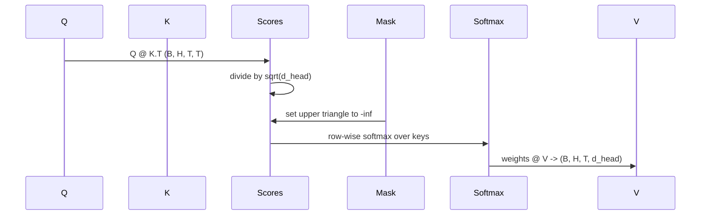

# Çok Başlı Kendine Dikkat

> Bir 線性投影,三种视图,H 个并行头,一面具──这是模型实际使用的注意区──

**Type:** Build
**Languages:** Python
**Prerequisites:** Phase 04 lessons, Phase 07 transformer lessons, Lessons 30 through 32 of this phase
**Time:** ~90 minutes

## Öğrenme Hedefleri
- Satır sorgu / anahtar / değer  projeyi bir 线性层 olarak gerçekleştirmek ve H 个头 olarak ayırmak
- kullanılır 処理計算 スケール dot-product attention。
-                                                                                                                                                                                                                                                               
- 检查固定输入下 Her başın dikkat ağırlıkları,并推理每个头 关注的内容──
- Oyuncak görevi üzerinde küçük bir dikkat bloğu eğitmek, kayıpları gözlemlemek  başları  özelleştirmek ve düşmek 


```figure
cap-multihead-attention
```

## Çerçeve

Dikkat, bir simgeyi ifade etmenin aynı sıradaki diğer simgelerden bilgi alabilmesini sağlar. Kendi dikkatini ifade eden sorular, anahtarlar ve değerler aynı girişten gelir.

Yüksek verimlilik gerçekleştirme modusu, bir hattı aşama kullanmaktır.`D`投影到 `3 * D`, tekrar üç görünümlü olarak kesip, sonra H 个头, her büyüklük için yeniden şekillendirmek`D // H`◊ matmul、softmax 和加权求和都作为批量テンサー 操作执行,因此各头可以在加速器上并行运行──

Bu ders bu blokun oluşturulmasını sağlar. Bu da nedensel maskeye katılır. Bu yüzden aynı kodun sadece dekodörle kullanılabilir bir dil modeli olarak kullanılır.

## Şekil sözleşmesi

输入是 `(B, T, D)`                                                                                                                                                                                                                                                              `(B, T, D)`Maske:`(T, T)`, veya yayına kadar yayınlanabilir.`(B, H, T, d_head)`, içinden `d_head = D // H`                                                                                                                                                                                                                                                              `D % H == 0`- Evet.

```mermaid
flowchart LR
    A["(B, T, D) 输入"] --> B[Linear D -> 3D]
    B --> C["拆分为 Q, K, V"]
    C --> D["reshape 为 (B, H, T, d_head)"]
    D --> E["scores = Q @ K.T / sqrt(d_head)"]
    E --> F[应用 causal mask]
    F --> G[对 keys 做 softmax]
    G --> H["context = weights @ V"]
    H --> I["reshape 为 (B, T, D)"]
    I --> J[输出 Linear D -> D]
    J --> K["(B, T, D) 输出"]
```



两个线性层(QKV projeksiyon 和输出 projeksiyon) bloğun içinde tek parametre¬¬dir.

## QKV bölümü

朴素实现将有三个独立线性层,分别用于 Q、K 和 V──高效实现只有一个层,输出 `3 * D`个特征并分分结果──二在数学上等价,因为三分乘以 `(D, D)`Ağırlıklı Matrix çarpmaları, bir kere çarpıp toplanıp oluşmaya eşit.`(3D, D)`权重的矩阵乘法──

Yüksek verim daha hızlıdır, çünkü hızlandırıcı sadece üç kez değil, bir kez matmul başlatır. Üç çocuk matrisi aynı parametre tensöründe olduğundan, birlikte başlatılabilir.

## Baş yeniden şekillendi .

Ayrıldıktan sonra, Q 、 K 、 V 都是 `(B, T, D)`◊ H 个 paralel çizgisi haline getirmek için dikkat  sorun, yeniden şekillendirelim 为 `(B, T, H, d_head)`, yeniden transpose için`(B, H, T, d_head)`△ baş 维度现在位于批次 维度旁边,因此 PyTorch 会把每头注意视为跨 `B * H`个独立实例的批量操作――

`d_head`维度保持在最后, bu yüzden puan matmul `Q @ K.transpose(-2, -1)`Bu boyutta küçülüyor.`(B, H, T, T)`Baş başına dikkat puanları:

## Ölçekleme

Notlar , yumruk maksimum ön ayrıştırma`sqrt(d_head)`Bu ölçeklendirme yoksa, nokta ürünleri de yanlız kalır.`d_head`增大而增大,把软max 推到一种几乎所有的质量都集中在一个条目上,其他条目都接近消失的状态――这种状态下 Gradient 很小,学习会停滞――除以`sqrt(d_head)`Skorların farklı baş boyutlarında fark olmasına izin ver.

## Sebep maskası

Bu noktada, "softmax" olarak, "softmax" olarak, "mask" olarak adlandırılır.`(T, T)`puan Matrix, köşeler üzerinde her bir maddeyi negatif olarak değiştirir.



Biz yapım sırasında maskesi tampon olarak kaydetmiştik, bu nedenle model ile aynı cihazda yer alır ve Gradient grafinin bir parçası değildir.`(T, T)`Bölge

## Çıktılık projesi

 başlık bağlam vektörleri elde `(B, H, T, d_head)`后,我们转换回 `(B, T, H, d_head)`, yeniden şekillendirmek için `(B, T, D)`Sonuncu uygulamayı yapıyorum.`(D, D)`线性投影──output projection 让模型可以混合各头──没有它,H个头只能通过后层重组,块会受到人为限制──

## Dikkatli ağırlık denetimi

Bu ders ileri geçiş üzerinde bir açıklama `return_weights=True`Bayrak ayarlama sonrası blok çıkışın yanında olacak ve biçime dönecek.`(B, H, T, T)`Baş başına dikkat ağırlıkları, kısa giriş üzerinde bir baş 权重 sısı haritasını basın, böylece nedenci üçgen struktur ve her konum sınır noktalarını görebilirsiniz.

İyi bir eğitim modelinde, farklı başlar farklı biçimlere bakacak. Bazı başlar yakın bir önceki Token'i görecek. Bazı başlar dizini açacak. Bazı başlar dikkatini neredeyse eşit derecede dağıtacak.

## Eğitim gösterisi

`main.py`部のデモ 会把注意ブロック 接到一小のLM頭,そして重複作業 上訓練全模型──输入中的每行都是随机 id,在整个上下文中复制──目標是右移の输入,所以模型必须学会下一个代號与前一个代號相似──損失は交叉エントロピー── H=4、D=32、T=12 和大小为64 sözlükleri kullanırken, CPU'daki Kayıp toplantısı 超三期 之后随机水平约`log(64) ~ 4.16`) aşağıya düşüp çok aşağıya düştü .`1.0`- Evet.

Demo'nun amacı, kullanışlı bir model eğitmek değil. Amaç, blokun her bölümünü aşmak ve her başının açık bir soruya cevap vererek bir şey öğrenmek.

## Bu ders neyi yapmaz

Gerçek modeldeki transformatör katmanı, dikkat                                                                                                                                                                                                                                                                                                                                                                                                                                                                                                                    

Bu, dönümsel veya AliBi pozisyon kodlamasını gerçekleştirmez. Bunlar aynı blokta QKV projeksiyonunun 步骤中应用中, ancak bunlar bağımsız öğretim birimleri. Burada yapılandırılan bloklar, sadece matmulde Q 和 K'yi dönüştürmekle uyumludur.

KV cache kullanılarak sonucu çıkarmaz. Önceden geçişler 缓存 anahtarları 和 değerler 变快的优化── autoregressive decoding 变快的优化── K 和 V tensor şekli sözleşmesini değiştirir, ancak Q ∈ Q değiştirmez.

## Şifreyi nasıl okuyabilirsiniz

`main.py`- Defini etti .`MultiHeadSelfAttention`△ Bu sınıf 包含两个线性层和一个注册的面具缓冲器──前行通过 会依次执行投影、重型、重点、重量、重量、重量、重量、重量、重量、重量、重量、重量、重量、重量、重量、重量、重量、重量、重量、重量、重量、重量、重量、重量、重量、重量、重量、重量、重量、重量、重量、重量、重量、重量、重量、重量、重量、重量、重量、重量、重量、重量、重量、重量、重量、重量、重量、重量、重量、重量、重量、重量、重量、重量、重量、重量、重量、重量、重量、重量、重量、重量、重量、重量、重量、重量、重量、重量、重量、重量、重量、重量、重量、重量、重量、重量、重量、重量、重量、重量、重量、重量、重量、重量、重量、重量、重量、重量、重量、重量、重量、重量、重量、重量、重量、重量、重量、重量、重量、重量、重量、重量、重量、重量、重量、重量、重量、重量、重量、重量、重量、重量、重量、重量、重量、重量、重量、重量,重量,重量,重量,重量,重量,重量,重量,重量,重量,重量,重量,重量,重量,重量,重量,重量,重量,重量,重量,重量,重量,重量,重量,重量,重量,重量,重量,重量,重量,重量,重量,重量,重量,重量,重量,重量,重量,重量,重量,重量,重量,重量,重量`code/tests/test_attention.py`Orta test şekil kontratını sabitledi, sebeplilik özelliği, yumuşaklık özelliği, baş bölme özelliği, gradyen akışı.

运行 demo──然后把 `n_heads`4'ten 8'e kadar devam et`d_model=32`Bu yüzden `d_head=4`), 如何变化的热图观察.
