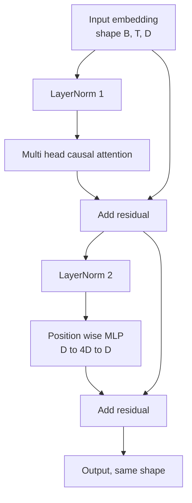
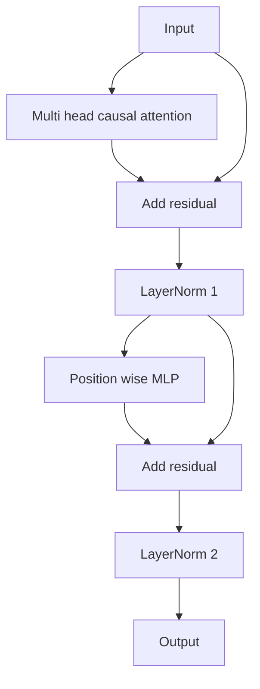

# Transformer Blokunu 0'dan gerçekleştirmek

> Bir blok her modern dekodör LLM'nin temel birimidir. Bir blok vardır. Bir blok vardır. Bir blok vardır. Bir blok vardır. Bir blok vardır. Bir blok vardır. Bir blok vardır. Bir blok vardır. Bir blok vardır. Bir blok vardır. Bir blok vardır. Bir blok vardır. Bir blok vardır. Bir blok vardır. Bir blok vardır. Bir blok vardır. Bir blok vardır. Bir blok vardır. Bir blok vardır. Bir blok vardır. Bir blok vardır. Bir blok vardır. Bir blok vardır. Bir blok vardır. Bir blok vardır. Bir blok vardır. Bir blok vardır. Bir blok vardır. Bir blok vardır. Bir blok vardır. Bir blok vardır. Bir blok vardır. Bir blok vardır. Bir blok vardır. Bir blok vardır. Bir blok vardır. Bir blok vardır. Bir blok vardır. Bir blok vardır. Bir blok vardır. Bir blok vardır. Bir blok vardır.

**Type:** Build
**Languages:** Python
**Prerequisites:** Phase 19 lessons 30 to 33 (tokenizer, embeddings, attention math, batched data loader)
**Time:** ~90 minutes

## Öğrenme Hedefleri

- PyTorch'in içindeki dönüştürücü blokları:LayerNorm, çok başlı sebepçi dikkat, kalıntılı bağlantılar, pozisyonsal MLP,
- LayerNorms'i iki yapılandırma arasında yerleştirmek, LN öncesi ve LN sonrası), ve neden bunlardan birinin ısınmaya gerek olmadığını ve                                                                                                                                                                                                                                             
- Çok sayıda baş dikkat içinde nedençi maskeli gerçekleştirmek, Token `i`Notları göremiyorum .`j > i`- Evet.
- 12 katmanlı bir yığın içinde iki değişkenin arasında bir derece akışı var.
- Bu blokı doğrudan değiştirilebilir birim olarak kullanın.

## Sorun

transformator = bir blok tekrarlamak. Bu blok bir kez yanlış başlarsa, tekrar tekrar 12 kez, modeliniz ya da ilk çağda yayılırsa, ya da her yolda ısınma ihtiyacı vardır. Bu ders göreceğiniz iki başarısızlık modeli nadir görülür.

Bir kez açık bir şekilde baktığında, düzeltme mekaniktir. Bu blokda iki kalıntı yolu ve iki normalleşme pozisyonu var.

## Anlaşım

Her dekodör sadece transformatör blokları bir işlevi, şekli alır.`(batch, sequence, embedding)`并返回相同形的テンサー──内部由两个子层组成的完成工作──



Bu pre-LN 变体──LayerNorm 位于残留分支 内部,在子層 之前──残留连接 会将未归一化的信号 向前传递──

LN sonrası 变体会把 LayerNorm 移至残余 后──



Form 完全相同──訓練行為不相同──LN sonrası kullanımı 时, geriye kalan yol boyunca 逆向流動的格里エンツ 必須穿越LayerNorm──在十二層深度和学习速率`3e-4`Aşağı, bu Gradient 会 sufficiently shortened, so far as it needs a warmup schedule──Pre-LN 让残路 保持未归化,因此 Gradient 能干净地传播到嵌入层──正因如此,GPT-2 之后发布的配置都使用Pre-LN──

### Sebepçi çok kişilik dikkat

Dikkat alt katmanı, girişleri soru, anahtar, değer tensörleri olarak üç şekilde yansıtır.`(B, T, D)`Şekil değiştir .`(B, H, T, D/H)`, içinden `H`                                                                                                                                                                                                                                                              `softmax(Q K^T / sqrt(d_k))`, Üst üç köşeler maskesi için, softmax  uygulamak maskesi, sonra çarpmak `V`Başlar bir arada bir yapılır.`(B, T, D)`Tansor,并再次投影──mask, modelin sonuçlı bir parçası olmasıdır── unutma maske, bir modelin aldatılmasını eğitmektir──

### MLP

Konumlar: MLP 会把同一个两层网络独立应用到每个代币──隐藏宽是嵌入宽的四倍,激活是 GELU,并且在第二线线的后接中落──MLP 内部没有代币相互交流──所有代币混合都发生在注意中──

### Geri kalan bağlantılar iki şeyi yapar.

Bu iki etkisi blokların genişlemesine neden olan iki etkendir.


```figure
cc-transformer-block
```

## Yapın

`code/main.py`实现了:

- `class LayerNorm`,带可学习的规模 和 shift、biased eps,并应用到每个代币矢量──
- `class MultiHeadAttention`,带 `num_heads`- Evet.`head_dim = d_model // num_heads`、Fused QKV projection、注册的因果化面具、注意失落 和残留失落──
- `class FeedForward`İki 線性層 var GELU aktivasyonu ve kesilmesi.
- `class TransformerBlock`,带 `pre_ln`Bayrak, iki değişken arasında değişim için kullanılır.
- Bir demo, 6 kat ön LN yığın ve 6 kat sonrası LN yığın, aynı giriş,并打印 (a) çıkış şekli,(b) 一次倒退通過 后 嵌入处的渐进规则──

- Yapma .

```bash
python3 code/main.py
```

输出: iki yığının şekli kontrolü,以及并排的渐进规范──在相同的学习率下,pre-LN yığının gömülme derecesi,LN sonrası yığının büyük bir sayı seviyesidir,这是 pre-LN 无需热升也能训练的实证信号──

## Yüküm

- `torch`Tansor matematikinde otograd ve`nn.Module`tesisatçılık
- İstifadesi`transformers`, pre-koşulu ağırlık kullanmayın. Bu blok, ilkelerden 实现.

## Doğada üretim biçimleri

Üç farklı yöntem, ders kitabının bloklarını teslim edilebilir bir şeye dönüştürür.

**Fused QKV projection.**Üç ayrı ıntılı aşama, üç kez çekirdek başlatılmasını ve üç kez eşleşmesini tüketir.`3 * d_model`Bu yolun bir başlatma sırasında aynı işi tamamlayabilir, sonra son eksis boyunca ırkın çıkış ve çıkış  birleşik yol her tür hızlandırıcıda daha hızlıdır ve GPT-2、LLaMA ve Mistral'ın referans uygulamalarına ırkınma biçimi ile uyumludur.

**Registered causal mask buffer.**Maske sadece en fazla aşağıdaki yazının uzunluğuna bağlıdır.`register_buffer`Bir kere dağıt, her seferinde ileri geç, aktif pencereden çık, ve her seferinde atlayıp dağıt. Bunu unutursak, maskeyi uzatır.

**Dropout in two places, not three.**İptal  应该位于 Atenção softmax 之后 (Atensiyon yumuşaklığı) 之后 (Atensiyon yumuşaklığı) 之后 (Atensiyon yumuşaklığı), yanı sıra MLP'nin ikinci doğrusal 之后 (Atensiyon yumuşaklığı) 后 (Atensiyon yumuşaklığı) 后 (Atensiyon yumuşaklığı) 后 (Atensiyon yumuşaklığı) 后 (Atensiyon yumuşaklığı) 后 (Atensiyon yumuşaklığı) 后 (Atensiyon yumuşaklığı) 后 (Atensiyon yumuşaklığı) 后 (Atensiyon yumuşaklığı) 后 (Atensiyon yumuşaklığı) 后 (Atensiyon yumuşaklığı) 后 (Atensiyon yumuşaklığı) 后 (Atensiyon yumuşaklığı) 后 (Atensiyon yumuşaklığı) 后 (Atensiyonyumuşaklığı) 后 (Atensiyonyumuşaklığı) 后 (Atensiyonyumuşaklığı) 后 (Atensiyon) 后) 后 (Atensiyon) 后 (Atensiyon) 后 (Atensiyon) 后 (Atension) 后) 后 (Atension) 后 (ononononononononononononononononononononononononononononononononononononononononononononononononononononononononononononononononononononononononononononononononononononononononononononononononononononononononononononononononononononononononononononononononononononononononononononononononononononononononononononononononononononononononononononononononononononononononononononononononononononononononononononononononononononononononononon

## Kullan

- Bu dersdeki bloklar doğrudan ders 35'e yerleştirilmiştir.
- pre-LN 变体是每个现代开权LLM 使用形式──post-LN 变体是2017年原始注意论文使用形式──了解二者就足以阅读你会遇到的任何解码架构──
- GELU'yu SiLU'ya çevirirsen, LLaMA 系列 aktivasyonu elde edersin. LayerNorm'ı RMSNorm'a çevirirsen, LLaMA 系列 normalisasyonunu elde edersin.

## Egzersizler

1. 给块 中每个线性 添加 `bias=False`bayrak。Modern Open Weights LLM  yayınlama zaman lineer katmanlar 带偏见──测量在 12 katman、768 dim 模型中能节省多少参数──
2. RMSNorm 替换 `nn.LayerNorm`,并验证 çıkış şekli 不变──
3. Bir bayrak ekle, ilk başına dön. Dikkat ağırlıkları olarak.`(B, T, T)`Tenzor: ∞, ∞, ∞, ∞, ∞, ∞, ∞, ∞, ∞, ∞, ∞, ∞, ∞, ∞, ∞, ∞, ∞, ∞, ∞, ∞, ∞, ∞, ∞, ∞, ∞, ∞, ∞, ∞, ∞, ∞, ∞, ∞, ∞, ∞, ∞, ∞, ∞, ∞, ∞, ∞, ∞, ∞, ∞, ∞, ∞, ∞, ∞, ∞, ∞, ∞, ∞, ∞, ∞, ∞, ∞, ∞, ∞, ∞, ∞, ∞, ∞, ∞, ∞, ∞, ∞, ∞, ∞, ∞, ∞, ∞, ∞, ∞, ∞, ∞, ∞, ∞, ∞, ∞, ∞, ∞, ∞, ∞, ∞, ∞, ∞, ∞, ∞, ∞, ∞, ∞, ∞, ∞, ∞, ∞, ∞, ∞, ∞, ∞, ∞, ∞, ∞, ∞, ∞, ∞, ∞, ∞, ∞, ∞, ∞, ∞, ∞, ∞, ∞, ∞, ∞, ∞
4. Bir akıl kontrolü yapın, onu yapın.`(2, 16, 384)`Tenzor`H=6`Aşağı gönderin iki değişken,并断言在权重初始化相同且dropout 设为零时,前出口 不同`not torch.allclose`)。

## Anahtar Terimler

| Term | What people say | What it actually means |
|------|-----------------|------------------------|
| Pre-LN | "Pre norm" | LayerNorm 位于 residual branch 内部，在每个 sublayer 之前；residual 携带未归一化的 signal |
| Post-LN | "Post norm" | LayerNorm 位于 residual add 之后；这是 2017 年论文发布的形式，并且需要 warmup |
| Causal mask | "Triangle mask" | Attention logits 的上三角被设为负无穷，因此当 j 大于 i 时，Token i 不能读取 Token j |
| Fused QKV | "Combined projection" | 一个宽度为 3D 的 linear，而不是三个宽度为 D 的 linears；一个 kernel，一次 matmul |
| Residual stream | "Skip connection" | 自上而下流过每个 block 的未归一化 tensor；也是每个 block 添加到的对象 |

## Daha Fazla Okumak

- 7. aşama ders 02 ((kendine dikkat sıfırdan), bu blokun altını öğrenmek
- Eğitim 7 ders 05(tam transformatör), aynı kemerin kodlayıcı dekodörünü öğrenmek 版本。
- Eğitim öncesi mini GPT'nin 10. aşaması, bu bloktan öğrenmek için eğitim sürecini tamamlamak gerekir.
- Eğitim 35'ün 19. aşaması, bu parça, 12 blokları bir GPT modeli haline getirecek.
