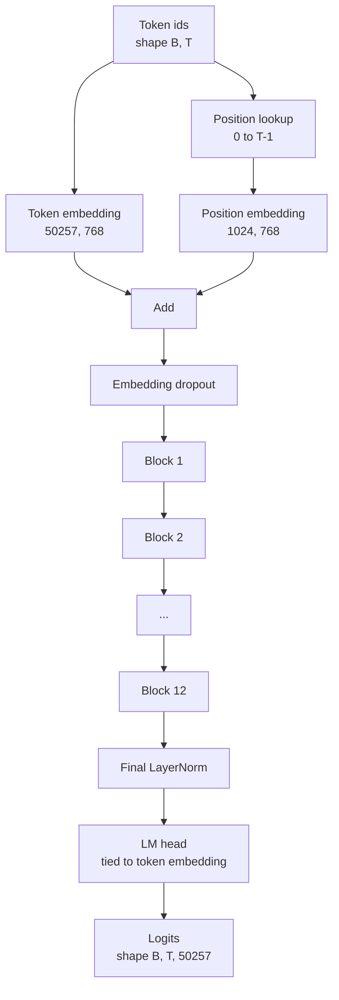
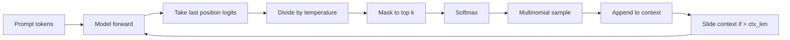

# GPT 模型组装

> 12 blok 堆叠, bir Token Embedding, bir öğrenmek elde pozisyon embed, bir final LayerNorm, ve bir权重绑定的 dil model başı. Bu tam 1.24 milyar parametreler GPT modelı. Bu ders bu bileşenleri bir çalışılabilir sınıf, bir istatistik parametresi ile model uyumlu bir 124M 形状, ve çok sayısal örnekleme kullanarak kullanır.

**Type:** Build
**Languages:** Python
**Prerequisites:** Phase 19 lessons 30 到 34
**Time:** ~90 分钟

## Öğrenme Hedefleri

- 将课 34 中的变压器块 组装成完整 GPT 模型:Token Embedding、Position Embedding、N 个块、最终 LayerNorm、language model başlık。
- 复现 1.24 milyar parametre配置:vocab 50257 文脈 1024 嵌入 768 十二个头,12层──
- Dil model başını Token Embedding'e yükleme ve bunun neden bu büyüklüğünde yaklaşık 38 milyon parametrini tasarruf edebileceğini açıklamak.
- Multinomal örnekleme, sıcaklık ölçeklemesi, üst-k kesim, sürpriz bir pencereden kaydırma ile bağlam uzunluğunu korumak.
- Kontrol 124M  hedef ölçüm parametresi sayımı 和 ileri geçme 成本。

## Sorun

Transformer blokları 单独存在时什么也做不了──你需要把代号 id 转变成向器,混入位置信息,让它们穿越堆,再投投回词汇逻辑──漏掉这四步中的任何一步,模型要么不能前进,要么位置信息漂移,要么不能说话──

Model biçimi de çok önemlidir. Reference GPT-2 küçük yukarıda belirtilen tam yapılandırma altında 1.24 milyar parametredir. Bu rakamlar gizemli değildir. Vocab 50257  çarpı 768 simge masasıdır.

## Anlaşım



Token idleri  token vektörleri  pozisyon idleri  pozisyon vektörleri                                                                                                                                                                                                                                                                                                                                                                                                                                                                                                            

### Ağırlık bağlama

İşaret Ekleme şekli `(vocab, d_model)`◊ dil model başı 需要从 `d_model`投影回 `vocab`△ bunlar birbirine dönüştürülür. △ ikisi de bağlanır, yani kelimenin anlamında aynı parametreler tensorunu kullanır, iki kez kullanılır. △ bu matrisin sözcükte 50257 和 d_model 768 下, bu matrisinde 38 milyon parametreler vardır. △ bağlanmadan sonra, bunun için iki kez maliyet ödemek zorundasın. △ bağlanmadan sonra, sadece bir kere maliyet ödemek zorundasın, ayrıca biraz daha temiz bir gradyen sinyal de elde edersin, çünkü yerleşim ve başlama bir arada yenilenir.

### Yerleşim yapısı, sinusoidal değil, öğrenmek için.

GPT-2 使用学习得到的位置嵌入──position table is a shape为 `(1024, 768)`Model: Model: Model: Model: Model: Model: Model: Model: Model: Model: Model: Model: Model: Model: Model: Model: Model: Model: Model: Model: Model: Model: Model: Model: Model: Model: Model: Model: Model: Model: Model: Model: Model: Model: Model: Model: Model: Model: Model: Model: Model: Model: Model: Model: Model: Model: Model: Model: Model: Model: Model: Model: Model: Model: Model: Model: Model: Model: Model: Model: Model: Model: Model: Model: Model: Model: Model: Model: Model: Model: Model: Model: Model: Model: Model: Model: Model: Model: Model: Model: Model: Model: Model: Model: Model: Model: Model: Model: Model: Model: Model: Model: Model: Model: Model: Model: Model: Model: Model: Model: Model: Model: Model: Model: Model: Model: Model: Model: Model: Model: Model: Model: Model: Model: Model: Model: Model: Model: Model: Model: Model: Model: Model: Model: Model: Model: Model: Model: Model: Model: Model: Model: Model: Model: Model: Model: Model: Model: Model: Model: Model: Model: Model: Model: Model: Model: Model: Model: Model: Model: Model: Model: Model: Model: Model: Model: Model: Model: Model: Model: Model: Model: Model: Model: Model: Model: Model: Model: Model: Model: Model: Model: Model: Model: Model: Model: Model: Model: Model: Model: Model: Model: Model: Model: Model: Model: Model: Model: Model: Model: Model: Model: Model: Model: Model: Model: Model: Model: Model: Model: Model: Model: Model: Model: Model: Model: Model: Model: Model: Model: Model: Model: Model: Model: Model: Model: Model: Model: Model: Model: Model: Model: Model: Model: Model: Model: Model: Model: Model: Model: Model: Model: Model: Model: Model: Model: Model: Model: Model: Model: Model: Model: Model: Model: Model: Model: Model: Model: Model: Model: Model: Model: Model: Model: Model:

### Nesil: sıcaklık, üst-k, çoklu

Generasyon ise autoregresivdir. Her adım, model her yerde tam kelime birikimine geri döner. Yukarıdaki logitler.



Üç dönüm, üç farklı davranışlara karşı karşı karşıya. Hava  neredeyse sıfır  düşüş açgözlülük. Hava                                                                                                                                                                                                                                                                                                                                                                                                                                                                                                 


```figure
cc-gpt-assembly
```

## Yapın

`code/main.py`实现:

- `class GPTConfig`124M'lik bir değerli veri sınıfı:`vocab_size=50257`- Evet.`context_length=1024`- Evet.`d_model=768`- Evet.`num_heads=12`- Evet.`num_layers=12`- Evet.`mlp_expansion=4`- Evet.`dropout=0.1`- Evet.`use_bias=True`- Evet.`weight_tying=True`- Evet.
- `class GPTModel`, içerir Token Embedding,Position Embedding,Embedding dropout,12 `TransformerBlock`、 nihai LayerNorm, ve de içinde bayrak 打开时绑定到代码嵌入的 `lm_head`- Evet.
- `count_parameters`Yardımcı, tek parametre sayısını geri getir.
- `generate`işlevi, sıcaklığı, üst-k, çok sayıdaki, sürükleyici pencere bağlamı,
- Bir demo, yapılandırma modeli, baskı parametresi sayımı ve referans 124M kontrolü ile birlikte, sonra sabit bir istekle kısa bir dizi oluşturarak, boru hattını gösterir 端到端可运行──

- Yapma .

```bash
python3 code/main.py
```

输出:parameter sayısı ile 124M 参考值对照、 sabit istekten 生成のトークン idleri, yanı sıra 打開時 LM başı 和 Token Embedding 共享 depolama bilgisi onaylama bilgileri

为了让demo 保持快速,脚本还会端到端运行一个小组配置(`d_model=64`- Evet.`num_layers=2`),并 inline 打印生成的代码序列──124M yapılandırma yapılandırılır, ancak sadece parametrelerin sayısını ve bir kez ileriye geçiş yapılır──

## Yüküm

- `torch`Tansor matematikinde, otograd ve modül tesisatında kullanılıyor.
- `code/main.py`Ders 34'te aynı blok örneğini yeniden gerçekleştirmek için.

## Doğada üretim biçimleri

Üç model bir modelin sadece çalışıp çalışmasını mı, gerçekten teslim edilebilmesini mi belirler.

**把 residual projections 初始化得小一些。**Dikkat Output Projection 和 MLP'nin ikinci doğrusal şehir doğrudan kalıntı ekleme giriyor. Eğer diğer doğrusal benzer standart sapma ilk başta onları, kalıntı akışı, derinlik büyümesi ile, ve son LayerNorm 推入过热区间── bu iki projeksiyon için std 按`1 / sqrt(2 * num_layers)`缩放; geri kalan akım 12 katın içinde mantıklı bir alanı koruyabilir.

**缓存 position id tensor，不要重复计算。** `torch.arange(T)`Yeni bir kayda her seferinde paylaşılacak.`__init__`Orta en büyük bağlamda bölünmüş, bir kez, her seferinde düzenlenmiş, ön T 个 girişleri kesmiş, ayrıştırıcıdan atlamış 往返──

**在 parameter 层面 tie weights，而不只是 copy。** ayar `lm_head.weight = token_embedding.weight`Çekilme, kopyalanma, ağırlık bağlama, hiçbir fayda yok.

## Kullan

- Bu dersdeki model sınıfı, sonraki dersdeki eğitimli model biçimleriyle aynıdır.
- LLaMA ailesini elde edebilecek konum yerleştirme RoPE'ye değiştirilir.
- GELU'yu SiLU'ya değiştirmek, LayerNorm'u RMSNorm'a değiştirmek, LLaMA ailesinin kalan değişimlerini elde etmek için kullanılır.
- Genreleme fonksiyonu herhangi bir log için kullanılabilir.

## Egzersizler

1. 解除 LM başı ve Token Embedding'ın绑定并重新统计参数──验证差值为50257 乘以768 = 3800万──
2. Öğrenmek için pozisyon yerleştirme                                                                                                                                                                                                                                                                                                                                                                                                                                                                                                                      
3. Nesil 添加 `greedy=True`Bayrak, örnekleme atlamak, argmax seçmek, bir dizi çalışmada belirleyici bir dizi belirlemek,
4. 添加 `repetition_penalty`旋, 之前 softmax, 将 prompt 或已生成在历史中任意的代币的逻辑除以一个常数──固定提示 显示大于一个的值将减少输出中的重复次数──
5. - Evet .`top_k`旁边添加 `top_p`(nukleus) örnekleme── Using两行检查确认保留代币的概率之和超过 `top_p`- Evet.

## Anahtar Terimler

| Term | What people say | What it actually means |
|------|-----------------|------------------------|
| Weight tying | “Tied embeddings” | LM head 和 Token Embedding 共享同一个 parameter tensor；节省 vocab times d_model 参数，并匹配 GPT-2 参考模型 |
| Position embedding | “Learned positions” | 一个单独的 table，形状为 (context length, d_model)，加到 token vectors 上；端到端学习得到 |
| Sliding window context | “Context cap” | 当 prompt 加生成 tokens 超过 context length 时，丢弃最旧的 tokens，让 active window 能放下 |
| Top-k sampling | “K truncation” | 保留值最高的 K 个 logits，把其余 logits mask 成 negative infinity，并在剩余项上 softmax |
| Temperature | “Sampling temperature” | 在 softmax 前用 T 除以 logits；T 小于 1 会变尖锐，T 等于 1 保持自然 distribution，T 大于 1 会变平坦 |

## Daha Fazla Okumak

- Fase 19 ders 34, bu modelin toplanmış bloklarını anlayın.
- Fase 19 ders 36, çapraz entropi kaybı öğrenmek
- Eğitim 37 ders, önceden eğitilmiş GPT-2 ağırlıklarını nasıl yükleyeceğimizi öğrenmek.
- 7. aşama ders 07 ((GPT sebepli dil modelleştirme), bir sonraki simge tahminini öğrenmek için matematik
- Eğitim öncesi mini GPT, aynı mimariyi öğrenmek
