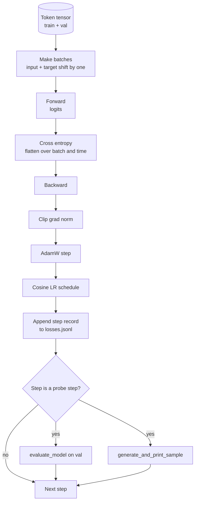

# Eğitim Çubuğu ve Değerlendirme

> Bu yüzden, bu konuda bir şey yapmamalıyız.`calc_loss_batch`Yardımcı ∞ ∞ ∞ ∞ ∞`evaluate_model`Bir kere geçmek için her bir adım at.`generate_and_print_sample`定性探査, ayrıca sonrasında çizilen JSONL kaybı logı. Aynı yapı, daha sonra inşa edeceğiniz her dekodörü eğitmek için kullanılabilir.

**Type:** Build
**Languages:** Python
**Prerequisites:** Phase 19 lessons 30 到 35
**Time:** ~90 分钟

## Öğrenme Hedefleri

- Bir eğitim döngüsü oluşturun, bir sonraki belirti tahmin için doğru giriş ve hedef ayarını kullanın, böylece çapraz entropi kaybını hesaplayın.
- 配置 AdamW, make weight decay 应用于重量テンサー,而不是应用于 LayerNorm 或 bias tensors──
- 实现带线性变暖和宇宙衰退的学习率表,并读取 LR 随时间的变化──
- Kullanım`evaluate_model`Bu nedenle, değerlendirmenin kaybı, değerlendirme kaybının daha fazla kullanılabilir hale gelmesi için, değerlendirmeyi bir şekilde değerlendirmeyi sürdürmek için, değerlendirmeyi bir şekilde değerlendirmeyi sürdürmek için, değerlendirmeyi bir şekilde değerlendirmeyi sürdürmek için, değerlendirmeyi bir şekilde değerlendirmeyi sürdürmek için, değerlendirmeyi bir şekilde değerlendirmeyi sürdürmek için, değerlendirmeyi bir şekilde değerlendirmeyi sürdürmek için, değerlendirmeyi bir şekilde değerlendirmeyi yaparak, değerlendirmeyi bir şekilde değerlendirmeyi yaparak, değerlendirmeyi bir şekilde değerlendirmeyi yaparak, değerlendirmeyi yaparak, değerlendirmeyi yaparak, değerlendirmeyi yaparak, değerlendirmeyi yaparak, değerlendirmeyi yaparak, değerlendirmeyi yaparak, değerlendirmeyi yaparak, değerlendirmeyi yaparak, değerlendirmeyi yaparak, değerlendirmeyi yaparak, değerlendirmeyi yaparak, değerlendirmeyi yaparak, değerlendirmeyi yaparak, değerlendirmeyi yaparak, değerlendirmeyi yaparak, değerlendirmeyi yaparak, değerlendirmeyi yaparak, değerlendirmeyi.
- Her adım`generate_and_print_sample`Bir kararlı örnek oluşturarak kayıp eğrisinde  göstermeden önce farklılıkları algılamak için.
- Her adım kaybını JSONL'ye uzatmak, yeniden yüklemek için, çizimleri, ve teslim edilebilir bir eğitim logunu oluşturmak için.

## Sorun

Bir tek baskı kayıp ve hiçbir şey yapmayan eğitim senaryoları 会在三方面失败──它不能告诉你是否输失正确原因在下降(模型可能只是在训练集上过,而从未真正学习)──它不能告诉你是否开始的分歧──失去可能升一步后恢复,也可能升一步后崩──它不能告诉你模型学到了什么──失去是一个规模;生成的样本是一段文字)──除非做测量,否则这些三种失败都会被隐藏起来──

Bu dersdeki döngü üç farklı yöntemle ölçülür. Bu nedenle, eser bu döngünün bir tanığıdır.

## Anlaşım



İki farklı belirgin bölüm ise kayıp düzlem ve Adam'ın parçalanması.

### Kayıp Düzeltme

Model in each position 预测 下一个代币──如果输入批量是代币 `[t0, t1, t2, t3]`O zaman hedef parti                                                                                                                                                                                                                                                                                                                                                                                                                                                                                                                          `[t1, t2, t3, t4]`❖ Çarşı entropi düz şekilde`(batch * seq, vocab)`上计算,并对照 `(batch * seq,)`❖ Unutma değişimi, model eğitimi kendi öngörüsü olarak; bu sıfır kaybı alır, ama yararlı hiçbir şey öğrenmez.

### AdamW parçalanması bölünmüştür

Ağırlık kaybı Ağırlık tensörlerini düzenleştirecek, ancak normallaşma ölçeklerini veya tersilikleri düzenlemeyecektir.

### Sıcaklık artı kosin programı

Heatup, öğrenme oranını sıfırdan hedefe doğru birkaç yüz adım içinde değiştirir. Optimizer'ın doluma zamanını sağlar. Kozins çöküşü, öğrenme oranını sıfıra yakın hale getirir. Son aşamada daha küçük adım boyutlarındaki ince ayar ağırlıklarına dönüştürür. Bu kombinasyon, ön 1000 adım ve son 1000 adımların çoğu zayıflık zamanını ortadan kaldırdığı için açık ağırlıklı LLM eğitiminin en yaygın programıdır.

### Değerlendirme yapıldı

`evaluate_model`Valideleme bölümü ile birlikte, sabit sayıda parti, toplu kayıp, parti sayısını ayırıp geri dönmek, Gradient yok, düşüş yok, aynı tohumda ve aynı bölükte, bu sayı geçerli.

### İlk sinyal olarak kalite örneklemesi

Bir eğitim kaybı Aşağı iyi düştü, ama üretilen örnekler hepsi aynı simgelik modellerin kötüdür. Bir kayb eğri düz görünüyor, ama üretilen örnekler yavaş yavaş sürekli bir kelimelik modeller öğrenmeye başlıyor.


```figure
cap-training-loop
```

## Yapın

`code/main.py`实现:

- `make_batches(token_ids, batch_size, context_length)`, bir uzun işaret tenzor kesimi 成 giriş ve hedef çiftleri olacaktır.
- `calc_loss_batch(model, inputs, targets)`, ileriyi gerçekleştirmek, düzleştirmek,并返回 skalar çapraz entropi。
- `evaluate_model(model, val_loader, max_batches)`,在没有grad 下代固定数的验证批次,并返回平均损失──
- `generate_and_print_sample(model, prompt, max_new_tokens)`, on fixed prompt 上运行 ders 35'in jenerasyon fonksiyonu 并印结果──
- `build_param_groups(model, weight_decay)`,生成两组 AdamW parametreler listesi
- `cosine_with_warmup(step, warmup_steps, total_steps, max_lr, min_lr)`, L.R. için geri dönmek için.
- `train(...)`,运行循环,持久化 `outputs/losses.jsonl`,并每 `eval_every`adımlar 打印 eval loss 和 sample──
- Bir demo, sentetik veriler üzerinde küçük model eğitimi az adımlar, JSONL günlüğüne yazmak ve araştırma noktaları print eval kaybı ve örnek. Bu demo CPU'da yukarı uzakta bir dakikadan daha düşük olarak tamamlanabilir.

- Yapma .

```bash
python3 code/main.py
```

输出: Her adım kaybı 行、 her araştırma aşamasının değer kaybı、 her araştırma aşamasının üretilen örneği, ve son olarak `outputs/losses.jsonl`- İşe yarayabilirsin .`json.loads`- Evet.

## Yüküm

- `torch`Autograd, Optimizer ve modüller kullanıyor.
- `main.py`Ders 35'i yeniden gerçekleştirmek için.`GPTModel`和 destek modülleri。

## Doğada üretim biçimleri

Üç modü, derslik döngüsünü gece boyunca çalışabileceğimiz bir şeye dönüştürür.

**Gradient norm clipping 不可协商。**Bir kötü parti ((Aservalue Data、LR spike、Number Value Limit Situation) büyük bir derecede oluşur.`backward`Sonra...`step`之前调用 `torch.nn.utils.clip_grad_norm_(params, max_norm=1.0)`, 可让优化器 保持在安全范围内──clipping value is a free parameter;1 is the default value of the majority of settings 都能住下都能住──

**可恢复的 JSONL logging，而不是 pickled state。**Her adım kayıp kayıtlarını  olarak `{"step": int, "train_loss": float, "lr": float}`JSONL'yi yazmak dayanıklıdır: herhangi bir çöküşten sonra okunur bir eser bırakabilirsiniz, 30 satır Python çizimleri ile ele alabilirsiniz, ayrıca son adımdan sonra tekrar çalıştırılabilirsiniz. Seçilen durum, bu dosyanın oluşturulmasında sizi bağlayacaktır.

**Eval batches 来自固定 slice。**Valideasyon tokenleri, her bir çalışmada tamamen aynı değerlendirme serilerine bağlı olarak, hareketli üretilmek yerine, seri olarak kesilmiştir.

## Kullan

- Bu dersdeki döngü gerçek veriler üzerinde eğitilen 124M modelinin kemik yapısı ile aynı.`datasets`Şekil yüklemeci, döngü, hareket halinde hareket etmektedir.
- JSONL logı, eğitim koşusunu kanıtın teslim edilebilir hale getirir.
- 定性 örnek araştırması 石岩 无法替代的底检查──

## Egzersizler

1. 添加 `weight_decay_groups()`Birim testleri, doğrulama ölçeği, ve yanlışı parametreleri 落入 no decay group,而线性 和嵌入量 落入 decay group──
2. Küçük bir metin dosyasındaki baytları kullanarak sentetik rastgele jetonları değiştirin, demo'yu okuyabilir içeriğe alıştırın.
3. Çeviri için bir tane ekle.`min_lr`zemin, değer`max_lr`%10'u, yeniden çizilmiştir.
4. JSONL log dışında, her `eval_every`adımlar 保存一个检查点──添加 `resume_from`Bayrak yeniden yükleme modeli durumu 和 Optimizer durumu。
5. Bu durumda, bu işlemin sabit bir bölgede kalmasını onaylayın.

## Anahtar Terimler

| Term | What people say | What it actually means |
|------|-----------------|------------------------|
| Loss alignment | “Shift by one” | Input tokens 位于 positions 0..T-1，target tokens 位于 positions 1..T；cross entropy 在 flattened shapes 上计算 |
| Decay split | “Two groups” | AdamW 接收带 weight decay 的 matrix shaped tensors，以及不带 decay 的 scale 或 bias tensors |
| Warmup | “Ramp” | learning rate 在固定步数内从零爬升到目标值，让 Optimizer state 可以填充 |
| Eval batches | “Held out batches” | validation token tensor 的一个固定 slice，在 script 启动时 slice 一次，并在每个 probe 中相同使用 |
| Qualitative probe | “Sample print” | 每 K steps 从固定 prompt 打印一次短 generation，用于捕捉单靠 loss 会隐藏的 failure modes |

## Daha Fazla Okumak

- Eğitim 35'i öğrenin.
- Eğitim aşamasında ders 37, önceden eğitilmiş ağırlıkları aynı modelde nasıl yükleyeceğini öğrenmek.
- Eğitim öncesi mini GPT'nin 10. aşaması, gerçek veri üzerinde işlemleri öğrenmek.
- EY 10 ders 10 ((değerlendirme), çapraz entropi kaybını anlamak 之外更广的 eval surface──
