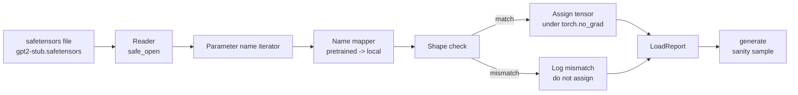

# Üstü eğitimli ağırlıklar

> ZERO Eğitim 124 milyon parametre modeli bir bütçe karar; yüklemek bir açık kontrol noktası 则是日常操作。本课将安全感器文件中预训练的GPT-2 tarzı ağırlıkları yüklemek 35 ders aynı mimarisi içinde, aşama aşama çözünürlük parametre isim haritası,并通过智能生成一个延续证明载成功──无网络、无第三方加载者、无不透明魔法──

**Type:** Build
**Languages:** Python
**Prerequisites:** Phase 19 lessons 30 to 36
**Time:** ~90 minutes

## Öğrenme Hedefleri

- Kullanım`safetensors`Python kütüphanesi 读取 safetensors dosyası,并检查 tensor isimleri 和 şekiller。
- Bu nedenle, her bir parametre adı, ders 35 GPT modelinin içindeki bir parametre olarak gösterilmektedir.
- 处理 published GPT-2 weights with this track model 之间不同的两套命名约定:`wte/wpe/h.N.attn.c_attn/c_proj`和 `mlp.c_fc/c_proj`,对应本地命名的`tok_embed/pos_embed/blocks.N.attn.qkv/out_proj`和 `mlp.fc1/fc2`- Evet.
- Herhangi bir ağırlık atanması 发生前,检测并拒绝形不匹配,并给出清晰错误──
- Üstüne yüklenmiş ağırlıklar kullan 生成一个短续作,并确认代币来自载荷分布,而不是随机初始分布──

## Sorun

Yayınlanmış ağırlıklar sizin mimarınız için değil 打包的──它们携带的是原始实现使用的名称──训练有素文件有形为`(2304, 768)``transformer.h.0.attn.c_attn.weight`Modeliniz 期望形 为`(2304, 768)``blocks.0.attn.qkv.weight`(Bu aynı Matrix, sadece düzen konvansiyon farklı), veya model kullanmak `nn.Linear`, bu bir metraj olarak kaydedilecek Matrix. Aynı parametreden üç farklı farklı farklı olarak ortaya çıkacak.

盲复制器将正确テンソルを 错误位置に放出,生成胡言乱语的模型──形 不同时拒绝复制但不记录任何日志的载体,将让你猜测哪个テンソルを 没有落位──本课的载体是显然的:每次任务都会记录日志,每个形都会检查,并且`LoadReport`Görüşme, görüşme ve şekil eşleşmezliği, neler olduğunu anlamaya yardımcı olur.

## Anlaşım



İsim haritası                                                                                                                                                                                                                                                                                                                                                                                                                                                                                                                         `torch.no_grad()`内部, bu nedenle autograd                                                                                                                                                                                                                                                                                                                       

### GPT-2 isimlendirme sözleşmesi

Yayınlanan GPT-2 ağırlıkları 使用如下名称:

| Pretrained name | Shape | Meaning |
|-----------------|-------|---------|
| `wte.weight` | (50257, 768) | Token Embedding |
| `wpe.weight` | (1024, 768) | Position Embedding |
| `h.N.ln_1.weight` | (768,) | block N 的 LayerNorm 1 scale |
| `h.N.ln_1.bias` | (768,) | block N 的 LayerNorm 1 shift |
| `h.N.attn.c_attn.weight` | (768, 2304) | 融合 QKV linear weight |
| `h.N.attn.c_attn.bias` | (2304,) | 融合 QKV linear bias |
| `h.N.attn.c_proj.weight` | (768, 768) | Attention output projection |
| `h.N.attn.c_proj.bias` | (768,) | Attention output projection bias |
| `h.N.ln_2.weight` | (768,) | LayerNorm 2 scale |
| `h.N.ln_2.bias` | (768,) | LayerNorm 2 shift |
| `h.N.mlp.c_fc.weight` | (768, 3072) | MLP fc1 weight |
| `h.N.mlp.c_fc.bias` | (3072,) | MLP fc1 bias |
| `h.N.mlp.c_proj.weight` | (3072, 768) | MLP fc2 weight |
| `h.N.mlp.c_proj.bias` | (768,) | MLP fc2 bias |
| `ln_f.weight` | (768,) | Final LayerNorm scale |
| `ln_f.bias` | (768,) | Final LayerNorm shift |

İki beklenmedik olay var.`c_attn`- Evet.`c_proj`- Evet.`c_fc`Bu çizgiler Matrix'in depolama şekli ile karşılaştırıldığında.`nn.Linear.weight`期望方式是转置的──Loader 会在分配时转置──LM başı 完全不在文件中;model 依赖与 `wte`Bu yüzden bir kere `wte`Başım, başım, başım, başım, başım.

### Yerel isimlendirme kongresi

本 트랙のモデル 使用描述性名称:

| Local name | Meaning |
|------------|---------|
| `tok_embed.weight` | Token Embedding |
| `pos_embed.weight` | Position Embedding |
| `blocks.N.ln1.scale` | block N 的 LayerNorm 1 scale |
| `blocks.N.ln1.shift` | LayerNorm 1 shift |
| `blocks.N.attn.qkv.weight` | 融合 QKV |
| `blocks.N.attn.qkv.bias` | 融合 QKV bias |
| `blocks.N.attn.out_proj.weight` | Attention output projection |
| `blocks.N.attn.out_proj.bias` | Output projection bias |
| `blocks.N.ln2.scale` | LayerNorm 2 scale |
| `blocks.N.ln2.shift` | LayerNorm 2 shift |
| `blocks.N.mlp.fc1.weight` | MLP fc1 |
| `blocks.N.mlp.fc1.bias` | MLP fc1 bias |
| `blocks.N.mlp.fc2.weight` | MLP fc2 |
| `blocks.N.mlp.fc2.bias` | MLP fc2 bias |
| `final_ln.scale` | Final LayerNorm scale |
| `final_ln.shift` | Final LayerNorm shift |

Haritalama sabit bir fonksiyon. Bu ders onu bir diktat olarak kullanır.

### Çubuklar

Gerçek GPT-2 ağırlıkları yaklaşık 0.5 GB。 Demo onları indirmez; ilk çalışmasında küçük bir güvenlik sensörü takımı üretir, tamamen aynı GPT-2 isimlendirme kavramını benimser ve 12 bloklu model、d_model 192 yerine 768 şekillerine uygun olarak kullanır。 Bu takımın doğru yapısı vardır, yüklemeci içindeki her kod yolu yanıtlanabilir。 takımı gerçek dosyaya değiştirin  sonrasında yüklemeci                                                                                                                                                                                                                                                                                                                                                                                                                            


```figure
cc-weight-remap
```

## Yapın

`code/main.py`实现:

- Bir ders 35 `GPTModel`Bu ders kendi kendini içerir.
- `make_pretrained_to_local(num_layers)`,展开每层条目──
- `load_safetensors(model, path)`,代名、映射名、检查形、转置 conv1d tarzı ağırlıkları, ve `torch.no_grad()`Aşağı görev.`LoadReport`- Evet.
- `make_stub_safetensors(path, cfg)`, doğru önceden eğitilmiş isimlendirme kavramının bir dosyası oluşturmak için kullanılır.
- Bir demo: ilk seferinde`outputs/gpt2-stub.safetensors`, yeni bir model oluşturmak, rastgele bir başlangıç yakalamak, bir devamı oluşturmak, bir daha devamı yakalamak, bir daha devamı yakalamak, bir daha devamı yakalamak, bir daha başlatmak, iki farklı şey denemek, bir daha başlatmak, bir daha başlatmak, bir daha başlatmak, bir daha başlatmak, bir daha başlatmak, bir daha başlatmak, bir daha başlatmak, bir daha başlatmak, bir daha başlatmak, bir daha başlatmak, bir daha başlatmak, bir daha başlatmak, bir daha başlatmak, bir daha başlatmak, bir daha başlatmak, bir daha başlatmak, bir daha başlatmak, bir daha başlatmak, bir daha başlatmak, bir daha başlatmak, bir daha başlatmak, bir daha başlatmak, bir daha başlatmak, bir daha başlatmak, bir daha başlatmak, bir daha başlatmak, bir daha başlatmak, bir daha başlatmak, bir daha başlatmak, bir daha başlatmak, bir daha daha başlatmak, daha daha daha daha daha daha başlatmak, daha daha daha daha daha daha daha daha başlatmak için, daha daha daha daha daha daha daha daha daha daha daha daha daha daha daha daha daha daha daha daha daha daha daha daha daha daha daha daha daha daha daha daha daha daha daha daha daha daha daha daha daha daha daha daha daha daha daha daha daha daha daha daha daha daha daha daha daha daha daha daha daha daha daha daha daha daha daha daha daha daha daha daha daha daha daha daha daha daha daha daha daha daha daha daha daha daha daha daha daha daha daha daha daha daha daha daha daha daha daha daha daha daha daha daha daha daha daha daha daha daha daha daha daha daha daha daha daha daha daha daha daha daha daha daha daha daha daha daha daha daha daha daha daha daha daha daha daha daha daha daha daha daha daha daha daha daha daha daha daha daha daha daha daha daha daha daha daha daha daha daha daha daha daha daha daha daha daha daha daha daha daha daha daha daha daha daha daha daha daha daha daha daha daha daha daha daha daha daha daha daha daha daha daha daha daha daha daha daha daha daha daha daha daha daha daha daha daha daha daha daha daha daha daha daha daha daha daha daha daha daha daha daha daha daha daha daha daha daha daha daha daha daha daha daha daha daha daha daha daha daha daha daha daha daha daha daha

运行:

```bash
python3 code/main.py
```

Çıktı: sabit yol, her isim, yüklü log`LoadReport`Özet                                                                                                                                                                                                                                                              

## Yüküm

- `safetensors`Disk biçiminde ve akış okumacısında kullanılır.
- `torch`Model ve görev matematikleri kullanıyor.
- İstifadesi`transformers`,不使用 `huggingface_hub`, ağ görüşmelerini yapmayın.

## Doğada üretim biçimleri

Üç tane model, yükleme cihazını oluşturmadığın ağırlıklarla karşı karşıya bırakırken güvenilir hale getirir.

**始终在任何 assignment 前验证 file。**打开文件,列出每个子名称 及其dtype 和形,运行完整映射和形检查,只有在成功后才开始分配──半加载模型 是静默失败机器──

**每次 assignment 都记录 source name 和 destination name。**Bir şey doğru görünmezse, hangi tenzorun nereye gittiğini size söyler.`LoadReport`veri sınıfı 会跟踪 `loaded`- Evet.`missing`- Evet.`unexpected`和 `shape_mismatch`Liste ve son olarak basınç özetleri

**LM head 是 weight tying alias，不是单独 copy。**Çekil`tok_embed`后设置 `model.lm_head.weight = model.tok_embed.weight`                                                                                                                                                                                                                                                              `lm_head.weight`Parametreyi çarpıtmak, parametreyi saymak 翻倍──

## Kullan

- Loader 适用于任何使用预训练的命名公约的安全感器文件──真实GPT-2 dosyaları(small / medium / large / xl)无需代码变更 即可工作;只有模型配置 不同──
- Bir kez isim haritasını güncellediğinde, aynı kalıp LLaMA、Mistral、Qwen ağırlıklarına kadar genişletilebilir.
- Ürün sonrası akıl sağlığı nesli hızlı bir kapıdır: Eğer yükleme sonrası örnekler yükleme öncesi örnekler gibi görünürse, yükleme model değiştirmediği gösterir, bu da haritası 静默漏掉了每个门──

## Egzersizler

1. Çıkartıcı 添加 `dtype`Argument, görev sırasında her tenzor hedefe atılır dtype(`bfloat16`- Evet.`float16`- Evet.`float32`)。 onay`float32`Model aşağıya düşebilir.`bfloat16`Hâlâ üretilebilir.
2. 添加 `expected_layers`Tartışmayı reddet.`h.N`Endeksler ve model `num_layers`Uygunsuz kontrol noktası.
3. Ürün yükleyiciyi 接入 ders 35 jenerasyon fonksiyonu,并生成两个并排样本:一个来自随机 init,一个来自载载固定――
4. 添加出口路径:使用预训练命名公约 将当前模型状态 写入一个新的安全感器文件──圆路路载机 并确认报告 中形不一致 为零──
5. 扩展 `NAME_MAP`以处理 LLaMA naming convention(无偏见、RMSNorm、fused qkv layout), ve oluşturduğunuz stub LLaMA sabitleme 上重新运行 loader。

## Anahtar Terimler

| Term | What people say | What it actually means |
|------|-----------------|------------------------|
| Name map | "Key remapping" | 从 pretrained tensor names 到 local parameter names 的 function；通常是一个 literal dict，每个 layer index 一个 entry，并在 loop 中展开 |
| Shape mismatch | "Bad shape" | Pretrained tensor 存在于 mapped name 下，但其 dimensions 与 local parameter 不一致；loader 会拒绝 assignment 并记录这对 name |
| Transpose-on-load | "Conv1d layout" | Published GPT-2 将 Attention 和 MLP projections 存储为 nn.Linear 期望形式的转置；loader 会在 assignment 时转置 |
| Weight tying alias | "Shared LM head" | 设置 model.lm_head.weight = model.tok_embed.weight，让 head 和 Embedding 共享 storage；正因为如此，head 不在 file 中 |
| Load report | "Coverage summary" | 一个小型 dataclass，跟踪 loaded、missing、unexpected 和 shape_mismatch lists；打印它可以判断加载是否成功 |

## Daha Fazla Okumak

- Eğitim 35: ağırlıkları almak mimarisi
- Eğitim döngüsü: Eğitim döngüsü
- Eğitim 10 ders 11 ((kvantizasyon): bellek 紧张时如何处理负载重量──
- Eğitim ve sonuçlar: çevresinin tam yaşam döngüsü
