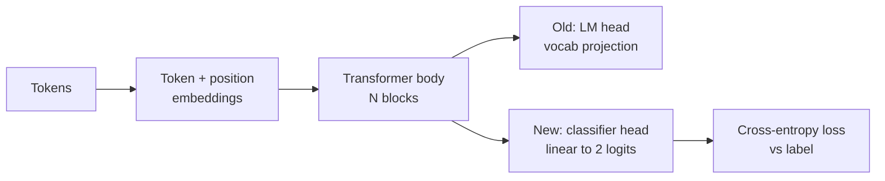
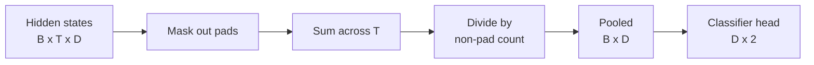
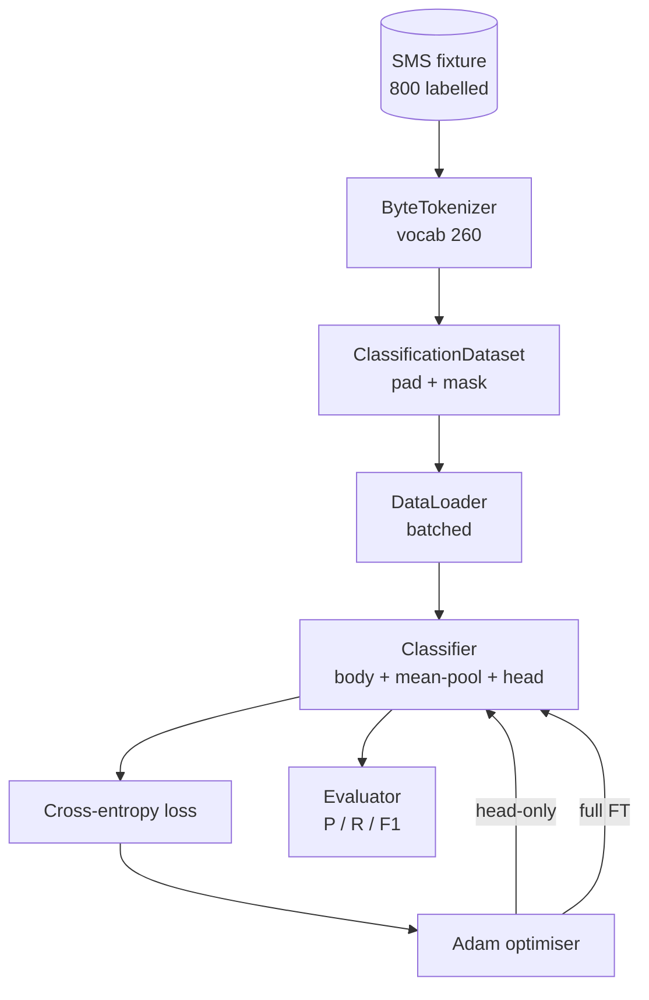

# Capstone Dersi 38: Baş Çıkarma yoluyla  sınıflandırıcı Yapımcılık

> Track B'nin ilk baş taşı。Eğitimli dil modeli ise bir üstü kendi kendine dikkat blokları, sonucu simge-böylece başıdır。Spam vs ham yapmak istediğinde başı yanlış, ama vücut 基本は对的。本课会解散頭,把一二級線形層 接到集成表示上,并用两种方式训练类别:

**Type:** Build
**Languages:** Python (torch, numpy)
**Prerequisites:** Phase 19 lessons 30-37 (NLP LLM track: tokenizer, embedding table, attention block, transformer body, pre-training loop, checkpointing, generation, perplexity)
**Time:** ~90 minutes

## Öğrenme Hedefleri

- Yeniden başlatılmamış bir vücut durumunda, dil model başını sınıflandırma başlığı olarak değiştirin.
- 实现两种训练模式:
- 构建 tokeniser-aware data pipeline,负责填充、面具填充,并对 Attention output做pooling──
- Çekil logitlerden  hesaplama doğruluğu、 bellek、F1 和 karışıklık matrisi。
- 推理参数 、訓練時間 和 headroom  arasındaki değişim ⋅

## Sorun

Siz generiği korpus üzerinde önceden eğitilmişsiniz  küçük bir transformatör. Çıktım başlığı son gizli durumu 投影 1000-token sözlüklere kadar 投影します. Şimdi sizin 800 条 spam veya ham için işaretlenen SMS mesajlarınız var. Bir ikili sınıflandırıcı oluşturmak için umut ediyorum. Burada üç seçenek vardır.

错误选择是基于800个例子从零训练一个新类型化器――训练有素模型的体体――已编码了有用结构:word identity、position、simple co-occurrence――丢失它就是浪费构建它时消耗的计算――

两个正确选择是头交换 后结体,以及头交换 后让身体可训练――Tükenli eğitim 快速,memory 几乎免费,在这么少的数据上也不太容易过fits──Tüm ince ayarlama 更慢,在小数据上可能过fit,但当下游域 偏离预训体 时可以达到更高的精度──

Bu ders aynı anda iki kişiyi oluşturur, böylece aynı zamanda aynı kıyasla bir şekilde görebilirsin.

## Anlaşım



Model bir fonksiyon:`f_theta(tokens) -> hidden_states`Baş bir fonksiyon:`g_phi(hidden) -> logits`Baş değiştirmek, saklanmak anlamına gelir.`theta`Ve değiştirdi`g_phi`Bedenin parametreleri pahalı bir bölümdür.

İki grup eğitimli parametreler  çok önemli:

- `theta`(vücut): Her dikkat bloğunun içinde milyonlarca ağırlık vardır.
- `phi`(başlı):`hidden_dim * num_classes`Ağırlıklar bir tarafa eklenir.

Sadece baş eğitiminde, hedeflenmişsin.`phi`计算 gradients,并让 `theta`PyTorch                                                                                                                                                                                                                                                                                                                                                                                                                                                                                                                          `requires_grad=False`Bunu yapabilmek için, başı, vücudu, donmuş kalmasını daha iyi görüyorum.

Tam ince ayarlama sırasında, gradientlerin tüm yığın boyunca akmasına izin verir. Bedenlerin ağırlıkları, uygun olarak hareket eder.

## Toplantı Sorusu

Sınıflayıcı  her dizi için bir vektör gerektirir, her bir simge için bir vektör değil.

- **Mean pool**Dikkat maskası:                                                                                                                                                                                                                                                            
- **CLS pool**Önceki: Önceki: Bir özel token, sadece çıkışını kullanıyor.
- **Last-token pool**GPT sınıflandırıcılarının uygulamasıdır.

Bu ders, açık bir dikkat maskası ağırlığı ile kullanılır.



## Veriler

800 SMS mesajı, 400 spam ve 400 ham, hepsi burada.`code/main.py`Orta belirleyici 生成──Jenerator Fixed seed kullan, şablonları seç ve slot dolgularını değiştir, 5 ila 25 token arasındaki mesajların uzunluğu çıkar. Gerçek veri kümeleri Bu ayar ışıksız olacaktır. Faktürün odak noktası yeniden üretilebilirlik olacaktır.

Veriler 按 80/20 split:640 tren,160 test。 Split 使用 stratified, therefore test set 保持 50/50 balance。one balance 已知的 held-out set 能让精度 和回忆 被当作可信数字 解读。

## Metrikler

Binary Classification 中 class 1 is positive class(spam)。计数如下:

- `TP`:预测为spam,实际就是spam──
- `FP`Spam için, aslında hamdır.
- `FN`Aslında spam.
- `TN`Önceki yazı:

Üç başlık ölçüsü:

- `precision = TP / (TP + FP)`❖ Spam olarak işaret edilen mesajlar arasında, spam oranı ne kadar?
- `recall = TP / (TP + FN)`◊ Gerçek spam'de, modelin belirtildiği oran ne kadar?
- `F1 = 2 * P * R / (P + R)`◊ 2. kişinin harmonik ortalaması

Kafası karışıklık matrisi, dört sayı 2×2 çizgi olarak basılacak.


```figure
cap-classifier-head-swap
```

## Mimarlık



Vücut çok küçük bir transformatör: vokal 260 ̊ gizli 64 ̊4 baş ̊ 2 blok ̊ maksimum dizisi 32 ̊ ̊ ̊ ̊ ̊ ̊ ̊ ̊ ̊ ̊ ̊ ̊ ̊ ̊ ̊ ̊ ̊ ̊ ̊ ̊ ̊ ̊ ̊ ̊ ̊ ̊ ̊ ̊ ̊ ̊ ̊ ̊ ̊ ̊ ̊ ̊ ̊ ̊ ̊ ̊ ̊ ̊ ̊ ̊ ̊ ̊ ̊ ̊ ̊ ̊ ̊ ̊ ̊ ̊ ̊ ̊ ̊ ̊ ̊ ̊ ̊ ̊ ̊ ̊ ̊ ̊ ̊ ̊ ̊ ̊ ̊ ̊ ̊ ̊ ̊ ̊ ̊ ̊ ̊ ̊ ̊ ̊ ̊ ̊ ̊ ̊ ̊ ̊ ̊ ̊ ̊ ̊ ̊ ̊ ̊ ̊ ̊ ̊ ̊ ̊ ̊ ̊ ̊ ̊ ̊ ̊ ̊ ̊ ̊ ̊ ̊ ̊ ̊ ̊ ̊ ̊ ̊ ̊ ̊ ̊ ̊ ̊ ̊ ̊ ̊ ̊ ̊ ̊ ̊ ̊ ̊ ̊ ̊ ̊ ̊ ̊ ̊ ̊ ̊ ̊ ̊ ̊ ̊ ̊ ̊ ̊ ̊ ̊ ̊ ̊ ̊ ̊ ̊ ̊ ̊ ̊ ̊ ̊ ̊ ̊ ̊ ̊ ̊ ̊ ̊ ̊ ̊ ̊ ̊ ̊ ̊ ̊ ̊ ̊ ̊ ̊ ̊ ̊ ̊ ̊ ̊ ̊ ̊ ̊ ̊ ̊ ̊ ̊ ̊ ̊ ̊ ̊ ̊    ̊ ̊     ̊                                                                                `pretrain_quick`Biraderin bir tek ders üzerinde beş dönem LM eğitimini yaparak, vücudun bir sıra dışı başlangıç noktası olmasına yardımcı olur.

## Ne yapacaksın?

Uygulama `main.py`Üzerinde bir test modülü var.`code/tests/test_main.py`)。

1. `ByteTokenizer`:把字节 映射到 ids,并保留一个pad id──
2. `Block`Bir tane Multi-Head Attention, bir tane Transformer Bloku.
3. `LMBody`:Token + position Embeddings 加上一叠块──返回隐藏状态──
4. `MeanPool`: sekans eksesi boyunca yapın maske ağırlıklı ortalama
5. `Classifier`:body、pool、linear head──Body in different regimes in the middle is the same instance──:Body in different regimes is the same instance──:Body in different regimes in the middle is the same instance──:Body in different regimes is the same instance──:Body in different regimes is the same instance──:Body in different regimes is the same instance──:Body in different regimes is the same instance──:Body in different regimes is the same instance──:Body in different regimes is the same instance──:Body in different regimes is the same instance──:Body in different regimes is the same instance──:Body in different regimes is the same instance──:Body in different regimes is the same instance
6. `freeze_body`和 `unfreeze_body`: beden parametrelerini değiştir  上 `requires_grad`- Evet.
7. `train_classifier`: bir paylaşım döngüsü, bir alım modeli, bir de mevcut eğitimli parametreler grubu, bir optimizer,
8. `evaluate`:运行 test set 并返回 `Metrics(precision, recall, f1, confusion)`- Evet.
9. `run_demo`Önceden: Önceden: Önceden: Önceden: Önceden: Önceden: Önceden: Önceden: Önceden: Önceden: Önceden: Önceden: Önceden: Önceden: Önceden: Önceden: Önceden: Önceden: Önceden: Önceden: Önceden: Önceden: Önceden: Önceden: Önceden: Önceden: Önceden: Önceden: Önceden: Önceden: Önceden: Önceden: Önceden: Önceden: Önceden: Önceden: Önceden: Önceden: Önceden: Önceden: Önceden: Önceden: Önceden: Önceden: Önceden: Önceden: Önceden: Önceden: Önceden: Önceden: Önceden: Önceden: Önceden: Önceden: Önceden: Önceden: Önceden: Önceden: Önceden: Önceden: Önceden: Önceden: Önceden: Önceden: Önceden: Önceden: Önceden: Önceden: Önceden: Önceden: Önceden: Önceden: Önceden: Önceden: Önceden: Önceden: Önceden: Önceden: Önceden: Önceden: Önceden: Önceden: Önceden: Önceden: Önceden: Önceden: Önceden: Önceden: Önceden: Önceden: Önceden: Önceden: Önceden: Önceden: Önceden: Önceden: Önceden: Önceden: Önceden: Önceden:

## Neden karşılaştırma önemlidir?

Başlı başına rejim genellikle daha hızlı, daha düz bir şekilde çalıştırılır. Bu ayarlı zamanda, başlı başına çalıştırılır.

Bu ders size sayıları ve maliyetleri anlamanızı öğretir. 800 örnek ve küçük vücut için, sadece başlı doğru seçimdir. 80.000 örnek ve daha büyük vücut için, tam ince ayarlama.`train_classifier`Birlikte sadece bir çağrı yapın.

## Hedefleri belirle

- 添加第三种政制,只解凍 最后一个块──这有时被称为部分细调──它比全FT 成本更低,比头只学得更多──
- 添加学习率调度器──对头 用kosine调度,并对身体 使用更小的常率,是常见生产设置──
- Uzal öğrenilmiş dikkat havuzu  değiştirilmiş ortalama birleştirme: bir带有一个学习查询的小注意层──在更长的序列上它通常优于平均池──

Uygulama sana haklar verdi. Testler anlaşmayı sabitledi.
