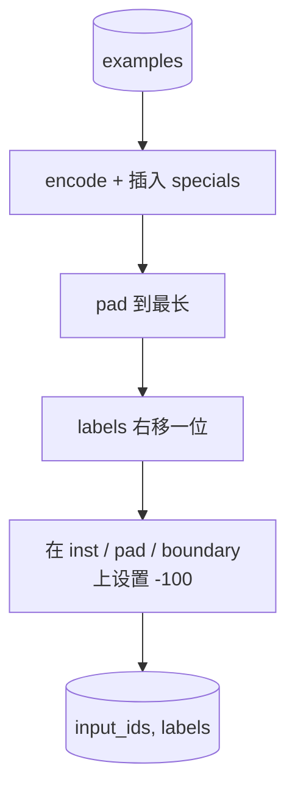

# Capstone 课程 39: Gözetimli ince ayarlama yoluyla  talimat ayarlama yapın

> Önceden eğitilmiş temel model bir diziyi sürdürür, ancak bir yönlendirmeyi takip edemez. Gözetimli ince ayarlama bu noktadan en az bir değişikliktir: model  giriş talimat ve beklenme yanıtı 配对组成的样本,并训练主体来预测响应代币――关键在于你只希望输出计算响应,而不是指示――本课将构建一个阿尔帕卡风格的SFT循环,其中包含自定义拼接函数,用`ignore_index=-100`屏蔽 instruction tokens,在200 个 instruction-response pairs 上训练,并使用精确匹配在持久的分分上评估──

**Type:** Build
**Languages:** Python (torch, numpy)
**Prerequisites:** Phase 19 lessons 30-37 (NLP LLM track: tokenizer, embedding table, attention block, transformer body, pre-training loop, checkpointing, generation, perplexity)
**Time:** ~90 minutes

## Öğrenme Hedefleri

- Düzgün talimat- yanıt verileri “şekil bir sebeplik sırası” olarak biçimlendirilecek.
- Bir kolat fonksiyonu oluşturun, talimat jetonlarını koruyun, çapraz entropiyi sadece cevap jetonlarını hesaplayın.
- SFT hedefi ile, küçük bir transformatör vücudu eğitmek ve değerlendirme metriklerinin değişimini gözlemlemek.
- 实现 açgözlülük 和 sıcaklık örneklenmiş jenerasyon,并遵守响应-start sınırı。
- Yaratılan tamamlamalar için hesaplama tam eşleşme.

## Sorun

Sonraki belirti tahminini kullan                                                                                                                                                                                                                                                                                                                                                                                                                                                                                                                       `"What is the capital of France?"`, bu sorunu devam ettirir veya yeni bir cümle yapar.

SFT sözleşmesi bir dizilme şablonu. Her bir eğitim örneği üç bölge içeren tek bir diziye dönüşür:

```text
<INST> What is the capital of France? <RESP> The capital of France is Paris.
```

Sınır işaretleri, eğitim sırasında saklanan özel işaretlerdir.`<RESP>` sonra her şey bir cevap, ve cevap  sadece değerlendirilmiş bir bölüm  temel modelin sonraki belirtilen amacı  hala uygundur; sadece her bir örnekte bu şekliyle bir dil üzerinde eğitilmiştir 

Ama burada bir tuzağı vardır. Eğer tüm dizini  normal çapraz entropi kaybına verirsen, sen de eğitim modelinde öngörülmüş talimat işaretleri  talimatları  belirlenmiş .

## Anlaşım


`ignore_index`Evet .`torch.nn.functional.cross_entropy`Bu bir işlev.`ignore_index`Şehir katkı 0 Kayıplar 和 0 Gradient──PyTorch 中的惯例是`-100`◊kollat fonksiyonu için her örnekte iki tenzor oluşturulur:`input_ids`(完整序列)`labels`(`input_ids`Bu bölümde eğitim pozisyonları kaplı.`-100`)。

模型在前進通過 期间看整个序列;Atensiyon instruction への出席できる──Loss 只有計算応答トークン──これは正是你想要的:指示上の条件,応答を予測する──

## Veriler

`main.py`Orta kesinlik iki yüz talimat- yanıt çiftini oluşturdu.

- Gerçek tek çekim ((X 的首都)
- aritmetik
- listeler çıkarımı
- Bir cümle özet
- kod(print, sort)
- tanımlama

Her görevde bir şablonlu talimat ve bir belirleyici yanıt vardır. Bu, basit bir tasarımı sürdürmek için tasarlanmıştır.

160 tren için bölünmüş 40 test, test seti tüm altı görev tipiyi kapsar, böylece kategoride tam eşleşme rapor edilebilir.

## Tokenizasyon ve Padding

Tokeniser byte seviyesinde ve üç özel özellikle birlikte:

- `INST_ID = 256`Etiket: Etiket talimat bölgesi
- `RESP_ID = 257`: Etiket talimat ve yanıt arasındaki sınır.
- `PAD_ID = 258`: değişken uzunluklu partilerin dolgulaması için kullanılır.

序列是 `[INST] inst_bytes [RESP] resp_bytes [PAD]*`◊ kolate fonksiyonu:

1. Her bir simge için bir işaret.
2. Bu parti içindeki her örnekli boyutunu bu parti içindeki en uzun dizinin uzunluğuna kadar uzatmak.
3. Yapımcılık`labels`= 右移一位的 `input_ids`(kötü LM hedefi), ve:
   - Nöbet alanı 替换为 `-100`- Evet.
   - 将 dolandırıcılık bölgesi 替换为 `-100`- Evet.
   - - Ben de .`RESP_ID`sınır pozisyonu 本身替换为 `-100`(你不训练模型预测 boundary token; it预测后续内容)



Şifte standart nedensel hile:`input_ids``i`预测 pozisyonu `i+1`Bu yüzden `labels[i] = input_ids[i+1]`(input 丢弃最终位置, target 丢弃第一个位置)

## Eğitim


Loop ⇒ Standard PyTorch SFT Loop──Adam, öğrenme hızı ∼3e-4~1e-3, ∼10-20 dönem boyunca çalıştırma.

Her beş dönem, döngü, bir süreli sürede bir değerlendirme geçişini gerçekleştirerek ve tam eşleşmeyi basarak.

## Nesil

eval 时,模型获得 talimat prefix `[INST] inst_bytes [RESP]`,并生成 tokens, until:

- 序列 ulaşmak `max_len`, veya
- 模型触发一个特殊 stop heuristic:连续两个句末字节(`.`- Evet.`!`- Evet.`?`)。

Bu ders açgözlülükle çözümü sağlar,并附带一个可选温度样品器──精确匹配 使用 açgözlülük,因为温度会让计变为 Stochastic──真实系统通常会样品,然后进行模糊判断;

## Tam Uygunluk Değerlendirme

Tam-tıpkı en sıkı metrik olan metriktir. Önceden verilen cevap satırı normalleştirilmiştir.

Gerçek SFT boru hattları F1 ((Dene) seviyesindeki token ile ıpkı hakim modeli  tam eşleşmeyi tamamlamak──Tam eşleşme  hala kullanılır, çünkü hiçbir fark yoktur; eğer 0.7 gösterirse, ıpkı doğru gösterdiği gibi %70'lik test talimatları ıpkı bir karakter olarak altın yanıt üretmektedir──


```figure
cc-sft-loss-mask
```

## Ne yapacaksın?

实现由一个 `main.py`Ürünleri test ediliyor.

1. `InstructionTokenizer`:带 reserved specials 的字段级编码编码指示前音或全对──
2. `make_dataset`Bu, bir çiftin üzerinde bir dizi görev türü oluşturur.
3. `SFTDataset`: her örnek için geri dön .`(input_ids, labels)`Maske hazır.
4. `sft_collate`: dinamik dolgu, yapı parti tensor, enstrüksiyonlarda 和 pad pozisyonları 上 `-100`- Evet.
5. `TinyGPT`Transformer vücudu 加 bağlı veya bağlı olmayan LM başı
6. `train_sft`:SFT döngüsü,带 per-epoch eval hooks──
7. `generate`Önceden:  sebepçi dekod yaptırmak, açgözlülük veya örneklenmek,并带 stop heuristic──
8. `exact_match`:normal bir dizileri karşılaştırma,返回 `[0, 1]`İçinde yüzer.
9. `run_demo`: yapılandırma verileri, eğitim yirmi dönem, değerlendirmek, sınıfı bölünmesi,并成功时以零 退出──

## Neden maske önemli?

没有面具,Loss 会把指示令牌当作目标――模型会学习预测指示―― bu farklı bir hedef,并将从两方面产生更差的模型――首先, model kapasitesi kullanıcı总会提供的输入的重构而浪费而浪费而浪费而浪费而浪费而浪费而浪费而浪费而浪费而浪费而浪费而浪费而浪费而浪费而浪费而浪费而浪费而浪费而浪费而浪费而浪费而浪费而浪费而浪费而浪费而浪费而浪费而浪费而浪费而浪费而浪费而浪费而浪费而浪费而浪费而浪费而浪费而浪费而浪费而浪费而浪费而浪费而浪费而浪费而浪费而浪费而浪费而浪费而浪费而浪费而浪费而浪费而浪费而浪费而浪费而浪费而浪费而浪费而浪费而浪费而浪费而浪费而浪费而浪费而浪费而浪费而浪费而浪费而浪费而浪费而浪费而浪费而浪费而浪费而浪费而浪费而浪费而浪费而浪费而浪费而浪费而浪费而浪费而浪费而浪费而浪费而浪费而浪费而浪费而浪费而浪费而浪费而浪费而浪费的的的的的.

## Hedefleri belirle

- 添加学习速率升温,随后使用神经衰退──SFT对 LR比预训更敏感──
- 添加 per token Loss logging,并绘制训练过程中的 Loss curve──注意早期时代 由模板代币(`<RESP>`、 ortak önlemler) 主导,后期 epochs 由真实答 token 主导。
- Bu değerlendirmenin BLEU-1 veya chrF'ye kadar genişletilmesi için, aynı anlamda yazılan ama cevap veren aynı modellerin doğru eşleşmesi için değerlendirilmesi gerekmektedir.
- 添加带有多轮格式化的聊天模板,并包含后续的固定上训练──

实现会给你格式合约、面具 和循环──Basis modelden talimat takipçisinin amacı 变化,就是一个拼图函数──
