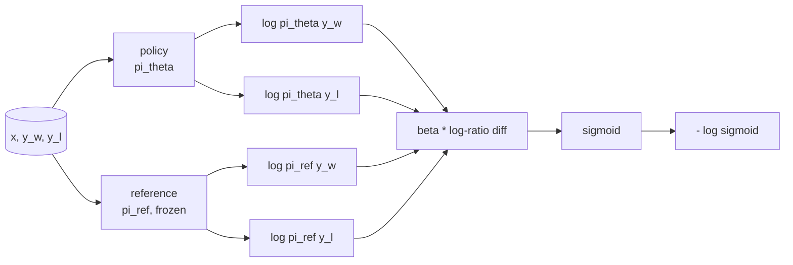
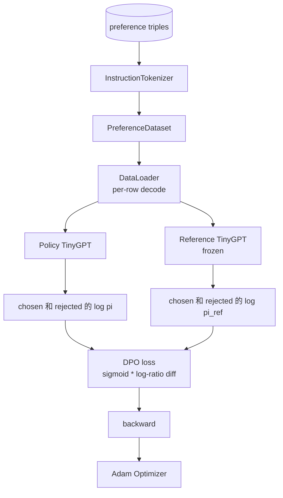

# Capstone  Ders 40: ZERO ' dan Başlangıç Direkt Tercihleri Optimizasyonu

> Ödül modelleri 和 PPO is classic RLHF stack。DPO bu stack ı ı ı ı ı ı ı ı ı ı ı ı ı ı ı ı ı ı ı ı ı ı ı ı ı ı ı ı ı ı ı ı ı ı ı ı ı ı ı ı ı ı ı ı ı ı ı ı ı ı ı ı ı ı ı ı ı ı ı ı ı ı ı ı ı ı ı ı ı ı ı ı ı ı ı ı ı ı ı ı ı ı ı ı ı ı ı ı ı ı ı ı ı ı ı ı ı ı ı ı ı ı ı ı ı ı ı ı ı ı ı ı ı ı ı ı ı ı ı ı ı ı ı ı ı ı ı ı ı ı ı ı ı ı ı ı ı ı ı ı ı ı ı ı ı ı ı ı ı ı ı ı ı ı ı ı ı ı ı ı ı ı ı ı ı ı ı ı ı ı ı ı ı ı ı ı ı ı ı ı ı ı ı ı ı ı ı ı ı ı ı ı ı ı ı ı ı ı ı ı ı ı ı ı ı ı ı ı ı ı ı ı ı ı ı ı ı ı ı ı ı ı ı ı ı ı ı ı ı ı ı ı ı ı ı ı ı ı ı ı ı ı ı ı

**Type:** Build
**Languages:** Python (torch, numpy)
**Prerequisites:** Phase 19 lessons 30-37 (NLP LLM track: tokenizer, embedding table, attention block, transformer body, pre-training loop, checkpointing, generation, perplexity)
**Time:** ~90 minutes

## Öğrenme Hedefleri

- DPO kaybını 推导为规模化日分差 上的sigmoid,并把它连接到隐含奖励──
- Referans model + politika model çiftini oluşturmak, bunlardan referans dondurulmuş, politika eğitimi mümkün olan¬¬¬¬¬¬¬¬¬¬¬¬¬¬¬¬¬¬¬¬¬¬¬¬¬¬¬¬¬¬¬¬¬¬¬¬¬¬¬¬¬¬¬¬¬¬¬¬¬¬¬¬¬¬¬¬¬¬¬¬¬¬¬¬¬¬¬¬¬¬¬¬¬¬¬¬¬¬¬¬¬¬¬¬¬¬¬¬¬¬¬¬¬¬¬¬¬¬¬¬¬¬¬¬¬¬¬¬¬¬¬¬¬¬¬¬¬¬¬¬¬¬¬¬¬¬¬¬¬¬¬¬¬¬¬¬¬¬¬¬¬¬¬¬¬¬¬¬¬¬¬¬¬¬¬¬¬¬¬¬¬¬¬¬¬¬¬¬¬¬¬¬¬¬¬¬¬¬¬¬¬¬¬¬¬¬¬¬¬¬¬¬¬¬¬¬¬¬¬¬¬¬¬¬¬¬¬¬¬¬¬¬¬¬¬¬¬¬¬¬¬¬¬¬¬¬¬¬¬¬¬¬¬¬¬¬¬¬¬¬¬¬¬¬¬¬¬¬¬¬¬¬¬¬¬¬¬¬¬¬¬¬¬¬¬¬¬¬¬¬¬¬¬¬¬¬¬¬¬¬¬¬¬¬¬¬¬¬¬¬¬¬¬¬¬¬¬¬¬¬¬¬¬¬¬¬¬¬¬¬¬¬¬¬¬¬¬¬¬¬¬¬¬¬¬¬¬¬¬¬¬¬¬¬¬¬¬¬¬¬¬¬¬¬¬¬¬¬¬¬¬¬¬¬¬¬¬¬¬¬¬¬¬¬¬¬¬¬¬¬¬¬¬¬¬¬¬¬¬¬¬¬¬¬¬¬¬¬¬¬¬¬¬¬¬¬¬¬¬¬¬¬¬¬¬¬¬¬¬¬¬¬¬¬¬¬¬¬¬¬¬¬¬¬¬¬¬¬¬¬¬¬¬¬¬¬¬¬¬¬¬¬¬¬¬¬¬¬¬¬¬¬¬¬¬¬¬¬¬¬¬¬¬¬¬¬¬¬¬¬¬¬¬¬¬¬¬¬¬¬¬¬¬¬¬
- İki model altında hesaplanan diziler seviyesinde log- olasılıkları,并 mask prompt tokens──
- - Evet .`(prompt, chosen, rejected)`Üç katı 上訓練政策,并观察 seçilmiş log-prob karşı karşısı reddedilen 上升──
- Uses tests Fixed Loss math、Gradient sign 和 reference invariance 的行为──

## Sorun

SFT modeli vardır. Bu talimatları izler, ancak çıkışı sabit değildir. Bazı tamamlamalar 清晰,有些冗长或错误── ayrıca küçük bir tercih çiftleri verisi vardır. Aynı bir istek için, insan bir tamamlama 标为 seçilir, diğer 标为 reddediler.

经典 RLHF 答案是两阶段管道――先用偏好――训练奖励模型――再用PPO 根据奖励政策――优化政策―― 这可行,但成本很高:PPO 期间内存中有两个模型,需要 KL控制让政策 接近参考,且当奖励模型 脆弱时会出现奖励黑客――

DPO, denetim altında olan bir kayıp ile bu iki aşamayı değiştirir. Ödül modeli, açıkça mevcut değil. Politikası, doğrudan tercih çiftlerinde bulunur.

## Anlaşım

Bradley-Terry modeli ile başlayın.`x`Ve iki tamamlama.`y_w`(seçilmiş)`y_l`İnsanın tercihleri .`y_w`Bu olasılıkla

```math
P(y_w > y_l \mid x) = \sigma\big( r(x, y_w) - r(x, y_l) \big)
```

İçlerinden `r`Bu bir gizli ödül fonksiyonu.`r`Sonra eğitim politikası.`pi`KL demirle en büyük ölçüde .`r`- ...

```math
\max_{\pi} \; \mathbb{E}_{x, y \sim \pi} \big[ r(x, y) \big] - \beta \, \mathrm{KL}(\pi \,\|\, \pi_{\text{ref}})
```

DPO'nun önerdiği gibi, bu amaçla en iyi politika uygulanıyor.`pi*`İşe yarayabilir.`r`写成 kapalı biçim:

```math
\pi^*(y \mid x) = \frac{1}{Z(x)} \, \pi_{\text{ref}}(y \mid x) \exp\!\left( \frac{r(x, y)}{\beta} \right)
```

- Evet .`r`Şimdiki düzenleme:

```math
r(x, y) = \beta \big( \log \pi^*(y \mid x) - \log \pi_{\text{ref}}(y \mid x) \big) + \beta \log Z(x)
```

`log Z(x)`项对 `y_w`和 `y_l`Aynı şey.`x`- Hayır .`y`), bu nedenle 时会抵消:

```math
\begin{aligned}
r(x, y_w) - r(x, y_l) = \beta \big( &\log \pi_\theta(y_w \mid x) - \log \pi_{\text{ref}}(y_w \mid x) \\
&- \log \pi_\theta(y_l \mid x) + \log \pi_{\text{ref}}(y_l \mid x) \big)
\end{aligned}
```

代入 Bradley-Terry sigmoid,并对偏好对取负记录概率:

```math
\begin{aligned}
L_{\text{DPO}}(\theta) = -\mathbb{E}_{(x, y_w, y_l)} \Big[
  \log \sigma\big( \beta \big( &\log \pi_\theta(y_w \mid x) - \log \pi_{\text{ref}}(y_w \mid x) \\
  &- \log \pi_\theta(y_l \mid x) + \log \pi_{\text{ref}}(y_l \mid x) \big) \big)
\Big]
\end{aligned}
```

Bu bir Kayıp. Bu bir simgelik bir simgeliktir. Bu kayıp dört log- olasılıktan oluşur.



## Değilme İşareti

Her antrenmanın yürütülmesinden önce bir akıl sağlığı kontrolü vardır.`log pi_theta(y_w | x)`求 Gradient:

```math
\frac{\partial L_{\text{DPO}}}{\partial \log \pi_\theta(y_w \mid x)} = -\beta \big(1 - \sigma(z)\big)
```

İçlerinden `z`Evet, Sigmoid'in argümanı.`z`Bu, seçilen tamamlama log- olasılıkları için politika geliştirmek anlamına gelir.`log pi_theta(y_l | x)`Bu nedenle, bu süreçte, bir süre sonra, bir süre sonra, bir süre sonra, bir süre sonra, bir süre sonra, bir süre sonra, bir süre sonra, bir süre sonra, bir süre sonra, bir süre sonra, bir süre sonra, bir süre sonra, bir süre sonra, bir süre sonra, bir süre sonra, bir süre sonra, bir süre sonra, bir süre sonra, bir süre sonra, bir süre sonra, bir süre sonra, bir süre sonra, bir süre sonra, bir süre sonra, bir süre sonra, bir süre sonra, bir süre sonra, bir süre sonra, bir süre sonra, bir süre sonra, bir süre sonra, bir süre sonra, bir süre sonra, bir süre sonra, bir süre sonra, bir süre sonra, bir süre sonra, bir süre sonra, bir süre sonra, bir süre sonra, bir süre sonra, bir süre sonra, bir süre sonra, bir süre sonra, bir süre sonra, bir süre sonra, bir süre sonra, bir süre sonra, bir süre sonra, bir süre sonra, bir süre sonra, bir süre sonra, bir süre sonra, bir süre sonra, bir süre sonra, bir süre sonra, bir süre sonra, bir süre sonra, bir süre sonra, bir süre sonra, bir süre sonra, bir süre sonra, bir süre sonra, bir süre sonra, bir süre sonra, bir süre sonra, bir süre sonra, bir süre sonra, bir süre sonra, bir süre sonra, bir süre sonra, bir süre sonra, bir süre sonra, bir süre sonra, bir süre sonra, bir süre sonra, bir süre sonra, bir süre sonra, bir süre sonra, bir süre sonra, bir süre sonra, bir süre sonra, bir süre sonra, bir süre sonra, bir süre, bir süre, bir süre, bir süre, bir süre sonra, bir süre, bir süre, bir süre, bir süre, bir süre, bir süre, bir süre, bir süre, bir süre, bir süre, bir süre, bir süre, bir süre, bir süre, bir süre, bir süre, bir süre, bir süre, bir süre, bir süre, bir süre, bir süre, bir süre, bir süre, bir süre, bir süre, bir süre, bir süre, bir süre, bir süre, bir süre, bir süre, bir süre, bir süre, bir süre, bir süre, bir süre, bir süre, bir süre, bir süre, bir süre, bir süre, bir süre, bir süre, bir süre, bir süre, bir süre, bir süre, bir süre, bir süre, bir

## Veriler

Bu derste 12 tercih üçlü vardır.`(prompt, chosen, rejected)` seçilmiş tamamlama 短且精确── redded 冗长、偏题或错误── bu çiftler 覆盖与教学39 相同任务族(rektör、算术、list), bu nedenle SFT tabanından 开始的政策会有一个合理起点──

DPO'nun üretiminde milyonlarca çift kullanımı vardır. Burada önemli olan, küçük bir veri kümesi üzerinde çalışabilmek ve seçilen ve reddedilen log-prob boşluğu belirgin bir şekilde artmak olacaktır.

## Referans Değişiklikleri

DPO 实现 olması gerekir dikkatli bir referans modeli işlemek 参照は固定不動の SFT modeli ◊ üç niteliği karşılamak gerekir:

- Referans parametreleri asla gradient almaz.
- Referans log- olasılıkları çağlar arasında asla değişmez.
- politika ile referans  Start `theta`Bu, bir referans olarak tanımlanmış bir başlangıçtır.

Bu nitelikleri aşağıdaki şekilde zorla gerçekleştirmek:

- Ön geçişleri 期间用 `torch.no_grad()`Bu bir referans.
- Her referans parametre için  ayar`requires_grad=False`- Evet.
- Referans yapımından sonra, geçiyor.`policy.load_state_dict(reference.state_dict())`Yapım politikası.


```figure
cap-dpo-preference
```

## Mimarlık



Model ve ders 39 İçinde kullanılan TinyGPT 相同(decoder-only、causal、byte tokeniser) ⋅reference 和 policy 共享架構; training period policy's weights from reference 发生 drift, while reference 保持 fixed──

## Ne yapacaksın?

实现由一个 `main.py`Ürünleri test ediliyor.

1. `InstructionTokenizer`:带 `INST`和 `RESP`Özellerin bayt simgesi.
2. `TinyGPT`Bu yüzden hemen seni 39'dan atlatır.
3. `make_preferences`Geri dön .`(prompt, chosen, rejected)`Üç katı.
4. `sequence_log_prob`:给定 model、prompt prefix 和 completion, return completion 上 next-token log-probabilities 的总和(不包含 prompt-position contribution) 』
5. `dpo_loss`Dört log- olasılık ve`beta`, örnek başına kayıp tensörü geri getirmek ve kayıt için kullanılacak içerikli ödül delta¬ı
6. `train_dpo`:epoch döngüsü, politikada 和 referans 下計算 seçilen ve reddedilen log-probs, uygulaması Kayıp,并执行 Adam adım。
7. `evaluate_margins`:在任意时时返回 politikası 下 seçilen redded log-probability marginı anlamına gelir
8. `run_demo`Bir küçük ısınma öncesi trenden  yapılandırma referansı 和 politika, kopya ağırlıkları, antrenman otuz adım, baskı adım başına Kayıp 和 marj,并成功时以零 退出──

## DPO'nun neden işe yarıyor

Bradley-Terry tercih modeli altında, DPO matematikte RLHF'ye eşit, sadece ödül parametreleşmesi ve dolaylı ödüller arasında fark vardır.`r(x, y) = beta * (log pi(y|x) - log pi_ref(y|x))`Seçenekler arasında tanınır, en fazla farklı bir hakkında `x`KL kısıtlaması yapısal bir eklemedir:`pi`                                  `pi_ref`Bu nedenle, politikalar çok uzakta ılımlı dereceleri  Referans sizin güvenlik ağınız 

## Hedefleri belirle

- Log-probability sum Add length normalization: Except for completion length。Length bias is a known DPO failure mode, model will prefer prefer shorter completions, because their log-probabilities are greater on the absolute value。
- 添加 Loss'ın IPO varianti:用 `(z - 1)^2`替代 sigmoid + log──比较它在固定上的融合──
- 添加一个标签-smoothing参数,在硬选择拒绝标签和统一 0.5 之间插值──
- Daha küçük, daha ucuz modeller değiştirmek için referans

实现会给你 Loss、引用不变 和训练循环──数学本课的核心──代码 让数学 具体化──
