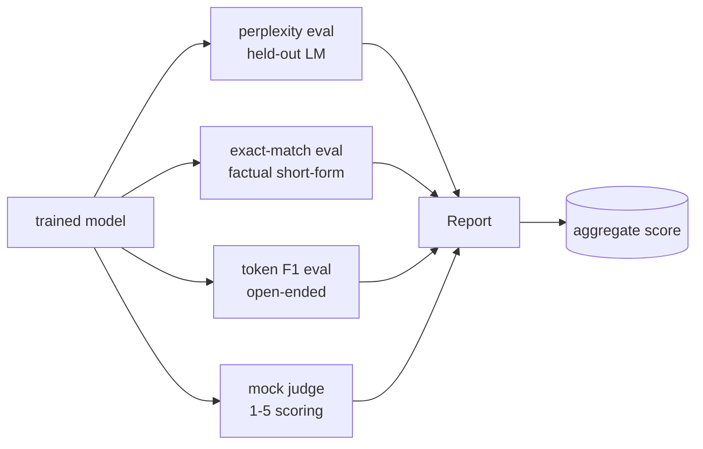
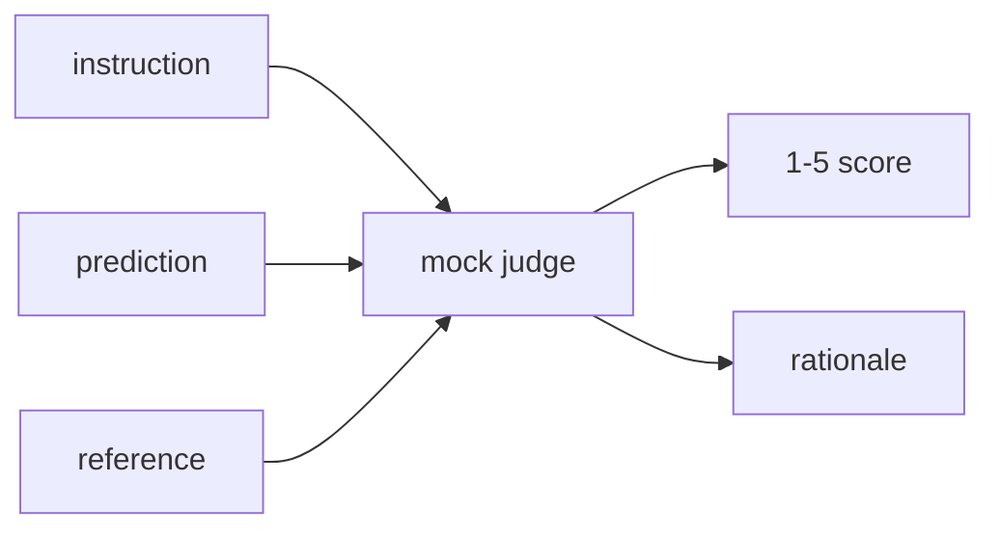
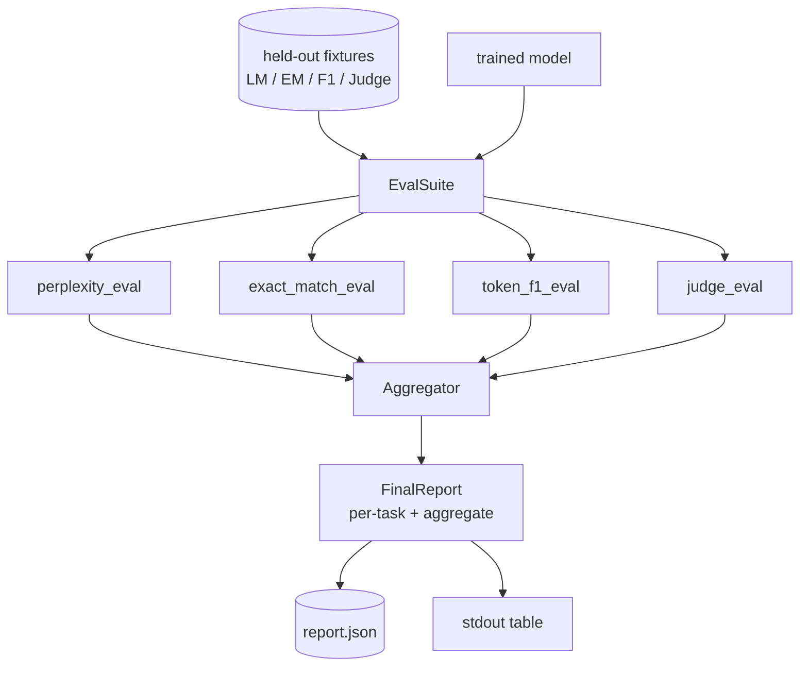

# Capstone Dersi 41: 完整 Değerlendirme Kökü

> Evalüasyon, bir bütünlü değerlendirme borusunu oluşturacaktır. Bu ders, uygun bir dil modelini oluşturacak, üzerinde dört farklı değerlendirme biçimi uygulayacak, sonuçları görev ayrımı raporu olarak bir araya getirecek ve yerel bir LLM-as-judge raporu sunacak. Tüm döngü çalışmasını sağlayacak.

**Type:** Build
**Languages:** Python (torch, numpy)
**Prerequisites:** Phase 19 lessons 30-37 (NLP LLM track: tokenizer, embedding table, attention block, transformer body, pre-training loop, checkpointing, generation, perplexity)
**Time:** ~90 minutes

## Öğrenme Hedefleri

- Küçük bir transformatörde maskeli simgeler kullanılarak kalkulüran karmaşıklık hesaplanır.
- Bu yüzden, bu konuda bir şey yapmamalıyız.
- 通过正常化 计算预测与参考 字符串之间的令牌级 F1──
- Bir yerel bir yargıç olarak LLM'yi oluşturmak için 1-5 payı kullanın.
- Dört değerlendirmeyi birleştirerek görev başına ayrılmış tek bir güçleme raporu oluşturmak.

## Sorun

单一指标 永远无法描述一个语言模型――语言分布的适应程度对语言分布的解释模型的困惑性,但不说明它是否能回答问题――Tacık eşleşen 说明模型 是否产出金字符串,但会惩罚正确的改写――Token F1 会宽容抛词,却可能被错误内容中的词汇重叠 欺骗――LLM-as-judge 能捕捉定性维度,但成本高且随机性――

Gerçekten istediğiniz boru hattı aynı zamanda bu dört yeteneğe sahiptir. Her değerlendirme diğer değerlendirmeyi kapsar. Kayıp olan bir boyut vardır. Her değerlendirme bu metrik için tasarlanmış farklı veri kapsamında çalışır. Son rapor, her görevi rakam ve toplam olarak gösterir.

Bu ders, bu boru hattını bir dosyanın ortasında inşa edecek.

## Anlaşım



Her değerlendirme bir birimdir .`(model, dataset) -> EvalResult`Bu işlemin sonuçları, kontrol için kullanılan metrik değerleri, örneğe göre ayrıntıları ve toplamın adı içerir.

## Kafası karışık, doğruca sayılır

Kafası karışıklıklı .`exp(mean negative log-likelihood per token)`❖ gerçekleştirmek iki tuzağın içindedir:

-  mean  gerçek Token pozisyonlarına dayalı olmalıdır, seri * sırası değil.
- model 预测下一个 Token,所以位置 `i`预测位置 `i+1`Bu birer birer  hata                                                                                                                                                                                                                                                                                                                                                                                                                                                                                                                       

The evaluation will be per batch  hesaplama pad olmayan pozisyonlar   `-log p(token)`总和与Token count,最后再相除── This is compared to average per-batch perplexities 更数值安全(后者会低估短序列的权重),并且符合教科书的定义──

## Normalleşme ile tam eşleşme

Harness 会在比较前 Normalleştirme tahminleri

- Küçük harflerle çevirilmiştir.
- İlk beyaz alanı yok et.
- İçeriye sürekli beyaz alanlar  tek bir alan olarak katlanır.
- Eğer iki tarafı sadece noktalama nedeniyle farklı ise,`.`- Evet.`!`- Evet.`?`)。

Normalleşme 让精确匹配 在实践中有用──model说 `"Paris"`Evet, evet.`"Paris."`Ben de öyleyim.`"  paris  "`Ve bu metrik hala normallaşmayı gerektiriyor.

## F1 simgesi, doğru yolu.

F1 simgesi simgeler çanta  hesaplama doğruluğu ve geri çağırma harmonik anlamı temelinde vardır.

1. Normalleştir tahmin 和 referans((((tıpkı aynı kurallarla)
2. 列表 (White Space Tokenization)
3. 统计 çoklu kesim.
4. Kesinlik = `intersection_count / len(pred_tokens)`❖ Hatırlat = `intersection_count / len(ref_tokens)`◊ F1 = Harmonik ortalama

Eğer tahmin ve referansı 都为空,F1 为 1(vacuous match) ・・・ Eğer sadece bir tarafı为空,F1 为 0。 bu model SQuAD değerlendirme referansına uygunsa,并能在表文上产生稳定数字──

## Yerel Sahte Yargıçlık Yüksek Lisansı

Gerçek yargıç API                                                                                                                                                                                                                                                                                                                                                                                                                                                                                                                         `{1, 2, 3, 4, 5}`Bir puan ve bir rasyon.

- Eğer normal tahmin normal referans gibidirse, 5
- Eğer tahmin ile referans  arasındaki F1 tokeninin en az 0.8'i ise 4'üdür.
- Eğer F1 simgesi varsa .`[0.5, 0.8)`, 则为 3
- Eğer F1 simgesi varsa .`[0.2, 0.5)`,则为2
- Diğer durumlar: 1

Bu gerçek bir yargıç değil, ama doğru bir arayüzü vardır.



## Toplantı

Toplam, normal değerlendirme puanlarının ağırlıklı ortalamasıdır.`[0, 1]`Orta sayı:

- Kafası karışık: normalleşmek`1 / (1 + log(perplexity))`                                                                                                                                                                                                                                                              
- Tam eşleşme: zaten var`[0, 1]`İçeride.
- F1 simgesi:`[0, 1]`İçeride.
- Yargıç: 5'den fazla.

Ağırlıklar yapılandırılabilir──默认组合是0.2 karışıklık、0.3 kesin eşleşme、0.3 token F1、0.2 hakim── Ağırlıklar seçimi bir ürün kararıdır; 本课暴露这个button,方便你实验──


```figure
cg-eval-quadrant
```

## Mimarlık



`EvalSuite`Bu çok basit bir orkestratör. Her bağımsız değerlendirme bir ücretsiz işlevdir.`(model, tokenizer, dataset, config)`Geri dönmedi .`EvalResult`- Evet.`Aggregator`收集结果并生成最终报告──demo 会打印表格,并写入一个JSON副本,供下游CI摄入──

## Ne yapacaksın?

实现一个 `main.py`- Testler.

1. `TinyGPT`:lections 38-40 中使用的同一个单独解码架构,内置在本课中以便独立运行──
2. `InstructionTokenizer`:带 INST / RESP / PAD özellerinin bayt tokenizerı。
3. Dört düzeltme:LM corpus、EM set、F1 set 和 judge set──
4. `perplexity_eval`: Return contains perplexity value 和 per-token kaybı histogram of `EvalResult`- Evet.
5. `exact_match_eval`: geri dönüş ortalama EM 和 örnek kayıtları için
6. `token_f1_eval`: Return mean token F1 和 örnek başına kayıtlar。
7. `mock_judge`和 `judge_eval`Örnek skorı: örneği değerlendirme ile, aynı zamanda bu setin ortalama puanı.
8. `Aggregator.normalise`::eval normallaşma kuralı
9. `Aggregator.aggregate`: ağırlıklı ortalama 和组装后的报告。
10. `run_demo`Kısa süreli eğitim: Küçük bir model, tüm dört değerlendirme, baskı rapor tablosu, JSON'a yazılmak, başarıyla sıfırdan çıkmak.

## Rapor okuyuyor

Rapor üç katlı, en üst katlı toplam puanı içerir. Aşağıda dört adet değerli rakam vardır. Aşağıda, teşhis için kullanılan örnek başına ayrıntılar vardır. Başarısız bir CI çalışması genellikle toplam gerektirir.

JSON dump, sabit anahtarlar kullanın, CI destibordunun trend çizgilerini çizmesini sağlayın.

## Hedefleri belirle

- 添加校准评估:model'in softmax olasılığı 否匹配其精度?
- 添加强度 eval:给每一个例子 标注扰乱(typo、paraphrase、distractor),并报告每类扰乱的度数下降──
- HTTP çağrısı 后面的真实模型 替换假判定──函数签名 不变──
- 添加 per task weight learning: 不使用固定 weights,而根据模型上的目标偏好顺序 拟合体重──

Bu uygulamada size dört çeşit değerlendirme agregatörü ve rapor verilir. Gerçek değerlendirme boruları, üzerinde daha fazla boyut oluşturur.
