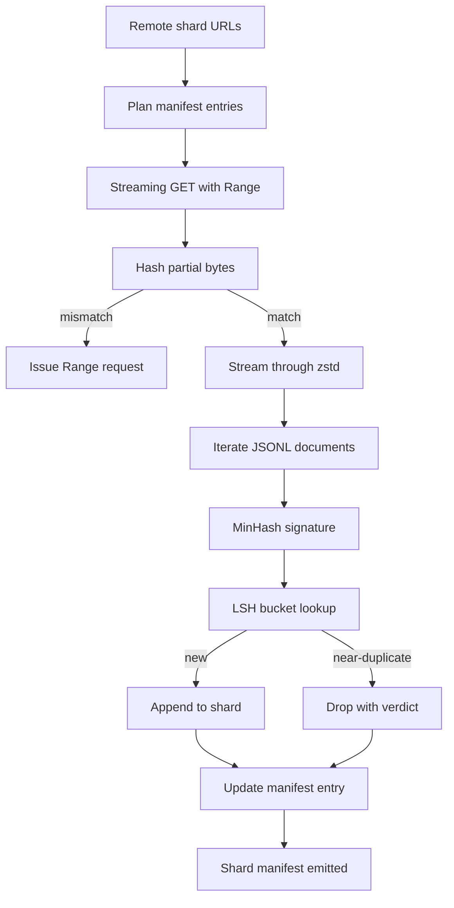

# Büyük Corpus Downloader

> 訓練言語モデル 早在第一次前進パス 之前就開始了──corpus 必須落至磁盤上,完成解壓縮・デプリカ化,并且可地址;在网络 4 パーセント 处断掉之前,再起故事就已经要设计好──本课会构建一个流通下载器:它拉取压缩的碎片,使用Zstandard 边下边解压缩,通过 MinHash加本地敏感的哈希为近复制生成指纹,并写的碎片 manifesto,让管道的其余部分可以信──

**Type:** Build
**Languages:** Python
**Prerequisites:** Phase 19 lessons 30-37
**Time:** ~90 minutes

## Öğrenme Hedefleri

- Kullanım`urllib`Akım uzak parçaları,并用 `zstandard`Tüm dosyaların bufferini hafızaya aktarmaktan kaçınmak için sıkıştır.
- verified byte offset için 发起 HTTP `Range`İstemler, kısmi indirmeleri yeniden başlatmak için
- Her belge için MinHash imzasını oluşturun ve LSH'yi kullanarak kopyalı kopyaları çarpışmaya hazırlayın.
- 输出包含内容 hash、byte size、document count 和 dedup verdict 的 shard manifest──

## Sorun

İlk kez 200 GB'lik bir tren sırasında, ağ %41'te koptu.`urllib`Ancak, bu iki başarısızlık noktası da, kısmi indirimi, yeniden yükleme ve ikili belge çıkarımıdır. Her ikisi de gelişmiş bir programı vardır. Her ikisi de sıklıkla atlatılır, çünkü boru hattı bir başlıyor.`requests.get`Çağırın.

Resume is a HTTP 问题──server 必须支持 `Range`, müşteri  on-disk kayıtlara göre verified offset takip, verified offset  verified offset  verified offset  verified offset  verified offset  verified offset  verified offset  verified offset  verified offset  verified offset  verified offset  verified offset  verified offset  verified offset  verified offset  verified offset  verified offset  verified offset  verified offset  verified offset  verified offset  verified offset  verified offset  verified offset  verified offset  verified offset  verified offset  verified offset  verified offset  verified offset  verified offset  verified offset  verified offset  verified offset  verified offset  verified offset  verified offset  verified offset  verified offset  verified offset  verified offset  verified offset  verified offset  verified offset  verified offset  verified offset  verified offset  verified offset  verified offset  verified of verified of verified of verified of verified of verified of verified of verified of verified of verified of verified of verified of verified of verified of verified of verified of verified of verified of verified of verified of verified of verified of verified of verified of verified of verified of verified of verified of verified of verified of verified of verified of verified of verified of verified of verified of verified of verified of verified of verified by verified by verified by verified by verified by verified by verified by verified by verified by verified by verified by verified by verified by verified by verified by verified by verified by verified by verified by verified by verified by verified by verified by verified by verified by verified by verified by veri

Deduplasyon bir imza 问题──Exact-hash dedup 会漏掉近副本:同一篇维基百科文章 带有三个不同板脚脚 出现,同一代码文件 带有不同的许可标题,同一篇博客帖的每个链接都带跟踪参数──MinHash加 LSH 能以子线性成本 捕捉这些情况──成本是每个文件一个签名,以及每个签名一个桶查找──

## Anlaşım



### Akışta `urllib`

Standart kütüphanesi`urllib.request.urlopen`Dosya benzeri nesneyi geri gönder.`zstandard.ZstdDecompressor().stream_reader`Orta,bytes net 流经 dekompresörden, tekrar belge iteratörüne girer, tamamen hiç memorie içinde materialise compressed shard veya decompressed shard── tek hafıza maliyeti çizgi tamponu、 mevcut belgenin MinHash imzası, ve LSH indeksi──

### Başvuru:`Range`

Her parça için iki dosya yaz: parça içi ve içi`.partial.json`Kontrol noktası.`verified_bytes`- Evet.`expected_size`- Evet.`sha256_prefix`(Bazı ön`verified_bytes`bytes 计算) ve kaynak URL。 start time, downloader 读取 checkpoint, on-disk bytes temelinde 重新计算 `sha256_prefix`, ve sadece yeniden hesaplanan hash 匹配时才恢复──如果哈希 错误,partial会被丢弃,下载从字节零重新开始──因为验证的字节被检查而不是被假定,所以沉默腐败不可能发生──

### MinHash artı LSH

MinHash, iki setin Jaccard benzerliğini sabit uzayla tahmin ediyor.`k`个最小 哈希 değerleri, her biri bağımsız bir 哈希 işlevi 个两个 Jaccard benzerliği 为 `s`Bu, imzalamaların herhangi bir bileşeninin üst üstelik bir olasılıkla gerçekleşmesi anlamına gelir.`s`- Evet.

Sonra LSH `k`个 bileşen 分为 `b`Bir grup, bir grup var.`r`sıralar, içlerinden `k = b * r`◊ iki belge en az bir bantta çarpışma olasılığı `1 - (1 - s^r)^b`Sana yardım edecek.`(b, r)`调优的  调优的`s`值附近形成尖 门──典型 corpus dedup                                                                                                                                                                                                                                                        `s = 0.8`,LSH araştırma literatürü kullan`k = 128`- Evet.`b = 32`- Evet.`r = 4`Bu noktaya ulaşmak.

### Sözleşme olarak parçacık manifesto

Downloader 唯一持久的输出是 manifest──manifest 按 shard 保存 URL、decompressed byte count、document count、dedup 后的独特 document count,以及最终 shard dosyasının sha256──下游Tokenization 读取 manifest,而不是目录列表──如果某个 shard 缺失或其 sha256 错误,manifest 会告诉下一阶段拒绝启动──manifest 是 data 已下载与 data 已下载和可验证 之间的决定性边界──


```figure
cap-corpus-downloader
```

## Yapın

`code/main.py`实现:

- `ShardPlanner`- 读取 shard URL 列表并生成 नियोजित manifest girişleri。
- `StreamingDownloader`- Açıkla seçeneği`Range``urllib`Akış, yazış, geçici dosya, 更新 `.partial.json`Kontrol noktası, devam et 时验证 sha256 ön semizliği
- `ZstdDocIterator`- Dosya benzeri akış olacak 包在 `zstandard.ZstdDecompressor`Bir belgesi çıkardı.
- `MinHasher`- Faksı hash tohumları kullanın `k`- bileşen imzası
- `LSHIndex`- Bend imzalar Bend çatışmaları rapor et 
- `Dedup`- 组合 hasher 和 index, her belgeyi 标记为`keep`Ya da`near_duplicate`,并附附与相一致的碎片ID──
- `ManifestWriter`-                                                                                                                                                                                                                                                                                                                                                                                                                                                                                                                             `manifest.json`- Evet.

Dosyaların altındaki demo disk üzerinde küçük bir sentetik korpus oluşturmak için kullanılır.`zstandard`Sıkıştır, geç.`file://`URL indir, ekseküde kopyalı,并打印 manifest。

- Yapma .

```bash
python3 code/main.py
```

yazı 以 sıfır 退出并印 宣言概要──

## Üretim Şekilleri

Dört örneği, bu ders gerçek bir vücut olarak genişletebilir.

**Checkpoint before write.** `.partial.json`必須在字節 追加到 shard 之前完成 `fsync`△否则电源损失 会颠倒顺序:shard bytes 在磁盘上,checkpoint 中没有它们,下一次再起点 认为验证字节比实际更少,翻译后音字节 会损坏文件──先检查点,再写──这与写前日志是同一种学科──

**Sharded LSH index.**200 GB'lık bir ölçek altında, tüm corpus'un tek LSH endeksi RAM'a girmez. İlk bant haş bölümü LSH endeksine göre, partisyonlar diske yükselir ve yalnızca yeni imzayı sorar.

**Tombstone, not delete.**Boşa çıkarılan kopyalar yargıya alacak .`near_duplicate`Ve çatışma belgelerinin parça kimliği  kayıtlı manifest içi                                                                                                                                                                                                                                                                                                                                                                                                                                                                                                               

**Per-shard sha256 in the manifest, plus a manifest sha256.**manifest 自身也会获得内容 hash──下游阶段 会在信任每分数入口 之前验证 manifest hash──没有这个机制,manifest 就是沉默攻击表面:能编辑单个文件的攻击者 可以破坏整个管道──

## Kullan

Üretim biçimleri:

- **Resume on every CI run.**CI Runner'lar efirlidir. ⋅ Downloader ⋅ her seferinde çalıştırmak için ⋅ yeni disk, ⋅ cache veya uzaktan ⋅ kurtarmak gerekir.`--cache-dir`Birinci sınıf bayrak.
- **Dedup before tokenization.**Tokenizasyon  çok pahalı. Aynı belge üzerinde iki kez çalışmak, aynı kayıp eğri için iki katlık maliyet ödemek.
- **Manifest as merge gate.**Eğitim çalışması, sabit commit'den 读取 manifest sha256。 yeni veri kümesi sürümünün 需要新的 manifest commit──code与 data 之间的链接是 git,而不是口口相传──

## Gönder

`outputs/skill-corpus-downloader.md`Gerçek proje içinde hangi URL'leri tanımlamak için  indirgenicini  kontrol noktaları dizinini  nasıl düzenleme  nasıl kullanılır  nasıl kullanılır  nasıl kullanılır`(k, b, r)`Üçlü, ve manifest, sürüm kontrolünde yerleştirilmiştir.

## Egzersizler

1. 添加 `--shingle-width`Bayrak,并测量 dedup hüküm, genişliklerinde 3、5、9 下 nasıl değişir.
2. 通过嗅探魔法字节,在 zstd 旁边添加 gzip 支持──下载器 不应要求调用者 指定代码──
3. 添加 `--resume-only`mod: Eğer kontrol noktasına ulaşmazsanız, yeni bir indirimi başlatmayı reddedin.
4. LSH indeksi  rak veya sqlite dosyasına taşınırken, 并测量 throughput ile in-memory variantı arasındaki farkı
5. Başlatma sırasında manifest ekle sha256 kontrol. Eğer disk üstündeki manifest ile `manifest.lock`İçinde açıklama hash disink, indiricisi kapatılmamalıdır.

## Anahtar Terimler

| Term | What people say | What it actually means |
|------|-----------------|------------------------|
| Shard | “一个 file” | corpus 的一个自包含 slice，拥有自己的 sha256，并作为 resume 和 dedup 的单位 |
| MinHash signature | “Fingerprint” | 一个 set 的 `k`-component sketch，其中每个 component 是该 set 上一个 independent hash 的最小值 |
| LSH band | “Bucket” | 一组 `r` 个 signature components，用作 collision detection 的单个 bucket key |
| Verified bytes | “Resume offset” | disk 上 sha256 prefix 与 checkpoint 匹配的 bytes；唯一安全的 resume offset |
| Manifest | “The index” | downloader 产出的单一 durable record，包含 content hashes |

## Daha Fazla Okumak

- [RFC 7233](https://datatracker.ietf.org/doc/html/rfc7233)- HTTP Aralık istekleri, yani devam protokolü
- [Zstandard format specification](https://datatracker.ietf.org/doc/html/rfc8478)- 让 流解压缩安全的框架格式
- [MinHash](https://en.wikipedia.org/wiki/MinHash)- 本课使用的 imzası ailesi
- [Locality-sensitive hashing](https://en.wikipedia.org/wiki/Locality-sensitive_hashing)- düşüş eşiği 背后的带 بندی方案
- 19 · 43 aşama - indirme 供给的 HDF5 tokenized corpus
- 19 · 44 aşama - Kozün programı
- 19 · 45 aşama - 消耗该时间的 AMP循环
