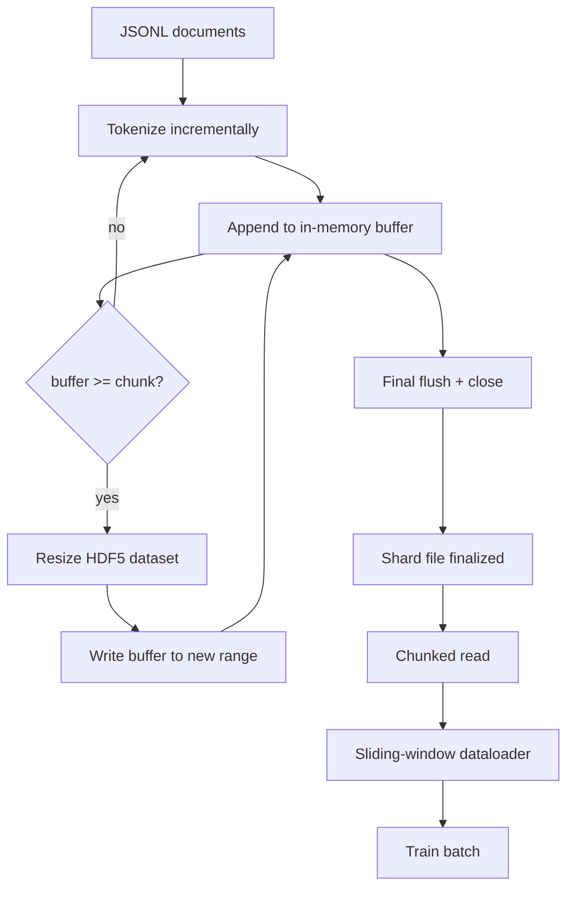

# HDF5 Tokenized 语料库

> İyi dil yazısı, bir eğitmenin gitme hızıyla okuyabilmesi için bir düzenleme yapması gerekir. Disk üzerindeki JSONL 16 veri yüklemeci işçisi değildir. HDF5'in tam sayıdaki parçalarındaki HDF5'in büyüklüğünü düzenleyebilir. Bu ders, HDF5'in büyüklüğünü düzenleyebilir şekilde tokenize etmeyi, çok sayıda dosyanın parçalanmış yazısını, eğitim sırasında parçalanmış okumalarını ve doğru paketleme ile kaydırma penceresi veri yüklemeciyi oluşturur.

**Type:** Build
**Languages:** Python
**Prerequisites:** Phase 19 lessons 30-37
**Time:** ~90 分钟

## Öğrenme Hedefleri

- Dokumenteyi bir dizi belirleyici parçalanma ile düzenlenebilir HDF5 tam sayı verisi seti olarak yazmak.
- Bir sürü HDF5 dosyasına yazılacak, başarısızlık sınırını kontrol edilebilir hale getirecek ve bu işlemleri mümkün kılacak.
- HDF5 üzerinden sayfa kaşının parçalanmış düzenini okuyun, veri yükleyiciyi sadece seri zamanında kopyoluyor.
- 规则发发出固定长度训练序列──

## Sorun

Modern dil model eğitim çalışması Onlarca işçi üzerinde gerçekleşir. Hızlıca saniyede yüz binlerce örnek okur. Diskte JSONL ilk soğuk saklama sayfasında hata yaparken çöküyor. JSON parser  çok yavaş, dosya sınırları arama yapmaz.$O(1)$Randeom erişim 平 token akışı

HDF5                                                                                                                                                                                                                                                                                                                                                                                                                                                                                                                           `tokens[3_200_000 : 3_208_192]`Bu sayfalardaki arşivler, sayfa kaşından kopyalanıp yeni dağıtılmış NumPy dizisine kadar arayan hiperlabı oluşturur.

Yapım sorunu yazılmaya hazırlıklı olmakta. Ölçülebilir veri kümeleri kolaylıkla yanlışıyla kullanılır: bir kez bir dosya yazmak, HDF5 dosyası parçalara ayırmak kullanışsız hale gelir. Bir kez tüm dosyaları yazmak, süreç ölürken tüm parçacık kaybedilmektedir.

## Anlaşım



### 正确使用 Ölçülebilir HDF5

token veri kümesi 使用 `maxshape=(None,)`Ve kesin.`chunks=(chunk_size,)`创建──写入时,将代币 缓存在长度为 `chunk_size`Buffer'de bulduğumuz zaman, veri kümesi tam olarak basılıyor.`chunk_size`扩展,并把缓冲 写入新范围──在 shard 结束时,剩余缓冲 会写入最后一个部分范围──除了最后的写入外,每次写入都是连续的和分别的;读者会根据 shard 的 HDF5属性 中记录的`token_count`Son kez yazıyorum.

### Parçalama yazısı

单个 HDF5 文件是单点故障──管线 会并行写入片段:Phase 19 lesson 42 中的每个输入片段 生成一个 HDF5输出片段──`shards.json`index 会按碎片 记录文件路、代码计数、文件计数,以及代码的 sha256──trainer 读取`shards.json`Küresel karşılamaları hesaplamak ve onaylamak için.

### Parçalama okuyucu

                                                                                                                                                                                                                                                              `swmr=True`Modu 打开自己负责的 HDF5 dosyaları,并请求 `tokens[start:stop]`△ bir kere parça 变热,HDF5'in parça düzeni bunu bir kez daha düşük maliyetli bir okuma yaptırır: h5py ⇒ bellek haritası 文件, yerine HDF5 parça kaşı ve OS sayfa kaşı 读取 tüm parçalar, tekrar tekrar isteklerin hiperslab 复制出来──worker 永远不会实现整个文件:slice将会被复制到数据载体的批量缓冲器,然后数据载体在批量时间将其复制到固定记忆训练 Tensor──热路 在每次块转换时一次系统调用;其余是 RAM 访问──

### Çekilme penceresi veri yükleyici

Dataloader, eğitim dizisinin uzunluğunun tek bildiği aşamadır.`window_size + 1`Token, sonra geri dön.`(input, target) = (tokens[:-1], tokens[1:])` Not compulsory to observe document boundaries: Bir pencere iki dosyayı geçebilir, ortasında açık bir `boundary_token_id`Bu standart paketleme kuralıdır; bu da ilk öğrenciler için kolay unutulan bir kuraldır, son elde edilen dil kütüphanesi %8 eğitim sınır simgelerinin %92 doğal metin olarak dönüşür.


```figure
cc-hdf5-corpus
```

## Yapın

`code/main.py`实现:

- `Tokenizer`- Bir bayt seviyesindeki belirleyici simgesi, demo için 足够好──接口是 `encode(text) -> list[int]`和 `vocab_size`- Evet.
- `HDF5ShardWriter`- 打開可调整大小的整数数据集, 打开代码缓冲到块大小,按固定大小步骤大小大小大小并写入,在关闭时把 打开`token_count`和 `sha256`记录为 HDF5 özellikleri。
- `ShardedTokenizationPipeline`- Giriş belgeleri üzerinden geçiyor, yazarın yanına yol açıyor, çıkıyor.`shards.json`İndeksi
- `MmapTokenStore`- 打開 shard files 进行碎片阅读(这个名字只是为了方便;h5py 读取是碎片,不是mmap 文件),计算全球抵消,暴露单个 `get_slice(start, stop)`API.
- `SlidingWindowDataloader`- Global stream 中 ランダム windows,并 yield `(input_ids, target_ids)`NumPy dizileri

Dosya tabanının demo bir çok küçük hafıza korpusunu oluşturur, iki parçaya ayırır, parça parça olarak okuyor, açar, 10 seri veri yükleyiciyi çalışır, her seri şeklini ve kontrol miktarını basar.

运行:

```bash
python3 code/main.py
```

脚本以 0 退出并印批量检查金──

## Üretim Şekilleri

Dört örneği, bu dersleri gerçek eğitim koşusuna yaymak için kullanılabilir.

**Chunk size 等于典型读取大小。**Eğitmen Her örnek 读取 `window_size + 1`个代币──把 HDF5 parça 设置为 `window_size`Çıkışın sayısı, okuyucu sayfa-kaşın düzeni, parçacık eşleşmez, her örnek iki parçaya dokunur.

**Token count 放在 attributes 中，而不是 dataset 中。**Veritabının son kısmı belki de tam olarak doldurulmamıştır, çünkü parça boyutu belgelerin sınırlarını ayırmak zorunda değildir.`token_count`作为 HDF5属性 存在数据集 上,并让读者在该值处截断──否则读者 会越过真实末尾读到零填补的代币,模型也会学会预测零──

**带 parallel verification 的 sharded sha256。**Her parça kendi simgesel baytları vardır. Sha256'ın.

**两侧都使用 `swmr=True`，writer 使用 `libver="latest"`。**Tek Yazar-Birden Okuyucu modusu              `libver="latest"`打开, önce her veri kümesini oluştur, sonra ayar `file.swmr_mode = True`                                                                                                                                                                                                                                                              `dataset.flush()`Bu şekilde kullan .`swmr=True`Açık okuyucu işçilerine uyumlu verileri görme fırsatı veriliyor.`libver="latest"`, veya SWMR'yi yapı değişiminden sonra yeniden başlatmak, "file locked" 失败的常见源──

## Kullan

Üretim biçimleri:

- **每个 source shard 一个 HDF5。**Downloader(Deneyim 42) Her URL 输出一个片;tokenization(本课) Her kaynak parça 输出一个 HDF5──1:1 haritası 让恢复 和部分故障恢复 变得简单──
- **Boundary token id。**Sınır tokeni, tokenizer sözcükünün bir parçasıdır, aynı zamanda veri yükleyiciyi kaydeten tek tokenidir. Eğer model onu göz ardı etmeliyse, eğitim kaybı, sınır tokeniyi gizleyecektir. Aksi takdirde model onu bir dizi ayırıcı olarak kullanır.
- **`shards.json` 是 source of truth。**添加新 shard 意味着写入 HDF5、计算它的 sha256,并添加一个入口──trainer 在启动时读取该文件一次,之后永远不碰目录列表──

## Gönder

Gerçek projelerde,`outputs/skill-hdf5-tokenized-corpus.md`Hangi tokenizer'in, hangi parça boyutunun, hangi trenerin penceresinin,`shards.json`Versiyon kontrolünde nerede yerleştirildiği, ve veriler yükleyici çalışanları nasıl dosyaları nasıl geçiyor,

## Egzersizler

1. HDF5 yazarına ekle`--compression gzip`Bayrak, ve demo corpus 上测量吞吐成本──为所选默认做出辩护──
2. 给滑窗数据加载 添加确定性种子,并验证相同种子的两次运行 会产生相同批量──
3. 添加 `--validate`mod,读取每个碎片,重新计算其代币的 sha256,并与 `shards.json`Bu yüzden, bu eğitimden önce çalıştırılmalıdır.
4. Parça boyutlarına göre pencerenin boyutunun yarısına göre pencerenin boyutunun iki katına göre, pencerenin boyutunun bir kısmı 吞吐── rapor sayfa-cache etkisi──
5. 添加 `--max-document-tokens`Bayrak, yazma sırasında kesinti çok uzun dosyaları.

## Anahtar Terimler

| Term | What people say | What it actually means |
|------|-----------------|------------------------|
| Resizable dataset | "Append-only" | 一个带 `maxshape=(None,)` 的 HDF5 dataset，通过按 chunk 大小 stride 调用 `resize` 增长 |
| Chunked layout | "How HDF5 stores it" | 固定大小的 on-disk blocks，HDF5 将其作为一个单元读取并缓存，因此 dataloader 能以低成本读取连续范围 |
| `swmr` mode | "Read-while-write" | Single-Writer-Multiple-Reader mode，使 dataloader workers 能安全共享文件 |
| Shard index | "shards.json" | 包含 offsets 和 content hashes 的所有 token shards 的 durable index |
| Sliding window | "Training sample" | global token stream 的固定长度 slice，trainer 会把它与 shift-by-one target 配对 |

## Daha Fazla Okumak

- [HDF5 chunking documentation](https://docs.hdfgroup.org/hdf5/v1_14/)- 本课使用的碎片化・尺寸化数据集布局
- [h5py user guide](https://docs.h5py.org/en/stable/)- HDF5 Python bağlamaları
- [h5py chunked storage](https://docs.h5py.org/en/stable/high/dataset.html#chunked-storage)- h5py  nasıl parçalara ayıklanmış veri kümelerini okur ve nasıl parçalara ayıklanmış cache ayarlanır
- 19 · 42 aşama - 输出由本课 टोकenize 的下载器
- 19 · 44 aşama - 消费这个数据包的 cosine时间表
- Eğitim aşamasının 19 · 45 aşaması
