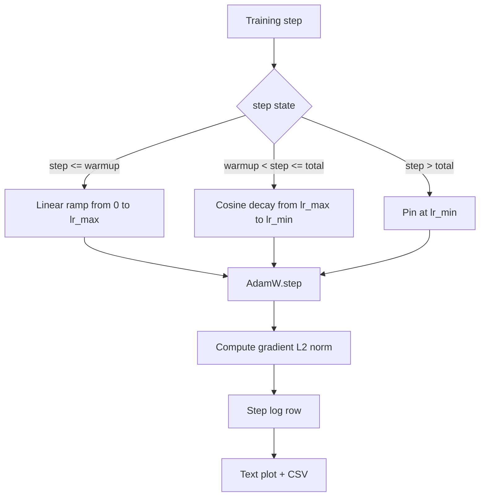

# 带 Linear Warmup 的 Cosine LR

> Öğrenme oranı programı sadece Kayıp Fonksiyonunun ikinci önemli kararıdır. AdamW, dil modelinin modern standart seçeneğidir. Çünkü modelin zayıf önceki binlerce güncelleme sırasında daha küçük etkili adım boyutlarını görmesine, aşamalı olarak konutlama zirvesine yükselmesine, daha sonra sıfır düşüşünü tekrar sıfırına yaklaştırmasına izin verir. Bu ders bu programı oluşturur, eğitim adımlarını yukarıdaki eğriyi çizer, programda 旁 记录 gradient normlarını kaydetir ve bu programı                                                                                                                                                                                                                                                                                                                                                                                                  

**Type:** Build
**Languages:** Python
**Prerequisites:** Phase 19 lessons 30-37
**Time:** ~90 分钟

## Öğrenme Hedefleri

- 实现一个AdamW Optimizer,并接入带线性变暖的共性学习率时间表──
- Bu işlemlerin değerini belirleyerek, kayarak kaymak gibi bir durumdan kaçınmak için,
- L2 normı ile öğrenme oranı arasında bir değişiklik yaparak, eğitim sağlığı durumunu gözlemleyelim.
- Programı 染为人眼可读的文本图, yanı sıra herhangi bir araç için kullanılabilir CSV 

## Sorun

Ön1 binlerce eğitim güncellemesi 最──模型的重量 仍然接近初始化──Optimiser'in yürüyüş ikinci anlık tahminleri 尚未稳定──gradyen norm 又大又噪── eğer öğrenme oranı bu güncellemeler arasında zirvedeyse, model ya da doğrudan farklılık gösterir, ya da sonsuza dek kaçmayan bir kayıp platoya düşer.──

- ...sürekli bir program var.`warmup_steps`,öğrenme oranı sıfırdan sıfır seviyeye kadar azalıyor`lr_max`❖ ından `warmup_steps`- Ne ?`total_steps`,öğrenme oranı  cosine eğri ın üst yarısında,`lr_max`衰减到 `lr_min`- Evet.`total_steps`后, öğrenme oranı 固定在 `lr_min`Bu şekilde bir yanlış düzenleme eğitmeni programdan çıkmaz.

构建问题在时间表中 很容易出现一个人. 六小时后表现为学习率 在模型开始过的时刻高出或低出 1%.

## Anlaşım



### Sıcaklık formülü

- Evet .`warmup_steps > 0`时位于 `[0, warmup_steps]``step`,öğrenme oranı `lr_max * step / warmup_steps`❖ Değişkin `warmup_steps = 0`"Sıfırdan" olarak görülen bir durum:`lr_max`Başlayın, hemen cosine çöküşe girin. Bazı test harmanları gelecektir.`warmup_steps = 0`, kontrol programı için hala kullanılabilir bir eğri oluşturabilir.

### Kosin formülü

- Evet .`(warmup_steps, total_steps]`Orta `step`,öğrenme oranı `lr_min + 0.5 * (lr_max - lr_min) * (1 + cos(pi * progress))`, içinden `progress = (step - warmup_steps) / max(1, total_steps - warmup_steps)`- Evet.`step = warmup_steps`,cosine 求值为 `cos(0) = 1`- Al .`lr_max`, 精确匹配──在 `step = total_steps`,cosine 求值为 `cos(pi) = -1`- Al .`lr_min`, çürümüş son noktaya doğru uyumlu.

İki son nokta üstün devamlılığı tesadüfen değil.`step`Bir tek fonksiyon yerine üç farklı fonksiyon yerine 拼接在一起──拼接的时间表在第一次变化`lr_max`Bir sınır kaybedeceğiz.

### Toplam adımlardan sonra zemin

- Evet .`step > total_steps`,öğrenme oranı  tutun `lr_min` sözleşme açıkça: programı rapor etmez, ekstrapolasyon etmez; yere sabitlenir, eğitmeni uyarı kaydetir, eğitmenlerin programı değiştirmesi gerekir.`total_steps`, değil modification loopı

### Birinci sınıfı norm ve oranı birleştirmek

Programı                                                                                                                                                                                                                                                                                                                                                                                                                                                                                                                            `step, lr, grad_l2_norm, loss`CSV tek kalıcı kayıt.


```figure
cap-cosine-warmup
```

## Yapın

`code/main.py`实现:

- `CosineWithWarmup`- Bir devletsiz işlev, formate for for basis config schedule of `lr(step) -> float`- Evet.
- `TrainState`- Bu bir model.`AdamW`Optimizer ve program 封装成单一步函数──
- `TrainState.step`- 运行一次前进通过一次倒退通过,记录梯度 L2 norm,并把 `lr(step)`应用到优化器──
- `plot_schedule_ascii`- 染为人眼可读的文本插图的时间表
- `write_schedule_csv`- Her adım için 输出一行学习率──

Dosyaların altındaki demo çok küçük bir yapı oluşturur .`nn.Linear`模型, 模型, 模型, 模型, 模型, 模型, 模型, 模型, 模型, 模型, 模型, 模型, 模型, 模型, 模型, 模型, 模型, 模型, 模型, 模型, 模型, 模型, 模型, 模型, 模型, 模型, 模型, 模型, 模型, 模型, 模型, 模型, 模型, 模型, 模型, 模型, 模型, 模型, 模型, 模型, 模型, 模型, 模型, 模型, 模型, 模型, 模型, 模型, 模型, 模型, 模型, 模型, 模型, 模型, 模型, 模型, 模型, 模型, 模型, 模型, 模型, 模型, 模型, 模型, 模型, 模型, 模型, 模型, 模型, 模型, 模型, 模型, 模型, 模型, 模型,                                                                                                                                                                                                                                                                                             

运行:

```bash
python3 code/main.py
```

脚本以 0 退出,并印每步训练日志 和时间表图──

## Üretim Şekilleri

4 model  can把 提升为生产文物

**Schedule 放在 config 中，而不是 code 中。**eğitmen gönderilen git'in YAML veya JSON yapılandırması 读取 `warmup_steps`- Evet.`total_steps`- Evet.`lr_max`- Evet.`lr_min`❖ Şartlılık, konfigüratörlük, içerikli olarak ele alınır; Şartlılık, kontrol edilebilir, çünkü konfigüratörlük, PR farklılığının bir parçasıdır.

**Step counter 是 monotonic，并与 epochs 解耦。**Veriler parçalanırken veya veri yükleyici yeniden başlatılırken, bazı çerçeveler bir adım ve zaman arasında bir program oluşturulur.`global_step`, yerine yerel sayıcıdan 读取──再运行 会在正确的时间表位置 位置继续,因为步数计器是持久轴──

**Schedule plot 放在 run directory 中。**Her antrenmanın bir parçası .`outputs/lr_schedule.png`(本课中的文本图片)写入其运行目录──reviewer 浏览目录时,无需重新运行任何东西就能智能检查时间──这能在 PR时间 捕获错误配置的时间表类 bug──

**Log row schema 固定。** `step, lr, grad_l2_norm, loss`,顺序如此──下游 not defteri veya arac tablosu 会读取这个方案;不弹版本就重新命名列,会让所有现有仪表板 失效──

## Kullan

Üretim biçimleri:

- **先 sweep peak，再 sweep 其他任何东西。** `lr_max`En hassas dönüm noktası. Önce küçük modelden sonra en iyi şekilde süpür.`lr_max`Model büyüklüğünde ölçeklenme  çok zayıf, bu yüzden küçük model süpürme  güçlü bir öncüdür.
- **Warmup 是 total steps 的 fraction，不是绝对 count。**Eğer sadece 2000 ısıtma adımını atarsak, neredeyse zirveye ulaşır; aynı miktarda 20 bin adım koşusu ise yüzde 10 ısınır.
- **`lr_min` 非零是有意的。**Bir tane için .`lr_max`%10'un zemin, Optimizer'ın uzun kuyruğunda öğrenmeye devam etmesine izin verecek.`lr_min = 0`Programda, bir çizelge üzerinde iyi görünen bir eğitim eğri ve aslında henüz tamamlanmamış bir eğitim modeli elde edilecek.

## Gönder

Gerçek projelerde,`outputs/skill-cosine-warmup.md`Hangi programı yapılandırıp yükleme programını, hangi eğitimci adımını ve nasıl olduğunu anlatacağım.`lr_max`Süzme 产出部署された価値──本课交付引擎──

## Egzersizler

1. 添加时间的逆正方根变化, ve 200 adım oyuncak eğitim koşusu 上对比──哪条曲线 产生更低的最终损失?
2. 添加 `--restart`Bayrak, `total_steps / 2`增加第二次暖化──为暖暖重启 在玩具运行 上是升升还是伤害做辩护──
3. 添加一个单位测试验证时间表是连续:对于 `[0, total_steps]`Orta, her adım,差值 `|lr(step+1) - lr(step)|`Öldürülmüş`lr_max / warmup_steps`- Ne?
4. Zamanlama 接入 `torch.optim.lr_scheduler.LambdaLR`, bunu çerçeve kodunun 组合──本课使用简单步骤函数;包装 改变了什么?
5. 添加 `--plot-png`Bayrak, geçiyor.`matplotlib`写出真实图――为本课的文本图 和 PNG 哪个更适合合作为CI runs 的默认做出辩护――

## Anahtar Terimler

| Term | What people say | What it actually means |
|------|-----------------|------------------------|
| Warmup | "Slow start" | 在前 `warmup_steps` 次 updates 中，从 zero 到 `lr_max` 的 linear ramp |
| Cosine decay | "Smooth drop" | 在剩余 steps 中，从 `lr_max` 到 `lr_min` 的上半段 cosine curve |
| Floor | "After training" | schedule 在超过 `total_steps` 后固定的 `lr_min` 值 |
| Gradient norm | "L2 of grads" | 拼接后的 gradient vector 的 Euclidean norm，每 step 记录 |
| Global step | "Schedule axis" | 一个能跨 restart 保留的 monotonic step counter，用于驱动 schedule |

## Daha Fazla Okumak

- [Loshchilov and Hutter, SGDR: Stochastic Gradient Descent with Warm Restarts (arXiv 1608.03983)](https://arxiv.org/abs/1608.03983)- cosine programının referans kağıdı
- [Loshchilov and Hutter, Decoupled Weight Decay Regularization (arXiv 1711.05101)](https://arxiv.org/abs/1711.05101)- AdamW'nin referans kağıdı
- [PyTorch torch.optim.lr_scheduler](https://docs.pytorch.org/docs/stable/optim.html#how-to-adjust-learning-rate)- adım fonksiyonları 如何与框架安排组合
- Eğlence 19 · 42 - 产出此表 所消费语料的下载器
- 19 · 43 aşaması - Bu programla birlikte  birlikte gelişen veri yükleyici
- 19 · 45 aşaması - gradient kesimleri 和 AMP,也就是循环的下一层
