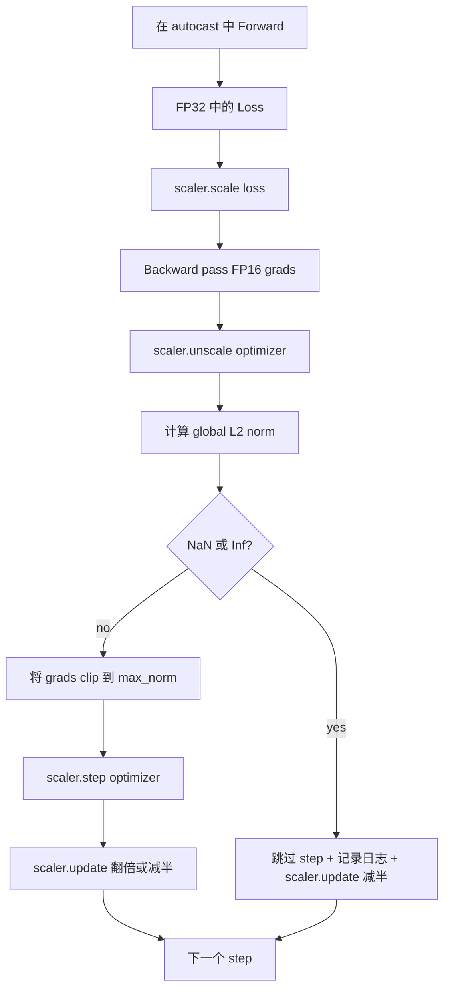

# Gradyent Kısaltma ve Karışık Precision

> Bu ders, üretim eğitiminin eksikliği için iki güvenlik kemeri vardır: Gradient Kliplemeyi iyi bir küresel L2 normuna kadar ayarlamak, ayrıca otomatik atış ve GradScaler'ın karışık hassaslık döngüsünü kullanmak, NaN ve Inf'i tespit etmek, net bir adım atmak, ve ölçekleme faktörünü kaydetmek, daha sonra analiz etmek.

**Type:** Build
**Languages:** Python
**Prerequisites:** Phase 19 lessons 30-37
**Time:** ~90 minutes

## Öğrenme Hedefleri

- 計算 tüm parametre gradientlerinin küresel L2 normunu, ve yapılandırma  değer 时原地 clip 
- Otomatik atışla GradScaler'ı toplayın. FP16'ı ileriye ve geriye geçirin.
- 检测 Loss 或 Gradient 中的 NaN 和 Inf, optimizer adımını atladı,并记录 this skip──
- Her adım  GradScaler'ın ölçekleme faktörünü rapor edin, devamlı büyük miktarda 能立刻可见――

## Sorun

Dün de temiz çalıştırma çalışma çalışması, 8.217 时 ನಷ್ಟ eğriğinde bir anda dik yukarı doğru yükseldi. Suçlu sorun bir seri, onun gradient normı 4.200'e ulaştı, bu önde gelen zirve normının 20 katıdır.

Karışık hassaslık eğitimi FP16'da yapılan ileri ve geri geçişlerin büyük bir kısmı ile, sıfır artırılır. FP16'ın gösterge aralığı çok dardır. FP16'da aşırı akışın tipik derecesi Inf'e dönüşür ve sonraki aşamada NaN'ye yayılır. Bu da bir sonraki optimizör adımına yol açar. Her ağırlığı NaN'ye koyulur.

构建问题在于正确连线――先 clip 再 unscale,值就会作用在规模梯度上;先 unscale 再 clip,GradScaler 上的操作顺序就很重要──正确顺序是:`scaler.scale(loss).backward()`Sonra ...`scaler.unscale_(optimizer)`Sonra ...`clip_grad_norm_`Sonra ...`scaler.step(optimizer)`Sonunda .`scaler.update()`Diğer tüm düzenler bir sessiz bozukluk döngüsüne neden olur.

## Anlaşım



### Küresel L2 normı

Küresel L2 norm, bir parametre standartı yerine, bir sonraki gradient vektörünün Euclidean normudur.`torch.nn.utils.clip_grad_norm_(parameters, max_norm)`Bu fonksiyon, pre-clip normuna geri döner, bu nedenle bu ders aynı zamanda doğal değer ve kesilmiş değerleri kaydedebilir, bu, teşhis için her adımı kesmekte olduğumuz için gereklidir.

### otomatik atış ve GradScaler

`torch.amp.autocast(device_type)`Bu, bir bağlam yöneticisi, FP16 ile seçim yaparak uygun işlevler gerçekleştirir.`torch.amp.GradScaler(device_type)`Bu, bir yardımcıdır, geriye döner, ön ölçek kaybı, ve optimizer adımında ön ters ölçek derecesi vardır.

Bu ders CPU otomatik yayın kullanıyor çünkü bu CI ortalama çalışacak içeriği; aynı kalıp geçebilir `device_type="cpu"`改为 `device_type="cuda"`Asal olarak CUDA'ya taşındı.

### NaN ve Inf tespit edilmesi

İlk olarak, Kayıp, geriye dönmüştür.`torch.isfinite`检查;Inf veya NaN Loss yararlı bir Gradient oluşturulamayacak, optimizer'e girecek, ön atlatılacak, sonra, sonra.`scaler.unscale_(optimizer)`Sonra, bu ders kullanılır.`has_non_finite_grad(...)`扫描未尺度梯度,并把任何inf或NaN视为跳──这些检查一起覆盖前进通过和后进通过 两类失败模式──

### Ölçekleme faktörü teşhisleri

Ölçekleme faktörü GradScaler'ın iç durumu.`scaler.get_scale()`, bunu öğrenme oranı ve gradient normı ile birleştirir. Sağlıklı çalışmalar, ölçekleme faktörünü gösterir.`2^17`Ya da`2^18`附近和── 行为异常的运行 会显示因子 在高值和低值之间振荡, 这说明模型的渐进 有时在范围内, 有时不在──不记录日志, 这诊断信号是不可见的──


```figure
grad-clip-monitor
```

## Yapın

`code/main.py`实现:

- `clip_global_l2_norm`- Evet .`torch.nn.utils.clip_grad_norm_`Çaplama, pre-clip ve post-clip normına dön.
- `has_non_finite_grad`- 扫描 Gradient 中 NaN 和 Inf'in yardımcısı──
- `AmpTrainState`- Bir model paketledi.`AdamW`Optimizeci, GradScaler ve otomatik bir döküm cihazı.`step(inputs, targets)`,运行完整的剪裁,扩展 和跳-on-NaN boru hattı
- `StepLog`和 `SkipLog`- strukturasyonun adım adım kaydı
- Bir demo, küçük bir antrenman yapacağım.`nn.Linear`model 20 个步骤,在步骤 5 向 Gradient 注入 Inf 以触发跳路,并印得到的日志──

运行:

```bash
python3 code/main.py
```

Scenario 0 退出,并印每步日记,每行标记为 `STEP`Ya da`SKIP`Bu isimlerden en az bir tanesi var.`SKIP`- Evet.

## Üretim Şekilleri

Dört örneği bu döngüyü üretim eğitim aşamasına yükseltebilirsiniz.

**Skip counter 应该是 alert，而不是一行 log。**Her eğitim süresi 跳过少量步骤 是健康的──每时出现数百次跳是硬警报:模型进入了FP16 无法承担区域,而循环 正在静默失败──本课跟踪1000-步骤滚滚跳率;生产中,如果率超过5% ,就应该页面──

**Clip threshold 放在 config 中。** `max_norm = 1.0`Bu, yeni bir dil modelinin eğitiminin öntanımlı değeri. Önce küçük model üzerinde tarama. Daha büyük bir eşiğ modelinin gerçek zorluklar arasında geri kazanılmasına izin ver. Daha küçük bir eşiğ, en kötü durumlarda, ama daha düşük bir kayıp eğri.

**Norm log 和 schedule 一起进入 CSV。**CSV sütunları `step, lr, grad_l2_pre_clip, grad_l2_post_clip, loss, skipped, skip_reason, scaler_scale`❖ Eleştirmen 打开文件后, aynı satırda şedyen görülebilir  Gradient's story、scaling factor,以及 skip outcome (含原因)  Bu sütunları 拆分多个文件中,是制造错位分析的配方──

**`scaler.update()` 每个 step 都运行，即使 skip 也一样。**Çıkışın üstü, ölçeklemeci 读取它的无inf counter,递增,并可能把因数 翻倍──在跳转阶段上,scaler 把因数 减半并重置计──忘记在跳转路上调用`update()`Bu, bir değişmemiş virüsün ölçekleme faktörü oluştuğundan kaynaklanıyor.

## Kullan

Üretim biçimleri:

- **Autocast device 匹配 optimizer device。**GPU eğitim `torch.amp.autocast(device_type="cuda")`; CPU kullanımı `torch.amp.autocast(device_type="cpu")`❖ Karıştırma cihazı, kalıcı bir hata oluşturacak.
- **Backward 前检查 Loss。** `torch.isfinite(loss).all()`Bir kez tenzor azaltılması; maliyet göz ardı edilebilir, NaN Kayıpları'nda ise, bir eğitim aşaması tamamlanmıştır.
- **`zero_grad` 中使用 `set_to_none=True`。**将 Gradient 设为 `None`Bu ayar ücretsiz bir sıfır değil, Optimizer'ın etkilenmemiş parametreler grubunun hesaplamasını yapmasına izin verir. Bu ayar ücretsiz bir sıfırlama ve hata yüzeyini azaltmaya da yardımcı olur.

## Gönder

`outputs/skill-clip-amp.md`Gerçek proje içinde eğitim adımını tanımlayın Klip eşiği kullanın ve otomatik yayın cihazı, CSV'nin sürüm kontrolü ortamındaki konum ve üretim atlama oranı uyarı eşiği nedir.

## Egzersizler

1. Gerçek kayıp tırnakı kullan                                                                                                                                                                                                                                                                                                                                                                                                                                                                                                                       
2. Bir ekle.`--bf16`mod, FP16 yerine FP16 ATAKATAKATAKATAKATAKATAKATAKATAKATAKATAKATAKATAKATAKATAKATAKATAKATAKATAKATAKATAKATAKATAKATAKATAKATAKATAKATAKATAKATAKATAKATAKATAKATAKATAKATAKATAKATAKATAKATAKATAKATAKATAKATAKATAKATAKATAKATAKATAKATAKATAKATAKATAKATAKATAKATAKATAKATAKATAKATAKATAKATAKATAKATAKATAKATAKATAKATAKATAKATAKATAKATAKATAKATAKATAKATAKATAKATAKATAKATAKATAKATAKATAKATAKATAKATAKATAKATAKATAKATAKATAKATAKATAKATAKATAKATAKATAKATAKATAKATAKATAKATAKATAKATAKATAKATAKATAKATAKATAKATAKATAKATAKATAKATAKATAKATAKATAKATAKATAKATAKATAKATAKATAKATAKATAKATAKATAKATAKATAKATAKATAKATAKATAKATAKATAKATAKATAKATAKATAKATAKATAKATAKATAKATAKATAKATAKATAKATAKATAKATAKATAKATAKATAKATAKATAKATAKATAKATAKATAKATAKATAKATAKATAKATAKATAKATAKATAKATAKATAKATAKATAKATAKATAKATAKATAKATAKATAKATAKATAKATAKATAKATAKATAKATAKATAKATAKATAKATAKATAKATAKATAKATAKATAKATAKATAKATAKATAKATAKATAKATAKATAKATAKATAKATAKATAKATAKATAKATAKATAKATAKATAKATAKATAKATAKATAKATAKATAKATAKATAKATAKATAKATAKATAKATAKATAKATAKATAKATAKATAKATAKATAKATAKATAKATAKATAKATAKATAKATAKATAKATAKATAKATAKATAKATAKATAKATAKATAKATAKATAKATAKATAK
3. 添加一个单位测试,验证在没有剪辑发生时,渐进式剪辑包装 会正确返回 pre-clip 和 post-clip 标准──
4. 添加滚窗跳速计算,以及一个CLI旗:如果速率 连续 100 个步骤 超过配置值,就让运行 失败──
5. Çapı 接到 kanonik CSV'ye`step, lr, grad_l2_pre_clip, grad_l2_post_clip, loss, skipped, skip_reason, scaler_scale`) yazmak, ve her satırın ardından flush 确认文件能在Ctrl-C 后保留下来──

## Anahtar Terimler

| Term | What people say | What it actually means |
|------|-----------------|------------------------|
| Global L2 norm | "Clip target" | 所有可训练 parameter 的拼接 gradient vector 的 Euclidean norm |
| autocast | "Mixed precision" | 在 `with` block 内，对符合条件的 operation 选择性执行 FP16（或 BF16） |
| GradScaler | "Loss scaler" | 在 backward 前乘以 Loss，并在 optimizer step 前 inverse-scale Gradient 的 helper |
| Skip | "Bad step" | 因为 Gradient 或 Loss 是 non-finite 而拒绝执行的 optimizer step；scaler 会将 factor 减半 |
| Scaling factor | "Scaler state" | GradScaler 当前的 multiplier；干净区间后翻倍，每次 skip 时减半 |

## Daha Fazla Okumak

- [Micikevicius et al., Mixed Precision Training (arXiv 1710.03740)](https://arxiv.org/abs/1710.03740)- İlk kayıp ölçekleme önerisi
- [Pascanu, Mikolov, Bengio, On the difficulty of training recurrent neural networks (arXiv 1211.5063)](https://arxiv.org/abs/1211.5063)- Gradient Klipçesi 参考论文
- [PyTorch torch.amp.GradScaler](https://docs.pytorch.org/docs/stable/amp.html)- 本课包裹的 skalar API
- [PyTorch torch.nn.utils.clip_grad_norm_](https://docs.pytorch.org/docs/stable/generated/torch.nn.utils.clip_grad_norm_.html)- 本课使用的剪裁原始
- 19 · 42 aşama - Çaplık 提供 corpus 的下载器
- 19 · 43 aşama - döngü 消耗的数据 loader
- 19 · 44 aşama - Bu döngü 组合的时间表
