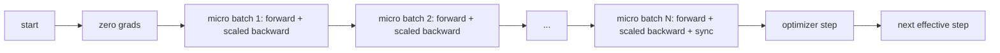
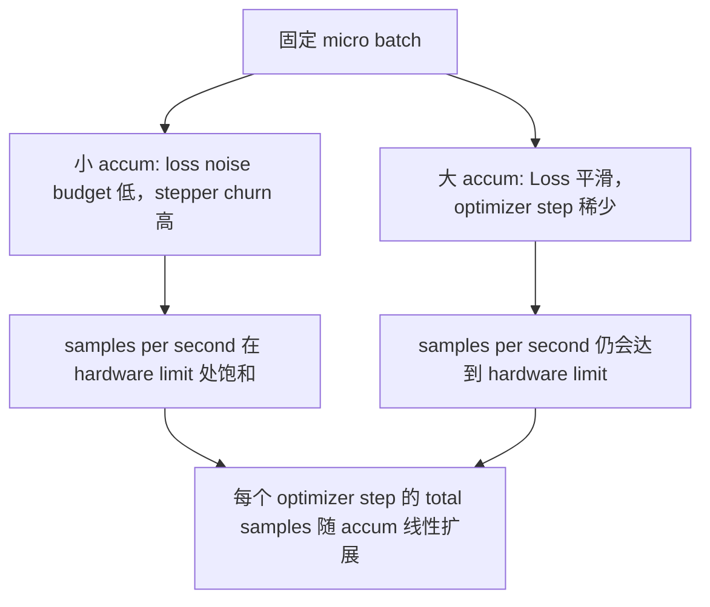

# Gelişmiş Bir Toplanma

> Bir mikro seriyle, yükünü yüklemeyi başarıyla hazırla. Ölçek kaybı, yavaşlatıcı bir adım, Gradient'i topla.

**Type:** Build
**Languages:** Python
**Prerequisites:** Phase 19 lessons 42 to 45
**Time:** ~90 minutes

## Öğrenme Hedefleri

- 推导 etkili parti 恒等式:`effective_batch = micro_batch * accum_steps`- Evet.
- Mikro-batch kaybı ölçeklemesini gerçekleştirmek, toplanan Gradient'i bir kez tam batch geriye doğru uyumlu hale getirmek.
- Son mikro seri içinde  önce optimizer senkronizasyonu atladı
- 读取 throughput against effective batch curve,并解释 decreasing return──

## Sorun

Eğer etkili bir parti 512'yi kullanmak istiyorsanız, çünkü Kayıp eğri daha düz, Optimizer adım bu ölçekte daha mantıklıdır. Masa üzerindeki hızlandırıcı, hafızayı tüketerek 32 örnek tutar.

风险在于,Loss 不再是大批时的相同数值──将16 微批的交叉进化 直接相加,将会是一个全批的 16 倍的 Loss──没有扩展──,Gradient 方向是正确的,但幅度是错误的,优化步骤会大16 倍──修复方法只有一次除法──这个修复也很容易忘了──

## Anlaşım



Sözleşme kısa:

- Her mikro seri kaybı var .`backward()`Ön ayrımı`accum_steps`PyTorch, gradyenin daha fazla olduğunu kabul etti.`param.grad`Bu durum, değerleri doğru ölçüde değerlendirmek için geçerlidir.
- Optimizer Adım Her etkili seri 触发一次,在最后一个微批的后退 后──中途步骤 会扭曲后续整个运行所依赖的每个参数──
- Optimizer'ın durumu ((momentum buffer、Adam anıları) her etkili adım bir kez ileri geri döner, her mikro-batch bir kez ileri geri döner değil.
- Tek bir cihazda, bu sadece muhasebe. Çok sıralı bir küme üzerinde, aynı bir örnektir.`no_sync`Kontextda, sıçrayarak Gradient tüm-küçükleştirir; son mikro-batch bir kez bir kez  tamamıyla birikmiş Gradient azaltır, yerine N 次 ağ maliyetini ödeme.

### Koddaki eşdeğerlik kanıtı

```python
loss = criterion(model(x_full), y_full)
loss.backward()
opt.step()
```

Ödeme

```python
for x, y in chunks(x_full, y_full, n):
    scaled = criterion(model(x), y) / n
    scaled.backward()
opt.step()
```

Bu arada, bu arada, bu da bir kez daha ortaya çıkmış bir tensör ile aynıdır.`equivalence_check`Ortalama 1e-4'in maksimum abs farkı 断言这个点──

### Maliyet nereye gider?

Her mikro seri bir kez ileriye ve bir kez geriye gerektirilir.`outputs/accum-curve.json`Orta üretim eğri , sabit mikro-batch'te ne olacağını gösterir . Aşağıdaki etkin batch  büyütme zamanı:



没有免费的午餐──将 `accum_steps`翻倍,将让每个优化步骤的墙时间 翻倍――变化是渐进估计的变化:在相同的墙预算下,你执行的优化步骤 更少,但每次都在更多样本上平均──文献把大批和小批视为不同的优化问题;本课关注的是机器,而不是统计──


```figure
cc-grad-accumulation
```

## Yapın

`code/main.py`Bu bir eser. Üç şey yapar.

### Adım 1: Dengelilik kontrolü

`equivalence_check()`Aynı tohumla aynı ağın iki kopyasını oluşturun. Birinde 16 numune partiyi görüyorsunuz. Birinde 4 numune parçası görüyorsunuz.`max_abs_diff < 1e-4`- Evet.

### Adım 2: Son Adımla Sinkronlama Patronu

`train_one_optimizer_step`Son mikro seri dışında her bir şehir girer.`no_sync_context(model)` Tek süreçte bu bağlamı bir açıktır; DDP'de burada dereceli tüm azaltma atlaması yapılır.`sync_counter`记录我们离开 no_sync scope 的次数; N 个微批, count is each effective step 一次, instead of N 次。

### Adım 3: Çıktıran eğri

`sweep_effective_batches`Uygulama adımları bir grup ve sabit mikro seri kullanın 运行同一个模型──每个设置都会记录:

- `samples_per_sec`: 看到的 toplam örnekler dışında duvar zaman
- `median_step_ms`: Her etkili adımın 50 . yüzdesi
- `sync_calls`: 被触发的集体点: 触发的集体点: 触发的集体点: 触发的集体点: 触发的集体点: 触发的集体点: 触发的集体点: 触发的集体点: 被触发的集体点: 被触发的集体点: 被触发的集体点: 被触发的集体点: 被触发的集体点: 被触发的集体点
- `avg_loss`: sweep of optimizer adımları 平均值

                                                                                                                                                                                                                                                                                                                                                                                                                                                                                                                             `outputs/accum-curve.json`,并可从笔记本中复用──

运行:

```bash
python3 code/main.py
```

脚本先打印等価差,再打印扫表,最后打印 JSON path──出口代码零──

## Kullan

Üretim eğitiminde, Gradient Akumulasyon 藏在一个扣 后面──PyTorch'ın örneği`accumulation_steps = effective_batch // (micro_batch * world_size)`Burada kullanılamayacağım çerçeve aynı döngüyi kaplayacak ama adım aynı: ölçek kaybı, son olmayan mikrosikronların üstündeki senkronizasyonu atlamak, biriktirmek, adım bir kez

实践中三个模式:

- Mikro-batch boyutu seçilir.
- Etkili parti öğrenme oranı çizelgesinden 中选择── Büyük etkili partiler  ölçekli öğrenme oranları ve ısınma gerektirir; bu, 2017 yılından beri tartışılan çizgi ölçekleme kuralıdır──
- Birlikte birleştirilen bir veri yükleme düğmesi, aynı zamanda çalıştırma süresi boyunca serbest düzenlemeyi ve yeniden yazmayı sağlayan tek bir araçtır.

## Gönder

`outputs/skill-gradient-accumulation.md`Bu tarifleri yakalayıp, arkadaşlarının yeni depoya koyabilmelerini sağla.`accum_steps`Ölçek Kayıp, son olmayan mikroskoblarda 上跳过优化器同步, her etkili parti Sadece adım Optimizer 一次, etkisiz partiye karşı geçiş oluştur JSON 记录, let trade可见。

## Egzersizler

1. Kullan .`--num-steps 100`重新运行扫描,并绘制样本每秒对有效批量――曲线在哪里变平?
2. 添加一个错误扩展变异(不做除法),并展示步骤 1 时相对参照的参数差──
3. SGD'yi AdamW'ye değiştirmek, optimizer durumunu onaylamak her etkili adımın bir kez ileriye doğru ilerlemesini, her mikro-batch'in bir kez ileriye doğru ilerlemesini değil.
4. 引入真实的 `DistributedDataParallel`kapak,并把 `no_sync_context`路由到它的方法──确认 sync_calls 每个有效批量 减少N-1──
5. 修改等価性チェック,对比两种不同的微分分 ((2 by 8 vs 4 by 4),并解释你需要放宽的任何宽容──

## Anahtar Terimler

| Term | What people say | What it actually means |
|------|-----------------|------------------------|
| Micro batch | 你 forward 的 batch | 单次 forward pass 中能放进 memory 的 slice |
| Accum steps | 每个 step 的 backward pass 数 | 在一次 optimizer step 前累加的 backward 数量 |
| Effective batch | 这个 batch | Micro batch 乘以 accum steps，再乘以 data parallel world size |
| Loss scaling | 除以 N | Per-micro-batch division，使 summed gradients 匹配 full batch |
| Sync on last | 跳过其余部分 | 只在 window 中最后一次 backward 上运行 Gradient collective |

## Daha Fazla Okumak

- PyTorch doks 中关于 `DistributedDataParallel.no_sync`技巧的制作 版本── 技巧的制作 版本── 技巧的制作 版本── 技巧的制作 版本── 技巧的制作 版本──
- Goyal et al., 2017, büyük parti eğitiminin çizgi ölçeklendirilmesi hakkında,                                                                                                                                                                                                                                                      
- PyTorch sorun takipçisi 中关于 Gradient Akumulasyon ile karışık hassasiyet ölçülmemenin ilişkisi
- Eğitim ve eğitimci asfaltlama için yapılan çalışmaların kapsamı:
- Eğitim 47'si ve kontrol noktası.
