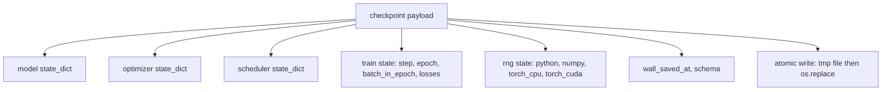
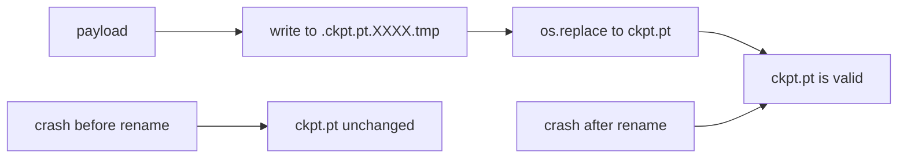
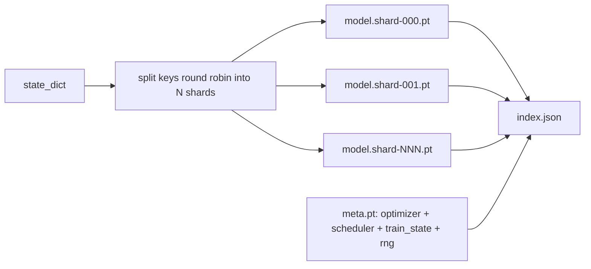

# Kontrol noktası 保存与恢复

> 训练中断会杀死运行;checkpoint 让它们可以继续──原子化保存模型、优化器、调度器、Loss history、step counter 和 RNG state,这样任何时刻被终止时,磁盘上都会留下一个有效文件──

**Type:** Build
**Languages:** Python
**Prerequisites:** Phase 19 lessons 42 to 45
**Time:** ~90 minutes

## Öğrenme Hedefleri

- Tüm antrenman durumunu tek bir payload'a kadar ele geçirerek, yeni bir sürece yeniden yüklenebilmesi için.
- Atom kurtarma, bir kazayı asla yazma bırakmaz.
- Python 、NumPy 和 PyTorch'ın RNG durumunu yeniden başlatmak, sonrası Kayıp 匹配未中断的基线──
- Bu yüzden artık tek bir dosya modeline yerleştirilebilmiyor  parça parça kontrol noktası düzenini oluşturmak, hash verification şartları ve bir JSON indeksi içerir 

## 问题

Bir eğitim görevi ayarladınız, 18 saat çalışmayı öngörüyorsunuz. 4 saat. 11. saat. Kluster yeniden başlandı, çünkü sizden daha yüksek maaşlı bir kişi çekirdek yükseltmesini onayladı. Kontrol noktası yok. Baştan başlamak zorundasınız.

Doğrudan eser, bir tek dosyadır, içinde kalıcı olarak eğitime ihtiyaç duyulan her şeyi korumak: model parametreleri、Optimizer durumu、Sedüler durumu、Kalan tarihi、Hazırlık aşamasında ve çağda kullanılan hesaplayıcılar, her bir rastlantı kaynaklı RNG durumu、RNG durumu yok, geri kazanma sonrası Kayıp eğri, başka bir eğri olacaktır── Aynı model、 Aynı veri、 farklı karıştırma、 farklı düşüş maskası、 tablo üzerinde farklı rakamlar。

Atomic save bu sözleşmenin diğer yarısıdır. Doğrudan yazılan son dosya adı, yazılı sırasında meydana gelen bir kaza anlamına gelir. Kötü dosya bırakılır.

## 概念



### 5 devlet kovaları

| Bucket | 为什么重要 |
|--------|------------|
| Model | Weights 和 buffers；也就是 model 本身。 |
| Optimizer | Momentum 和 adaptive moments；没有它们，下一步就是另一个 Optimization 问题。 |
| Scheduler | Learning rate 在 curve 上的位置；cosine schedules 尤其在意这一点。 |
| Train counters | Step、epoch、batch-in-epoch，以及绘制 dashboard 的 Loss history。 |
| RNG state | 为 dropout、data shuffling，以及 model 内部的任何 sampling 提供 determinism。 |

### Atomik kaydetme



两条规则──第一,临时文件必须位于目标所在的同一目录中,这样的重命名才会停留在同一个文件系统内;跨设备重命名 不是原子的──第二,临时名称对每次尝试都必须唯一,避免两作者 相互覆盖──

### Parçalara ayrılmış kontrol noktaları

Modelle 变大时,单文件 payload 会变得太大,加载不够快,检查不方便,而且在网络共享中途动时非常痛苦──解决方法是把参数状态 拆分碎片,并写入一个小索引把它们关联起来──



Index 记录 shard count、每个 shard 的 sha256,以及 meta file 的 sha256──任何哈希不匹配时, loader 会明确失败──Shards can fall on different physical disk;meta 很小,会先读取──

### Özetleme:

Bir sonraki döneme kadar devam etmenin bir kaç dakikadan bir güne kadar zaman kaybı olacağını düşünüyorum.`(epoch, batch_in_epoch)`RNG durumu. Sonra, eğitim döngüsü, rastgele sayı üreticisi olacak.`batch_in_epoch`⇒ ⇒ ⇒ ⇒ ⇒ ⇒ ⇒ ⇒ ⇒ ⇒ ⇒ ⇒ ⇒ ⇒ ⇒ ⇒ ⇒ ⇒ ⇒ ⇒ ⇒ ⇒ ⇒ ⇒ ⇒ ⇒ ⇒ ⇒ ⇒ ⇒ ⇒ ⇒ ⇒ ⇒ ⇒ ⇒ ⇒ ⇒ ⇒ ⇒ ⇒ ⇒ ⇒ ⇒ ⇒ ⇒ ⇒ ⇒ ⇒ ⇒ ⇒ ⇒ ⇒ ⇒ ⇒ ⇒ ⇒ ⇒ ⇒ ⇒ ⇒ ⇒ ⇒ ⇒ ⇒ ⇒ ⇒ ⇒ ⇒ ⇒ ⇒ ⇒ ⇒ ⇒ ⇒ ⇒ ⇒ ⇒ ⇒ ⇒ ⇒ ⇒ ⇒ ⇒ ⇒ ⇒ ⇒ ⇒ ⇒ ⇒ ⇒ ⇒ ⇒ ⇒ ⇒ ⇒ ⇒ ⇒ ⇒ ⇒ ⇒ ⇒ ⇒ ⇒ ⇒ ⇒ ⇒ ⇒ ⇒ ⇒ ⇒ ⇒ ⇒ ⇒ ⇒ ⇒ ⇒ ⇒ ⇒ ⇒ ⇒ ⇒ ⇒ ⇒ ⇒ ⇒ ⇒ ⇒ ⇒ ⇒ ⇒ ⇒ ⇒ ⇒ ⇒ ⇒ ⇒ ⇒ ⇒ ⇒ ⇒ ⇒ ⇒ ⇒ ⇒ ⇒ ⇒ ⇒ ⇒ ⇒ ⇒ ⇒ ⇒ ⇒ ⇒ ⇒ ⇒ ⇒ ⇒ ⇒ ⇒ ⇒ ⇒ ⇒ ⇒ ⇒ ⇒ ⇒ ⇒ ⇒ ⇒ ⇒ ⇒     ⇒       ⇒      ⇒                                                                                                                                               


```figure
cc-atomic-checkpoint
```

## Yapın

`code/main.py`4 primitif ve 1 demo sürücüsü sunuyorum.

### Adım 1: RNG durumunu yakalamak ve geri kazanmak

`capture_rng_state`Python'u içeren bir dikt geri dön.`random.getstate`NumPy'nin`np.random.get_state`, ve PyTorch CPU ve CUDA RNG baytları`restore_rng_state`Bu yüzden, bir CPU tenzoru, bir Uint8 byte tamponu.

### Adım 2: Atomik kurtarma

`atomic_save`Bu yükü hedef dizinin içindeki geçici dosyayalara yazacağız ve sonra kullanacağız.`os.replace`Son adı için değiştirmek.`atomic_write_json`Çekilen indeks için aynı işlemleri yapın.

### Adım 3: 完整检查点回路行程

`save_checkpoint`RNG'yi bir dikte bağlamak için bir model, optimizer, programcı, tren durumu,`load_checkpoint`Geri dönüp geri dön.`TrainState`◊ schema alanı = yükseltme hok: futurformate变化会递增版本 string,而 loader 会进行发送──

### 4. adım: parçalanmış variant

`save_sharded_checkpoint`E-shaping  modu, parametreler anahtarlarını N 个 shards arasında bölünerek, kendi atomlarını kullanarak 写入每个 shard,写入一个包含优化器、调度器和火车状态的元文件,并写入包含 shard sha256 的 JSON索引.`load_sharded_checkpoint`Birleştirilme süreci.

### Adım 5: Yeniden başlatma gösterimi

`run_resume_demo`会将一个小模型 训练 `total_steps`, `interrupt_at`保存点,然后继续运行――第二个过程 会恢复点并运行剩余步骤――该函数 返回断点 之后两条损失轨迹的最大绝对差──有RNG恢复,差异为零或浮点噪音──

- Yapma .

```bash
python3 code/main.py
```

Tek bir dosya ve parçalanmış demolar , tüm yorumlar , büyük farklar , küçük bir bölüm .`outputs/resume-demo.json`- Evet.

## Kullan

生产训练会把检查点 作为教练的一部分交付──形状相同:model + Optimizer + scheduler + counters + RNG,以原子方式写入,并按步名,便于找到最新文件──Sharded layouts 通过并行阅读 支持大型模型加载;`index.json`Bu işin gerçekleşmesinin bir parçası.

Üç modü zorla gerçekleştirmek:

- **Schema 是 payload 中的一个 string。**Göçmenlik, onun ayrılığıdır.
- **对每个 shard 计算 Sha256。**静默截断的下载是最糟糕的 bug; yükleyici ya hızlı başarısız, ya da geç geç başarısız.
- **让 checkpoint cadence 保持诚实。**Her N adım  bir kez kaydetir, ve her birkaç ayda bir kaç dakikada  bir kez kaydetir, daha kısa bir kişi alır.

## Gönder

`outputs/skill-checkpoint-save-resume.md`Bu becerileri repo'ya koy, periyodik kaydetim sitesine koy.`save_checkpoint`, in startup                                                                                                                                                                                                                                                                                                                                                                                                                                                                                                                           `load_checkpoint`- Evet, evet.

## Egzersizler

1. Parametre gruplarındaki kullanımı değiştirmek için`.weight`结尾的层 vs `.bias`Ne zaman her düzen daha uygun olur?
2. 扩展保存循环,保留最后 K 个检查点,并清理更旧的点──当盘 很小时,合适的 K 是多少?
3. Bir ekle.`--ckpt-every-seconds`Bayrak, duvar saati aralığı 触发保存, sadece adım sayımı değil.
4. 添加一个检查总数验证路径,在启动运行,扫描目录中的每个检查点,并报告哪些已腐败──
5. 实现一个 `migrate_v1_to_v2`işlevi, ⇒ payload ⇒ yeni bir alan ekle,并递增 schema string──让 load 同时兼容两个版本──

## Anahtar Terimler

| Term | 人们常说 | 实际含义 |
|------|----------|----------|
| Atomic save | “写入然后祈祷” | 写入同一目录中的 temp file，然后用 os.replace 放入 target name |
| State dict | “Weights” | Model parameters 和 buffers，按 parameter name 作为 key |
| Sharded checkpoint | “大 model file” | 多个文件，每个 shard 一个，加上一个 meta file 和一个包含 sha256 的 JSON index |
| RNG state | “Random seed” | python random、numpy、torch CPU、torch CUDA 的捕获状态；不只是 seed |
| Mid-epoch resume | “Restart” | 快进 RNG，并从同一 epoch 中的下一个 batch 继续 |

## Daha Fazla Okumak

- POSIX `rename`Semantik, için kullanılan`os.replace`Atomiklik iddiasına bağlılık
- PyTorch  Hakkında `torch.save`和 `torch.load`Dosyaları, cihazlar arası restorasyon için kullanılır.`map_location`- Evet.
- Fase 19 ders 46 bu ders kontrol noktası yararlı yükü kapsamaktadır ve bu aşamada korunabilir gradient birikimi vardır.
- Eğlence 19 ders 48 bu programın uyumlu devlet dikt biçimi ile ilgili dağıtılmış ambalajları kapsamaktadır.
- Linux çekirdeği `fsync`Atom adı değiştirme 背后的耐久性保障的文件, atom adı değiştirme 背后的耐久性保障的文件, atom adı değiştirme 背后的耐久性保障的文件, atom adı değiştirme 背后的耐久性保障的文件, atom adı değiştirme 背后的耐久性保障的文件, atom adı değiştirme 背后的耐久性保障的文件, atom adı değiştirme 背后的耐久性保障的文件, atom adı değiştirme 背后的耐久性保障的文件, atomic name name name name
