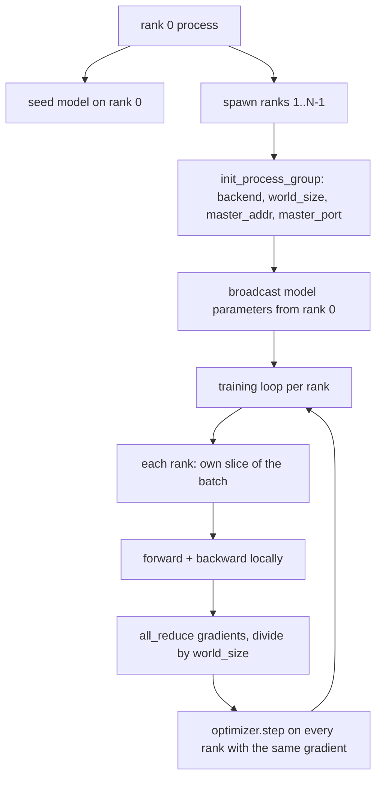
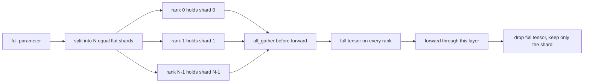

# Değişken Veri ve FSDP

> Çok sıralama eğitimi iki kolektifdir. Üstelik, bir dizi dizi dizi dizi dizi dizi dizi dizi dizi dizi dizi dizi dizi dizi dizi dizi dizi dizi dizi dizi dizi dizi dizi dizi dizi dizi dizi dizi dizi dizi dizi dizi dizi dizi dizi dizi dizi dizi dizi dizi dizi dizi dizi dizi dizi dizi dizi dizi dizi dizi dizi dizi dizi dizi dizi dizi dizi dizi dizi dizi dizi dizi dizi dizi dizi dizi dizi dizi dizi dizi dizi dizi dizi dizi dizi dizi dizi dizi dizi dizi dizi dizi dizi dizi dizi dizi dizi dizi dizi dizi dizi dizi dizi dizi dizi dizi dizi dizi dizi dizi dizi dizi dizi dizi dizi dizi dizi dizi dizi dizi dizi dizi dizi dizi dizi dizi dizi dizi dizi dizi dizi dizi dizi dizi dizi dizi dizi dizi dizi dizi dizi dizi dizi dizi dizi dizi dizi dizi dizi dizi dizi dizi dizi dizi dizi dizi dizi dizi dizi dizi dizi dizi dizi dizi dizi dizi dizi dizi dizi dizi dizi dizi dizi dizi dizi dizi dizi dizi dizi dizi dizi dizi dizi dizi dizi dizi dizi dizi dizi dizi dizi dizi dizi dizi dizi dizi dizi dizi dizi dizi dizi dizi dizi dizi dizi dizi dizi dizi dizi dizi dizi dizi dizi dizi dizi dizi dizi dizi dizi dizi dizi dizi dizi dizi dizi dizi dizi dizi dizi dizi dizi dizi dizi dizi dizi dizi dizi dizi dizi dizi dizi dizi dizi dizi dizi dizi dizi dizi dizi dizi dizi dizi dizi dizi dizi dizi dizi dizi dizi dizi dizi dizi dizi dizi dizi dizi dizi dizi dizi dizi dizi dizi dizi dizi dizi dizi dizi dizi dizi dizi dizi dizi dizi dizi dizi dizi dizi dizi dizi dizi dizi dizi dizi dizi dizi dizi dizi dizi dizi dizi dizi dizi dizi dizi dizi dizi dizi dizi dizi dizi dizi dizi dizi dizi dizi dizi dizi dizi dizi dizi dizi dizi dizi dizi dizi dizi dizi dizi dizi dizi dizi dizi dizi dizi dizi dizi dizi dizi dizi dizi dizi dizi dizi dizi dizi dizi dizi dizi dizi dizi dizi dizi dizi dizi dizi dizi dizi dizi dizi dizi dizi dizi dizi dizi dizi dizi dizi dizi dizi dizi dizi dizi dizi dizi dizi dizi dizi dizi dizi dizi dizi dizi dizi dizi dizi dizi dizi dizi dizi dizi dizi dizi dizi dizi dizi dizi dizi dizi dizi dizi dizi dizi dizi dizi dizi dizi dizi dizi dizi dizi dizi dizi dizi dizi dizi dizi dizi dizi dizi dizi dizi dizi dizi dizi dizi dizi dizi dizi dizi dizi dizi dizi dizi dizi dizi dizi dizi dizi dizi dizi dizi dizi dizi dizi dizi dizi dizi dizi dizi dizi dizi dizi dizi dizi dizi dizi dizi dizi dizi dizi dizi dizi dizi dizi dizi dizi dizi dizi dizi dizi dizi dizi dizi dizi dizi dizi dizi dizi dizi dizi dizi dizi dizi dizi dizi dizi dizi dizi dizi dizi dizi dizi dizi dizi dizi dizi dizi dizi dizi dizi dizi dizi dizi dizi dizi

**Type:** Build
**Languages:** Python
**Prerequisites:** Phase 19 lessons 42 to 45
**Time:** ~90 minutes

## Öğrenme Hedefleri

- Kullanım`gloo`Backend 启动跨 N 个级的过程组,不需要特殊硬件──
- 实现一个最小的DDP wrapper,在施工时 广播参数,并后后全降梯
- 证明 per-rank gradients 的全降匹配 连锁输入 上的单进程梯度──
- 勾勒 FSDP parametre parçalanması: Her sıra 持有一片,前進 时收集全テンサー,后落──

## 问题

模型能放进一个设备──数据设置 放不下──优化预算 要求你在每秒钟内 看到N 倍样本──第一个杆是数据平行:每个级别在批次的不同片上运行同一个模型,然后在优化步骤前平均梯度──第二个杆是FSDP:模型本身也放不进一个设备,所以每个级别都持每个参数的一部分,并通过 期间逐层重建全 tensors──

痛点在会计管理──如果参数在排列之间漂流,这次运行会静默损坏──如果你平均梯度但没有平均损失,仪表板就会撒谎──如果集体后端 无法达成拓条,运行会永远挂──修复方法是亲手写一次集体,然后永远不要信任你无法复现的包装──

Bu ders CPU'nun üzerinde çalışıyor.`gloo`Arka tarafı her PyTorch'ın oluşturulması bir başlangıç, bir kabul`torch.multiprocessing`İşçiler; aynı kodun bir çok GPU düğmesine geçiş yapılması `nccl`时, yapı değişmek zorunda değildir.

## 概念



###  İki önemli kolektif

| Collective | 做什么 | 何时使用 |
|------------|--------------|------|
| `broadcast` | 将一个 tensor 从一个 rank 复制到所有其他 rank | Parameter init、scheduler state、任何 one-to-all sync |
| `all_reduce` | 在所有 rank 间对一个 tensor 求和（或 mean、或 max），每个 rank 都得到结果 | Backward 后的 Gradient averaging |
| `all_gather` | 每个 rank 贡献一个 tensor，每个 rank 都得到 concatenation | Logits collection、FSDP parameter unshard |

DDP sözleşmesi 时`broadcast`, geriye 后 `all_reduce`❖ FSDP çizelgesi 在每一层前进通过 前加入 `all_gather`- Evet.

### Gradyent ortalaması 匹配 tek süreç gradienti

N 个级 上用B 个样本的批次 训练模型,必须产生与单个过程在N*B 的批次 上训练相同的梯度──是对每级梯度 求和并除以N,得到平均损失梯度,这是中减的交叉 Entropy的结果在全批次 上会的结果──Lesson code 会在手动全减梯度和参考单过程梯度 之间断定`max-abs-diff < 1e-3`- Evet.

### FSDP çizelgesi



Hatırlama kazancı kesin: sırayla parametreler hatıra  düşer 1/N。代价是收集,每次前进通过都要支付。Production FSDP 会将收集与上层的计算重叠,所以壁表成本比朴素核算预测的小得多。本课对每个参数做回路,并断重复与原始位等――

### CPU ve Dark Backend

CUDA üretim hedefi, ancak CPU'nun üstündeki kod yolları da aynıdır.`gloo`CPU'nun kolektif arka uçları.`nccl`慢数级,但API表面完全相同.`backend="gloo"`İlk başta,并用 `torch.multiprocessing`                        `torchrun`; ikisi de sonunda aynı şekilde konuşacaklar .`torch.distributed`                                                                                                                                                                                                                                                              `backend="nccl"`、 cihaz tenzorları, ve `torchrun`Başlatılmak.


```figure
cg-allreduce-ring
```

## Yapın

`code/main.py`- Evet, yapabilmek için.

### Adım 1: Başlatma süreci grubu

```python
os.environ["MASTER_ADDR"] = "127.0.0.1"
os.environ["MASTER_PORT"] = str(port)
dist.init_process_group(backend="gloo", rank=rank, world_size=world_size)
```

`MASTER_ADDR`和 `MASTER_PORT`Bu yüzden, bu bir araçla bir araya gelmek için, bir sürü sefer çalıştırmak için, bir bağlantı yoluyla bir bağlantı yoluyla bir bağlantı yoluyla bir bağlantı yoluyla bir bağlantı yoluyla bir bağlantı yoluyla bir bağlantı yoluyla bir bağlantı yoluyla bir bağlantı yoluyla bir bağlantı yoluyla bir bağlantı yoluyla bir bağlantı yoluyla bir bağlantı yoluyla bir bağlantı yoluyla bir bağlantı yoluyla bir bağlantı yoluyla bir bağlantı yoluyla bir bağlantı yoluyla bir bağlantı yoluyla bir bağlantı yoluyla bir bağlantı yoluyla bir bağlantı yoluyla bir bağlantı yoluyla bir bağlantı yoluyla bir bağlantı yoluyla bir bağlantı yoluyla bir bağlantı yoluyla bir bağlantı yoluyla bir bağlantı yolu ile bir bağlantı yolu ile bir bağlantı yolu ile bir çatışma meydana gelir.

### Adım 2: İnşaat 时 yayın

`MinimalDDP.__init__`遍历每个参数 和缓冲,并调用 `dist.broadcast(tensor, src=0)`◊Rank 0'un değeri kanonik başlangıç haline gelmiştir. ◊Rank bu adımdan sonra, her sırada kendi tohumları ile başlangıç, sıradan ilk adımdan ayrılma başlar.

### Adım 3: Geriye 后 tüm azaltma gradientleri

```python
def all_reduce_grads_(module, world_size):
    for p in module.parameters():
        if p.grad is None:
            p.grad = torch.zeros_like(p.data)
        dist.all_reduce(p.grad.data, op=dist.ReduceOp.SUM)
        p.grad.data.div_(world_size)
```

Her sıra sonunda aynı ortalama gradiyenti elde eder. Optimizer adım şimdi her sıra üzerinde aynı giriş işlevi üzerine kuruluyor. Bu da tüm çalışmada parametrelerin senkronize kalmasının nedeni.

### 4. Adım: Değerlilik kanıtlaması

`manual_all_reduce_matches_single_process`0 sıralamasında aynı model oluşturulur, tüm azaltma sonrası gradiyenti tek süreçle birleştirilmiş girişlerde hesaplanan gradiyenti karşılaştırılır.

### Adım 5:FSDP geri dönüş yolculuğu

`fsdp_round_trip_sketch`Her parametreyi düzelt, çakış.`world_size`Bu, bir parça olarak yeniden oluşturulur. Bu, bir parça olarak yeniden oluşturulur.

运行:

```bash
python3 code/main.py
```

默认 dünya boyutu 2 ⋅ 2 CPU işlemleri ⋅ ⋅ ⋅ ⋅ ⋅ ⋅`gloo`相互通信,并以零 退出──输出 `outputs/ddp-demo.json`捕获各级的参数总数、全减后的梯度规范、FSDP dönüş-trip sonucu,以及手动对参考梯度差──

## Kullan

Üretim eğitim stackları 调用相同 primitives──PyTorch 的 `DistributedDataParallel`增加了:post-backward gradient hooks, all-reducing and backward overlap;bucketed all-reducing, will多个小 gradients 合并为一次集体;以及教案 46 使用过的 `no_sync`bağlamı

PyTorch'un FSDP'si arttırıldı: Her katman düz bir parametre görünümü, her sıralamada bir bitişik tampon bulunmasını sağlar; aşağı katman bölünmemiş olarak mevcut katman hesaplamalarının üst üste geçmesi; ayrıca seçilebilir parça CPU yükü olmaması。

形状保持不变: start时播放,backward 后降低,parametre 放不下时进行碎片──

## Gönder

`outputs/skill-distributed-fsdp-ddp.md`Yeni bir eğitim metniyle birlikte.`gloo`CPU'nun işlem grubunu başlatmak, kullanmak`nccl`GPU'nun işlem grubunu başlatın, model 包 DDP kabuğunda, inşaat sırasında yayın 后 后 后 后 后 减,按需使用FSDP çizelgesinde tüm_gather 模式对参数 分片──

## Egzersizler

1. Kullanım`--world-size 4`运行,并确认整个运行 中参数传播 保持在 1e-3 以下。
2. Bu da bir diğer yöntem .`dist.all_reduce(op=dist.ReduceOp.AVG)`Zaman farkı...
3. DDP ambalajına  ekle geriye dönük kaçağı, tümüyle azaltın geriye dönük olanın geriye kalan kısmıyla örtüşmelerini; ölçüm duvar saati  iyileştirmek
4. 实现 FSDP re-shard step:forward pass 后, tekrar yerel shard ile 替换全 tensor──确认 per-rank memory 下降──
5. CUDA 机器上将后端 换为 `nccl` Hangi çevre değişkenlerini kaydetmek  değişir, hangi değişmez.

## Anahtar Terimler

| Term | 人们的说法 | 实际含义 |
|------|-----------------|------------------------|
| Backend | "gloo or nccl" | 实现 collective ops 的 library；gloo 是 CPU，nccl 是 GPU |
| World size | "Total ranks" | group 中的 process 数量；group 是 collectives 操作的 unit |
| Rank | "Worker id" | group 内的 process identifier，从零开始索引 |
| All-reduce | "Sum the grads" | 在所有 rank 间对一个 tensor 求和，每个 rank 最终得到相同结果 |
| Unshard | "Gather the params" | 通过 all_gather 从 per-rank slices 重建 full tensor |

## Daha Fazla Okumak

- PyTorch `torch.distributed`Dokümanlama, bu ders bağımlılıklarının kolektif semantikasını anlamak.
- `gloo`Kütüphane'nin kolektif listesi, CUDA tarafından desteklenen biçimleri`nccl`İlkeler aynı.
- Eğitim 46'sı, DDP'nin tümüyle azaltılacağını anlamak için`no_sync`Orta gradient birikimi modeli
- Fase 19 ders 47, DDP ve FSDP çalıştırma sırasında sağ kalacak kontrol nokta düzenini öğrenmek
- PyTorch FSDP belgeleri, burada eskiz parametre parçalanma üretim uygulamalarını öğrenmek için
