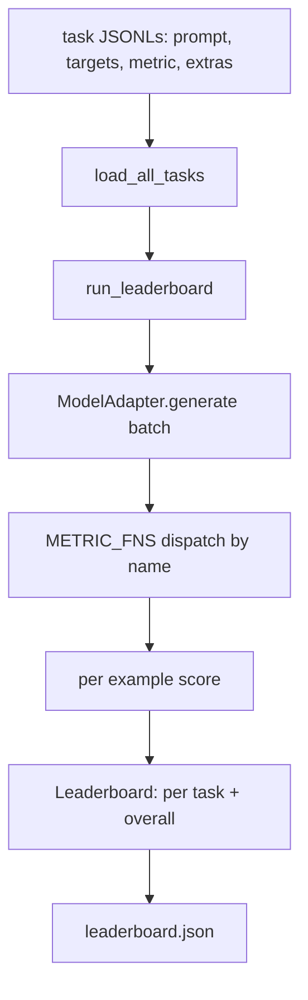
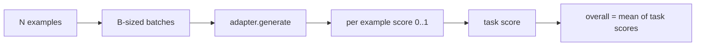

# 语言模型评测 Harness

> Eğer bir model tanımlanamayan görev üzerinde iyi performans gösterirse, o zaman tesadüf olarak iyi performans gösterir.

**Type:** Build
**Languages:** Python
**Prerequisites:** Phase 19 lessons 42 to 45
**Time:** ~90 minutes

## Öğrenme Hedefleri

- Bir görevi JSONL dosyası olarak tanımlamak, her örnek 包含 `prompt`- Evet.`targets`- Evet.`metric`, ve seçilebilir `extras`- Evet.
- 实现五个指标:精确匹配、红色-l F1、执行可检查、多选和子字符串含量──
- 构建一个运行器,按任务 批处理例子,并分发给可替代的模型适配器──
- 输出 leaderboard JSON, içerir her görev puanı, gecikme, ve geri dönüşü genel ortalama

## 问题

Her hafta yeni bir dil modeli ortaya çıkar. Satışcılık konuşması çok iyi gittiğini söylüyor.

Eğer repo'nun harness yoksa, sadece iki modeli karşılaştırma hissine sahip olursun. Harness varsa, sabit görev kümesi üzerinde kalır, sabit metrikler üzerinde karşılaştırır ve farklı JSON çıkışı elde eder. Harness ise dün çalışması ile bugün çalışması arasındaki bir sözleşmedir.

陷是让harness 过适合单个模型──修复方式是让所有模型的特定选择都留在harness 之外:harness 小到十五分钟能读完,任务小到随随随随随随随随随随随随随随发行, metrics 从零编写以便同事审计,而适配器是唯一模型的特定代码放置的地方──替代适配器,leaderboard 会变;替代任务,leaderboard 会变──其他东西都不应变──

## 概念



### Görev özellikleri

Her örnek JSONL bir satırdır:

```json
{"id": "arith-00", "prompt": "compute: 2 + 2", "targets": ["4"], "metric": "exact_match"}
```

对于需要得分助手的指标,`extras`携带旁路 payload:

```json
{
  "id": "code-00",
  "prompt": "python: write a function f that doubles its input",
  "targets": ["ok"],
  "metric": "code_exec",
  "extras": {"io_pairs": [[1, 2], [3, 6]]}
}
```

Bir görev var .`outputs/tasks/`Aşağıdaki bir `.jsonl`文件──文件名就是任务名称── 一文件中的所有例子 共享同一个计量──

### 五个 sabit görevler

| Task | Metric | 测试内容 |
|------|--------|---------------|
| arithmetic | exact_match | 对确定性答案的 Token 级正确性 |
| summary | rouge_l | 针对单行 reference summary 的 longest common subsequence F1 |
| code-exec | code_exec | 可执行测试：预测出的 function 必须满足一组 input-output pairs |
| multiple-choice | multiple_choice | prediction 的首字母必须匹配允许的 letter |
| generation | substring_contains | Free-form text 必须包含至少一个 target substring |

### Metrik sözleşme

Her metrik bir işlevi vardır:`(prediction, targets, extras) -> float in [0.0, 1.0]`❖ Örnek başına puan kullanmak 取平均得到任务得分,再对任务得分 取平均得到总体──Metrik fonksiyonlar 都很小:

- `exact_match`:转小写、折叠白空、判断平等──
- `substring_contains`: Aynı normallaşma,做 alt kat testı。
- `multiple_choice`İlk karakterini alın ve büyük bir yazı için çevirin.
- `rouge_l`:LCS uzunluğu, tahmin ve referans uzunluğu, hesaplama doğruluğu ve geri çağırma F1
- `code_exec`: 调用                                                                                                                                                                                                                                                                                                                                                                                                                                                                                                                          `f(x)`, İstatistik eşleşmeler

code_exec metrikleri 会在精简后的内置名区 中运行预测──本课的测试 断言 `import os`- Bu yüzden başarısız olacağım.`os`Not in namespace;You cannot from code prediction  access file system。

### Model adaptör

```python
class ModelAdapter(Protocol):
    def generate(self, prompts: Sequence[str]) -> List[str]: ...
    @property
    def name(self) -> str: ...
```

Adaptör 接点──本课提供 `ToyAdapter`Bu bir kesinlik örneği eşleşicisi, beş sabit görevler arasında her bir istekle 返回正确答案──真相調整器 会调用模型并返回输出──Harness 不关心是哪一个──

### Koşucu

`run_task`Her birim işlemi`batch_size`个提示,并分发给对函数──`run_leaderboard`Her görevi tamamlamak ve ortalama bir görev almak.`write_leaderboard`输出带 schema string 的 JSON,这样未来格式 变化不会静默破坏仪表板──




```figure
eval-harness-matrix
```

## Yapın

`code/main.py`- Evet, yapabilmek için.

### Adım 1: Tohum sabitleme görevleri

`seed_fixture_tasks(target_dir)`- Evet .`.jsonl`İlk seferinde`main.py`Eğer bu kayıt boşsa, bu dosyaları bitirecek.

### Adım 2: Yükleme görevleri

`load_all_tasks(task_dir)`读取每个 `.jsonl`,并返回从任务名到 `Example`Kayıtlar 列表的 dict──以`#`İlk yorum satırı ve boş satırlar atlatılacak, böylece katılımcı bu dosyaları yorumlayabilir.

### Adım 3:Metrikleri uygula

Her metrik, küçük bir işlevi içerir ve birim testi bulunmaktadır. Bu dersin test kümesi 13 vaka içerir.

### Adım 4: Koşucu yaz

`run_task`代 seri,并生成一个 `TaskResult`, bunlardan skor, doğru sayım, toplam sayım ve gecikme içerir.`run_leaderboard`Tüm görevleri tamamlayarak, genel ortalama ile üretilir.`Leaderboard`- Evet.

### Adım 5: JSON gönder

`write_leaderboard`İdare Kurulu.`--include-per-example`Bayraklar örnek kayıtları için çıkarılır, böylece puanlar  değişirken, tahminleri önceki seferden farklı yapabilirsiniz.

- Yapma .

```bash
python3 code/main.py
```

İlk kez çalıştım, oyuncak adaptörüyle toplanıyorum.`outputs/leaderboard.json`◊ Oyuncak adaptörü kullanmak 时 genel puan 1.0;`test_main.py`Orta bir adapter testi  gösterdi  adapter  cevap veremediğinde, aynı halis 0.0 ⋅

## Kullan

Gerçek modelle bağlanmak için bir adaptör yazın.

```python
class HttpAdapter:
    name = "vendor.v1"

    def __init__(self, endpoint, api_key):
        self.endpoint = endpoint
        self.api_key = api_key

    def generate(self, prompts):
        out = []
        for prompt in prompts:
            response = http_post(self.endpoint, prompt, self.api_key)
            out.append(response["text"])
        return out
```

- Evet .`main()`Üstüne çık.`ToyAdapter`替换成 `HttpAdapter`❖ Harness, görevler, ölçümler ve liderlik tabloları değişmez.

Gerçek projelerde harness yayınlanırken, üç modü zorla gerçekleştirilmelidir:

- **Pin task files。**leaderboard.json ya da hash-pinned görev içeriği taşımak, ya da JSONLs bir bir taşımak; yoksa görev dosyası bir değişim puanı değişecek, ve sen hangi değişmiş olduğunu belirleyemezsin.
- **Diff predictions，不只是 diff scores。** `--include-per-example`Bayrak size puanı gösterir. Aşağıya düşerken model ne diyor?
- **限制 batch size。**Gerçek adaptörler fiyat sınırı vardır. Küçük seri boyutu var.

## Gönder

`outputs/skill-lm-eval-harness.md`携带食谱:JSONL görev spesifikasyonu,5 metrik, değiştirilebilir adaptör,batched runner,带 schema string of leaderboard JSON。`outputs/tasks/`İçinde görev dosyaları sabitlemelerdir; onları gerçek projeye kopyalayın başlangıç noktası olarak.

## 练习

1. 添加第六任务,并使用您从零编写的自定义测量(类似BLEU的重叠、类似BLEURT的参考得分,或任何合同的清晰的东西)
2. 扩展 `code_exec`, tutmak,并接受一组预期 stdouts 作为目标──
3. 添加一个排名表差命令:给定两个 `leaderboard.json`文件, basın hangi görevler  değişim ve değişim miktarı 
4.  limiti her örnek için                                                                                                                                                                                                                                                                                                                                                                                                                                                                                                                         `timeouts`sütun
5. Lider tablosunda sha256 pin görev içeriği kullanın, böylece gelecek okuyucuların aynı görevleri değerlendirdiğini doğrulayabilirler.

## 关键术语

| Term | 人们的说法 | 实际含义 |
|------|-----------------|------------------------|
| Task spec | “eval format” | JSONL 文件，每个 example 包含 prompt、targets、metric 和可选 extras |
| Metric | “你怎么打分” | 从 (prediction, targets, extras) 到 [0, 1] 内 float 的函数 |
| Adapter | “model client” | 带有 generate(prompts) -> list[str] method 的对象；唯一的模型特定代码 |
| Leaderboard | “scoreboard” | 包含 per-task scores、total counts、latency 和 overall average 的 JSON |
| Code exec metric | “运行它并检查” | 在受限 namespace 中执行 prediction，并与 input-output pairs 比较 |

## 延伸阅读

- İlk Lm değerlendirme-harness, üretim sınıfı referansı olarak kullanılabilir, büyüklüğü daha fazla, ama şekli aynı.
- HuggingFace'ın hafifliği aynı sözleşmenin başka bir gerçekleşmesidir.
- Eğitim aşamasında, 19 ders 46                                                                                                                                                                                                                                                                                                                                                                                                                                                                                                                    
- Fase 19 ders 47                                                                                                                                                                                                                                                             
- Fase 19 ders 48                                                                                                                                                                                                                                                                                                                                                                                                                                                                                                                         
