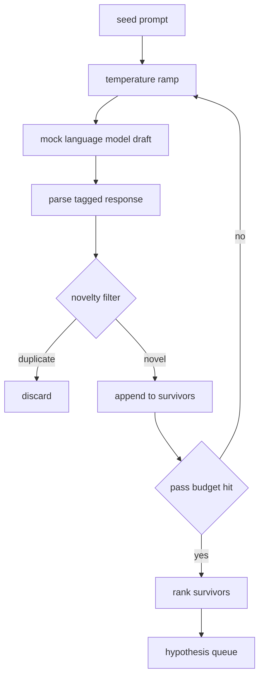

# Hipotez Generatörü

> Bir araştırma ajanı aynı soruyu iki kez sorarsa, önemli olan her taslakı yeni bir yere düşürmek.

**Type:** Build
**Languages:** Python
**Prerequisites:** Phase 19 Track A lessons 20-29
**Time:** ~90 分钟

## Öğrenme Hedefleri
- Tohum prompt  sürücü örnekleme,  dönüştürmek  dönüştürmek                                                                                                                                                                                                                                                                                                                                                                                                                                                                                                             
- Her geçit boyunca örneklemenin sıcaklığı yükseltilsin, sonraki taslak daha uzaklara kaysın.
- Küçük bir yerleştirme modeli ile ve kosinus mesafe eşiği 过近似重复项──
- Yenilik, spesifiklik ve test edilebilirlik ile birleştirilmiş bir skor fonksiyonu kullanmak.
- 让每一步都保持确定性,使同一种子 总是产生相同的队列──

## Neden bir daha dönersin?

Bir planlayıcı bir model kullanır, bir kez sadece bir hipotez alır. Bu çalışmış örnek için sorun yok. Ama bir araştırma döngüsü için biçim karşı değildir.

İki fikir bir araya gelerek bu kuyruk oluşturur. Birincisi sıcaklık yükseltilmesidir: her seferinde numuneci 时都把温度 提高一点,让后草更愿意游走―― ikinci olarak yenilik filtrelenmesidir: her bir taslak 之后, jeneratör 测量它与每一个前幸存者的嵌入距离,并拒绝任何落在集群 内部的内容――

Bu ders, sabit bir istek dili modeli sunar, sabit bir istek için kullanılır 脚本化 代引序列を返します。 bu istek 足以完整条路径:seed prompt 输入,应用温度ランプ,解析候选,运行新品フィルター,输出排列列──

## Hipotez 形状

```text
Hypothesis
  id             : int           (monotonic within a run)
  text           : str           (the claim)
  variables      : list[str]     (what changes between conditions)
  metric         : str           (what the runner will measure)
  baseline_ref   : str | None    (which paper or run the comparison cites)
  draft_pass     : int           (which sampler pass produced this)
  temperature    : float         (the sampler setting at draft time)
  novelty_score  : float         (distance from prior survivors, 0..1)
  rank_score     : float         (weighted sum used for ordering)
```

`variables`和 `metric`Notes: Notes: Notes: Notes: Notes: Notes: Notes: Notes: Notes: Notes: Notes: Notes: Notes: Notes: Notes: Notes: Notes: Notes: Notes: Notes: Notes: Notes: Notes: Notes: Notes: Notes: Notes: Notes: Notes: Notes: Notes: Notes: Notes: Notes: Notes: Notes: Notes: Notes: Notes: Notes: Notes: Notes: Notes: Notes: Notes: Notes: Notes: Notes: Notes: Notes: Notes: Notes: Notes: Notes: Notes: Notes: Notes: Notes: Notes: Notes: Notes: Notes: Notes: Notes: Notes: Notes: Notes: Notes: Notes: Notes: Notes: Notes: Notes: Notes: Notes: Notes: Notes: Notes: Notes: Notes: Notes: Notes: Notes: Notes: Notes: Notes: Notes: Notes: Notes: Notes: Notes: Notes: Notes: Notes: Notes: Notes: Notes: Notes: Notes: Notes: Notes: Notes: Notes: Notes: Notes: Notes: Notes: Notes: Notes: Notes: Notes: Notes: Notes: Notes: Notes: Notes: Notes: Notes: Notes: Notes: Notes: Notes: Notes: Notes: Notes: Notes: Notes: Notes: Notes: Notes: Notes: Notes: Notes: Notes: Notes: Notes: Notes: Notes: Notes: Notes: Notes: Notes: Notes: Notes notes notes: Notes notes not notes: Notes notes notes notes notes notes by by by by by by by by by by by by by by by by by by by by by by by by by by by by by by by by by by by by by by by by by by by by by by by by by by by by by by

`baseline_ref`Bu seçenek seçilebilir, ancak öneriler sunulur.


```figure
cg-novelty-ramp
```

## Yapılandırma



Bu döngü çok doğrudan. Yani her kutuda sıkı bir sözleşme var.

## Temperatür rampası

- Evet .`t_min`Başlayın, tamamlayın.`t_max`Son, adım`(t_max - t_min) / (n_passes - 1)`◊ Her geçiş için mevcut sıcaklık                                                                                                                                                                                                                                                                                                                                                                                                                                                                                                                     `GeneratorConfig.schedule()` oluşuyor`n_passes`个均间隔的值──mock model 通过在一小组按 `(prompt, temp_bucket)`索引的脚本化反应 之间切换来遵守温度──桶是开区间,因此温度的小幅变化会选择不同桶,并产生不同的草案──在生产中,样本会是真实模型,并传入`temperature=t`- Evet.

默认                                                                                                                                                                                                                                                                                                                                                                                                                                                                                                                           `0.2`- Ne ?`1.2`Bu yüzden, yenilik filtresi için, aslında reddedilen numuneyi ödemek zorunda değiliz.`0.2`时,model 会复述种子──高于 `1.2`时,response 往往偏离主题并导致解析者 失败──

## Yenilik Filtresi

Her taslak çözülmüş, jeneratör metni yerleştirir,并与每个接受的假设比较──嵌入是小型哈希袋的字符号,并正常化到单位长度──两个单位向量之间的宇宙距离 是`1 - dot(a, b)`❖ Eğer bir sonraki hayatta kalanın en az uzaklığı ise `novelty_threshold`- Evet, evet.`0.25`- Evet.

hashed embedging 并不高级──它是确定性的、零依赖,并足以捕捉显而易见的情况:两个草案 共享大多数名词──制作部署 会换成小型句模型──接口 保持不变──

## Rank puanı

```text
rank_score = w_novelty * novelty_score
           + w_specificity * specificity_score
           + w_testability * testability_score
```

Üç alt puan.`novelty_score`Önceki hayatta kalanla en az yerleşim mesafesi vardır.`specificity_score`Bu, bir varsayımdır.`testability_score`Hipotezde aynı zamanda belirtilen metrik ve temel 时为一, sadece belirtilen metrik 时为二分之一, yoksa ise为零──

默认权重是 `0.4`- Evet.`0.3`- Evet.`0.3` Güçleri jeneratör yapılandırması içinde yer alır, bu nedenle aşağıdaki programları düzenleyebilirsiniz, 代码yi kırmak zorunda değilsiniz.

## Sahte dil modeli

```python
class MockLLM:
    def sample(self, prompt: str, temperature: float, seed: int) -> str:
        ...
```

- Evet .`(prompt, temperature, seed)`Üç kez, örnekler kesin.`(prompt_signature, temperature_bucket)`索引的脚本化响应表―― eğer 表没有某个键的入口,样本会返回一个会让解析者失败的倒退――其中一个测试会覆盖这个倒退路――

Tohumlar karışık bir tepki verecek.`(prompt, temperature)`Çift 配上不同种会产生不同草案──测试中我们固定种,以保持结果可复现── gerçek dağıtım sırasında, tohum 会来自系统时钟或反──

## Çıktı sırası

输出是按 `rank_score`降序排序 of                                                                                                                                                                                                                                                                                                                                                                                                                                                                                                                        `Hypothesis`Kayıt 列表──第五十二课中的跑者 弹出头,运行实验,第五十三课中的评价者 写回判决── eğer hüküm 假设说错了, runner 就弹出下一个──

Sır sınırlıdır. Orkestör boşluktayken, tohumları hızla genişletebilir ve jeneratörün tekrar çalışmasını durdurur.

## Nasıl okuyabilirim?

`code/main.py` defini `Hypothesis`- Evet.`MockLLM`- Evet.`HypothesisGenerator`Ve bir kesinlik demo.`run(seed_prompt)`Metod, geri dönüş sıradan sonra sırada; geçiş sayısı `GeneratorConfig.n_passes`读取,而不是作为一个论点 传入──嵌入 是一个的代币的的的的的的的的的的的的的的的的的的的的的的的的的的的的的的的的的的的的的的的的的的的的的的的的的的的的的的的的的的的的的的的的的的的的的的的的的的的的的的的的的的的的的的的的的的的的的的的的的的的的的的的的的的的的的的的的的的的的的`numpy`Matematikleri yerleştirmek tamamen basit, bu yüzden dersler taşınabilir kalır.

`code/tests/test_generator.py`覆盖 linear path、duplikat reddetme yolu、parser başarısızlık yolu、 sıcaklık ramp sınırı 和 sıra sıralaması。

## İçeri girer.

第五十三课读取两者的成果并写出判决──四节课组合成一个没有人参与的研究循环;人可以在任何边界介入── 第五十三课生成队列──第五十一课取队的头并运行文学搜索 来确认或反驳它──第五十二课取同一个头并运行实际实验──第五十三课读取两者的成果并写出判决──第五十一课组组组合成一个没有人参与的研究循环;人可以在任何边界介入──第五十三课读取两者的成果并写出判决──四节课组合成一个没有人参与的研究循环;人可以在任何边界介入──
