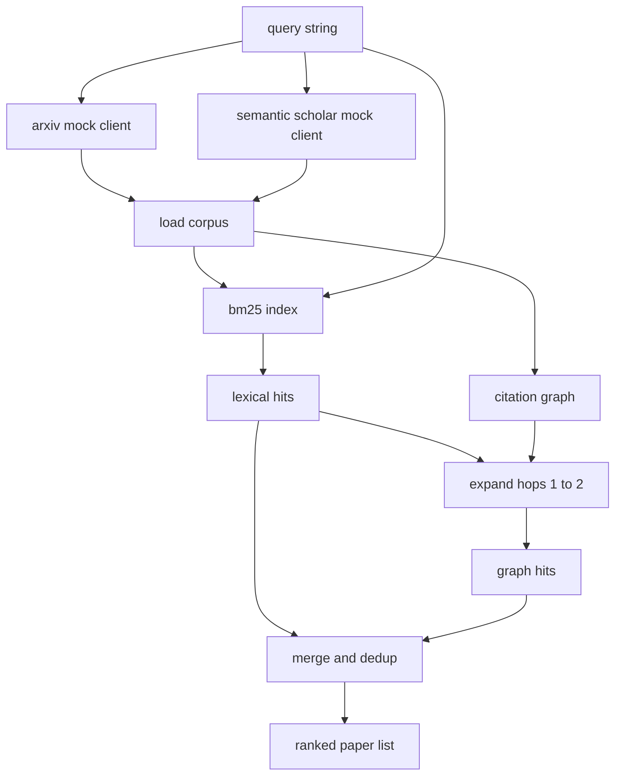

# 文献检索

> Bir hipotez  çok ucuz                                                                                                                                                                                                                                                                                                                                                                                                                                                                                                                       

**Type:** Build
**Languages:** Python
**Prerequisites:** Phase 19 Track A lessons 20-29
**Time:** ~90 分钟

## Öğrenme Hedefleri
- Bu da bir küçük kağıt kayıtı.
- Sadece stdlib sayı yapı kullanın, abstracts üzerinde yapı BM25 indeks
- 遍历引用图,浮现词典搜索 遗漏的论文──
- 通過稳定的紙 id,对词典和图 两轮命中结果去重──
- İki sahte dış API'yi  paketlemek  tek müşteri  arkasında, böylece gerçek son noktaları  giriş sırasında,                                                                                                                                                                                                                                                                                                                                                                                                                                                                                                   

## Neden iki seferlik bir çekim gerekiyor?

Açıklamalar için anahtar kelime arama yapılır, sorgu ile geri dönecektir. Bu, çoğu aşama durumu kapsar. Ama iki tür durum kaybedilecektir. İlk sınıf farklı kelime kullanılarak temel kağıt olacaktır. Örneğin, sorgu "sparse attention" bir makale kaybedilecektir. "transformer yönlendirme blok seçimi" başlıklı makale. İkinci sınıf ilgili kağıt, belli bir ankörün sonraki çalışmalarını alıntılar; ankörün yeniden ileriye doğru ilerlemesini bulur.

本课会构建这两轮──摘要 上的 BM25 捕获词汇 hits──引用图穿越从种子集合 出发,向前和向后扩展一到两跳──二者的并集按纸 id 去重,并用一个小型组合分排序──

## Kağıt 形状

```text
Paper
  id          : str           (稳定 identifier，mock corpus 中为 "p001")
  title       : str
  abstract    : str
  year        : int
  authors     : list[str]
  references  : list[str]     (这篇 paper 引用的 paper ids)
  citations   : list[str]     (引用这篇 paper 的 paper ids)
  source      : str           (提供它的 mock api，"arxiv" 或 "s2")
```

Referanslar ve alıntılar 字段形成有向引用图──2 sahte API 返回的字段有重叠但不完全相同,因此 corpus loader 会按 `id`Onları toplayıp toplayalım.


```figure
cg-citation-hops
```

## Mimarlık



Arama müşteriyi 拥有这两轮和 merge──caller 传入一个查询,并拿回一个排列列的列表;其中每个条目都携带每纸分 字段(`bm25_score`- Evet.`graph_distance`- Evet.`recency_score`- Evet.`final_score`), açıklama için kullanılır.

## BM25'i gerçekleştirmek

实现使用标准 Okapi BM25,默认参数为 `k1=1.5`- Evet.`b=0.75`index: iki sözlük:`term -> doc_frequency`和 `term -> list of (doc_id, term_count)`△ belge uzunluğu △ abstrakt △ simge sayı △ ortalama belge uzunluğu △ indeks  yapılandırma sırasında hesaplama bir kez △ sorgu 打分时,会对 sorgu terimleri 求和:`idf * tf_norm`, içinden `tf_norm` BM25 长度归一化术语频度

Tokeniser önce`lower`, yeniden biçimsiz sayısal karakterlere ayrılmıştı.

```math
\begin{aligned}
\text{idf}(t) &= \log\!\left(\frac{N - \text{df} + 0.5}{\text{df} + 0.5} + 1.0\right) \\
\text{tf\_norm}(t) &= \frac{f \cdot (k_1 + 1)}{f + k_1 \cdot \left(1 - b + b \cdot \text{dl} / \text{avgdl}\right)} \\
\text{score}(d, q) &= \sum_{t \in q} \text{idf}(t) \cdot \text{tf\_norm}(t)
\end{aligned}
```

## İfadeler grafik geçiş

Graf 会从 corpus 构建一次──Forward edges 从一篇论文指向它的引用──Backward edges 从一篇论文指向它的引用──traversal is breadth first search,以顶部BM25 hits为 seed,最多两跳──

两跳是刻意设置的上限──一跳太浅;agent 常常需要直接祖先或后裔──三跳会让连接图上的结果规模膨胀,并且容易偏离主题──本课把跳限 暴露为一个配置键,这样下游循环可以紧紧紧紧紧紧紧它──

## Dedup & sıralama

两轮会返回重叠集合――merge 作为关键的纸 id──每篇纸的最终分数是一个加权混合──

```text
final_score = w_bm25 * bm25_score_norm
            + w_graph * graph_score
            + w_recency * recency_score
```

`bm25_score_norm`BM25 puanı, birleşik setin en büyük BM25 puanı dışında, bu nedenle bu bölümde 0'dan 1'e kadar bir nokta vardır.`graph_score`Doğrudan leksik hitler için`0.6`, 两跳为`0.3`,否则为零──`recency_score`En küçük yılın en büyük yılının en büyük yılının en küçük yılının en büyük yılının en büyük yılının en küçük yılının en büyük yılının en büyük yılının en büyük yılının en büyük yılının en küçük yılının en büyük yılının en büyük yılının en büyük yılının en büyük yılının en büyük yılının en büyük yılının en büyük yılının en büyük yılının en büyük yılının en büyük yılının en büyük yılının en büyük yılının en büyük yılının en büyük yılının en büyük yılının en büyük yılının en büyük yılının en büyük yılının en büyük yılının en büyük yılının en büyük yılının en büyük yılının en büyük yılının en geçiyordu.

默认 ağırlıklar `0.5`- Evet.`0.3`- Evet.`0.2`◊ ağırlıklar yapılandırma; eski konu belki de sonluğu azaltır, hızlı değişen konu ise onu artırır.

## Sahte corpus

Bir yüz kağıt var.`build_corpus()`生成──每篇篇 都有手写标题和摘要,主题来自五类之一:注意稀疏度、检索增强、低级适配器、数据集蒸化和评估利用──引用和引用已连线,让每个主题都形成一个连接的子图,并带有少量跨主题边缘──

İki sahte API istemcisi`ArxivMockClient`- Evet.`SemanticScholarMockClient`Arxiv 返回タイトル、抽象、年、作者──Semantic Scholar 追加引用和引用──回复客户端 按 id 取并集; cross client field disagreement handling 留到后续课程──

## Dersler 52 ve 53

Ders 52 Ortacı Koşucu 会读取 `paper.id`- Evet.`paper.title`, ve soyut'un ilk üç cümlesi, deneyin bağlamı olarak. Ders 53`paper.year`和 `paper.references`, ııııııııııııııııııııııııııııııııııııııııııııııııııııııııııııııııııııııııııııııııııııııııııııııııııııııııııııııııııııııııııııııııııııııııııııııııııııııııııııııııııııııııııııııııııııııııııııııııııııııııııııııııııııııııııııııııııııııııııııııııııııııııııııııııııııııııııııııııııııııııııııııııııııııııııııııııııııııııııııııııııııııııııııııııııııııııııııııııııııııııııııııııııııııııııııııııııııııııııııııııııııııııııııııııııııııııııııııııııııııııııııııııııııııııııııııııııııııııııııııııııııııııııııııııııııııııııı

Çıkarıcı müşteri 返回一个 `RetrievalResult`, aynı zamanda sıralama listesi ve her sorgu ölçümleri içerir: hit sayısı, ortalama puan, üst puan, toplam duvar zamanı, böylece aşağı yukarı gözlemlenebilirlik geçişleri zamanla değişen kalitede çizilebilir.

## Nasıl okuyabilirim?

`code/main.py`- Defini etti .`Paper`- Evet.`ArxivMockClient`- Evet.`SemanticScholarMockClient`- Evet.`BM25Index`- Evet.`CitationGraph`- Evet.`RetrievalClient`Bir sınıf, 60行, grafik geçiş bir yöntemdir.

`code/tests/test_retrieval.py`覆盖词典路径、图路、合并、dedup 和空调查询──

## Ne yeri var ?

Ders elli  bir hipotez oluşturmak. Ders elli bir  literatür araştırmak, bu hipotezden karar vermek. Eğer olmazsa, Ders elli iki 运行实验. Ders elli üç 读取检索结果 和实验指标,写出判断.
