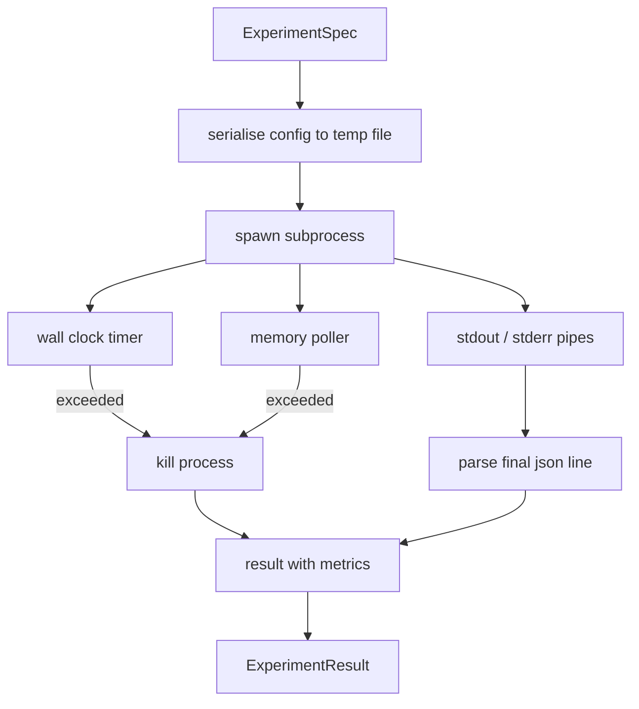

# Deneyim Koşucu

> Loop'un dürüstlüğü ölçümlerine bağlıdır. Yapımcıyı oluştur: bir spesifikasyon alır, sandboxed alt işlemde bir değerlendirici gönderir.

**Type:** Build
**Languages:** Python
**Prerequisites:** Phase 19 Track A lessons 20-29
**Time:** ~90 分钟

## Öğrenme Hedefleri
- Deneyi bir tipli spec olarak kodlayacağız, koşucu onu bir alt işlem için seriye edebilir.
-  Hard duvar saatinin zamanlaması ve yumuşak hafıza kapısının alt işlemini başlatmak, 
- Bu, bir tek sonuç kaydını yakalamak için yapılandırılmış metrikler blobı oluşturur.
- Construct ablation table, on fixed base spec 上一次扫一个配置按──
-                                                                                                                                                                                                                                                               

## Neden alt işlem kullanın

Araştırma döngüsü 会运行不信赖代码――hypotesis 来自样品,实验脚本也来自同一路径;把其中任一当作安全的过程中的代码,都等待一次会拖管弦仪的崩――Yüksek süreçler, dili kendisinde en basit bir izolektür:一个独立的过程、一个独立的地址空间,以及父母侧的信号处理――

Burada koşucunun  tam bir kum kutulaması yok. Cgroup yok, seccomp filtre yok, isim alanı yeniden düzenlenmesi yok.

## DeneyimSpec 形状

```text
ExperimentSpec
  spec_id        : str            (stable id，"exp_001")
  hypothesis_id  : int            (链接回 lesson 50 中的 queue)
  script_path    : str            (要运行的 python script 路径)
  config         : dict           (作为一个 json arg 传给 script)
  seed           : int            (experiment 的 deterministic seed)
  wall_timeout_s : float          (hard timeout，超出则 kill)
  memory_cap_mb  : int            (soft cap，轮询；超出则 kill)
  metric_keys    : list[str]      (evaluator 会读取的字段)
```

script disk üzerinde var; runner   write into a temporary file path  write into a temporary file path, script 再读取它──script 应该在 stdout 上打印单个 json line,其键是 `metric_keys`Üstündeki diğer içerikler yakalanır, ama metrikleri inceleyen onları göz ardı eder.


```figure
cg-runner-limits
```

## Mimarlık



Runner bir sınıf, bir ana yöntemle bir tane. Poller bir küçük iptir, her seçme aralarında bir kez ortaya çıkıyor ve kullanılabilir bir zamanda proc dosya sisteminden 读取 alt işlemlerin `psutil`eşdeğer; platform ortaya çıkmazsa, geri dönüşü hiçbir şekilde yapılmaz.

## Neden yumuşak hafıza kapağı ?

Hard hafıza kapakları 需要 `resource.setrlimit`Bu ders sadece POSIX üzerinde çalışmaktadır. Bu ders taşınabilir bir yaklaşım sunar: Platform sorgu sakinleri ayarının büyüklüğü, eğer limitten fazlasa, alt işlemleri öldürür.

Proces denetimi desteği olmayan sistemlerde, polyer bir kez uyarı kaydetir ve kendini devre saatini devreye kapatır.

## 捕获 stdout 和 stderr

Runner 会在完成时读取并排空两条管──Stdout 会逐行扫描; sonuncusu json için çözülebilmektedir ve tüm gerekli şeyleri içerir`metric_keys`Json çizgilerinin sonuçta kalması olarak değerlendirilecek.`intermediate_metrics`; değerlendirici öğrenme eğrilerini çizmek için kullanabilir.

Stderr 会原样捕获到结果中──runner 永远不会因为非零出口代码而升;它将代码记录在结果中──任何非零出口都标记为`"crash"`, hatta metrikleri yazdırmış olsa bile değerlendirici kısmi çalışmalar başarısızlık olarak kabul eder.

## Ablation tablosu

```python
def ablate(base: ExperimentSpec, knob: str, values: list[Any]) -> list[ExperimentSpec]:
    ...
```

给定基特标 和按号,该辅助会返回每个值对应的一个特标,并覆盖 `config[knob]` Her bir şehrin bir üyesi olacak.`spec_id`(`f"{base.spec_id}_{knob}_{value}"`)―Runner 提供一个 `AblationRunner`Bu özellikleri sırayla yürütüp, düğme değerini anahtar olarak geri gönder.`AblationTable`- Evet.

Neden bir kez sadece bir düğmeyi değiştirir. Bütün faktorial süpürmeler, indeks düzeyleri büyüyor, değerlendirici üretir  açıklanamayan sonuçlar. Bir kez bir düğme değerlendirici üretir.

## Determinizm

Her spec bir tane tane taşır. Koşucu, bir dizi ayarlama yaparak bir tane tane tane gönderir.`config["__seed"] = spec.seed`)。`code/experiments/`Orta numaralı deney senaryoları 会尊重 seed,并跨 runs 产生 the same metrics──lesson 53 中的评价者依赖此点;没有确定主义,所谓的"回归"可能只是不同的随机初始化──

## Sahte deney senaryosu

本课提供一个实验脚本:`code/experiments/sparsity_experiment.py`▽It's a real script, will read your own config file, use numpy random pass 模拟一个小型训练运行,并打印一个json metrics blob──script 支持 `sleep_s`Test zamanlarını kullanmak için düğme, de destek `allocate_mb`Kürek, bellek sorgulamasını test etmek için kullanılıyor.

Simülasyon hiç gerçekten eğitilmiyor hiçbir şey. Bu bir sayısal hesaplama, simülasyon değil, simülasyon. Gerçek deney metni, bir model içeriyor.

## Sonuç 形状

```text
ExperimentResult
  spec_id              : str
  hypothesis_id        : int
  exit_code            : int
  terminal             : "ok" | "timeout" | "oom" | "crash"
  wall_time_s          : float
  peak_rss_mb          : float | None
  metrics              : dict
  intermediate_metrics : list[dict]
  stdout_tail          : str
  stderr_tail          : str
```

değerlendirici 会先读取 `metrics`和 `terminal`Eğer terminal değilse`"ok"`... deney hesaplama başarısız çalışmak için, değerlendirici hüküm otomatik olarak üretilir.

## Nasıl okuyabilirim?

`code/main.py`- Defini etti .`ExperimentSpec`- Evet.`ExperimentResult`- Evet.`ExperimentRunner`- Evet.`AblationRunner`和一个确定性化演示――副进程管理 是一个类――memory poller 是一个小线──ablation helper 是一个单独函数──

`code/experiments/sparsity_experiment.py`Yapılan testler kullanılır. Argv'den 读取配置文件路径, ve tamamlandığında tek json metrik satırı yazılır.

`code/tests/test_runner.py`覆盖成功路径、timeout路径、崩路径、ablation table,以及跨两次运行的确定性检查──

## Ne yeri var ?

Ders elli 生成 hipotezi. Ders elli bir 过掉文献 已解决的内容── Ders elli iki 针对剩余部分运行实验── Ders elli üç 读取结果,运行意义测试,并写出管弦师 存储到假说 id 上的判决──
