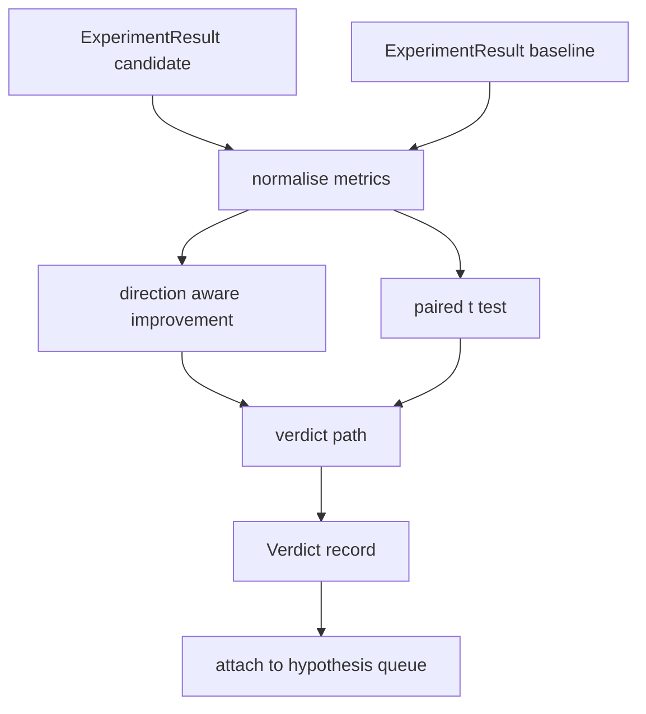

# 结果评估器

> runner 产出了数字──evaluator 判断这些数字代表改进,退缩,还是噪音──构建一条判决 路径,把 metrics 转换成一句结论──

**Type:** Build
**Languages:** Python
**Prerequisites:** Phase 19 Track A lessons 20-29
**Time:** ~90 minutes

## Öğrenme Hedefleri
- İşe yönelik yönde gelişme ve sabit bir eşiğin, adayın başvuru ile karşılaştırılması
- Her tohumun ölçümlerinden yukarıdaki çalışma çiftleştirilmiş t testi,并读取得到的p值──
- Log ölçekli ölçümlere normalleştirmek, aşağıdaki raporları çizgi ölçümlerle karıştırmak için kullanın.
- Her bir hipotezin hükmünü çıkarın. Orkestör, bu hipotezi 50. ders sırasına eklesin.
- Her adımı saf tut, aynı giriş her zaman aynı hüküm çıkar.

## Neden çift test

Runner  verilen tek sayı değişimin gerçek olup olmadığını açıklayamıyor. Aynı yapı değişimi farklı karmaşıklık elde edecektir. değişim sadece gürültü olabilir. Doğru karşılaştırma yöntemleri çiftleştirilmiştir: aynı tohumlar, aynı veriler, bir kez aday ile yürüyüş, bir kez temel ile yürüyüş.

Bu dersden başlamak için test edilmedi.`scipy.stats`Matematik yeterince küçük, bir ekran da okuyabilir.

```text
diffs    = [a_i - b_i for i in seeds]
mean     = sum(diffs) / n
variance = sum((d - mean) ** 2 for d in diffs) / (n - 1)
t_stat   = mean / sqrt(variance / n)
df       = n - 1
p_value  = two_sided_p(t_stat, df)
```

İki taraflı p değeri kullanılır düzenli eksik beta işlevi.

## Yöneticiyi iyileştirmek

Bazı ölçümler 变大时表示改进(精度、吞吐量) ・・・ Diğer bazı变小时表示改进(損失、混乱、壁時間) ・・・ değerlendirici 在每个度上携带一个`direction`- Evet.

```text
if direction == "higher_is_better":
    improvement = (candidate - baseline) / abs(baseline)
elif direction == "lower_is_better":
    improvement = (baseline - candidate) / abs(baseline)
```

İyileşme, daha yüksek için daha iyi metriktir, negatif için iyileşme, daha farklı bir aday gösterir.

Bir sabit eşiğiydi.`improvement_threshold=0.02`, %s of 2) değişimin yeterince büyük olup olmadığını belirlerken, bu eşiğinden aşağı bir yargı yapılabilir.


```figure
cg-paired-verdict
```

## Mimarlık



değerlendirici 运行三个独立计算,并在判决 路径中把它们合并──每个计算都是没有共享状态的纯函数──

## Günlük normallendirme

Kayıplara karşı karışıklık  indeks ilişkisi   kaybı  azalması 0.1  kaybı  kaybı  azalması  kaybı  kaybı  kaybı  kaybı  kaybı  kaybı  kaybı  kaybı  kaybı  kaybı  kaybı  kaybı  kaybı  kaybı  kaybı  kaybı  kaybı  kaybı  kaybı  kaybı  kaybı  kaybı  kaybı  kaybı  kaybı  kaybı  kaybı  kaybı  kaybı  kaybı  kaybı  kaybı  kaybı  kaybı  kaybı  kaybı  kaybı  kaybı  kaybı  kaybı  kaybı  kaybı  kaybı  kaybı  kaybı  kaybı  kaybı  kaybı  kaybı  kaybı  kaybı  kaybı  kaybı  kaybı  kaybı  kaybı  kaybı  kaybı  kaybı  kaybı  kaybı  kaybı  kaybı  kaybı  kaybı  kaybı  kaybı  kaybı  kaybı  kaybı  kaybı  kaybı  kaybı  kaybı  kaybı  kaybı  kaybı  kaybı  kaybı  kaybı  kaybı  kaybı  kaybı  kaybı  kaybı  kaybı  kaybı  kaybı  kaybı  kaybı  kaybı  kaybı  kaybı  kaybı  kaybı  kaybı  kaybı  kaybı  kaybı  kaybı  kaybı  kaybı  kaybı  kaybı  kaybı  kaybı  kaybı  kaybı  kaybı  kaybı  kaybı  kaybı  kaybı  kaybı  kaybı  kaybı  kaybı  kaybı  kayb  kayb  kayb  kayb  kayb  kayb  kayb  kayb   kayb  kayb     kayb  kayb    kayb  kayb  kayb   kayb  kayb     kayb  kayb     kayb  kayb     kayb  kayb     kayb  kayb           kayb       kayb                                        

Bu ders için`scale`字段为 `"log"`Bu nedenle, bu metrikler, daha düşük seviyede daha iyi metrikler olarak değerlendirilmiş ve daha düşük seviyede daha düşük seviyede daha iyi metrikler olarak değerlendirilmiş.`log(28) - log(32) = -0.133`%2'den çok daha yüksek.

```text
if scale == "log":
    a = log(candidate)
    b = log(baseline)
else:
    a = candidate
    b = baseline
```

`scale="linear"`(默认) Metrikler bu dönüşümden geçecek. Aynı kod yolu aynı zamanda iki işlem yapar.

## Tohum başına çiftli test

第五十二课的跑者会为每次跑 输出一个最终测量分点――对测试,evaluator 需要候选人 每种种子 一种种子,基线 每种种子 一个种子――orchestrator 会在一组种子上使用两个配置运行相同的实验,然后把两组`ExperimentResult`Kayıtlar değerlendiriciye teslim edilmiştir.

değerlendirici seed 配对 seed 位于 `result.metrics["seed"]`), sonra talebinin ölçümlerini geçiyor. Eğer iki grup listedeki tohumlar birbirine uymuyorsa, değerlendirici atılacak.`PairingError`Orkestrasyoncu yeniden çalışmalı.

## Yargı şekli

```text
Verdict
  hypothesis_id          : int
  metric                 : str
  direction              : "higher_is_better" | "lower_is_better"
  scale                  : "linear" | "log"
  candidate_mean         : float
  baseline_mean          : float
  improvement            : float       (signed, fraction; see direction rules)
  p_value                : float | None  (None if n < 2)
  significance_threshold : float
  improvement_threshold  : float
  verdict                : "improved" | "regressed" | "noise" | "failed"
  rationale              : str
```

Yargı 路径 张小 karar tablosu:

```text
1. If any candidate result has terminal != "ok": verdict = "failed"
2. else if |improvement| < improvement_threshold:  verdict = "noise"
3. else if p_value is None or p_value > significance: verdict = "noise"
4. else if improvement > 0:                          verdict = "improved"
5. else:                                             verdict = "regressed"
```

Rasyonasyon, insan tarafından okunur bir cümle. Orkester, bir hipoteze göre bir cümleyi log olarak kaydedebilir.

## Şifreyi nasıl okuyabilirsiniz

`code/main.py`- Defini etti .`MetricSpec`- Evet.`Verdict`- Evet.`Evaluator`、t istatistik 和 eksik beta yardımcıları, ayrıca bir belirleyici demo¬t test kullanılarak saf stdlib matematik 实现;numpy sadece ölçümler listesini okumak için kullanılır 并计算 means 和 variances。

`code/tests/test_evaluator.py`覆盖改善路径、退回路径、噪音 路径(小改善)、噪音 路径(低 n)、失敗終端 路径、log 標準化路径、已知参照值对比的 t test,以及对配错──

## Bu boşluklar nerede

第五十二课在多种种中 上用候选人和基线 配置运行实验──第五十三课读取这些运行 并写出判决──orkestrator 把四人一起:

```text
for hypothesis in queue:
    literature = retrieval.search(hypothesis.text)
    if literature_settles(hypothesis, literature):
        attach(hypothesis, verdict="settled")
        continue
    candidates = runner.run_all(specs_for(hypothesis))
    baselines  = runner.run_all(baseline_specs_for(hypothesis))
    metric_spec = MetricSpec("perplexity", direction=LOWER, scale=LOG)
    verdict = evaluator.evaluate(hypothesis.id, metric_spec, candidates, baselines)
    attach(hypothesis, verdict)
```

Bu orkeströr bu ders içinde değil; bu dört ders kendi tanımlarındaki veri sınıfları ile birlikte, herhangi bir ek yapıştırıcı gerektirmez.
