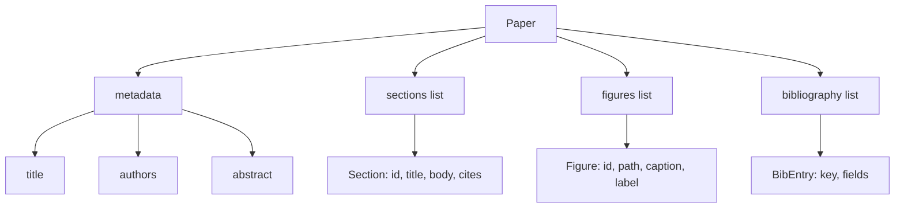
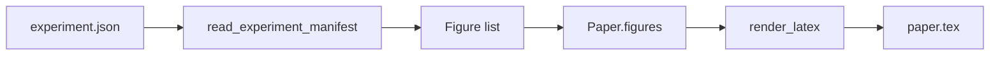
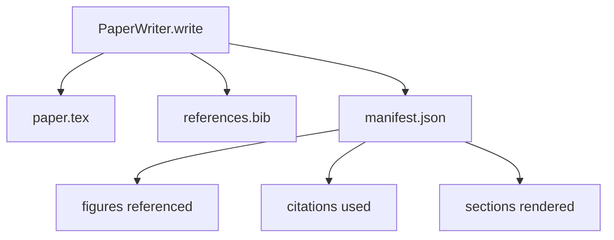

# 论文写作器

> LaTeX iskelet, araştırmacı ile tipetişör arasındaki bir sözleşmedir. Eğer sözleşme bozulursa belge toplanamaz ve başarısızlık çok açık olacaktır.

**Type:** Build
**Languages:** Python
**Prerequisites:** Phase 19 lessons 50-53
**Time:** ~90 minutes

## Öğrenme Hedefleri

- Araştırma kağıdı, serbest bir belge değil, bilinen bölüm grafiği olan yapılandırılmış eser olarak görülecek.
- Herhangi bir prosa yazmadan önce, soyut bir açıklama oluşturun, bölümler, figür boşlukları ve bibliografi anahtarlarının LaTeX iskeletleri.
-  Deterministik slot mekanizması ile deney çıkışları  yollar  başlıkları  figürler  iskelet 
-                                                                                                                                                                                                                                                               
- 输出单个 `paper.tex`Bir tane.`references.bib`, tekrar bir listeye her referanslı figür ve her kullanılan alıntı manifestoı ekleyin.


```figure
ch-paper-skeleton
```

## Neden önce iskelet?

Prosa başından itibaren proje Yapısal borç toplama. Giriş. Bir rakamın tanımlanmadan önce alıntılandığı yazılar.

Skeleton 会反转这一点──结构 先以数据 形式声明──Bölümler is带名和序的槽──Bölümler is带 ids 和字幕的槽──Bibliografi anahtarları üstteki açıklamalarda,并带有它们的指向的条目──Bölümler Bir kez bir slot'ta, Yer üretir, gider, harness herhangi bir prosa yazabilirsiniz 之前验证: her figürün bir slotı vardır, her alıntıda bir giriş vardır, her bölümde içerik tabloda görünebilir 中中中中中中中中中中中中中中中中中中中中中中中中中中中中中中中中中中中中中中中中中中中中中中中中中中中中中中中中中中中中中中中中中中中中中中中中中中中中中中中中中中中中中中中中中中中中中中中中中中中中中中中中中中中中中中中中中中中中中中中中中中中中中中中中中中中中中中中中中中中中中中中中中中中中中中中中中中中中中中中中中中中中中中中中中中中中中中中中中中中中中中中中中中中中中中中中中中中中中中中中中中中中中中中中中中中中中中中中中中中中中中中中中中中中中中中中中中中中中中中中中中中中中中中中中中中中中中中中中中中中中中中中中中中中中中中中中中中中中中中中中中中中中中中中中中中中中中中中中中中中中中中中中中中中中中中中中中中中中中中中中中中中中中中中中中中中中中中中中中中中中中中中中中中中中中中中中中中中中中中中中中中中中中中中中中中中中中中中中中中中中中中中中中中中中

Bu, planlara, araç çağrısına ve yukarıdaki disiplinlerin izlerine uygulanıyor.

## Kağıt şekli



Her alanı normal Python verileri...`Paper`LaTeX string'in saf fonksiyonu. Harness ön introspect kağıdı: statistik bölümler, kayıp rakam dosyalarını listede, her kontrol edebilirsiniz`\cite{key}`- Evet .`BibEntry`- Evet.

## Verim sözleşmesi

Birinci, iskeletin içindeki her figür boşluğu bir çıkış yapıyor.`\begin{figure}`blok,并带有稳定标签,格式为 `fig:<id>`İkinci olarak, her bölüm bir tane çıkardı.`\section{}`,并带有稳定标签,格式为`sec:<id>`, bu şekilde çapraz referanslar çalışabilir.`\bibliography`blok,其 `references.bib`精确包含纸上声明的条目,不多也不少──

违反任何一条都是报警,不是警告. 骨架就是合同. 静默丢弃的图像的 render就是合同破裂.

## Deneyimlerden elde edilen rakam enjeksiyonu

Bu iz Önceki bölümler: Bu deney sonuçlarını JSON manifestoları haline getirmek için. Her manifesto, bir eser listesi ile birlikte, yolları ve kısa başlıkları içerir.`Figure`Kayıtlar



Enjeksiyon deterministik ⋅ Şekil kimlikleri ⋅ deney adı 加上 monoton counter 派生── Captions from manifest──Paths 会相对纸的输出目录做正常化,因此即使实验输出 位于磁盘其他位置,LaTeX 也能编译──

## İftira eden proza jeneratörü

Bu ders model kullanmayacak.`MockProseGenerator`读取概要形,并决定性 地输出散文──概要形 是每个节 一条短字符串──generator 会将该字符串扩展成两个短段落,并把部分标题 编织进去──生成的散文 只会在概要 声明时名滴数字 和引用──

Bu yeterli test yazarının her davranışını gerçekleştirmek için jeneratörü model çağrısına dönüştürmek gerekir. Etrafındaki harman değişmeye gerek yok. Bu da proz jeneratörünün çağrılabilir değerini açıklamasıdır.

## Açık çıkış

yazar 会向输出目录 输出三个文件──



manifest is down游 evaluator or critical loop 读取的内容──它不解析 LaTeX;它不解析 LaTeX;它不读取 manifest──下一课 评论循环 会将这个 manifest 作为输入,并产生反意见列表──这就是为什么 manifest 是合同的一部分,而 LaTeX 不是──

## Valideleme kapıları

yazarı 在写入任何文件 之前运行四个门──

1. Kağıt içinde her bir rakam kimliği var.
2. Her bölümün`cites`字段引用的图书馆钥匙都已在纸上声明──
3. Açık olmayanı.
4. Başlık 非空。

Başarısızlık kapısı dışarı atılacak .`PaperValidationError`,并给出精确原因──harness 将该原因作为失败模式 暴露出来──没有部分写:要么输出全部三个文件,要么一个也不输出──

## Şifreyi nasıl okuyabilirsiniz

`code/main.py`- Defini etti .`Paper`- Evet.`Section`- Evet.`Figure`- Evet.`BibEntry`- Evet.`PaperValidationError`- Evet.`MockProseGenerator`- Evet.`PaperWriter`Ve bir tane .`render_latex`fonksiyon`write`yöntem 接收输出目录,并输出 `paper.tex`- Evet.`references.bib`和 `manifest.json`- Evet.`read_experiment_manifest`yardımcı 会将 deney listesi manifest 转换为 `Figure`Kayıtlar

`code/tests/test_paper_writer.py`覆盖: 没有节目 时的骨格 render、带两个节目 和两个数字的完整 render、missing-citation gate、duplicate-figure-id gate、manifest content,以及 LaTeX-string contract(每个节 输出一个`\section{}`, her rakam                                                                                                                                                                                                                                                                                                                                                                                                                                                                                                                          `\begin{figure}`)。

## Daha ileri gitmeye çalışıyorum .

Gerçekte gerçekleştirmek için iki uzantı gerekir. Birincisi, çok formatlı render:同一个`Paper`biçimleri oluşturmak için kullanılabilir Blog yazı için Markdown, ve önizleme kullanılabilir HTML:  renderer `Paper`Üstün strateji, ikinci, alıntı zenginleştirme: given determin本地 DOI cache,writer from citation key  get BibTeX entries── ikisi de değerlidir, ya da olabilir 触摸骨合同的情况下添加──

Skeleton is this time down注── Bölümler, rakamlar ve alıntılar 以 data 形式声明, prose 生成到 slots 中,manifest 与 LaTeX 一起输出── diğer her gelişme üzerinde bir kitle olabilir──
