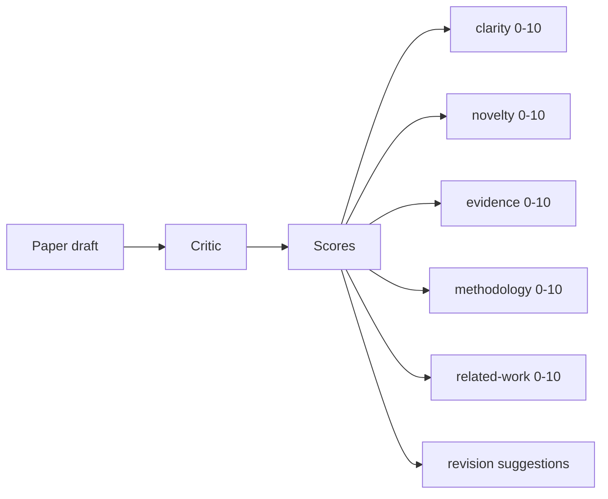
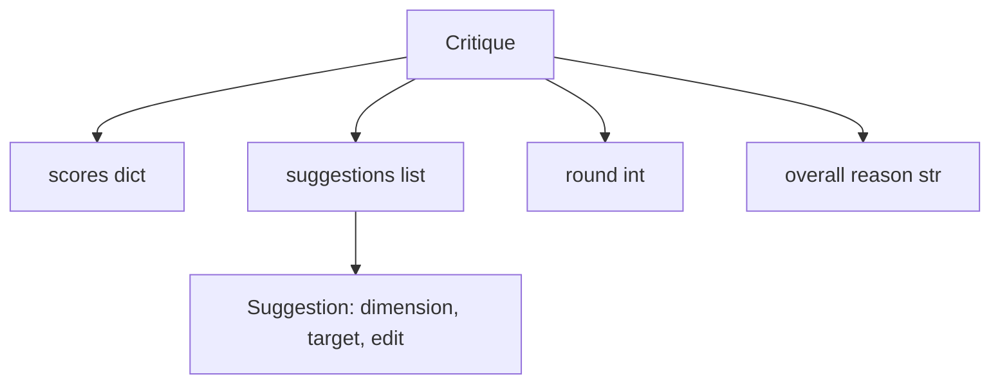
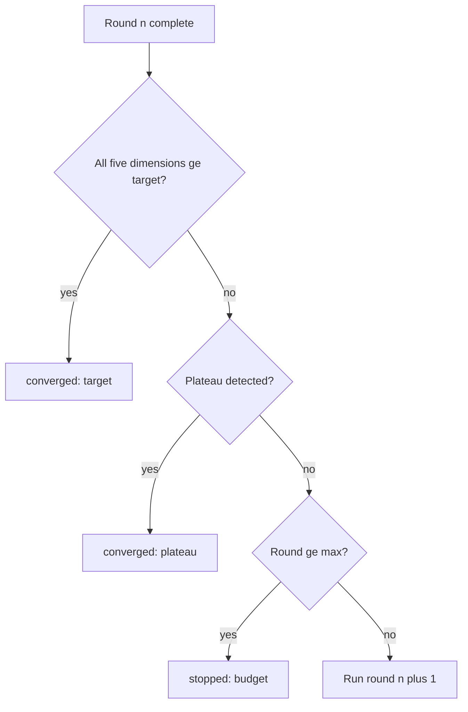
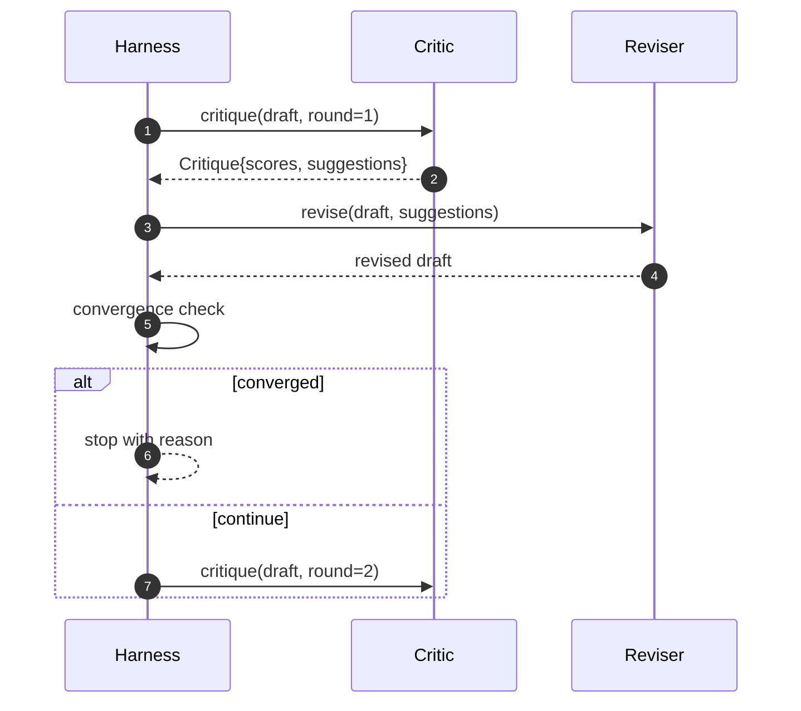

# Eleştirmenlik Çeliği

> İlk kez "iyi görünüyor" eleştirmeni kötüye döner. "İş ihtiyacı" eleştirmeni de kötüye döner.

**Type:** Build
**Languages:** Python
**Prerequisites:** Phase 19 lessons 50-53
**Time:** ~90 minutes

## Öğrenme Hedefleri


```figure
ch-critic-converge
```

- 按五个固定维度为论文草稿打分: açıklık, yenilik, kanıt, yöntem, ilgili çalışma­lar
- Her bir eleştirinin bir düzeninde yeniden yazılmak yerine yapısal bir inceleme için kullanılması farklıdır.
-                                                                                                                                                                                                                                                               
- Bu yüzden, bu konuda çok fazla bilgi almak için, bu konuda çok fazla bilgi edinin.
- 输出轮回追踪,让仪表板或下一阶段可以染分数轨迹──

## Neden beş sabit boyut kullanın?

Özgür biçimli eleştirmen, bir geri dönüş önerisi bölümünün modelidir.

5 boyut bir şapka.



%s bir vektördür. Harness, her boyutda değişimleri gözlemler. Bir açıklık artırır. Ama kanıtlar büyük ölçüde düşerken, kanıtlar yukarıdaki gerileme, uyum kontrolü görür.

## Kritik 结构



Her öneride, geliştirilen boyut, hedef bölüm ve uygulanabilir bir düzenleme bulunmaktadır.`edit`Bu ders bir kesinlik düzenleyicisi sağlar, bölümlere ekleme yaparak 操作 için düzenleme yapar.

## Dönüşüm kuralları, aşama sırasıyla yürütülür

Kritik döngü, üç şarttan herhangi birinden geçerek sona erecektir.



Hedef en sıkı durumdur: açıklık, yenilik, kanıt, metodoloji, ilgili çalışma) beş boyuttan her biri ulaşılması gerekir.`>= target_score`(默认)`8.0`),loop 才会返回成功──平均值很高,但有一个弱度不够──板块检测会比较当前轮平均值和上轮平均值──如果连续两轮的改善低于`plateau_epsilon`(默认)`0.1`- Çeviri`plateau`Bütçe, döngü sayısı için bir sert sınırı.`5`),并以 `budget`Çıkış.

序很重要──目标 优先 plateau, plateau 优先 budget──如果第三轮在同一时间代中既达到目标又会触发高原,结果是`target`- Hayır .`plateau`- Evet.

## Neden plato tespit 跨两轮运行

单轮高原是噪音──真实的批评者 即使面对固定草案,每次代也会回归有略有不同的分数,因为确定性得分 仍然取决于应用的建议以及应用顺序──要求连续两轮高原可以过这种噪音──如果利用 报告高原,说明草案 确实已经停止了改进──

## 本课中的确定性 eleştirmen

Bu ders, bir eleştirmenin bir çağrısı olacaktır. Bu üç sinyalle bir projeye dayanacak.`originality_tag`字段(yenilik) ⋅reviser 知道如何把每个分数上推──

```text
clarity      在平均 section 正文长度增加时增长
novelty      在 originality_tag 设置为 "high" 时增长
evidence     在某个 section 的 figure_refs 非空时增长
methodology  在存在标题为 "Method" 且有正文的 section 时增长
related-work 在存在标题为 "Related Work" 且有正文的 section 时增长
```

reviser 会把每条建议 解释为定向增加.

## 完整 loop 契约



Harness 拥有圆计、跟踪 和融合检――批判 拥有得点――revisor 拥有差──三者都不会触碰彼此的状态──

## İzleme 输出

Her bir turda bir iz etkinliği çıkarılır, yuvarlak sayı, puan vektörleri, öneriler sayımı ve bir yaklaşım hükümü bulunur.

## 防止坏批判的预算

Bir eleştirmen, bir de bir de bir de bir de bir de bir de bir de bir de bir de bir de bir de bir de bir de bir de bir de bir de bir de bir de bir de bir de bir de bir de bir de bir de bir de bir de bir de bir de bir de bir de bir de bir de bir de bir de bir de bir de bir de bir de bir de bir de bir de bir de bir de bir de bir de bir de bir de bir de bir de bir de bir de bir de bir de bir de bir de bir de bir de bir de bir de bir de bir de bir de bir de bir de bir de bir de bir de bir de bir de bir de bir de bir de bir de bir de bir de bir de bir de bir de bir de bir de bir de bir de bir de bir de bir de bir de bir de bir de bir de bir de bir de bir de bir de bir de bir de bir de bir de bir de bir de bir de bir de bir de bir de bir de bir de bir de bir de bir de bir de bir de bir de bir de bir de bir de bir de bir de bir de bir de bir de bir de bir de bir de bir de bir de bir de bir de bir de bir de bir de bir de bir de bir de bir de bir de bir de bir de bir de bir de bir de bir de bir de bir de bir de bir de bir de bir de bir bir de bir de bir de bir de bir de bir de bir de bir de bir de bir de bir de bir de bir de bir de bir de bir de bir de bir de bir de bir de bir de bir de bir de bir de bir de bir de bir de bir de bir de bir de bir de bir de bir de bir de bir de bir de bir de bir de bir de bir de bir de bir de bir de bir de bir de bir de bir de bir de bir de bir de bir de bir de bir de bir de bir de bir de bir de bir de bir de bir de bir de bir de bir de bir de bir de bir de bir de bir de bir de bir de bir de bir de bir de bir de bir de bir de bir de bir de bir de bir de bir de bir de bir de bir de bir de bir de bir de bir de bir de bir de bir de bir de bir de bir de bir de bir de bir de bir de bir de bir de bir de bir de bir de bir de bir de bir de`budget` Kullanıcı bunu bir tasarım hataları yerine eleştirel hatalar olarak yorumlar.

## Nasıl okuyabilirim?

`code/main.py`- Defini etti .`Critique`- Evet.`Suggestion`- Evet.`Critic`Protokol,`Reviser`Protokol,`CriticLoop`Ve bir tane .`make_deterministic_critic_pair`Fabrika, kesinlik eleştirmeni ve uyumlu bir revisoru içerir.`Paper`结构,让本课可以独立运行──

`code/tests/test_critic_loop.py`覆盖: birinci tur sonrası tek düzenleme düzeltmeleri, düzeltilmiş taslaklar, hedef birleşmeleri, iki tur sonrası plato tespitleri, hiçbir önerme yapılmamış, gelişen bütçe tüketimi, önerilerin uygulanması ve izleme yapısı.

## Daha fazla araştırmak

Gerçekleşmek iki genişleme gerektirir. Birinci, boyut ağırlıkları: atölyeler 论文会更重视新品而不是方法;jurnal 则相反──konvergense kontrol 会变成加权平均值──二, çift eleştirmen: bir eleştirmen 负责打分,第二批评者 在修订者 在看看建议 之前对它们作出裁决──二有价值,并且都可以组合在一个`Critique`Yapıların üstünde.

关键注是分量向量── once critique is structured, all other improvements, convergence rule, dashboard, paired critic, can be in unchanging loop context 
