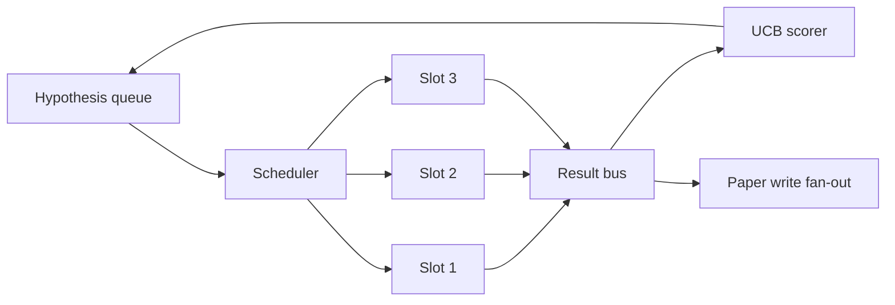
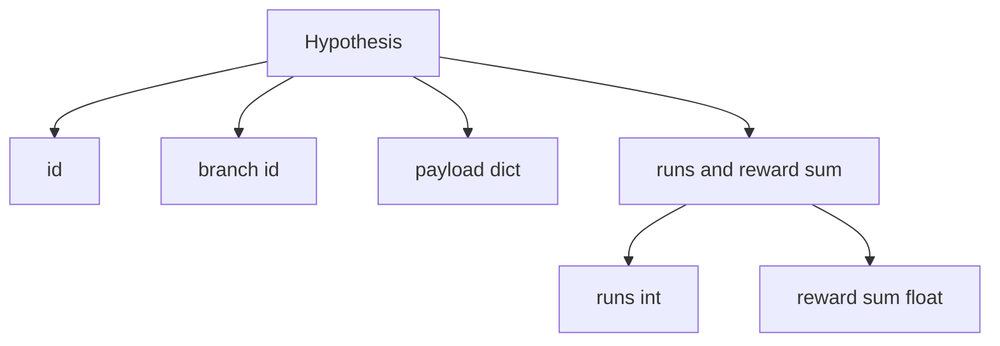
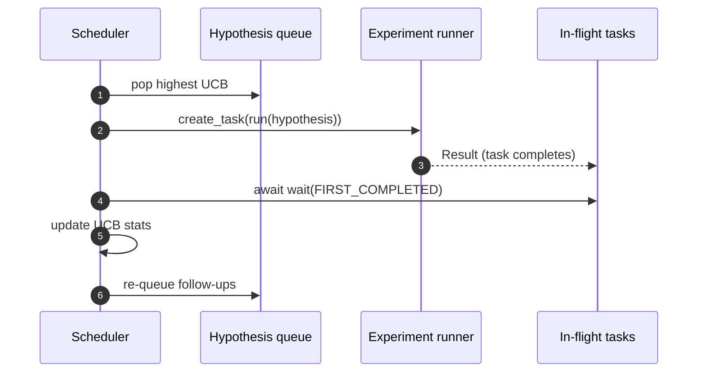

# İterasyon Programlayıcısı

>  Programlayıcı olmayan araştırma döngüsü, bir hayali kuyruktur.  Programlayıcı, bir döngüdür.

**Type:** Build
**Languages:** Python
**Prerequisites:** Phase 19 lessons 50-53
**Time:** ~90 minutes

## Öğrenme Hedefleri


```figure
ch-ucb-scheduler
```

- Araştırma iş akışını bir hipotez kuyrukuna dönüştürmek, deney boşluklarını birleştirmek ve sonuç tekrar tekrar hayran olmak için bir dizi hipotezi çizgi oluşturmak.
- Bu yüzden çok sayıda deney yaptırıp programcıya tüm boşlukları meşgul tutmalarını sağlayın.
- UCB'yi her hipotezi dalı için kullanın 打分, programcıyı araştırmayı bırakmadan yapabilirsiniz 低产出分
- Tamamlanan sonuçlar kağıt yazma aşamasına ve tekrar sıra aşamasına yayılacak, dalın çıkmasını sağlayacak ve takip hipotezleri oluşturur.
- 暴露 発回数 iz, 含分分、slot işgalı 和 kesim kararları

## Neden programcı, iş listesinden değil?

平 iş listesinin işlerin iş sırasıyla gönderilmesi için yapılacağı işler.

İlginç tasarım seçimi skorlama kuralıdır. 贪心 scorer 总是选择当前领导,永远不探索. 平均 scorer 永远不利用. UCB (UCB) ⇒ 平均值 (UCB) ⇒ 平均值 (UCB) ⇒ 平均值 (UCB) ⇒ 平均值 (UCB) ⇒ 平均值 (UCB) ⇒ 平均值 (UCB) ⇒ 平均值 (UCB) ⇒ 平均值 (UCB) ⇒ 平均值 (UCB) ⇒ 平均值 (UCB) ⇒ 平均值 (UCB) ⇒ 平均值 (UCB) ⇒ ⇒ 平均值 (UCB) ⇒ ⇒ ⇒ ⇒ ⇒ ⇒ ⇒ ⇒ ⇒ ⇒ ⇒ ⇒ ⇒ ⇒ ⇒ ⇒ ⇒ ⇒ ⇒ ⇒ ⇒ ⇒ ⇒ ⇒ ⇒ ⇒ ⇒ ⇒ ⇒ ⇒ ⇒ ⇒ ⇒ ⇒ ⇒ ⇒ ⇒ ⇒ ⇒ ⇒ ⇒ ⇒ ⇒ ⇒ ⇒ ⇒ ⇒ ⇒ ⇒ ⇒ ⇒ ⇒ ⇒ ⇒ ⇒ ⇒ ⇒ ⇒ ⇒ ⇒ ⇒ ⇒ ⇒ ⇒ ⇒ ⇒ ⇒ ⇒ ⇒ ⇒ ⇒ ⇒ ⇒ ⇒ ⇒ ⇒ ⇒ ⇒ ⇒ ⇒ ⇒ ⇒ ⇒ ⇒ ⇒ ⇒ ⇒ ⇒ ⇒ ⇒ ⇒ ⇒ ⇒ ⇒ ⇒ ⇒ ⇒ ⇒ ⇒ ⇒ ⇒ ⇒ ⇒ ⇒ ⇒ ⇒ ⇒ ⇒ ⇒ ⇒ ⇒ ⇒ ⇒ ⇒ ⇒ ⇒ ⇒ ⇒ ⇒ ⇒ ⇒ ⇒ ⇒ ⇒ ⇒ ⇒ ⇒ ⇒ ⇒ ⇒ ⇒ ⇒ ⇒ ⇒ ⇒ ⇒ ⇒ ⇒ ⇒ ⇒ ⇒  ⇒ ⇒ ⇒ ⇒   ⇒ ⇒            ⇒                                       

## 系统结构



sıra 保存假设──scheduler 在 slot 释放时选择 UCB最高假设──每个插槽 异步运行一个实验──完成的实验将将结果将到车上.

## Hipotez 结构



`branch`UCB istatistiklerinin anahtarıdır. Birçok hipotez bir dalı paylaşabilir.`runs`Bu dalda tamamlanmış deneylerin sayısı,`reward_sum`Bu da bir ödül.

## UCB puanlaması

本课使用的 UCB公式是经典 UCB1──

```math
\text{ucb}(\text{branch}) = \text{mean\_reward}(\text{branch}) + c \sqrt{ \frac{\ln(\text{total\_runs})}{\text{runs}(\text{branch})} }
```

`total_runs`Bu, tüm dalların toplam sayısı.`c`Bu , bir araştırma ağırlığıdır .`sqrt(2)`◊ ⇒ ⇒ ⇒ ⇒ ⇒ ⇒ ⇒ ⇒ ⇒ ⇒ ⇒ ⇒ ⇒ ⇒ ⇒ ⇒ ⇒ ⇒ ⇒ ⇒ ⇒ ⇒ ⇒ ⇒ ⇒ ⇒ ⇒ ⇒ ⇒ ⇒ ⇒ ⇒ ⇒ ⇒ ⇒ ⇒ ⇒ ⇒ ⇒ ⇒ ⇒ ⇒ ⇒ ⇒ ⇒ ⇒ ⇒ ⇒ ⇒ ⇒ ⇒ ⇒ ⇒ ⇒ ⇒ ⇒ ⇒ ⇒ ⇒ ⇒ ⇒ ⇒ ⇒ ⇒ ⇒ ⇒ ⇒ ⇒ ⇒ ⇒ ⇒ ⇒ ⇒ ⇒ ⇒ ⇒ ⇒ ⇒ ⇒ ⇒ ⇒ ⇒ ⇒ ⇒ ⇒ ⇒ ⇒ ⇒ ⇒ ⇒ ⇒ ⇒ ⇒ ⇒ ⇒ ⇒ ⇒ ⇒ ⇒ ⇒ ⇒ ⇒ ⇒ ⇒ ⇒ ⇒ ⇒ ⇒ ⇒ ⇒ ⇒ ⇒ ⇒ ⇒ ⇒ ⇒ ⇒ ⇒ ⇒ ⇒ ⇒ ⇒ ⇒ ⇒ ⇒ ⇒ ⇒ ⇒ ⇒ ⇒    ⇒ ⇒ ⇒  ⇒ ⇒ ⇒  ⇒ ⇒         ⇒     ⇒ ⇒      ⇒                                                                                                                                                                                                          `+inf`, bu yüzden denememiş dallar 总是先调调调――平均奖励高的分支会保持高分,直到其他分支会追上;运行很多次但奖励不高的分支会被运行次数更少的替代品超过──

Çöpçü ile kesme kapısı ayrılıyor.`prune_after_runs`Sonraki denemeler`3`) 后平均 ödül 低于绝对 floor (doğru)`0.2`) zaman, kesim, bu dalı gelecek programlamalardan çıkarır. Bu sırayı  sınırları tutmak için sağlar.

## İstihbaratın İstihbaratı

programlayıcı 使用 `asyncio.create_task`驱动实验──每个任务 运行实验运行(一个 `async def`Çağırılabilir),并返回一个 `Result`❖ Başlık döngüsü `asyncio.wait(..., return_when=asyncio.FIRST_COMPLETED)`Uçuş görevlerini bekleyin, toplayın ve her seferinde tamamlanınca puanlama güncelleme yapın.



Üç yuvarlak ve çalıştırılmaya devam eder. Ana döngü, tek bir deneyde asla engellemez.

## Fan-out: kağıt tetikleyicileri

Bir dalın ortalama ödülü geçer .`paper_threshold`(默认)`0.7`), ve bu şube  henüz kağıt üretilmemiş  zaman, programcı bir `paper.trigger`Evren hayranı çıkış listesine. Aşağı游会第五十四课的论文作家 接手它.

## Yayınlama: takip hipotezleri

Yüksek performanslı sonuçlar geldiğinde, programcı kullanıcıların sağladığı bilgileri kullanabilir.`expander`Aynı dalda bir veya daha fazla takip hipotezi üretmek.`Result`- Ne ?`list[Hypothesis]`Bu ders, kağıt eşiğinden daha fazla bir ödül elde edecek bir kesinlik genişleticisi sunar.

## Bütçeler

İki bütçeye sahip olmak, kaçak döngüleri önlemek için programcıyı korumak.

```text
max_experiments    : 跨所有 branches 运行的 experiments 总数
max_seconds        : wall-clock cap (asyncio time)
```

Eğer bir şey başlıyorsa, programcı yeni görevleri düzenlemeyi durdurur, uçuşta görevleri bekler, tamamlar, ve son izleri geri döndürür.`stop_reason`- Evet.

## İzleme ve son rapor

Her planlama kararı, bir etkinlik çıkarır. Son rapor, bir bölümden bir tarihe göre yapılır.

## Nasıl okuyabilirim?

`code/main.py`- Defini etti .`Hypothesis`- Evet.`Result`- Evet.`BranchStats`- Evet.`IterationScheduler`Ve bir tane .`make_deterministic_runner`Fabrika, bir tane geri dönecek. Bir tane de beklenmedik ödüllerle.`delay_ms`(默认)`5ms`), 让同步可观察──

`code/tests/test_scheduler.py`覆盖:UCB 优先选择未尝试分支、平行槽占用、跨越门时的纸触发器、低产出试验 后的分支剪、粉丝-out takip hipotezleri,以及预算出口(eksperiment count 和壁時計 两者)

## Daha fazla araştırmak

Gerçekleşme üç büyüme gerektirir. Birinci, UCB istatistiklerinin sürekliliği: mevcut istatistikler 存在内存里; gerçek programcı 会チェックポイント 它们,让重启保留已经花掉的探索预算──二,多目的得分:每个结果不再输出一个 skalar reward,而是输出一个矢量,UCB 变成Pareto-style picker──第三,文脈盗:picker 基于假设的特征长度──复杂性) 进行条件化,让相似的假设 共享探索──

Programlayıcı, araştırma yapma 超越工作清单的地方── UCB 接好、slots并行运行后, tüm diğer gelişmeler üzerine yerleştirilebilir──
