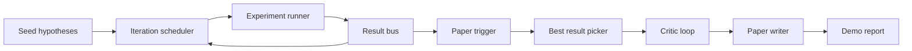
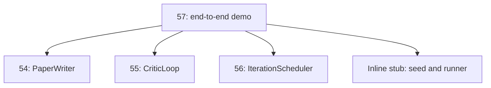
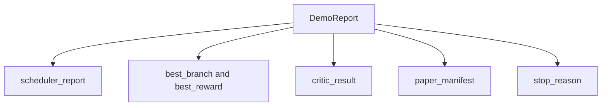

# Sonundan Sonuna Araştırma Demo

> Demo, önceden yazdığın her sözleşmenin bir araya gelmesi gereken yer.

**Type:** Build
**Languages:** Python
**Prerequisites:** Phase 19 lessons 50-53
**Time:** ~90 minutes

## Öğrenme Hedefleri


```figure
ch-research-pipeline
```

- Oto- Araştırma Çapısı 端到端串连起来: hipotezi tohum, deney koşucu, programcı, eleştirel çapı, kağıt yazarı
- 组合前四节 D'nin ilk sınıfları çerçeve üzerinden değil, normal Python'dan aktarılıyor.
- 运行循环 until自行终止,并输出一个列出每阶段 输出单一 Demo report──
- Demo belirleyici tutun, test süiti kesin bir şekilde sonuçlanabilir.
- Eğer herhangi bir aşama sözleşmeyi 破坏时,暴露清晰的失败模式,避免下一个阶段 使用破损输入 继续运行──

## Bu neyin bir parçası?



六个阶段──seed is a list of three条 hypotheses──scheduler using three parallel slots In between them run six experiments──bus 报告一个或多个纸触发器──picker 选择单个最佳结果──批判循环 基于该结果 构建的草案 进行代──纸作家 输出最终的 LaTeX、BibTeX 和 manifest──

## Neden kopyalamak yerine ithal et?

Önceki her bölümde bir tane toplumsal veri sınıfları ve fonksiyonları ile birlikte veri veri sınıfları ve fonksiyonları ile birlikte verilir.`main.py`❖ Demo 通过调整 `sys.path`Bu çerçeve kablosu değil; önceki derslerde test dosyaları ile ışığa aktarılan ışığa benzer.



inline stub 代表第 50〜第 53 课: 一小型种子假设生成器 和 一同步奖励函数──用户可以通过调整两个进口,将在线 stub 替换为那些课程中的真实原始的──

## Deterinizm 保证

Demo on construction is deterministic──experiment runner Using seeded NumPy──critical loop's reviser 按固定顺序遍历固定维度──paper writer's prose generator is the 54 课中的 mocked 版本──scheduler's UCB picker 在代代序上打破 Ties,而不是随机选择──

给定相同的种子,Demo 会输出相同的报告――test 通过运行Demo 两次并比较 manifest 来断这个属性――

## Demo raporunun şekli



Her alanın birbiri yukarıdaki aşamada yer alıyor. Demo hiçbir çıkışı değiştirmiyor. Sadece onları bir araya getiriyor.

## Başarısızlık modusu 处理

Her aşamada bir yazma hatası çıkartmak ya da başarılı olmak gerekir.

```text
Scheduler ........ returns SchedulerReport with stop_reason
                   in {queue_empty, max_experiments, deadline}
Best-result pick . raises NoTriggerError if no paper trigger fired
Critic loop ...... returns LoopResult with status converged or stopped
Paper writer ..... raises PaperValidationError on contract break
```

Bu sözleşmeyi sabitlemiş:`test_no_triggers_raises_typed_error`和 `test_best_picker_raises_when_no_triggers`Şubesi yokken, çekiciler çıkaracak.`NoTriggerError`- Ne ?`BestResultError`Ve yazar da asla kullanılmaz.

## En iyi sonuç seçicisi

programcı 会按分支 输出纸触发器──picker 选择所有触发器 中中 mean reward 最高的分支──ties 按分支 id 的字母顺序打破,使Demo deterministic──picker 是一个小型纯函数;test 使用固定的时间表报告 固定它的行为──

## 串接 eleştirmen döngüsü

第55 课中的批判循环 作用于`MiniPaper`❖ Demo  seçilmiş dal 构建一个 `MiniPaper`: Use branch id fill abstract,seed 两个部分(Kâhyâ ve Sonuçlar),并根据 branch'ın ortalama ödül 设置 `originality_tag`(Eğer `>= 0.8`Yüksek, eğer `>= 0.6`Çekilmez, düşük veya orta seviyede.

Daha sonra revisor 代到融合─output 会进入 paper writer─

## 串接 kağıt yazarı

54 . Sınıfdaki makale yazarı , rakamları ve bibliografiyi içermeye çalışır .`Paper`Şekil: Demo`mini_to_full_paper`升级 konverged `MiniPaper`, seçilmiş dal için bir rakam ekleyecek ve eleştirmen önerilerine göre bir küçük sentetik bibliyografi oluşturmaya ve oluşturmaya devam edecek.

## Nasıl okuyabilirim?

`code/main.py`- Defini etti .`BestResultError`- Evet.`NoTriggerError`- Evet.`DemoReport`- Evet.`pick_best_branch`- Evet.`build_mini_paper`- Evet.`mini_to_full_paper`和 `run_demo`❖ Üst düzey ithalatı bir kez düzenlenecek`sys.path`, ve kendi derslerinden çekmek`PaperWriter`- Evet.`CriticLoop`和 `IterationScheduler`- Evet.

`code/tests/test_e2e.py`覆盖:Demo 端到端运行并输出一个五个字段 全部填充的报告;两次运行之间的确定性;没有分支 过了门时的 NoTriggerError;作者合同 破坏时的 PaperValidationError;纸质公布 包含选定的分支的数字;以及调节器停止理由是预期值之一――

## 继续扩展

Demo 变绿后,有三个值得串连的扩展──第一,恒久状态:每个阶段的结果:写入一个小型JSON store,使重启可以不重新运行便宜的阶段就恢复──第二,dashboard:scheduler 和 critic loop 的追踪事件 染为单一时间线──第三,真实模型调用:将被嘲笑的散文生成器 和确定性评论者 替换为模型驱动的版本;配线不需要改变──第三,真实模型调用:将被嘲笑的散文生成器 和确定性评论者 替换为模型驱动的版本;

Demo'nun görevi yapıyı kanıtlamak, mimariyi kanıtlamak, dört ders, dört ithalat, bir rapor, bir aşama eklemek, bir aşama eklemek, bir aşama eklemek, bir aşama eklemek.
