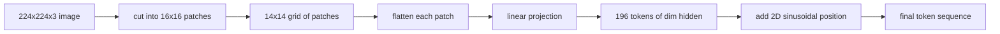

# 视觉编码器 Patches

> 读取像素的视觉模型需要像素分词器──补丁嵌入就是那分词器──将图像切割成正方形网格,展平每正方形,投影到线性层,然后添加2D 位置信号,以便变压器知道每正方形在原始图像中的位置──

**Type:** Build
**Languages:** Python
**Prerequisites:** 第19期第30-37课（B轨基础）
**Time:** ~90 分钟

## Öğrenme hedefi

- Resimleri sabit boyutlu eklemler için değiştirmek için yerleştirme sırası oluşturmak.
- 实现基于 `Conv2d`Bu proje, bir proje ile bir proje ile bir proje ile bir proje ile bir proje ile bir proje ile bir proje ile bir proje ile bir proje ile bir proje ile bir proje ile bir proje ile bir proje ile bir proje ile bir proje ile bir proje ile bir proje ile bir proje ile bir proje ile bir proje ile bir proje ile bir proje ile bir proje ile bir proje ile bir proje ile bir proje ile bir proje ile bir proje ile bir proje ile bir proje ile bir proje ile bir proje ile bir proje ile bir proje ile bir proje ile bir proje ile bir proje ile bir proje ile bir proje ile bir proje ile bir proje ile bir proje ile bir proje ile bir proje ile bir proje ile bir proje ile bir proje ile bir proje ile bir proje ile bir proje ile bir proje ile bir proje ile bir proje ile bir proje ile bir proje ile bir proje ile bir proje ile bir proje ile bir proje ile bir proje ile bir proje ile bir proje ile bir proje ile bir proje ile bir proje ile bir proje ile bir proje ile bir proje ile bir proje ile bir proje ile bir proje ile bir proje ile bir proje ile bir proje ile bir ile bir proje ile bir proje ile bir ile bir proje ile bir proje ile bir ile bir proje ile bir ile bir proje ile bir ile bir proje ile bir ile bir ile bir proje ile bir ile bir ile bir proje ile bir ile bir ile bir bağlantısı ile bir ile bir ile bir bağlantısı ile bir ile bir ile bir bağlantısı ile bir ile bir ile bir bağlantısı ile bir ile bir ile bir bağlantı kursa bir bağlantı kursa bir bir bir bir bir bir bağlantı kursa bir bir bir bir bir bir bir ile bir ile bir ile bir ile bir ile bir ile bir bağlantı kursa bir bir ile bir ile bir ile bir ile bir bağlantı kursa bir bir bir ile bir ile bir bir ile bir ile bir ile bir bağlantı kursa bir bir bir bir bir ile bir ile bir ile bir ile bir ile bir ile bir ile bir ile bir ile bir ile bir ile bir ile bir ile bir ile bir ile bir ile bir ile bir ile bir ile bir ile bir ile bir ile bir ile bir ile bir ile bir ile bir ile bir ile bir ile bir ile bir ile bir ile bir ile bir ile bir ile bir ile bir ile bir ile bir ile bir ile bir ile bir ile bir ile bir ile bir ile bir ile bir ile bir ile bir ile bir ile bir ile bir ile bir ile bir ile bir ile bir ile bir ile bir ile bir ile bir ile bir ile bir ile bir
- 构建确定性 2D 正弦位置嵌入,以便token顺序编码空间位置──
- 验证合成 armatura                                                                                                                                                                                                                                                                                                                                                                                                                                                                                                                        `Conv2d`/ 展开等效性──

## 问题

Transformer 接收一系列向量──图像是一个3通道网格──将每个像素作为代码读取导致序列长度爆炸:224x224 RGB 图像是150,528个代码,这是12层 Transformer 无法承受──将图像读取为一个巨大的平面向量会丢弃局局部性,而注意层无法从中恢复──编码器前端的工作是将图像素网格压缩为数百个代码,每个代码概括一个正方形区域──

补丁嵌入通过一个线性投影解决了这个问题――将将224x224 图像切割成16x16块会产生包含196 块的14x14 网格――每个补丁都从`(3, 16, 16) = 768`像素值展平为一个向量,然后线性层将其映射到模型的隐藏维度――Transformer 见 196 维度为`hidden`(genellikle 768) bir simge ile bir CLS simgesi eklenir. Bu, ağın geri kalan kısmının ödünç alabileceği bir dizi.

## 概念



### Neden bir düzeltme, bir resim değil?

dikkat, bir dizi uzunluğunun ikinci katıdır. 196 tane simgelik bir dizi kat katılık için harcanır.`196 * 196 = 38,416`dikkat çekme sayısı; 150,528 个代币序列的成本为 `150,528 * 150,528 = 22.6 billion`❖ Eklemler dikkat hesaplama miktarını 590.000 kat azaltabilir ve tek bir 16x16 bölge yüksek görüntü görevlerini gerçekleştirmek için yeterli sinyal taşıyabilir. ❖ Eklemlerin bir kısmının ayrıntılı boşluk ayrıntılarını kaybetmesi, genellikle ayrıntılı konumlandırma sırasında ikinci yüksek çözünürlüklü bölümün çalışmasının neden olduğu nedenindir.

### Neden bir proje yeterli?

Her bir ekleme bağımsız bir boyut olarak görülür.`768 * 768 = 589,824`参数) ve eğitim hızı çok hızlıdır. Daha derin bir kıvrım vardır.

### `Conv2d`技巧

Hiç doldurulmamış.`Conv2d(in_channels=3, out_channels=hidden, kernel_size=patch_size, stride=patch_size)`√ √ √ √ √ √ √ √ √ √ √ √ √ √ √ √ √ √ √ √ √ √ √ √ √ √ √ √ √ √ √ √ √ √ √ √ √ √ √ √ √ √ √ √ √ √ √ √ √ √ √ √ √ √ √ √ √ √ √ √ √ √ √ √ √ √ √ √ √ √ √ √ √ √ √ √ √ √ √ √ √ √ √ √ √ √ √ √ √ √ √ √ √ √ √ √ √ √ √ √ √ √ √ √ √ √ √ √ √ √ √ √ √ √ √ √ √ √ √ √ √ √ √ √ √ √ √ √ √ √ √ √ √ √ √ √ √ √ √ √ √ √ √ √ √ √ √ √ √ √ √ √ √ √ √ √ √ √ √ √ √ √ √ √ √ √ √ √ √ √ √ √ √ √ √ √ √ √ √ √ √ √ √ √ √ √ √ √ √ √ √ √ √ √ √ √ √ √ √ √ √ √ √ √ √ √ √ √ √ √ √ √ √ √ √ √ √ √ √ √ √ √ √ √ √ √ √ √ √ √ √ √ √ √ √ √ √ √ √ √ √ √ √ √ √ √ √ √ √ √ √ √ √ √ √

### Yerleşme

Token taşımıyor proje dışında herhangi bir sırada. 2D 正弦嵌入 each token provides a fixed signal, to code it `(row, col)`位置── yerleşik boyutların yarısı, bir dizi frekans altında bir çizgi konumunu kodlamak için正弦/余弦 kullanır; diğer yarısı kodlamada sıra konumları── kodlama kesinliktir, bu nedenle çözünürlüğü değiştirmek için yeniden antrenman yapmanız gerekmez ve bu şekilde modelde antrenman sırasında hiç görülmemiş bir ağ biçimine yeniden antrenman yapmanız gerekir.

|组件|形状|参数|
|-----------|-------|------------|
|补丁投影（`Conv2d`）| `(hidden, 3, patch, patch)` | `3 * P * P * hidden + hidden` |
|位置嵌入（固定）| `(num_patches, hidden)` | 0（计算，未学习）|
| CLS token（已学习）| `(1, hidden)` | `hidden` |

对于 224 分辨率的 ViT-Base/16:投影中590,592 参数,CLS token中768 参数,正弦位置为零──下一课 (59) 在该前端顶部堆叠一个12层Transformer──

###  Sağlıklı kontrolün eşitlik

补丁步骤 iki çeşit yazılıdır:`Conv2d`投影和显式展开然后线性──它们必须以相同重量产生相同输出──如果不这样做,则展开数学是错误的,编码器的剩余部分是建立在沙子上──本课中的测试练习了这种等价性──


```figure
ch-patch-tokenizer
```

## Yapın onu.

`code/main.py`实现:

- `PatchEmbed`- Evet .`nn.Module`包装 `Conv2d`Yönlendirme yaptırmak için kullanılıyor.
- `sinusoidal_2d(grid_h, grid_w, dim)`, 2D konum tablosunun yapılandırılmış ıstatsız işlevi¬
- `VisionFrontEnd`, CLS ön yerleştirme ve konum ekleme bir kez ön yönlü aktarma için birleştirilmiş olacaktır.
- Bir tane .`synthesize_image(seed)`Yardımcı, yapabilirsin.`numpy.random`构建确定性 224x224x3 armatura
- Bir gösterim, kodlayıcı ön uç yoluyla 运行一张 fixture 图像,并印输出形状、CLS token 范数和一行位置嵌入──

- Yapma .

```bash
python3 code/main.py
```

输出:224x224 sabitleme 编码为形`(1, 197, 768)`Birinci simge CLS, sonraki 196'si tamamlama simgesidir. Bir satır içinde yerleşik birim simgesidir.

## Kullan

Aynı düzeltmeler ön端 appeared in every modern video language model: CLIP ViT-L/14、SigLIP、DINOv2、Qwen-VL 系列 and InternVL 堆都从`Conv2d`补丁投影加上位置信号开始──下游各系列之间的差异(CLS ile CLS olmayan 池化、注册代码、 farklı补丁大小 14 和 16、插值位置通过动态分辨率进行)──本课程中的前端是每个模型的依赖基础──

## 测试

`code/test_main.py`Şekil:

-  tıklama sayısı `(image_size / patch_size) ** 2`
- 输出形匹配`(batch, num_patches + 1, hidden)`
- `Conv2d`投影等于在小型固定上手动展开然后线性投影 投影等于在小型固定上手动展开然后线性投影 上手动展开然后线性投影
- Normal pozisyon şeması düzen arasında kesinlik vardır
- CLS token across batch dim广播 ve asla yayılmayacak

- Onları kullan:

```bash
python3 -m unittest code/test_main.py
```

## 练习

1. Öğrenmek için kullanın.`nn.Parameter`正弦 pozisyonu değiştirmek, küçük kompleks sınıflandırma görevlerinin ilk yıl kaybı ile karşılaştırmak.

2. - Ben de .`Conv2d`替换为显式 `nn.Unfold` 加`nn.Linear`,并断言输出匹配在浮动容量差范围内──同样数学,有两种拼写方法──

3. 添加对非方形补丁大小的支持 (örneğin, geniş ekran girişleri 32x16),并验证位置表处理非方形网格──

4. E-Botololar büyüklüğü 1、8、64  Analyze Eklemlemlem Adımları。 Eklem projeksiyonu çok azdır; aşağıdaki kaydın dikkat seviyesi baskın yer almaktadır。

5. 4 类合成形数据集 (圆形、正方形、三角形、星形) 上将前端训练为结特征提取器;; CLS token输出应线性分离;;

## 关键术语

|术语 |这意味着什么 |
|------|---------------|
|补丁|图像的方形子区域，通常为 14x14 或 16x16 |
|补丁嵌入 |一个扁平面片到hidden dim区域的线性投影 |
|序列长度|补丁token化后的 token数量，通常加上 CLS |
|正弦位置 |修复了编码 2D 网格坐标的 sin/cos 信号 |
| CLS token |学习向量作为池化头添加到序列前面 |

## 进一步阅读

- 对于原始补丁嵌入框架,图像值为16x16个字(ViT,2021)。
- Dikkat Tüm İhtiyacınız Var (2017)
- Registertoken'in DINOv2 ıssası için, bir ekleme ekleyebilirsiniz.
