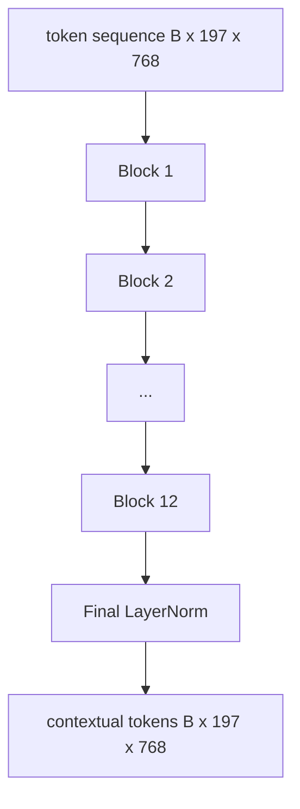
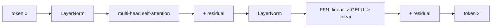

# 视觉 Transformer 编码器

> 补丁单独看不到── 12 个注意头的 12 层预 LN Transformer,补丁代码序列を上下文代码序列に変換する. CLS token'i son olarak gizlenmiş durumda bir araya getirerek tüm görüntü özelliklerini oluşturur.

**Type:** Build
**Languages:** Python
**Prerequisites:** 第19期第30-37课（B轨基础）
**Time:** ~90 分钟

## Öğrenme hedefi

- 实现具有多头自注意和前子层的预 LN Transformer块──
- 12 tane 12 başlı blok toplayarak ViT-Base kodlayıcı oluşturulur.
- 58'inci dersindeki düzeltmeleri kodlayıcıya bağlamak ve kullanmak için önde aktarmak için kullanmak.
- 验证 CLS token her düzeltmenin bilgileri topladı mı?

## 问题

补丁嵌入生成一系列197 个标记,每个标记都是一个向量,不知道任何其他补丁――一张猫的图片需要每补丁才能知道哪些补丁包含胡须,哪些包含背景,哪些包含眼睛――Transformer is a mechanism to build this consciousness, once a attention layer――没有它,补丁前端就是一个无法理解的聪明的分词器――

Standart yapı 12 blok derinliği 、 12 头宽,预层Norm 放置、GELU 激活和 4倍前扩展── bu yapı CLIP ViT-L、SigLIP、DINOv2、Qwen-VL 系列、InternVL ve 2025-2026 yılları için tüm diğer açıklık hakları ağır görüntü kodlayıcılarının sütunlarıdır. Bu yapı yeterince kararlıdır, bu makalelerin herhangi birini okuyabilir ve bu yapıtaş şeklini varsayarsınız, ancak açık bir açıklama yapılmışsa başkaları vardır──

## 概念





### LN 前与 LN 后

Orijinal Transformer 将 LayerNorm 放置在残差後── Pre-LN( her alt kat öncesindeki LayerNorm) her modern görsel dil modelinin kullanıldığı bir sürümdür, çünkü önceden öğrenme oranı yeterli değildir.

### Çok dikkatli olmak

Her baş kendi boyutlarına doğru bir proje gösterir .`head_dim = hidden / num_heads``(query, key, value)`Üç grup var.`hidden = 768`和`heads = 12`Her bir başta`dim = 64` 12 başlılık birleştirilmiştir, sonra da çıkışları bağlantılıdır                                                                                                                                                                                                                                                      

### Neden 4 kat daha genişletmeliyiz ?

FFN `hidden -> 4 * hidden -> hidden`GELU   middle ⋅ ∞ ∞ ∞ ∞ ∞ ∞ ∞ ∞ ∞ ∞ ∞ ∞ ∞ ∞ ∞ ∞ ∞ ∞ ∞ ∞ ∞ ∞ ∞ ∞ ∞ ∞ ∞ ∞ ∞ ∞ ∞ ∞ ∞ ∞ ∞ ∞ ∞ ∞ ∞ ∞ ∞ ∞ ∞ ∞ ∞ ∞ ∞ ∞ ∞ ∞ ∞ ∞ ∞ ∞ ∞ ∞ ∞ ∞ ∞ ∞ ∞ ∞ ∞ ∞ ∞ ∞ ∞ ∞ ∞ ∞ ∞ ∞ ∞ ∞ ∞ ∞ ∞ ∞ ∞ ∞ ∞ ∞ ∞ ∞ ∞ ∞ ∞ ∞ ∞ ∞ ∞ ∞ ∞ ∞ ∞ ∞ ∞ ∞ ∞ ∞ ∞ ∞ ∞ ∞ ∞ ∞ ∞ ∞ ∞ ∞ ∞ ∞ ∞ ∞ ∞ ∞ ∞ ∞ ∞ ∞ ∞ ∞ ∞ ∞ ∞ ∞ ∞ ∞ ∞ ∞ ∞ ∞ ∞ ∞ ∞ ∞ ∞ ∞ ∞ ∞ ∞ ∞ ∞ ∞ ∞ ∞ ∞ ∞ ∞ ∞ ∞ ∞ ∞ ∞ ∞ ∞ ∞ ∞ ∞ ∞ ∞ ∞ ∞ ∞ ∞ ∞ ∞ ∞ ∞ ∞ ∞ ∞ ∞ ∞ ∞ ∞ ∞ ∞ ∞ ∞ ∞ ∞ ∞ ∞ ∞ ∞ ∞ ∞ ∞ ∞ ∞ ∞ ∞ ∞ ∞ ∞ ∞ ∞ ∞ ∞ ∞ ∞ ∞ ∞ ∞ ∞ ∞ ∞ ∞ ∞ ∞ ∞ ∞ ∞ ∞ ∞ ∞ ∞ ∞ ∞ ∞ ∞ ∞ ∞ ∞ ∞ ∞ ∞ ∞ ∞ ∞ ∞ ∞ ∞ ∞ ∞ ∞ ∞ ∞ ∞ ∞ ∞ ∞ ∞ ∞ ∞ ∞ ∞ ∞ ∞ ∞

|组件| ViT-Base 规模的参数 |
|-----------|------------------------------|
|每个块的 qkv 投影 | `3 * 768 * 768 = 1.77M` |
|每个块的输出投影| `768 * 768 = 590K` |
|每块 FFN（4 倍扩展）| `2 * 768 * 4 * 768 = 4.72M` |
|每块的 LayerNorm | `4 * 768 = 3K` |
|每块总计 |约 710 万 |
| 12 块 |约85M |
|加前端|总计约86M |

ViT-Base bir 86M 参数编码器. 2026 yılı standartlarına göre, bu değer çok küçüktür. SigLIP-So400M 400M, Qwen-VL ViT 675M için, ancak genişlik ve derinlikteki yapı aynıdır.

### Çizgiyi mi?

Vision Transformer sadece kodlayıcı içerir ve iki yönlü:`i`Herhangi bir token'a katılabilirsiniz.`j`△ maske yok. ◦ 61 ⇒ Koducu'daki metin kendi dikkatini etki örtüsü ile kullanır.

### CLS token öğrendi ne?

CLS token, öğrenme parametrelerinden başlayarak, kendi düzeltme içeriği olmadan, her blokun dikkatini toplamak için bilgi toplamak için geçer. Son katmanlara kadar, CLS işlem tüm görüntülerin vektörünün toplamıdır. Aşağıdaki başlık bu tek vektörün sınıf mantıklarına doğru projeleneceğini belirler.


```figure
ch-cls-funnel
```

## Yapın onu.

`code/main.py`实现:

- `MultiHeadSelfAttention`, `qkv`Yapılan proje­tion­ı­ı­ı­ı­ı­ı­ı­ı­ı­ı­ı­ı­ı­ı­ı­ı­ı­ı­ı­ı­ı­ı­ı­ı­ı­ı­ı­ı­ı­ı­ı­ı­ı­ı­ı­ı­ı­ı­ı­ı­ı­ı­ı­ı­ı­ı­ı­ı­ı­ı­ı­ı­ı­ı­ı­ı­ı­ı­ı­ı­ı­ı­ı­ı­ı­ı­ı­ı­ı­ı­ı­ı­ı­ı­ı­ı­ı­ı­ı­ı­ı­ı­ı­ı­ı­ı­ı­ı­ı­ı­ı­ı­ı­ı­ı­ı­ı­ı­ı­ı­ı­ı­ı­ı­ı­ı­ı­ı­ı­ı­ı­ı­ı­ı­ı­ı­ı­ı­ı­ı­ı­ı­ı­ı­ı­ı­ı­ı­ı­ı­ı­ı­ı­ı­ı­ı­ı­ı­ı­ı­ı­ı­ı­ı­ı­ı­ı­ı­ı­ı­ı­ı­ı­ı­ı­ı­ı­ı­ı­ı­ı­ı­ı­ı­ı­ı­ı­ı­ı­ı­ı­ı­ı­ı­ı­ı­ı­ı­ı­ı­ı­ı­ı­ı­ı­ı­ı­ı­ı­ı­ı­ı­ı­ı­ı­ı­ı­ı­ı­ı­ı­ı­ı­ı­ı­ı­ı­ı­ı­ı­ı­ı­ı­ı­ı­ı­ı­­­­­­ı­­­­­­­­­­­­­­­­­­­­­­­­­­­­­­­­­­­­­­­­­­­­­­­­­­­­­­­­­­­­­­­­
- `FeedForward`,4 倍扩展 GELU MLP。
- `Block`, bir ön LN blok, dikkat ve bir geride kalanın ön kat kat katından oluşur.
- `ViT`12 blokluk bir yığın, son bir katman normuna sahip.
- `VisionEncoder`- Evet .`VisionFrontEnd`58 . Sınıfdan bağlantıya kadar .`ViT`堆,并公开返回上下文序列和池化 CLS 向量 `forward()`- Evet.
- Bir gösterim, tam bir kodlayıcı ile 运行合成的224x224 armature 图像,并每隔一层打印输入形、输出形、参数计数和 CLS 范数──

- Yapma .

```bash
python3 code/main.py
```

输出:fixture 编码为`(1, 197, 768)`张量──CLS 范数 层组合上漂移,然后稳定在最终 LayerNorm──总参数报告约为86M──

## Kullan

Bu tanımlı kodlayıcı, genişlik ve derinlikte 2025-2026 yılları için her açık ağırlıklı VLM'de sağlanan bloklar topluluğuyla aynıdır.

- **宽度和深度。**- Büyük`hidden=1024, depth=24, heads=16`SigLIP So400M `hidden=1152, depth=27, heads=16`Aynı bir parça.
- **池化头。**CLS池(本课) bilan平均池(SigLIP) bilan dikkat池(sonraki VLM)
- **位置处理。**固定正弦曲线 (第 58 课) ⇒学习的1D、ALiBi与2D RoPE──块数学没有改变──
- **注册token。**DINOv2 前置 4 个额外学习的代码.

Bu bloklar temel olarak toplanmıştır.

## 测试

`code/test_main.py`Şekil:

- 单个块保留形状并且对输入批量大小不变
- Key axis üzerinde dikkat oranı toplamı 1 (sımsık 智)
- 剩余路径已连接(零输入仍通过CLS token产生非零输出)
- 4 kat üstlenmiş ön yönlü bir form oluşur
- 梯度 from CLS 输出流向面片投影  梯度 from CLS 输出流向面片投影  梯度 from CLS 输出流向面片投影 梯度 from CLS 输出流向面片投影 梯度 from CLS 输出流向面片投影 梯度 from CLS 输出流向面片投影 梯度 from CLS 输出流向面片投影 梯度 from CLS 输出流向面片投影 梯度 from CLS 输出流向面片投影

- Onları kullan:

```bash
python3 -m unittest code/test_main.py
```

## 练习

1. 添加寄存器token(CLS 后添加 4 学习向量)并重新运行──通过最后一层的软max 分布的来比较注意力图的平滑度──

2. LN'yi LN'ye değiştirmek ve bir dönem boyunca LN'yi bir dönem içinde geliştirmek için LN'yi bir dönem içinde geliştirmek ve LN'yi bir dönem içinde geliştirmek için LN'yi bir dönem içinde geliştirmek.

3. Bu nedenle, bu engel gerçekleşecek.`attn_mask`参数, böylece aynı blok yeniden çözücü blok olarak kullanılabilir.`(seq, seq)`,下三角形──

4. Kullanım`torch.profiler`分析批量大小为 1、8、64 的前向传递── MLP 层 主导壁时间,而不是注意力──

5. Düşük aşamalı LoRA  Adaptörü kullanarak bir dikkat başının q-k-v  projesi yerine, kalan kısmını bitirin, ve test derecesi sadece beklediğiniz konumdaki akışın.

## 关键术语

|术语 |这意味着什么 |
|------|---------------|
|预 LN | LayerNorm 应用在每个子层之前而不是之后 |
|自我关注 |每个token都以相同的顺序关注其他所有token |
|多头|隐藏的dim分布在 `H` 独立注意头中 |
| FFN 扩展 |前馈层在收缩之前加宽至 `4 * hidden` |
| CLS 池 |使用第一个token 的最终隐藏状态作为图像摘要 |

## 进一步阅读

- 编码器配方 için, 張图像值16x16 个单词(ViT,2021)。
- DINOv2 (2023) 用于注册token和自监督预训目标──
- SigLIP (2023), 62'de kullanılan ortalama birim değişimleri ve sigmoid oran kaybı için kullanılır.
