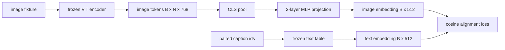

# Modemleri ve düzenli bir proje katmanına göre

> Video kodlayıcılar resim belirtileri üretir. Metin çözücüler metin belirtilerini tüketir. İki tarafı farklı vektor alanlarında yaşar. Küçük iki katlı MLP bir görüntü belirtilerini metin yerleşik alanlara yansıtır ve iki alanın uyum içinde kalmasını sağlayan bir başlıktan ötesini oluşturur. Bu proje, görsel dil modelinin en küçük parçasıdır ve göç için en önemli kısmıdır.

**Type:** Build
**Languages:** Python
**Prerequisites:** 第19期第30-37课（B轨基础）
**Time:** ~90 分钟

## Öğrenme hedefi

-  iki katlı bir MLP 投影 oluşturun, resim özelliklerini metin içine yerleştirilmiş uzaylara yerleştirin.
- 构建一个模拟文本嵌入表(没有预训练的分词器,没有真正的语料库) ⋅
- 計算投影图像token和配对标题嵌入之间的余弦对齐损失──
- Kullanım 结视觉编码器和结文本表单独训练投影──

## 问题

您有一个视觉编码器 ((第 58-59 课),可生成维度 `vision_hidden = 768`Bir kodlayıcı var, size yerleştirilmiş boyutları ayarlamak istiyorum.`text_hidden = 512`之上 (任意其他数字也同样合理) ――解码器需要文体形的代币──图像代币不是文体形的:它们存在编码器在仅视觉预训期间学习的基础中,与解码器的词量无关──

两层 MLP 投影(线性、GELU、线性) bu farkı giderdi.`768 * 1024 + 1024 * 512 = 1.3M`参数), tek bir GPU üzerinde birkaç dakikada antrenman yapılabilir ve bu, eğitimin tamamlanmış bir aşamasında tek bir parçasıdır.

## 概念



### 投影前池化

视觉编码器发发出 197 个标记――文本侧有单标题级嵌入――它们的结合,每个样本需要一个图像级向量―― CLS 池化是最简单的:编码器中获取第一个标记并对其投影――所有197 个标记进行平均池也是另一种选择, SigLIP kullanımı yöntem──要么将197 个向量合并为一个――

### Neden bir kat değil iki kat?

Tek bir hattlı projeksiyon döndürülebilir ve yeniden küçülebilir, ancak iki uzay eğilimi oranı uyumsuzsa, sabit bir temel olamaz. İki hattlı katman arasındaki GELU proje için bir hattsız bir eğilimi sağladı, bu deneyime göre CLIP stilinin özelliklerini ve dil modelini bir araya getirmek için yeterli oldu. Daha derin seviyede bir projeksiyon (LVA-NeXT GLU kullanılarak; Qwen-VL bir yığın dikkat katmanı kullanılarak) genişledi; iki kat MLP, BLIP-2'in Q-Former  proje başlığı ile birlikte olan bir kural kılavuzudur.

|层|形状|参数|
|-------|-------|------------|
| FC1 | `(vision_hidden, projection_hidden)` | `768 * 1024 + 1024` |
|激活|格鲁| 0 |
| FC2 | `(projection_hidden, text_hidden)` | `1024 * 512 + 512` |

Bir tane .`768 -> 1024 -> 512`Başlarda yaklaşık 1.3M 个参数 vardır.

### 余弦对齐损失

- Bu anlamı yok .`image_emb == text_emb`- Evet, evet.`image_emb`Örgüt alanında`text_emb`Yolu aynı yönde.`1 - cos_sim(image, text)`, aralığı 0( tam olarak karşıya) 2(相反) 〜 eğitim, her parti için 0.

### 结编码器是门

Video kodlayıcı 86M parametreye sahiptir. Metin tablosu birkaç milyon kişiye sahiptir. Bu özelliklerin tümü de bir projeye göre değişir. Bu da bir projeye göre 1.3M parametreyi değiştirir. Bu, her bir adaptöre dayalı VLM'nin işleyiş şekliyle uyumludur.


```figure
ch-projection-bridge
```

## Yapın onu.

`code/main.py`实现:

- `MLPProjector(in_dim, hidden_dim, out_dim)`, GELU  aktiv iki katlı linear MLP 
- `MockTextEmbedding(vocab_size, dim)`, bir 结嵌表, 种子的确定性初始化
- `make_pair(seed, vocab_size)`, sintetization a对(图像、标题) sample──标题 is short id 序列;标题嵌入 is token embedding for average value poikerization──标题嵌入 is token embedding for average value poikerization──标题嵌入 is token embedding for average value poikerization──标题嵌入 is token embedding for average value poikerization──标题嵌入 is token embedding for average value poikerization──标题嵌入 is token embedding for average value poikerization──标题嵌入 is token embedding for average value poikerization──标题嵌入 is short id sequence,
- `cosine_alignment_loss(image_emb, text_emb)`, her zaman`1 - cos_sim`- Aynada.
- Bir eğitim döngüsü, 32 adet yapay döngü üzerinde 200 adımlık bir proje, video kodlayıcı ve metin gösterisi ile sonuçlanır ve her 25 adımlık bir kayıp basılır.

- Yapma .

```bash
python3 code/main.py
```

输出: 200 adım içinde ilk kayıptan yaklaşık 1.07'e düşüp yaklaşık 0.80'e düştüğü bir eğitim raporu, yalnızca projekstiyonla resim göstergesini metin boşluğuna çekilebileceğini göstermektedir.

## Kullan

Her açık ve ağır VLM'de aynı model ortaya çıkar:

- **LLaVA 1.5.**CLIP-ViT-L'den LLaMA'ya  gizlenmiş  gömülmüş 2 katı GELU MLP 投影──结视觉编码器,结 LLM, 仅训练投影(然后在第二阶段解 LLM) 
- **BLIP-2.**Q-Former 针对图像代币的交叉关注 通过针对图像代币的交叉关注 通过针对图像代币的交叉关注 通过获取32个学习查询代币,然后投投到LLM 嵌入dim── Q-Former 最后投投投头类似本课的MLP──
- **MiniGPT-4.**BLIP-2 Q-Former'den Vicuna'ya çıkış 嵌入dim'in tek hattlı projesi
- **Qwen-VL.**Çok katlı bir akıl akıl adaptörü var, ama son bir parçası hala LM'ye kadar ımşıldanmış bir proje olarak kalıyor.

形状は違います. 作用は同じ:池图像トークen、投影〜文本嵌入式、单独訓練──

## 测试

`code/test_main.py`Şekil:

- 投影仪输出形与配置 `out_dim`匹配
- 结文本嵌入表的 `requires_grad`参数为零
- 余弦 kaybı aynı vektörde 0 , karşıt düzlem vektörde 2
- Bir kez geriye doğru aktarma sonrası projeyi gösterme derecesi akışı
-                                                                                                                                                                                                                                                                                                                                                                                                                                                                                                                              

- Onları kullan:

```bash
python3 -m unittest code/test_main.py
```

## 练习

1. CLS'i toplamda 196 patch tokenine değiştirmek, 200 adım sonrasında ortalama değer toplamını karşılaştırmak ve son kayıpları karşılaştırmak. Ortalama toplam genellikle yapay veriler üzerinde daha hızlı çalışmaktadır; CLS doğal görüntülerde örnek verimliliği daha yüksektir.

2. Alışkanlıkların ölçüleri, değer kaybına eklenir.`cos / tau`) 中,并观察当 `tau`Çok küçük bir ses veya çok büyük bir kayıp.

3. İki katlı MLP'yi tek bir liner katlılık yerine değiştirmek ve kayıp farkını ölçmek.

4. Yükleme cihazının ağırlığına küçük bir L2  ceza ekleyin ve bunun 余弦 ile nasıl birleştiğini gözlemleyin.

5. 保存投影仪权重, sonra onları 结的视觉编码器 ile yeniden yükle ve 反向传播 olmadan çalıştır 推理──验证投影仪是您唯一需要交付的新文物;部署时编码器仍需运行前向传播──

## 关键术语

|术语 |这意味着什么 |
|------|---------------|
|模态对齐 |使图像和文本嵌入在一个共享空间中具有可比性的行为 |
|投影头|将一个空间映射到另一个空间的小模块，通常是 2 层 MLP |
|余弦相似度 |点积除以 L2 范数的乘积 |
|冻结编码器|视觉（或文本）模型的所有参数均带有 `requires_grad=False` |
|模拟语料库|使用合成对，因此训练不依赖于数据集下载 |

## 进一步阅读

- İki aşamalı eğitim için LLaVA 论文() projesi, sonra LM) 』
- Q-Former'ın BLIP-2 dersi, proje alternatifleri olarak öğrenilmektedir.
- Qwen-VL 技术报告,将交叉注意力适配器使用作更深的投影头――
