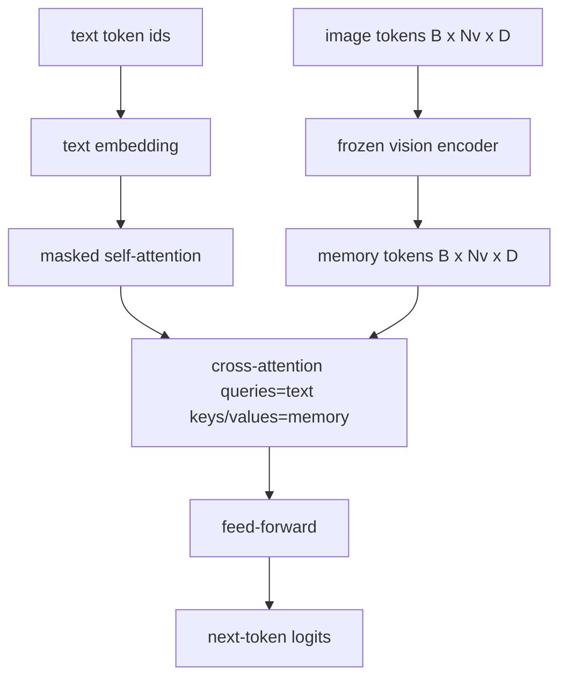
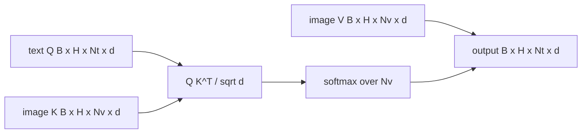

# 交叉注意力融合

> Projection Layer bir görüntü veimeni bir başlık veimeni bir araya getirir. Gerçek görsel dil çözücü her metin tokeni her eklem tokeniye katılımcı olmalıdır, bu nedenle model her kelimeyi bir bölgeye yerleştirebilir.

**Type:** Build
**Languages:** Python
**Prerequisites:** 第19期第30-37课（B轨基础）
**Time:** ~90 分钟

## Öğrenme hedefi

- 实现多头交叉注意力,其中查询流是文本,键/值流是视觉──
- 组成解码器块:因果自注意力+交叉注意力+前──
- 获得正确的掩模形: 交叉注意力无掩模, 交叉注意力因果掩模, 交叉注意力无掩模, 交叉注意力无掩模, 交叉注意力无掩模, 交叉注意力无掩模, 交叉注意力无掩模, 交叉注意力无掩模, 交叉注意力无掩模, 交叉注意力无掩模, 交叉注意力无掩模, 交叉注意力无掩模, 交叉注意力无掩模, 交叉注意力无掩模, 交叉注意力无掩模, 交叉注意力无掩模, 交叉注意力无掩模, 交叉注意力无掩模, 交叉注意力无掩模, 交交交交交交交交交交交交交交交交交交交交交交交交交交交交交交交交交交交交交交交交交交交交交交交交交交交交交交交交交交交交交交交交交交交交交交交交交交交交交交交交交交交交交交交交交交交交交交交交交交交交交交交交交交交交交交交交交交交交交交交交交交交交交交交交交交交交交交交交交交交交交交交交交交交交交交交交交交交交交交交交交交交交交交交交交交交交交交交交交交交交交交交交交交交交交交交交交交交交交交交交交交交交交交交交交交交交交交交交交交交交交交交交交交交交交交交交交交交交交交交交交交交交交交交交交交交交交交交交交交交交交交交交交交交交交交交交交交交交交交交交交交交交交交交交交交交交交交交交交交交交交交交交交交交交交交交交交交交交交交交交交交交交交交交交
- Kullanım Satır metin belirtileri ve sabit görüntü belirtileri

## 问题

Bir diziye bir görüntü belirti ve metin belirti bağlamak bir birleşim seçeneği biçimidir. İlk birleşim, Cameleon ve Emu3 kullanılacak yollardır.

后期融合 has two advantages──首先, metin akışı temiz kalır, model saf metin işlevi kalır── İkincisi, resim akışı her bir görüntüye bir kez hesaplanır ve her çözümü aşamasında tekrar kullanılır, bu nedenle uzun bir başlık için bile üretmek çok uygun olur── maliyet her blok için bir ekstra dikkat katmanı olacaktır──

## 概念





### 面具 şekli

解码器块内 iki dikkat farklı gömleğe ihtiyaç duyar:

|注意|查询长度 |密钥长度|面膜|为什么 |
|-----------|--------------|------------|------|-----|
|自我关注 | `Nt`（文本）| `Nt`（文本）|因果：下三角 `(Nt, Nt)` |自回归期间文本token可能不会向前看 |
|交叉注意力| `Nt`（文本）| `Nv`（愿景）|没有口罩|整个图像对每个文本位置都是可见的 |

Bu ders bir şekil doğrulama işlevi içerir, bu nedenle onları bir araya karıştırarak `ValueError`Bu, bir hata değil, bir kayıp.

### Neden dikkat çekmek için bir şey yapmıyoruz?

Bir metin oluşturmadan önce, önce resimleri iyice izleyin.`t`Resimlerin herhangi bir düzeltmesine dikkat edebilirsiniz; resim blokları zaman sırasıyla değildir. Bazı Flamingo 变体在交交错多图像和文段时添加了每个样本的掩盖模式, ancak tek bir görüntü ile başlık için,交叉注意可以看到一切──

### 键/值缓存

图像键和值在解码开始时计算一次并存存储中──每个新文本代币都使用缓存而无需重新计算──这是推理时字幕快速运行的原因:重型 ViT 运行一次;交叉注意在每一步中重复使用其键和值──本课程公开缓存并测试缓存中路径──

### 块组成

解码器块运行:预 LN -> 自注意力 -> 残差 -> 预 LN -> 交叉注意力 -> 残差 -> 预 LN -> 前 -> 残差──三个子层,每个子层都有自己的层Norm。 Flamingo 论文在交叉注意力上添加了一个可学习的 tanh门,初始化为零,因此结的语言模型一开始保持不变,训练也保持稳定;规范基线在此处使用)没有门。

```python
class DecoderBlock:
  def forward(self, text_tokens, image_tokens, text_mask, cross_mask):
      text_tokens = text_tokens + self.self_attn(self.ln1(text_tokens),
                                                 mask=text_mask)
      text_tokens = text_tokens + self.cross_attn(self.ln2(text_tokens),
                                                  image_tokens,
                                                  mask=cross_mask)
      text_tokens = text_tokens + self.ffn(self.ln3(text_tokens))
      return text_tokens
```


```figure
ch-crossattn-fan
```

## Yapın onu.

`code/main.py`实现:

- `CrossAttention(hidden, heads)`, tek başına`q`和 `kv`投影的多头交叉注意力──
- `CausalSelfAttention(hidden, heads)`, standart çözücülerin dikkatini koruma çabalarından
- `DecoderBlock`,LN'nin geri kalanı üç kat katlı bir yapı oluşturur.
- `VisionLanguageDecoder`, Model Video Kodlayıcı Çıktı ve Küçük Metin Yatıştırma Tablosu tarafından sağlanan dört katlı kodlayıcı.
- `causal_mask(length)`Geri dön .`(length, length)`Aşağıda bir tane var.
- Bir gösteride, uzunluğu 10 olan iki metin dizisine uzunluğu 197 olan bir görüntü belleği sağlar ve çıkış şeklini, kendi dikkatini gizleyen şeklini ve her konumdaki çaplı dikkat çıkışını basar.

- Yapma .

```bash
python3 code/main.py
```

输出:解码器产生 `(2, 10, text_vocab)`张量──面罩形为`(10, 10)`KV 缓存重用检查确认缓存与未缓存路径之间的相同逻辑──

## Kullan

交叉注意力 iki üretim serisinde ortaya çıktı:

- **Flamingo 和 IDEFICS。**Her K 个语言模型块 into a交叉注意力子层,并使用结的 LM──视觉语言适配器是交叉注意力块及其门──
- **BLIP-2.**Q-Former Bir grup sabit 32 sorgu simgesi'nden bir görüntü özelliklerine geçiş dikkatini kullanır, sonra sorgu bir projeyi LM 嵌入空间中へ

Bu dersdeki blokların şekli doğrudan iki tarafta da yer alır.

## 测试

`code/test_main.py`Şekil:

- Sonuç örtü, aşağı üçgenin ve beklenen bul şekliyle uyumludur.
- Ne kadar uzun bir anahtar olursa olsun, anahtar odaklılık çıkış şekli her zaman `(B, Nt, hidden)`
- KV  Kaydetme yolu kaydetmemiş yollar arasında hareketlilik kapasitesi farkına uygun
- Metin ve resim akımları arasındaki biçimsel uyumsuzluk açıkça ortaya çıktı.`ValueError`
- Complete decoder ön yönlü aktarım doğru seri ve seri şekli oluşturur

- Onları kullan:

```bash
python3 -m unittest code/test_main.py
```

## 练习

1. Bu yöntemin bir sonraki aşaması ise, bir sonraki aşamasında, bir sonraki aşamasında, bir sonraki aşamasında, bir sonraki aşamasında, bir sonraki aşamasında, bir sonraki aşamasında, bir sonraki aşamasında, bir sonraki aşamasında, bir sonraki aşamasında, bir sonraki aşamasında, bir sonraki aşamasında, bir sonraki aşamasında, bir sonraki aşamasında, bir sonraki aşamasında, bir sonraki aşamasında, bir sonraki aşamasında, bir sonraki aşamasında, bir sonraki aşamasında, bir sonraki aşamasında, bir sonraki aşamasında, bir sonraki aşamasında, bir sonraki aşamasında, bir sonraki aşamasında, bir sonraki aşamasında, bir sonraki aşamasında, bir sonraki aşamasında, bir sonraki aşamasında, bir sonraki aşamasında, bir sonraki aşamasında, bir sonraki aşamasında, bir sonraki aşamasında, bir sonraki aşamasında, bir sonraki aşamasında, bir sonraki aşamasında, bir sonraki aşamasında, bir sonraki aşamasında, bir sonraki aşamasında, bir sonraki aşamasında, bir sonraki aşamasında, bir aşamasında, bir aşamasında, bir aşamasında, bir aşamasında, bir aşamasında, bir aşamasında, bir aşamasında, bir aşamasında, bir aşamasında, bir aşamasında, bir aşamasında, bir aşamasında, bir aşamasında, bir aşamasında, bir aşamasında, bir aşamasında, bir aşamasında, bir aşamasında, bir aşamasında, bir aşamasında, bir aşamasında, bir aşamasında, bir aşamasında, aşamasında, aşamasında, aşamasında, aşamasında, aşamasında, aşamasında, aşamasında, aşamasında yapılacak bir aşamasında yapılacak bir aşamasında yapılacak bir aşamasında yapılacak bir aşamasında yapılacak bir aşamasında yapılacak bir aşamasında yapılacak bir aşamasında yapılacak bir aşamasında, aşamasında yapılacak bir aşamasında, aşamasında aşamasında yapılacak bir aşamasında aşamasında aşamasında aşamasında aşamasında aşamasında aşamasında aşamasında aşamasında aşamasında aşamasında aşamasında aşamasında aşaması yapılacak bir aşaması yapılacak bir aşama

2. 交错注意掩码, içinde aynı çözücü birden fazla görüntü ve birden fazla metin bölümünü tüketir.

3. - Evet .`Nt=64, Nv=576`(Yüksek çözünürlüklü 24x24 网格) üzerinde analiz yapılır dikkat ve kendi dikkat seviyesinden.`Nt * Nv`, ve yüksek görüntü çözünürlüğünde baskın bir konumdadır.

4. Çıkarış dikkat çizelgesine sorgu sonucu düşüş ekle,并测量演示中的标题多样性(çeylenin örneği farklılıkları交叉图中的 dropup'un artması ile artması ile birlikte)

5. Bir önceki 风格 风格 关注块 olarak değiştirmek için, her bir aşama üzerinde belirlenmiş 32 符号 sorgulaması kümesi bir görüntü özellikleri vardır.

## 关键术语

|术语 |这意味着什么 |
|------|---------------|
|后期融合|文本和视觉位于不同的流中；交叉注意力在每个区块上架起了桥梁|
|交叉注意力| Q 来自一个流，K 和 V 来自另一个流 |
|因果面具|下三角布尔掩码，可防止在自回归过程中向前看 |
| KV缓存|图像键和值存储一次并在每个解码步骤中重复使用 |
|记忆token|解码器进入的冻结图像token |

## 进一步阅读

- Flamingo (2022) , kapı kontrolü ile bağlantılı bir tasarımın bir parçasıdır.
- Q-Former'in BLIP-2 (2023), bir öğrenme sorgu kümesinin bir şekilde bir şekilde birleştirilmiş bir dikkat blokudur.
- IDEFICS (2023) Flamingo 配方 开放重量复制品
