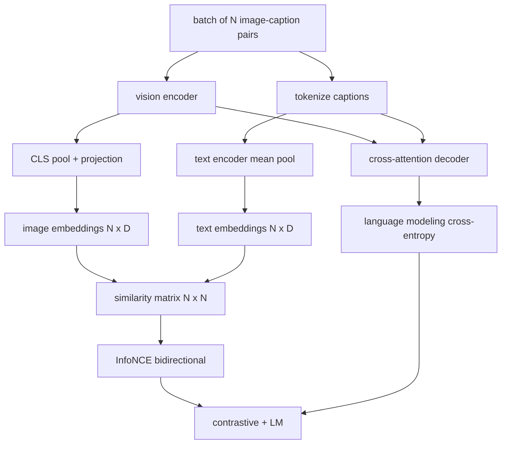

# 视觉语言预训练

> 编码器、投影和码器已接线──现在一起训练他们──两个目标驱动学习:对比图像文本损失(InfoNCE),将匹配在联合嵌入空间中拉拉拉一起,以及语言建模损失,要求解码器为每个图像添加标题──结合起来,它们教会网络找到合适的图像作为标题并为图像编辑标题──

**Type:** Build
**Languages:** Python
**Prerequisites:** 第19期第30-37课（B轨基础）
**Time:** ~90 分钟

## Öğrenme hedefi

- Bir dizi görüntü başlığı için bir grup görüntü kaybı için InfoNCE gerçekleştirmek için bir grup görüntü başlığı için bir grup görüntü kaybı için bir grup görüntü oluşturmak için bir grup görüntü oluşturmak için bir grup oluşturmak için bir grup oluşturmak için bir grup oluşturmak için bir grup oluşturmak için bir grup oluşturmak için bir grup oluşturmak için bir grup oluşturmak için bir grup oluşturmak için bir grup oluşturmak için bir grup oluşturmak için bir grup oluşturmak için bir grup oluşturmak için bir grup oluşturmak için bir grup oluşturmak için bir grup oluşturmak için bir grup oluşturmak için bir grup oluşturmak için bir grup oluşturmak için bir grup oluşturmak için bir grup oluşturmak için bir grup oluşturmak için bir grup oluşturmak için bir grup oluşturmak için bir grup oluşturmak için bir grup oluşturmak için bir grup oluşturmak için bir grup oluşturmak için bir grup oluşturmak için bir grup oluşturmak için bir grup oluşturmak için bir grup oluşturmak için bir grup oluşturmak için bir grup oluşturmak için bir grup oluşturmak için bir grup oluşturmak için bir kurulmaktadır.
- Bu, bir diğer deyişle, bir diğer deyişle, bir diğer deyişle, bir diğer deyişle, bir diğer deyişle, bir diğer deyişle, bir diğer deyişle, bir deyişle, bir deyişle, bir deyişle, bir deyişle, bir deyişle, bir deyişle, bir deyişle, bir deyişle, bir deyişle, bir deyişle, bir deyişle, bir deyişle, bir deyişle, bir deyişle, bir deyişle, bir deyişle, bir deyişle, bir deyişle, bir deyişle, bir deyişle, bir deyişle, bir deyişle, bir deyişle, bir deyişle, bir deyişle, bir deyişle, bir deyişle, bir deyişle, bir deyişle, bir deyişle, bir deyişle, bir deyişle, bir deyişle, bir deyişle, bir deyişle, bir deyişle, bir deyişle, bir deyişle, bir deyişle, bir deyişle, bir deyişle, bir deyişle, bir deyişle, bir de, bir deyişle, bir de, bir de, bir deyişle, bir de, bir de, bir de, bir de, bir de, bir de, bir de, bir de, bir de, bir de, bir de, bir de, bir de, bir de, de, bir de, bir de, de, bir de, de, de, de, de, bir de, de, de, bir de, de, de, bir de, de, de, de, de, de, de, de, de, de, de, de, de, de, de, de, de, de, de, de, de, de, de, de, de, de, de, de, de, de, de, de, de, de, de, de, de, de, de, de, de, de, de, de, de, de, de, de, de, de, de, de, de, de, de, de, de, de, de, de, de, de, de, de, de, de, de, de, de, de, de, de, de, de, de, de, de,
- 合成 200 模拟图像字幕语料库, gerçek veri kümesini indirmek gerekmiyor
- 50 adımlık bir eğitim döngüsü yürütmek ve kayıpların azalmasını gözlemlemek.

## 问题

Görüş dil modeli iki beceri gerektirir. Bu iki beceri gerektirir. Bir başlık verilmiş, çok sayıda görüntüde doğru bir görüntü bulunmuş olmalıdır. Bu bir başlık yazılmış olmalıdır.

InfoNCE  sorumlu sıralama yarısı                                                                                                                                                                                                                                                                                                                                                                                                                                                                                                                    `N^2 - N`- Neyse. - Neyse.`(N, N)`LM                                                                                                                                                                                                                                                                                                                                                                                                                                                                                                                            

## 概念



### InfoNCE 在一段话中

N 个图像嵌入堆叠为行, N 个文本嵌入堆叠为行―― L2-将两者归结――计算`N x N`矩阵 `S = I T^T / tau`, içinden `tau`Bu, bir öğrenme sıcaklığıdır.`argmax`沿对角线运行:行 `i`                                                                                                                                                                                                                                                                                                                                                                                                                                                                                                                             `i`Ortalama değeri ise, aynı işlemleri gerçekleştirmek için en yüksek bir değere sahiptir.

###  sıcaklık çok önemli

 sıcaklık `tau`控制 softmax 的峰值程度──太小(例如 `tau = 0.01`) ve seviye sadece en zor negatif değerden gelir, eğitim gürültü vardır.`tau`参数 olarak; burada gösterim aynı şeyi yaptı.

### 语言建模损失

解码器通过交叉注意力消耗图像内存代号,并预测每个位置的下一个文本代号――损失是与下一个位置目标的标准交叉――填充位置被隐藏在损失之外――

### 合并损失

`total = contrastive + lm_weight * lm`, içinden `lm_weight`Bu iki kaybı paylaşmak için kodlayıcı ve projeksiyonu 梯度; sadece çözücü LM 损失梯度 olarak kabul eder. Bu farklı ağırlıklara sahip CoCa ve BLIP kullanımı çoklu görev birimidir. SigLIP sadece kontrastlı 项leri korur ve sigmoid çift kaybı  softmax yerine kullanır.

|组件|损失面|影响|
|-----------|--------------|---------|
|信息NCE |联合空间中的配对排名 |编码器+投影+文字头|
| LM |以图像为条件的 token预测 |编码器+投影+解码器 |
|合并|多任务 |全栈|

### Neden 50 adım gösterim için yeterli?

模拟语料库, her zamanki görüntü ve her zamanki başlık ID'sini içeren 200 adet bir komple bir kitlemedir. 16'luk bir tomurcuk büyüklüğünde 50 SGD adımdan sonra, mutlak değer gerçek veri modeli tarafından elde edilebilecek seviyeden yukarıda kalsa bile, iki tür kayıp da belirgin bir şekilde düşer.


```figure
ch-infonce-diagonal
```

## Yapın onu.

`code/main.py`实现:

- `MultimodalModel`, küçük bir ViT 编码器、MLP 投影仪、 küçük bir metin tarafı编码器(嵌入式 id 上的平均值池) ve 61 课中的交叉注意解码器──
- `info_nce_loss(image_emb, text_emb, temperature)`, iki yönlü CLIP 式对比损失──
- `lm_loss(logits, target_ids, padding_id)`,屏蔽的下一个代码交叉──
- `make_mock_corpus(seed, n_pairs)`, geri dön 200 个确定性 (图像,caption)
- 訓練循環運行 50 步骤,批量大小为 16,Adam 优化器和学习的对数温度参数──每5 步骤一次印两损──

- Yapma .

```bash
python3 code/main.py
```

输出: 约对比损失`ln(16) = 2.77`Düşüp 2.4 'e düştü .`ln(512) ≈ 6.24`İki kez düşüş de gerçek modellerin düzeyde bağlantı olduğunu kanıtladı.

## Kullan

Aynı kayıp biçimi:

- **CLIP (2021)。**仅图像-文本对比,具有单独结结编码器字幕探针──
- **CoCa (2022).**Bir modeldeki resim metni ile resim başlığı karşılaştırıldığında LM 損失──本课构建的确切模式──
- **BLIP (2022) 和 BLIP-2.**LM ile karşılaştırıldığında, üç kez daha fazla kayıp.
- **SigLIP (2023).**InfoNCE'yi kaybı için sigmoid olarak değiştirmek; aynı karşılaştırma etki, farklı fonksiyon biçimi:
- **LLaVA 系列。**两阶段训练,其中第一阶段是对齐 (结 LM 上的余弦),第二阶段使用未结的 LM 添加 LM 损失――第60 课对应第一阶段;本课对应第二阶段――

## 测试

`code/test_main.py`Şekil:

- InfoNCE  损失在图像/文本行之间是对称的
- Benzerlik matçları büyük doğru sayılardaki kusursuz köşelerden oluştuğunda, bilgi kaybı 0'ya geri döndü.
- LM Kayıpları Tamamen Yüklenmiş
- 模型前向传递 iki türlü kayıp ve hata oluşur
- 5 adımlı eğitim döngüsü, birleştirme kaybını azaltır

- Onları kullan:

```bash
python3 -m unittest code/test_main.py
```

## 练习

1. InfoNCE'yi SigLIP 风格'ın sigmoid'i kaybı için değiştirmek ve simülasyon dil kütlesinde karşılaştırma yapma yapması için kullanmak.

2. Ekleme: Her bir grup, önceki gruptan en zor olan karşı karşı karşı karşı karşı karşı karşı karşı karşı karşı karşı karşı karşı karşı karşı karşı karşı karşı karşı karşı karşı karşı karşı karşı karşı karşı karşı karşı karşı karşı karşı karşı karşı karşı karşı karşı karşı karşı karşı karşı karşı karşı kayıpları daha hızlı düşüyor mu kontrol ediyor.

3. Birleştirilmiş gömülmüş üstü ekleme resim-metin eşleşen ikileme başı(真/假: bunlar eşleşebilir mi?) Üçüncü kayıp olarak, BLIP'in üçleme ayarını kopyalayın.

4. Bu model dil kütlesini, Markov zincirinden alınan başlık ID 序列ine, Markov zincirinin dönüşüm matrosuna, resim halinde değiştirmek için kullanılır.

5. Kullanım`lm_weight = 0`訓練相同的模型, sonra kullan `lm_weight = 1`Yeniden eğitim:                                                                                                                                                                                                                                                             

## 关键术语

|术语 |这意味着什么 |
|------|---------------|
|信息NCE |噪声对比估计：相似度矩阵上的交叉熵 |
|温度|控制对比 softmax 的峰值程度的标量 |
|硬阴性|模型发现的非对角线对令人困惑，但对于采样很有用 |
| LM 损失 |字幕侧的标准下一个token交叉熵 |
|联合嵌入空间|投影后图像和文本向量所在的共享空间 |

## 进一步阅读

- İlk karşılaştırma yapısı için kullanılan kâğıt.
- Bir modelde bir metin ile karşılaştırma yapmak için kullanılan CoCa 紙
- SigLIP 论文, Sigmoid'in kayıp değişikliği ve genişleme daha iyi nedenlerini tanıttı.
