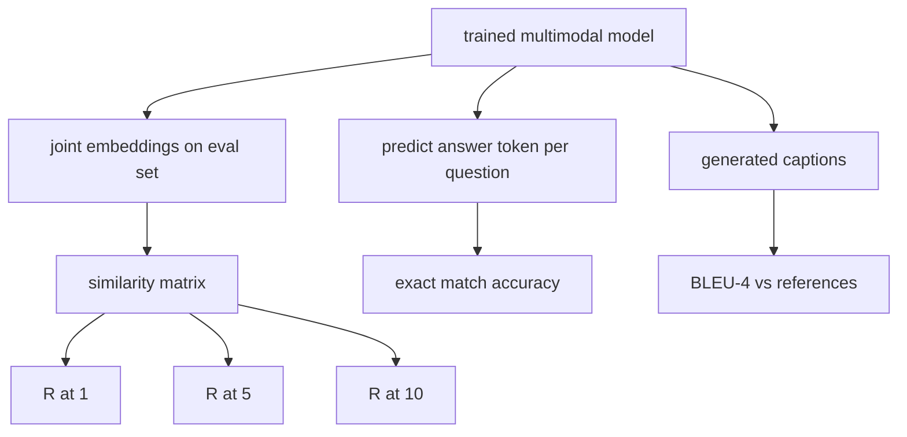

# 多模态评估

> 培训是循环的一半――另一半是测量――本课程从基元构建三个评估表面:图像标题检索报告为R@1、R@5、R@10;视觉问答报告为精确匹配准确性;图像字幕报告为BLEU-4──每个指标都是模型输出函数和在几秒内运行的综合评估套件──

**Type:** Build
**Languages:** Python
**Prerequisites:** 第19期第58-62课（Track E基础：编码器、Transformer、投影、交叉注意力融合、预训练）
**Time:** ~90 分钟

## Öğrenme hedefi

- Resim ve başlık içindeki benzerlik matçına göre hesaplanır.
-                                                                                                                                                                                                                                                               
- Yaratılış ve referans belirti sırasından hesaplanan BLEU-4, herhangi bir dış kütüphanenin gerekliliği yoktur.
-  62 lık eğitim modelinde kurulan bütünüyle düzenlenen tüm üç değerlendirmeyi yürütmek için

## 问题

Eğitim kaybı sabitlenmeye başladığında, çok modelli bir modelin tamamlandığını ilan edebiliriz. Eğitim kaybı ölçüsü, eğitim dağılımına uygun; modelin, kalın bir grupta sıralanmaya, sorulara cevap vermeye veya insan tarafından kabul edilen başlıkları yazmaya uygun olup olmadığını ölçemez.

- **检索（R@1，R@5，R@10）。**Sorma başlıkları oluşturmak ortak yerleşim; değerlendirme havuzundaki her bir görüntü için bir sıralama yapılması; rapor uyumlu görüntülerin ön 1、 ön 5、 ön 10 名──对称(图像到文本) biçimindeki çalışma biçimi aynıdır mı?
- **视觉问答（完全匹配）。**给定(图像,问题),模型输出一个答案token──精确匹配是每个样本一个:预测答案是否等于参考答案?评估集的平均值──
- **字幕 (BLEU-4)。**生成字幕──参考标题计算 1 克到 4 克精度的几何平均值,并牺牲简洁性──多重参考是标准形式(一张图像,多个参考标题)──

Her ölçüm bir ince fonksiyonudur. Bu ders hepsini kodla inşa edecek, bu nedenle matematik spesifiktir ve yüzeyin kontrolünüzde kalır. Gerçek bir temel test süsüyeti (MS-COCO、VQA v2、GQA、OK-VQA) aynı fonksiyon şeklinde yerleştirilebilir.

## 概念



### Şekillik Rektöründe

Şekil ve başlık yerleştirme arasında yapılandırma `(N, N)`余弦相似度矩阵── her satır için, benzerlik derecesine göre sıralama yapılır── Recall@K, K'nın önüne konulan çizgilerin bölümüdür.

### VQA 精确匹配

△ △ △ △ △ △ △ △ △ △ △ △ △ △ △ △ △ △ △ △ △ △ △ △ △ △ △ △ △ △ △ △ △ △ △ △ △ △ △ △ △ △ △ △ △ △ △ △ △ △ △ △ △ △ △ △ △ △ △ △ △ △ △ △ △ △ △ △ △ △ △ △ △ △ △ △ △ △ △ △ △ △ △ △ △ △ △ △ △ △ △ △ △ △ △ △ △ △ △ △ △ △ △ △ △ △ △ △ △ △ △ △ △ △ △ △ △ △ △ △ △ △ △ △ △ △ △ △ △ △ △ △ △ △ △ △ △ △ △ △ △ △ △ △ △ △ △ △ △ △ △ △ △ △ △ △ △ △ △ △ △ △ △ △ △ △ △ △ △ △ △ △ △ △ △ △ △ △ △ △ △ △ △ △ △ △ △ △ △ △ △ △ △ △ △ △ △ △ △ △ △ △ △ △ △ △ △ △ △ △ △ △ △ △ △ △ △ △ △ △ △ △ △ △ △ △ △ △ △                          

### BLEU-4

```math
\text{BLEU-4} = \text{BP} \cdot \exp\big(\text{mean}(\log p_1, \log p_2, \log p_3, \log p_4)\big)
```

İçlerinden `p_n`n n 元语法精度 (,) herhangi bir referans literatüründe ortaya çıkan n 元语法 kesim sayısı, n 元语法 toplamı hariç,`BP`Bu basit bir ceza.

```math
\text{BP} = \begin{cases} 1 & \text{当生成长度} > \text{参考长度} \\ \exp(1 - r/g) & \text{否则，其中 } r \text{ 为参考长度，} g \text{ 为生成长度} \end{cases}
```

Bazıları için.`p_n`Çen ve Çerez'in  yöntemi kullanılması için, herhangi bir 零-sayı, molekül ve分母加1 için, bu düşük sayım sisteminin en güvenli özsaygısıdır.

### 综合评估套件

50 numune değerlendirme kitlesi, 62'de kullanılan aynı simülasyonlu dil kütle modeline göre hafıza içinde inşa edilmiş ve saklı olan tohumlarla oluşmaktadır.

- `pairs`:50 个 (图像、caption_ids)
- `vqa`:50 个(şekil 问题 ID 答案 ID) 三元组。
- `caps`:50 个(图像,reference_caption_ids,...])条目, her bir görüntü en fazla 3 个引用。

Bu kit, tohumlar arasından belirlenmiş ve eğitim dilinin kütlesinde kalmıştır, bu nedenle gösterge, modelin hiç görmediği veri hesaplamalarına göre tutulmaktadır.

|指标|范围 |随机基线 (N=50) |
|--------|-------|------------------------|
| R@1 | 0 到 1 | 0.02（1/N）|
| R@5 | 0 到 1 | 0.10 |
| R@10 | 0 到 1 | 0.20 |
| VQA EM | 0 到 1 | 1 / 词汇 |
| BLEU-4 | 0 到 1 |小但非零 |

Sinteş veri üzerinde çalışan 50 adımlı eğitimler için, tahmin göstergesi çok yüksek olmayacaktır; bunlar gösterim kontrolünün içeriği olarak, rastgele bir temel çizgiden yüksek olarak tahmin edilir.


```figure
ch-recall-window
```

## Yapın onu.

`code/main.py`实现:

- `recall_at_k(sim_matrix, k)`İki yönde geri dön .`[0, 1]`Orta bir floating point sayısı.
- `vqa_exact_match(predictions, references)`, geri dön .`int`Aynı şeylerin ortalama değeri
- `bleu4(generated, references, smoothing=True)`, çok fazla referans desteği vardır.
- `build_eval_suite(seed, n_samples, vocab_size, max_len)`, üç kesinlik değerlendirme listesine geri dönmek.
- `evaluate(model, suite)`, tüm üç göstergeyi yürütüyor ve geri dönüyor .`dict`Sayfa:
- Bir gösterim, 62'de yeni başlangıçlı çok modolu model yükle, değerlendirme yapın, sonra 50 adımlı bir eğitim yapın ve tekrar değerlendirin, basmadan önce/sonra göstergeyi oluşturun.

- Yapma .

```bash
python3 code/main.py
```

输出: önce/sonrası ölçüm tablosu, incelemeyi yakın zamanda öğrenme sinyalinin gelişmesine, VQA  gelişmesine, BLEU-4  gelişmesine, 4 克 doğruluk yükseltmesine yönelik bir yapı yapısını göstermektedir.

## Kullan

Her gösterge doğrudan üretim tabanına yer alır:

- **检索。**MS-COCO 5K val、Flickr30K、ImageNet 零样本都是同一相似性矩阵上的 R@K 问题──将合成 eval 替换为真文件,函数签名保持不变──
- **VQA。**VQA v2、GQA、OK-VQA aynı doğru uyum biçimini kullanır.
- **BLEU-4.**MS-COCO 字幕、NoCaps、Flickr30K 字幕均使用BLEU-4加 CIDER 和 METEOR──添加 CIDER 是另一项功能──

Gerçek bir temel test için, lütfen.`build_eval_suite`替换为真正的加载程序并保留函数体──数学与基准无关──

## 测试

`code/test_main.py`Şekil:

-recall@k = 0.0 = 0.0 = 0.0 = 0.0 = 0.0 = 0.0 = 0.0 = 0.0 = 0.0 = 0.0 = 0.0 = 0.0 = 0.0 = 0.0 = 0.0 = 0.0 = 0.0 = 0.0 = 0.0 = 0.0 = 0.0 = 0.0 = 0.0 = 0.0 = 0.0 = 0.0 = 0.0 = 0.0 = 0.0 = 0.0 = 0.0 = 0.0 = 0.0 = 0.0 = 0.0 = 0.0 = 0.0 = 0.0 = 0.0 = 0.0 = 0.0 = 0.0 = 0.0 = 0.0 = 0.0 = 0.0 = 0.0 = 0.0 = 0.0 = 0.0 = 0.0 = 0.0 = 0.0 = 0.0 = 0.0 = 0.0 = 0.0 = 0.0 = 0.0 = 0.0 = 0.0 = 0.0 = 0.0 = 0.0 = 0.0 = 0.0 = 0.0 = 0.0 = 0.0 = 0.0 = 0.0 = 0.0 = 0.0 = 0.0 = 0.0 = 0.0 = 0.0 = 0.0 = 0.0 = 0.0 = 0.0 = 0.0 = 0.
-call@k 尊重 `k <= N`Ün sınır
- 1.0.0'ya dönün.
- bleu4 在不相交词汇上返回 0.0
- vqa  精确匹配等等等等等等等等等等等等等等等等等等等等等等等等等等等等等等等等等等等等等等等等等等等等等等等等等等等等等等等等等等等等等等等等等等等等等等等等等等等等等等等等等等等等等等等等等等等等等等等等等等等等等等等等等等等等等等等等等等等等等等等等等等等等等等等等等等等等等等等等等等等等等等等等等等等等等等等等等等等等等等等等等等等等等等等等等等等等等等等等等等等等等等等等等等等等等等等等等等等等等等等等等等等等等等等等等等等等等等等等等等等等等等等等等等等等等等等等等等等等等等等等等等等等等等等等等等等等等等等等等等等等等等等等等等等等等等等等等等等等等等等等等等等等等等等等等等等等等等等等等等等等等等等等等等等等等等等等等等等等等等等等等等等等等等等等等等等等等等等等等等等等等等等等等等等等等等等等等等等等等等等等等等等等等等等等等等等等等等等等等等等等等等等等等等等等等等等等等等等等等等等等等等等等等等等等等等等等等等等等等等等等等等等等等等等等等等等等等等等等等等等等等等等等等等等等等等等等等等等等等等等等等等等等等等等等等等等等等等等等等等等等等等等等等等等等等等等等等等等等等等等等等等
- build_eval_suite  Return expected对数、vqa 项和标题条例数

- Onları kullan:

```bash
python3 -m unittest code/test_main.py
```

## 练习

1. CIDER'in n-gramda TF-IDF ekleme hakkı kullanılması, bu bilgi zenginlik göstergesi olarak ödüllendirilecek.

2. 实施软精度 VQA: Her sorunun çok sayıda kişilik işçi yanıtları vardır, eğer uygunsa,精度为`min(human_count / 3, 1)`❖复制 VQA v2──

3. 添加 `bleu4`NaN güvenli değişim, çözebilir boşlukların üretimi sırası çökmez.

4. R@K'nin birinden hesaplanan ortalama düşüş sayısı sıralaması (MRR) ◊ MRR, doğru projeyi K'nin üst kısmında yerleştirmek için çok hassasdır.

5. Eğitim sırasında beş kontrol noktası, model çalışmasını değerlendirmek için adım 0、10、20、30、40、50) ve öğrenme eğilimi çizmek için bir inceleme noktası oluşturdu.

## 关键术语

|术语 |这意味着什么 |
|------|---------------|
| R@K |正确匹配出现在前 K 个结果中的查询比例 |
|精确匹配 |最简单的VQA评分：预测答案等于参考|
| BLEU-4 | 1 到 4 克精度的几何平均值，带有简洁性代价 |
|多参考|字幕指标接受每个图像的多个参考字幕 |
|保留 |评估集是从与训练语料库不相交的种子中采样的 |

## 进一步阅读

- Sıfık bir formül ve veri kümesi istatistikası VQA v2 ı kullanmak için.
- TF-IDF 加权 n-gram 字幕の CIDEr 论文。
- BLEU 原始版本(Papineni 等人,2002) için kullanılır
- MS-COCO 字幕評価脚本
