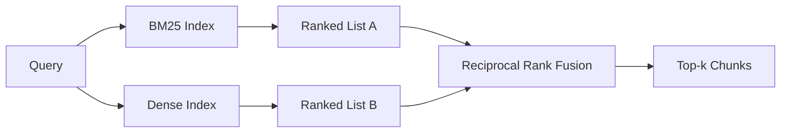

# BM25 ve yoğun yerleşimlerin karışık incelemesi

> 词汇和语义检索相反的查询分布上失败──倒数排名融合的混合检索不会插值,而是投票 - 并且投票在每个查询类上获胜──

**Type:** Build
**Languages:** Python
**Prerequisites:** 第 11 阶段课程 04（嵌入）、06（RAG）；第 19 阶段 Track B 基础（第 20-29 课）；第 19 阶段第 64 课（分块策略）
**Time:** ~90 分钟

## Öğrenme hedefi
- Robertson ve Spark Jones'a göre BM25'in baştan başta uygulanmaya başlaması için formüller vardır.
- Bu nedenle, çevrimiçi olarak çalışmak için, kesinlik simülasyonu üzerine yoğun bir denetleme cihazı inşa edilmiştir.
- Cormack、Clarke 和 Buettcher'a göre, 2009 yılında yayınlanan gibi, bu, neden oran oranı artışında baskın bir konumda olduğunu açıklıyor.
- 调整 RRF k 常数和每种模态权重,并小型固定 语料库上读取权重──

## 问题

Bu soruların birinde, bir sözcük için bir işaret vardır.`AbortMultipartOnFail`Bu sorgu BM25 üzerinden mikro saniye biriminde doğru Go işlevi ile geri döner. Aynı sorgu üç benzerlik sınırında yer alır ve yoğun arama makinesi hata dosyasını ilk sırada yerleştirecektir.

Kullanıcı sorusu:  How do we handle over-abort or multipart word when never entered abort or multipart word BM25 返回                                                                                                                                                                                                                                      

两者之间的选择并非一成不变的──查询分布是变量──生产RAG 系统从同一点处理这两个类,因此查询必须同时处理这两个类──这是混合查询──合并步骤是必须正确的部分──

## 概念



### BM25 一段话

BM25                                                                                                                                                                                                                                                              `k1`Kontrol Sözcükleri; Kaynak değeri 1.5 yayımlanmış bir öneridir, temel olmadan hareket etmemelisiniz.`b`控制文档长度的重要性;默认值 0.75 表示较长文档会受到惩罚,但不是线性──

IDF 公式使用平滑的 Robertson 和 Spark Jones 定义,即 `log((N - df + 0.5) / (df + 0.5) + 1)`◊ Bir terim dil kütüphanelerinin yarısından fazlasında ortaya çıktığında, 日志'deki ekleme IDF'nin doğru değerini korumasına yardımcı olur.

字段加权可让您告诉 BM25, simge isimlerinde uyum, gerçek yazıda uyumdan daha önemlidir. Bu şekilde matematikte aynı kalmak ve her alanın ayrı bir sayı olmamak için, indeksleme sürecinde terminoloji sayısının katılamıdır.

### Bir bölümden yoğun bir inceleme

Kullanılan yerleşim modeli, her blokun sabit boyut veleminde yerleştirilmesini sağlar. Soruşturma sırasında, yerleşim sorusu, her blokun benzerliği üzerine eksendi sıralanmasını yapar ve önceki k 个 个 个 个 个 个 个 个 个 个 个 个 个 个 个 个 个 个 个 个 个 个 个 个 个 个 个 个 个 个 个 个 个 个 个 个 个 个 个 个 个 个 个 个 个 个 个 个 个 个 个 个 个 个 个 个 个 个 个 个 个 个 个 个 个 个 个 个 个 个 个 个 个 个 个 个 个 个 个 个 个 个 个 个 个 个 个 个 个 个 个 个 个 个 个 个 个 个 个 个 个 个 个 个 个 个 个 个 个 个 个 个 个 个 个 个 个 个 个 个 个 个 个 个 个 个 个 个 个 个 个 个 个 个 个 个 个 个 个 个 个 个 个 个 个 个 个 个 个 个 个 个 个 个 个 个 个 个 个 个 个 个 个 个 个 个 个 个 个 个 个 个 个 个 个 个 个 个 个 个 个 个 个 个 个 个 个 个 个 个 个 个 个 个 个 个 个 个 个 个 个 个 个 个 个 个 个 个 个 个 个 个 个 个 个 个 个 个 个 个 个 个 个 个 个 个 个 个 个

Bu ders, kesinlik üzerine kurulu hashlemeyi kullanır, bu nedenle, net ayarlama gerekmez.

### 倒数秩融合,已公布的公式

两个排列榜――任一列表中出现的每一位候选人,将其倒数排列贡献相加―― 2009年论文使用`1 / (k + rank)`,k = 60 olarak varsayılan değer olarak.

Yayınlama düzenli sayısı k = 60 ⋅ Not arbitrary ⋅ When k = 60 ⋅ When, ranking 1 ⋅ Contribution is 1/61, ranking 10 ⋅ Contribution is 1/70 ⋅ Contribution decline slow, therefore deepitude candidate still votes― ⋅ smaller k ⋅ use top results dominate― ⋅ k ⋅ ⋅ ⋅ ⋅ ⋅ ⋅ ⋅ ⋅ ⋅ ⋅ ⋅ ⋅ ⋅ ⋅ ⋅ ⋅ ⋅ ⋅ ⋅ ⋅ ⋅ ⋅ ⋅ ⋅ ⋅ ⋅ ⋅ ⋅ ⋅ ⋅ ⋅ ⋅ ⋅ ⋅ ⋅ ⋅ ⋅ ⋅ ⋅ ⋅ ⋅ ⋅ ⋅ ⋅ ⋅ ⋅ ⋅ ⋅ ⋅ ⋅ ⋅ ⋅ ⋅ ⋅ ⋅ ⋅ ⋅ ⋅ ⋅ ⋅ ⋅ ⋅ ⋅ ⋅ ⋅ ⋅ ⋅ ⋅ ⋅ ⋅ ⋅ ⋅ ⋅ ⋅ ⋅ ⋅ ⋅ ⋅ ⋅ ⋅ ⋅ ⋅ ⋅ ⋅ ⋅ ⋅ ⋅ ⋅ ⋅ ⋅ ⋅ ⋅ ⋅ ⋅ ⋅ ⋅ ⋅ ⋅ ⋅ ⋅ ⋅ ⋅ ⋅ ⋅ ⋅ ⋅ ⋅ ⋅ ⋅ ⋅ ⋅ ⋅ ⋅ ⋅ ⋅ ⋅                                                                                                                                                                                                        

Bu iki başarının arasında bir ayarlama var.`k`常数── her biçimdeki ağırlıklara göre bir, böylece eğer birinden söz konusu metin kütlesinde daha iyi olduğunu gösteren önceden kanıt varsa BM25 veya yoğunluğu artırabilirsiniz── sıralama katkılarını ağırlıkla çarpma en basit prensibi gerçekleştirmek için yapar; dereceli düşüş şeklini koruyor ve belirsiz kalıyor──

### Neden birleşim %s + %s değerinden daha iyidir ?

BM25 bölümü sınırsızdır ve dil kütlesine bağlıdır.`alpha * bm25 + (1 - alpha) * cosine`Her bir dil kütlesinin alfa üzünlü olması gerekir ve her bir yeniden indeksi sırasında kesintisi olacaktır.

Bu, Vespa ve Weaviate'deki kayıtlarda duyduğunuz RankFusion ve RRF'nin argümanlarıyla aynıdır. Aynı sonuca varıyorlar: Eğer çok güçlü bir kanıt yoksa, sıralamaya dayalı olarak kalın.

```figure
rrf-fusion
```

## Yapın onu.

`code/main.py`实现:

- `tokenize(text)`- 快速正则表达式token器──
- `BM25Index`- Şanslı, beraber.`add`和 `search`Ve düzeltilebilir.
- `mock_embed`- Evet.`DenseIndex`- 64'te olduğu gibi belirginlik yerleştirilmiştir, bu nedenle bloklar göreceli­tir.
- `rrf(rankings, k, weights)`- 已发布多模态权重融合──
- `HybridRetriever`- BM25 ile yoğun bir şekilde birleştirilmiştir.
- Bir gösteri .`main()`, küçük bir düzenleme yükle 语料库, çalıştır üç özel olarak her bir arayanın üstünlük eksikliği sorgularını gösterir, ve her bir model oluşturulan sıralama ve birleşim listesi çap eder.

- Yapma .

```bash
python3 code/main.py
```

Not: Not: Not: Not: Not: Not: Not: Not: Not: Not: Not: Not: Not: Not: Not: Not: Not: Not: Not: Not: Not: Not: Not: Not: Not: Not: Not: Not: Not: Not: Not: Not: Not: Not: Not: Not: Not: Not: Not: Not: Not: Not: Not: Not: Not: Not: Not: Not: Not: Not: Not: Not: Not: Not: Not: Not: Not: Not: Not: Not: Not: Not: Not: Not: Not: Not: Not: Not: Not: Not: Not: Not: Not: Not: Not: Not: Not: Not: Not: Not: Not: Not: Not: Not: Not: Not: Not: Not: Not: Not: Not: Not: Not: Not: Not: Not: Not: Not: Not: Not: Not: Not: Not: Not: Not: Not: Not: Not: Not: Not: Not: Not: Not: Not: Not: Not: Not: Not: Not: Not: Not: Not: Not: Not: Not: Not: Not: Not: Not: Not: Not: Not: Not: Not: Not: Not: Not: Not: Not: Not: Not: Not: Not: Not: Not: Not: Not: Not: Not: Not: Not: Not: Not: Not: Not: Not: Not: Not: Not: Not: Not: Not: Not: Not: Not: Not: Not: Not: Not: Not: Not: Not: Not: Not: Not: Not: Not: Not: Not: Not: Not: Not: Not: Not: Not: Not: Not: Not: Not: Not: Not: Not: Not: Not: Not: Not: Not: Not: Not: Not: Not: Not: Not: Not: Not: Not: Not: Not: Not: Not: Not: Not: Not: Not: Not: Not: Not: Not: Not: Not: Not: Not: Not: Not: Not: Not: Not: Not: Not: Not: Not: Not: Not: Not: Not: Not: Not: Not: Not: Not: Not: Not: Not: Not: Not: Not: Not: Not: Not: Not: Non: Non: Non: Non: Non:

## 调整旋

|旋钮|默认|何时调高|何时调低|
|------|---------|----------------|------------------|
| BM25 k1 | 1.5 |文档中的术语会重复，且你希望频率更重要 |文档很短，术语重复主要是噪音 |
| BM25 b | 0.75 |长文档确实每个词携带的信息更少 |文档长度与主题无关 |
| RRF k | 60 |较深排名的候选仍应投票 |Top-1 应该占主导 |
| BM25 weight | 1.0 |语料库包含字面标识符，查询也按字面匹配 |查询多为用户改写 |
| Dense weight | 1.0 |查询多为改写或语义表达 |查询多为字面表达 |

Bu, bir araya gelerek, doğrudan değil, düzenlemeler yapabilmek için 68'inci sınıfın değerlendirme araçlarını yeniden kullanmakla kalkan sorgu kitlesinde kullanılır.

## 演示将隐藏的故障模式

**词汇外token。**BM25'in IDF, dil kütlesine göre hesaplanmıştır, bu nedenle sadece sorguda kullanılan terminolojik katkılar sıfırdır. Sıkı yerleşimler aynı miktarda bir görüntü oluşturur.

**停止token统治。**BM25 针对单词the在语料库中产生统一的排名──过索引器中停止token或接受高 IDF 术语自然占主导地位──

**跨模态的内容相同。**Eğer sizin dil kütleğiniz BM25'in en üst 1'üne kadar yeterince küçükse ve BM25'in de yoğun bir üst 1'e kadar ise RRF aynı komşunun aynı üst 1'ünü size sağlayacaktır. Bu doğru bir davranış, başarısız değil, ancak birleşmeyi görünecek kadar görünmez hale getiriyor.

## Kullan

生产模式:

- BM25 is processing in; bottle is word frequence字典, ve değil向量。
- Bu ders içinde biz düz listeler kullanıyoruz; üretim sırasında siz HNSW kullanıyorsunuz)
- İki sorgu yürütülüyor; birleşim, birleşimlerin sabit zamanlı birliği.
- Her bir arama için bir seçim yapın, böylece aşağıdaki yeniden düzenleyiciler hangi seçimleri destekleyeceğini görebilirler.

## Gönderi

Bölüm 66. Bu ders içinde birleşim üstü-k ve dönüşüm kodlayıcı kullanımı yeniden sıralama. Bölüm 68. Bu ders içinde birleşim kontrol cihazı, 69'da bir sonluk sisteminin ilk aşamasıdır.

## 练习

1. - Ben de .`mock_embed`替代为供应商提供的真实模型──重新运行演示并报告 只有密集排名在释义查询上的变化──
2. 添加第三种模式:单独索引的块摘要并融合为第三排列列表──量增益──
3. RRF'yi 10、30、60、100、200¬ üzerinde tarayın.
4. BM25F'yi doğru gerçekleştirmek için (her bölüm uzunluğu standartlaştırılmak yerine çarpı teknikler) ve en önemli kod uyumlu bir dil kütlesinde karşılaştırmak için

## 关键术语

|术语 |人们怎么说|它实际上意味着什么 |
|------|-----------------|------------------------|
| BM25 | “词汇搜索” | idf x 饱和 tf x 长度归一化的概率排名 |
|参考文献 | “等级融合”|各个排名列表的 1 / (k + 排名) 之和； k = 60 默认 |
| k1 | “TF 饱和度” |控制重复术语停止添加更多分数的速度 |
|乙| “长度惩罚” | 0 表示忽略文档长度，1 表示完全标准化 |
|场加权 | “符号提升”|在索引期间重复token以增强该字段中的匹配|
|基于排名与基于分数的融合 | “为什么 RRF 优于线性”|不同模式下的排名具有可比性；分数不|

## 进一步阅读

- Cormack、Clarke、Buettcher,倒数排名融合优于孔多塞和个人排名学习方法,SIGIR 2009
- Robertson、Walker、Beaulieu、Gatford、Payne,Okapi at TREC-3(原始 BM25 论文)
- [Vespa：使用 BM25 和 Embeddings](https://docs.vespa.ai/en/tutorials/hybrid-search.html) karışık inceleme yap
- [Weaviate：混合搜索](https://weaviate.io/developers/weaviate/search/hybrid)
- 第 11 阶段 第 06 课 - RAG 基础知识
- Bölüm 64 - Bölüm cihazının çıkışı burada indeks düzenleme
- 第19 阶段 第66 课 - 消耗融合的 top-k 的交叉编码器 重排器
