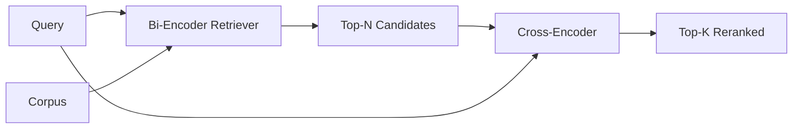

# 交叉编码器 重排序

> İkili kodlayıcı bağımsız olarak soru ve dosya içine yerleştirilmiştir. İkili kodlayıcı onları birbirine bağlayacak ve aynı anda okuyacak.

**Type:** Build
**Languages:** Python
**Prerequisites:** 第11期第06课（RAG）、第11期第07课（高级RAG）；第 19 阶段 Track B 基础（第 20-29 课）；第 19 阶段第 65 课（混合检索喂养此阶段）
**Time:** ~90 分钟

## Öğrenme hedefi
-  Giriş biçimi  parametre hesaplama ve her sorgu tarafından iki kodlayıcı kontrolcü ve çap çaplı kodlayıcı yeniden düzenlemeci olarak ayrılmıştır
- Baştan itibaren, küçük bir geçiş kodlayıcıyı Transformer blok olarak gerçekleştirirken, bir dizi sorgu ve belgeyi tüketir ve tek bir eşya gönderir.
- 连接两阶段检索然后重新排序管道:使用廉价检索器检索前 N,使用交叉编码器将 N 重新排序为前 K,返回 K──
- Küçük sabit dil kütlesinde gecikme ve kalite ağırlığını ölçmek, belirli gecikme bütçesini doğru seçmek için N:

## 问题

İki kodlayıcı, soru ve belgeyi aynı vektör alanına ve ekşi ip sıralamaya yerleştirecektir. Bu iki kodlama asla birbirini görmeyecek. Bu model, soruları düşünmeden, belgedeki tüm yararlı içeriği tek vektörlere sıkıştırmalı. Bu, hızlı bir şekilde  indeksleme yaparken her belge bir kez yerleştirilir, soru sorarken her soru bir kez yerleştirilir ve bu, dil kütlelerinin büyüklüğünde sıralama yapmanın tek yoludır.

代価就是精度── aynı genel konuyu taşıyan iki dosya, birinden soruyu cevapladığında diğerinden cevap verilmese bile neredeyse aynı yerleşime sahip olabilir.

交叉编码器通过一起阅读查询和文件来解决这个问题――该模型收录`[query] [SEP] [document]`Tek bir dizi olarak, tüm bağlantılarda tam dikkatle çalışmak, bir ilgili işaret miktarı oluşturmak ve arşivin her bir göstergesi sorguların her göstergesiyle ilgili olarak karar vermek için tamamlanmış yukarıdaki aşağıdaki örneklere göre bir model oluşturmak.

成本就是吞吐量──双编码器嵌入一次并永久查询的情况下,交叉编码器每个查询,文档) 对于运行一次──对于包含1000万文档的语料库,每个查询需要进行1000万次前向传递──在请求预算中无法运行──

Çözüm bölge aşamasıdır. İkili kodlayıcı kullanmak N 个 个 个 ⇒ İkili kodlayıcı kullanmak N 重新排序将 N 重新排序为 top-K── N 很小(50~200), ikili kodlayıcı kalitesi yükseltilmesi önemli yerlere odaklanır.

## 概念



### 交叉编码器的输入形状 交叉编码器的输入形状

标准包装为`[CLS] query_tokens [SEP] document_tokens [SEP]`◊ CLS  konum output  gönderilen  output ile ilgili işaretlerin tek 线性头── bazı uygulamaları ortalama değerli bir hücre kullanmak yerine CLS; fark çok küçük── önemli nokta bu modelin her bir sayı üretmek için ◊

22M parametre交叉编码器(`ms-marco-MiniLM-L-6-v2`权重等级) tipik üretim noktasıdır. 568M 参数 `bge-reranker-v2-m3`) çevrimiçi yeniden düzenlenmesi veya K'den daha küçük bir baş sayfasının yeniden düzenlenmesi için saklanmaktadır.

### Neden bu ders eğitimi küçük çocuk için?

Gerçek geçiş kodleyicisi, küçük bir düzenleme kodleyicisi Transformer'dir. Yapım sırasında, bir kontrol noktasını yükleyip onu çalıştırırsınız. Bu ders sırasında, hedefimiz size modelin şeklini ve gecikme kalitesi eğriğinin şeklini göstermek, en gelişmiş düzenleme makinesini eğitmek değil. Bu nedenle, küçük bir yapı oluşturduk.`nn.Module`, içinde bir Transformer blokı 、多头注意 (devay olarak 4 个头) ve bir geri dönüş başı vardır.

Oyuncak modeli sabit dil kütüphanesinden doğru şekil öğrenir: ilgili sorgu-dokümanlar karşılaştırmadan daha yüksek tahmin puanları ile ilgili değildir.

### 延迟与质量

İki aşamalı bir borunun düzenlenebilir bir parametri vardır: N.

|N |第 2 阶段的 recall@1 |每个查询的交叉编码器前向传递 |延迟 |
|---|--------------------|---------------------------------------|---------|
| 5 | 0.62 | 0.62 5 |低|
| 20 | 0.81 | 0.81 20 |中等|
| 50 | 50 0.86 | 0.86 50 | 50高|
| 100 | 100 0.86 | 0.86 100 | 100非常高|

Yukarıdaki rakamlar sadece bu düzenin ölçüm değerini değil, şeklini gösterir. Bu düzen gerçektir.

Değerlendirme eğriden seçilen N'in artışı için geçici bütçe.


```figure
rerank-funnel
```

## Yapın onu.

`code/main.py`实现:

- `CrossEncoder`- Bir küçük.`torch.nn.Module`Token embed, bir çok başlı dikkat ve önde gelen Transformer blok, bir işaret ortalama değer bir baş oluşturur.
- `tokenize_pair(query, document)`- iki karakteryi bir kimlik 序列ine bağlamak, onun tipini kimlik simgesi sınırları, kesinlik ve stdlib
- `train_tiny(pairs)`- Bir kez kontrol eğitimi yapılması için üçlü listeler üzerinde bir kez kontrol eğitimi yapılması için, model sabit bir şekilde makul bir sayı üretilebilir.
- `rerank(query, candidates, top_k)`- 生产接口──
- `pipeline(query, retriever, top_n, top_k)`- İki sınıf.
- 演示 `main()`, 65'te bir ders biçiminden basın, önce N 个, önce K 个, yeniden sıralama,并排 iki listeyi basın,并报告每个阶段的延迟――

- Yapma .

```bash
python3 code/main.py
```

输出显示双编码器的顶-N、交叉编码器的顶-K以及时间序摘要──交叉编码器的调用需要更长时间,但不会运行在完整的语料库──双编码器排名第二或第三的答案当选时,两阶段总数保持在请求预算范围内──

## 演示将隐藏的故障模式

**交叉编码器不对称。** `rerank(q, d)`和 `rerank(d, q)`Eğer bir şey değiştirmezsen, hatırın yıkılır.

**N 太低，无法暴露该 bug。**Eğer N = K ayarlanırsa,交叉编码器 K 个候选人重新排序, fakat yeni adayları üst K 带来无法. K 个候选人. K 个候选人.

**训练数据泄漏到评估中。**Eğer manuel token'ın eğitimi değerlendirme sorgularını içerse, yeniden sıralamalar çok şaşırtıcı görünüyor.

**生产权重很密集。**22M 参数交叉编码器在 float32 时为 88MB──在承诺低于100毫秒的p95 之前规划模型服务器的内存──

**批处理很重要。**Gerçek bir geçiş kodlayıcı bir grup içinde çalışmaktadır N 个候选──本课程在 `_batch_encode`Bu işlemleri gerçekleştirmek için kullanılıyor.`torch.tensor(...)`构建批量 id 和类型 id 张量并运行一次前向传递──跳过批处理,延迟会乘以 N──

## Kullan

生产模式:

- İki kodlayıcıyı, birleştirilen kodlayıcıyı ve N'yi birbirine bağlamak hiçbir değişikliğin değerlendirmeyi başarısız hale getirecektir.
- 通過 (query, document_id) 哈希缓存重排器的输出──稳定语料库上的相同查询会重排成相同顺序;缓存命中可以免费降低延迟──
- 记录排名第 1 的交叉编码器分数──top-1 分数低于语料库特定值的查询是域外命中;让LLM表达我不确定──

## Gönderi

Bölüm 68  ders biten biten değerlendirmek bu iki aşamalı boru. 69  ders bu ağırlıklı düzenleme cihazı bağlanacak 65  ders karışık inceleme cihazı sonra  cevap üreticisi önce.

## 练习

1. N'yi 5'den 50'e kadar tarayın, yeniden çizin, çıkışını yeniden çizin.
2. Bir dönem yerine on dönem için bir dönem için bir dönem için bir dönem için bir dönem için bir dönem için bir dönem için bir dönem için bir dönem için bir dönem için bir dönem için bir dönem için bir dönem için bir dönem için bir dönem için bir dönem için bir dönem için bir dönem için bir dönem için bir dönem için bir dönem için bir dönem için bir dönem için bir dönem için bir dönem için bir dönem için bir dönem için bir dönem için bir dönem için bir dönem için bir dönem için bir dönem için bir dönem için bir dönem için bir dönem için bir dönem için bir dönem için bir dönem için bir dönem için bir dönem için bir dönem için bir dönem için bir dönem için bir dönem için bir dönem için bir dönem için bir zaman ayırma biçimleri için bir sürecek.
3. CLS simgesi ile 头替换平均值池──比较该 fixture 的收性──
4.  Etiketler                                                                                                                                                                                                                                                             
5. 65'inci sınıfın ikili kodlayıcı olarak değiştirilmiştir ve iki aşama bağlantılıdır.

## 关键术语

|术语 |人们怎么说|它实际上意味着什么 |
|------|-----------------|------------------------|
|双编码器 | “矢量检索器” |独立编码查询和文档；余弦对它们进行排名 |
|交叉编码器 | “重排” |联合编码(query, doc)；输出一个相关标量 |
|两级管道 | “检索并重排” |便宜的检索器返回 N，昂贵的重排器保留 K |
| N（候选预算）| “重新排列池” |每个查询交叉编码器得分的候选者数量 |
|平均池头 | “最后隐藏的平均值” |将编码器的最后一层输出平均为一个向量 |

## 进一步阅读

- Nogueira, Cho,Passage BERT,2019 年 - 规范的交叉编码器排名论文
- Reimers, Gurevych,Sentence-BERT: Using Siamese BERT 网络的句子嵌入,2019 年 - 关于双编码器与交叉编码器
- [SentenceTransformers 交叉编码器文档](https://www.sbert.net/examples/applications/cross-encoder/README.html)
- [BGE Reranker v2 模型卡](https://huggingface.co/BAAI/bge-reranker-v2-m3)
- 第19 阶段 第65 课 - 混合检索器 养此重新排序阶段
- 19. aşama 68 . Sınıf - Yeniden sıralama getiren yükseltme değerlendirmesini ölçmek
