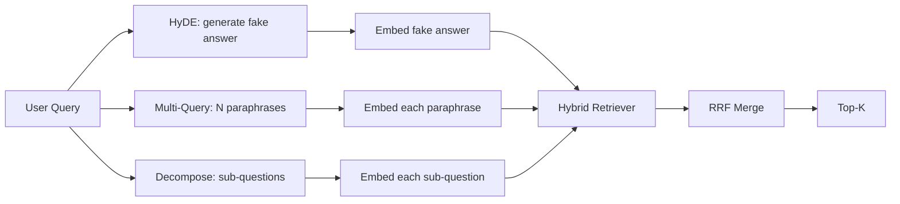

# 查询重写:HyDE、多查询和分解

> Kullanıcı giriş sorguları, aramacı tarafından istenen sorgu değildir. Yeniden yazmak arama öncesi boşluğu giderir, bu nedenle indekslerin gördüğü içerik cevaplara daha yakındır.

**Type:** Build
**Languages:** Python
**Prerequisites:** 第 11 阶段课程 04（嵌入）、06（RAG）；第 19 阶段 Track B 基础（第 20-29 课）；第 19 阶段第 64 和 65 课
**Time:** ~90 分钟

## Öğrenme hedefi
- 实现假设文档嵌入 (HyDE): bir yanlış cevap oluşturun, bu vektörün yerine bu vektörün üzerine arama yapın.
- 实现多查询扩展:将一个查询重写为N个释义,个别检索,通过倒数等级融合合并并集──
- 实现查询分解:将复杂问题分为子问题,按子问题检索,合并──
- Bir yarışta performansını anlatarak her stratejinin nasıl kazanıldığını açıkladı.
-                                                                                                                                                                                                                                                               

## 问题

Kullanıcı girişleri  Başarısız olduğunda ve bütçeler biterse, ekibimiz ne yapar?──语料库'da bir belge yazıyor:AbortMultipartOnFail S3 bölümünü durdurur, ve başarısız olduğunda her kova yeniden sınav bütçesini azaltır── sorgu ve belge paylaşım sözcüğü yok.

修复方法在查询触及检查器之前重写查询.2023年论文 Precise Zero-Shot Dense Retrieval without Relevance Labels(Gao 等人) HyDE: Requirements LLM 编写一个能够回答查询的文档,嵌入这个假设文档,并将其嵌入用于检查向量.

两种近亲技术与HyDE相结合――多查询扩展(Microsoft'un GraphRAG 术语) kullanarak sorguların N 个释义并检索每个释义,然后合并――分解(2024 yılında Stanford DSPy 工作中流行为子查询分解) 上传失败且预算耗尽时我们的团队将什么做分为两个问题:上传失败时会发生什么和重试预算耗尽时会发生什么──

Bu ders, bu üç projeyi gerçekleştirir ve aynı sabit dil kütüphanesine yönelik olarak çalıştırır.

## 概念



### HyDE 详细信息

HyDE ile LLM 编写的假设文档向量替换用户的查询向量──提示很短:

```text
You are a domain expert. Write a one-paragraph passage that answers the question
below. Use the same vocabulary and phrasing the documentation in this domain would
use. Do not refuse. Do not say you do not know.

Question: {user_query}

Passage:
```

LLM'nin cevabı gerçek cevap olarak yanlışdır, çünkü LLM senin语料库を知らない。それはいい。检索器は事実正しさに関心なく, sadece faktorik doğruluğa önem verir 配分。假设段落には  аборт、多部分、桶、予算等の言葉が含まれ, çünkü bu kelimeler konuyu içeren gerçek dosya bölümlerinde yer alır.

Üretim sırasında, varsayımların dosyasını iki ila üç cümleye sınırlayacaksınız. Daha uzun varsayımlar daha fazla gürültü toplayacaktır.

### Çok sorgu genişleme detayları

Ürün kullanıcı sorgularının N 个释义──最简单的提示:

```text
Rewrite the following question in {N} different ways. Each rewrite must preserve
the original intent. Number them 1 to {N}. Do not add explanations.
```

检索每个释义的顶-k――将 N个排名列表与RRF 合并(第 65 课中的算法与相同) ∼廉价、并行、确定性──

Kullanıcının ifadesi, soru sormanın birçok aynı derecede etkili yolun birisidir, çok sayıda soru kazanır ve herhangi bir yeniden yazma daha iyi bir şekilde ortaya çıkarılır.

### Ayrıntılı ayrıntılar

Tek bir kontrolü karşılayamadı birçok yönlü soruları.

```text
The following question may require information from multiple distinct topics.
Decompose it into a list of sub-questions. Each sub-question must be answerable
independently. If the question is already atomic, return it unchanged.

Question: {user_query}
```

检索每个子问题――合并―― 连词、多从句比较或两个不相关主题的问题,分解是正确的工具――原子问题的工具错误;分解器的工作是回复单个问题,而不是发明假子问题――

### Neden bu üç şey var ?

Üç kişi birbirine tamamlayıcıdır. HyDE 弥补查询代币与语料库代币之间的差.多查询覆盖释义方差.多查询分解覆盖多主题查询.

## 模拟 LLM

Bu ders çevrimiçi olarak devam ediyor.

- 对于每一个固定 查询:书面假设段落、三个释义和分解结果──
- 对于未知查询:确定性转换:获取查询的内容词,通过同义词映射对其进行扩展,然后返回结果──

模拟的形形才是重要的,而不是数据. 模拟的形才是重要的,而不是数据. 模拟的形才是重要的,而不是数据.


```figure
cd-hyde-vector
```

## Yapın onu.

`code/main.py`实现:

- `MockLLM`- Yukarıdaki belirtiler değişir.
- `HyDERewriter`- 调用LLM编写假设文档,将重写器输出返回为`RewriteResult`, içeren varsayımlar ve araştırma araçları kullanılması gereken sorular
- `MultiQueryRewriter`- 调用LLM进行N个释义,返回查询列表――
- `DecomposeRewriter`- 调用LLM进行分解,返回子问题──
- `retrieve_with_rewriter`- 采用重写器和检索器,运行重写,融合结果──
- Bir gösterim, sabit üzerinde çalıştırmak üç yeniden yazıcı ve ilk olarak hangi stratejiyi yazdırmak için geri dönmek için.

重复 第 65 课中的检索器形状(混合 BM25 + dense) ・・・融合 yine aynı RRF。 tek yeni biçim ise重写器接口, çok küçük。

- Yapma .

```bash
python3 code/main.py
```

输出是每个策略的排名和最终摘要―― HyDE 措辞不匹配的查询中胜──多查询中胜──多查询中胜──分解多主题查询中胜──后备方案 (后备方案) 无重写器)

## 演示将隐藏的故障模式

**HyDE 对语料库特定标识符的幻觉是错误的。**Bu model bir işlevi adı geliştirdi. Sağ tarafı BM25'in sayısal çöküşü varsayımıdır. Çünkü geliştirilen isim şimdi bir yüksek güç ağırlığı göstergesidir.

**多查询重写全部收敛。**弱模型 will produce three almost the same release. N 次检索返回 the same top-k. RRF 合并并不是比单检索好.

**分解过度分割。**Çözücü atom sorunu bir listeye dönüştürecek. Tüm sorgular aynı dosyaları geri döndürür, ancak sıralama düşer.

**延迟成倍增加。**HyDE 需要花费一次LLM 通话费用──多查询花费一次LLM 调用生成 N 次重写,然后生成 N 次检索──分解需要一次LLM 调用分解,然后进行 M 次检索──检索并行进行;LLM 电话是发言权──

## Kullan

生产模式:

- 按查询长度选择每一个查询策略:原子短查询得到多查询,复杂多子句查询得到分解,行话重查询得到HyDE──
- 通过查询哈希缓存重写器输出──许多查询重复──
- Ve tüm üç sonuç kümesini yürütmek, RRF'yi kullanarak üç sonuç kümesini birleştirmek.

## Gönderi

69 . Sınıf bu yeniden yazıcı aşamasını 65 . Sınıfın inceleme makinesine götürür ve 66 . Sınıfın inceleme makinesine yerleştirir. 68 . Sınıf değerlendirme inceleme makinesi inceleme hatırlatmalarının gelişmesine katkıda bulunur.

## 练习

1. 实现 RAG-Fusion (多查询的 2024年变体), içinde yeniden yazıcının释义有意多样化, sonra yeniden sıralanma adımları (第 66 课)
2. 添加第四种策略:step-back prompting(向LLM 询问更一般的问题,检索该问题,然后再缩小范围)
3. 通过添加问题是原子的头来训练分解器识别原子查询――测量前后的过分率――
4. Gerçek modeller ile LLM'nin yerine modeller kullanmak.
5. Her bir yeniden yazma için, yeniden yazmanın değerini aşağıya düşürmek için, hatırlamalara olan etkisini ölçmek için,

## 关键术语

|术语 |人们怎么说|它实际上意味着什么 |
|------|-----------------|------------------------|
|海德 | “伪造文件检索”| LLM写出答案；嵌入并检索它而不是查询 |
|多查询 | “释义扩展”| N次重写查询；检索N次，按RRF合并|
|分解 | “子查询分割” |多主题查询拆分为子问题，单独检索 |
|原子查询 | “单一主题” |如果不发明假子问题就无法分解 |
|后退一步| “抽象查询”|提出更一般性的问题，检索，然后缩小范围 |

## 进一步阅读

- Yüksek, yüksek, yüksek, yüksek, yüksek, yüksek, yüksek, yüksek, yüksek, yüksek, yüksek, yüksek, yüksek, yüksek, yüksek, yüksek, yüksek, yüksek, yüksek, yüksek, yüksek, yüksek, yüksek, yüksek, yüksek, yüksek, yüksek, yüksek, yüksek, yüksek, yüksek, yüksek, yüksek, yüksek, yüksek, yüksek, yüksek, yüksek, yüksek, yüksek, yüksek, yüksek, yüksek, yüksek, yüksek, yüksek, yüksek, yüksek, yüksek, yüksek, yüksek, yüksek, yüksek, yüksek, yüksek, yüksek, yüksek, yüksek, yüksek, yüksek, yüksek, yüksek, yüksek, yüksek, yüksek, yüksek, yüksek, yüksek, yüksek, yüksek, yüksek, yüksek, yüksek, yüksek, yüksek, yüksek, yüksek, yüksek, yüksek, yüksek, yüksek, yüksek, yüksek, yüksek, yüksek, yüksek, yüksek, yüksek, yüksek, yüksek, yüksek, yüksek, yüksek, yüksek, yüksek, yüksek, yüksek, yüksek, yüksek, yüksek, yüksek, yüksek, yüksek, yüksek, yüksek, yüksek, yüksek, yüksek, yüksek, yüksek, yüksek, yüksek, yüksek, yüksek, yüksek, yüksek, yüksek, yüksek, yüksek, yüksek, yüksek, yüksek, yüksek, yüksek, yüksek, yüksek, yüksek, yüksek, yüksek, yüksek, yüksek, yüksek, yüksek, yüksek, yüksek, yüksek, yüksek, yüksek, yüksek, yüksek, yüksek, yüksek, yüksek, yüksek, yüksek, yüksek, yüksek, yüksek, yüksek, yüksek, yüksek, yüksek, yüksek, yüksek, yüksek, yüksek, yüksek, yüksek, yüksek, yüksek, yüksek, yüksek, yüksek, yüksek, yüksek, yüksek, yüksek, yüksek, yüksek, yüksek, yüksek, yüksek, yüksek, yüksek, yüksek, yüksek, yüksek, yüksek, yüksek, yüksek, yüksek, yüksek, yüksek, yüksek, yüksek, yüksek, yüksek, yüksek, yüksek, yüksek, yüksek, yüksek, yüksek, yüksek, yüksek, yüksek, yüksek, yüksek, yüksek, yüksek, yüksek, yüksek, yüksek, yüksek, yüksek, yüksek, yüksek, yüksek, yüksek, yüksek, yüksek, yüksek, yüksek, yüksek, yüksek, yüksek, yüksek, yüksek, yüksek, yüksek, yüksek, yüksek, yüksek, yüksek, yüksek, yüksek, yüksek, yüksek, yüksek, yüksek, yüksek, yüksek, yüksek, yüksek, yüksek, yüksek, yüksek, yüksek, yüksek, yüksek, yüksek, yüksek, yüksek, yüksek, yüksek, yüksek, uykuyu, yüksek, yüksek, yüksek, uykuyu, yüksek, yüksek
- 微软研究院, 检索的多查询扩展
- Stanford Üniversitesi DSPy,多跳 QA 的子查询分解
- [LlamaIndex 查询转换文档](https://docs.llamaindex.ai/en/stable/optimizing/advanced_retrieval/query_transformations/)
- 第11 阶段 第 07 课 - Yüksek sınıf RAG 模式
- 第19 阶段 第65 课 - 重写器 tarafından sağlanan kontrol cihazı
- 第19 阶段 第68 课 - 测重写器提升的评估
