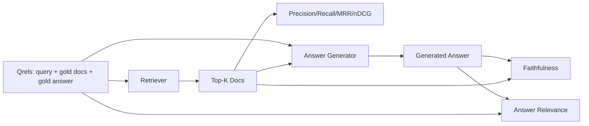

# RAG  değerlendirme: kesinlik oranı, çağrı oranı, MRR, nDCG, sadakat, cevap ilişkisi

> Eğer aynı anda soru ve cevapları değerlendiremiyorsanız, sistem taşıyamayacaksınız.

**Type:** Build
**Languages:** Python
**Prerequisites:** 第11期第06课（RAG）、10（评估）；第 19 阶段 Track B 基础（第 20-29 课）；第 19 阶段课程 64, 65, 66, 67
**Time:** ~90 分钟

## Öğrenme hedefi
- 根据黄金 qrel 计算四个检索指标: precision@k、recall@k、MRR(平均倒数排名) ve nDCG@k。
- 計算兩答等級指标:忠誠度 (doing)                                                                                                                                                                                                                                                       
- Buyruklama                                                                                                                                                                                                                                                            
- 读取 标标值 检索,排名,生成或接地: teşhis hattında hata oluştuğu yer

## 问题

RAG sisteminde en az dört etkinlik parçası vardır: bölük makinesi, kontrol makinesi, yeniden düzenleme makinesi, üreticisi. Bunların herhangi biri yanlış cevaplara yol açabilir.

User Report Error Answerı. %s %s %s %s %s %s %s %s %s %s %s %s %s %s %s %s %s %s %s %s %s %s %s %s %s %s %s %s %s %s %s %s %s %s %s %s %s %s %s %s %s %s %s %s %s %s %s %s %s %s %s %s %s %s %s %s %s %s %s %s %s %s %s %s %s %s %s %s %s %s %s %s %s %s %s %s %s %s %s %s %s %s %s %s %s %s %s %s %s %s %s %s %s %s %s %s %s %s %s %s %s %s %s %s %s %s %s %s %s %s %s %s %s %s %s %s %s %s %s %s %s %s %s %s %s %s %s %s %s %s %s %s %s %s %s %s %s %s %s %s %s %s %s %s %s %s %s %s %s %s %s %s %s %s %s %s %s %s %s %s %s %s %s %s %s %s %s %s %s %s %s %s %s %s %s %s %s %s %s %s %s %s %s %s %s %s %s %s %s %s %s %s %s %s %s %s %s %s %s %s %s %s %s %s %s %s %s %s %s %s %s %s %s %s %s %s %s %s %s %s %s %s %s %s %s %s %s %s %s %s %s %s %s %s %s %s %s %s %s %s %s %s %s %s %s %s %s %s %s %s %s %s

- 检索指标, kontrol cihazının sonuçlarını değerlendirmek için kullanılır.
- İndeksi sıralama, sıradaki doğru blokların konumunu değerlendirmek için yapılmaktadır.
- 忠实地对生成器是否停留在检查到的上下文中进行评价──
- Cevap ve değerlendirme ilişkisi tamamen çözüldü mi?

Bu ders, tüm altı göstergeyi dosya üzerinde oluşturur.

## 概念



### 精度@k

Eğer altın 3 dosya varsa ve 3'ün en üstü 2 dosya ve bir hata dosyası varsa, doğrulama 3'ün 2 / 3'ü olacaktır.

### hatırlat@k

Altın arşivinde, üst-k ne kadar bölümü kapsar? Altın 3 arşiv varsa ve üst-5'te tüm bu üç arşiv varsa, hatırlayın@5 için 1.0。 Yanlış cevapların maliyeti çok yüksek olduğunda, hatırlayın(

RAG üretimi sırasında, genellikle kullanılan bir gösterge, recall@k. oluşturmakla ilgili olmayan blokları kolayca kaldırılabilir; hiç görmemiş olan bloklardan cevaplar üretemez.

### MRR(平均倒数排名)

 Her sorgu için, sıralama listesindeki ilk ilgili dosyanın yerini bulun.  Rating'in düşüş sayısı 1/ konumdur.  Tüm sorgu kümesinin ortalama değeri.

MRR için 1 pozisyon ağırlığı çok büyük.

### nDCG@k

標準化贴现累积收益──完整公式为每检索到的文档分配增益──通常为 1 表示相关,0 表示不相关), konumdaki对数lere göre indirim yapılır, 求和, sonra ideal DCG olarak ayrılır.

nDCG 适应分级相关性:黄金可以说文档 A 是 3,文档 B 是 2,文档 C 是 1──MRR 和recall@k 将所有内容平化为二进制──当语料库每查询有多部分相关文档时,请使用 nDCG──

### 忠诚

Bu nedenle, bu ifadeyi uygulayarak, bu ifadeyi uygulayarak ve bu ifadeyi uygulayarak, bu ifadeyi uygulayarak, bu ifadeyi uygulayarak ve bu ifadeyi uygulayarak, bu ifadeyi uygulayarak, bu ifadeyi uygulayarak ve bu ifadeyi uygulayarak, bu ifadeyi uygulayarak, bu ifadeyi uygulayarak, bu ifadeyi uygulayarak, bu ifadeyi uygulayarak, bu ifadeyi uygulayarak, bu ifadeyi uygulayarak, bu ifadeyi uygulayarak, bu ifadeyi uygulayarak, bu ifadeyi uygulayarak, bu ifadeyi uygulayarak, bu ifadeyi uygulayarak, bu ifadeyi uygulayarak, bu ifadeyi uygulayarak, bu ifadeyi uygulayarak, bu ifadeyi uygulayarak, bu ifadeyi uygulayarak, bu ifadeyi uygulayarak, bu ifadeyi uygulayarak, bu ifadeyi uygulayarak, bu ifadeyi uygulayarak, bu ifadeyi uygulayarak, bu ifadeyi uygulayarak, bu ifadeyi uygulayarak, bu ifadeyi uygulayarak, bu ifadeyi uygulayarak, bu ifadeyi uygulayarak, bu ifadeyi uygulayarak, bu ifadeyi uygulayarak, bu ifadeyi uygulayarak, bu ifadeyi uygulayarak, bu ifadeyi uygulayarak, bu ifadeyi uygulayarak, bu ifadeyi uygulayarak, bu ifadeyi uygulayarak, bu ifadeyi kullanarak, bu ifadeyi uygulayarak, bu ifadeyi uygulayarak, bu ifadeyi kullanarak, bu ifadeyi, bu ifade ile, bu ifade ile, bu ifade ile, bu ifade, bu ifade, bu ifade, bu ifade, bu ifade, bu ifade, bu ifade, bu ifade, bu ifade, bu ifade, bu ifade, bu ifade, bu ifade, bu ifade, bu ifade, bu ifade, bu ifade, bu ifade, bu ifade, bu ifade, bu, bu ifade, bu ifade, bu, bu ifade, bu, bu, bu, bu ifade, bu ifade, bu, bu, bu ifade, bu, bu, bu, bu, bu, bu, bu, bu, bu, bu, bu, bu, bu, bu, bu, bu, bu, bu, bu, bu, bu, bu, bu, bu, bu, bu, bu, bu, bu, bu, bu, bu, bu, bu, bu, bu,

忠诚度抓住模型发明内容的生成器故障模式──即使检查器返回正确块,产生幻觉的生成器也会损坏──忠诚也称为基础、支持、归属──

Bu ders, güvenilirliği gerçekleştirmek için kesinlik simülasyonu yargılamayı, her açıklamanın simgesi, kontrol edilen yukarıdaki yukarıdaki üzerinde yüklenmiş değerlerle olup olmadığını kontrol etmelidir.

### 答案相关性

答案是否真正解决问题?忠诚问答案是否基于上下文?──答案相关性问答案是否基于问题?──答案是否基于问题?──答案是否基于问题?──答案是否基于问题?──答案是否基于问题?──答案是否基于问题?──答案是否基于问题?──答案是否基于问题?──答案是否基于问题?──答案是否基于问题?──答案是否基于问题?──答案是否基于问题?──答案是否基于问题?──答案是否基于问题?──答案是否基于问题?──答案是否基于问题?──答案是否基于问题?──答案是否基于问题?──答案是否基于问题?──答案是否基于问题?──答案是否基于问题?──答案是基于问题?

## Dökme qrel

```python
{
  "qid": "q1",
  "query": "what is the abort threshold for multipart uploads",
  "gold_doc_ids": ["d1", "d3"],
  "gold_answer_substring": "three failed parts",
  "graded_relevance": {"d1": 3, "d3": 2},
}
```

Her sorunun yanında:
- 查询字符串,
- Bir grup altın belgesi kimliği (DQ)
- 分级相关性字典( nDCG için),
- 黄金答案字串( her krel'in referans değerinin verileri olarak kaydedilmektedir; bu dersdeki sadakat, arama yapılmış olanların üzerine yazılı olarak hesaplanır ve bu kısımların değil, çıkarılanların açıklamalarını hesaplamak için hesaplanır)

Bu ders, bir el yapımı yapılandırma ayarı sağladı, bu nedenle değerlendirme hemen kullanılabilir.


```figure
ci-rag-metric-ladder
```

## Yapın onu.

`code/main.py`实现:

- `precision_at_k(retrieved, gold, k)`- 字面定义──
- `recall_at_k(retrieved, gold, k)`- 字面定义──
- `mean_reciprocal_rank(retrieved_list_of_lists, gold_list)`- Soruların ortalama değeri:
- `ndcg_at_k(retrieved, graded_relevance, k)`- DCG / IDCG  has द्व进制或分级增益──
- `extract_claims(answer)`- Cevapları cümle şeklinde bölmek
- `faithfulness(claims, context_texts, judge)`- Desteklenen taleplerin bir parçası olarak
- `answer_relevance(question, answer, judge)`- 判断答案是否解决问题──
- `MockJudge`- 确定性token重叠判断, 离线运行的评估,
- `evaluate_pipeline(pipeline_fn, qrels, ks)`- 运行每个指标的协调器──
- 针对 qrel 运行三种管道变体(分块基线、混合检索、混合 + 重新排名)并印标签表的演示──

- Yapma .

```bash
python3 code/main.py
```

输出显示单指标中每个变体的精度@k、recall@k、MRR、nDCG@k、忠诚度和答案相关性──混合检索行在召回方面击败分块器基线;重新排序在MRR上击败混合行──

## 读取标志来诊断故障

|症状|可能的原因 |修复什么问题 |
|---------|-------------|-------------|
|低召回率@k，低精度@k |分块剪切答案或检索器找不到它 |分块边界（第 64 课）或检索器模态（第 65 课） |
|不错的召回率@k，低 MRR |右块位于 top-k 中但不在位置 1 |重新排序（第 66 课）|
|高MRR，低忠诚度|尽管上下文正确，生成器仍然发明内容 |生成提示；强制引用或拒绝 |
|忠诚度高，相关性低 |答案有根据但偏离主题 |查询重写器（第 67 课）或生成提示 |
|均四高，用户仍抱怨|评估集不具有代表性 |使用真实用户查询扩展 qrels |

## 演示将隐藏的故障模式

**LLM-as-judge 偏差。**Model kendi çıkışını yargıladığında, genellikle gerçek durumdan daha sadık olduğunu düşünür.

**Qrel 腐烂。**Konuşma kitlesinin değişmesiyle birlikte altın cevap da değişecektir. 2024 yılının 1 Ocak ayı ilk çeyreğinde altın dosyalar, 2024 yılının 10 Ocak ayında artık doğru cevap olmayacak, çünkü takım bu işlevi yeniden adlandı.

**忠诚度微观检查错过了宏观声明。**Her cümlenin sadakati geçerli olabilir, fakat genel cevapların yapısı yanlış yönlendirilir.

**Recall@k 掩盖了每个查询的失败。**%90'ın ortalama geri dönüş oranı bir sorgu sınıfının her zaman kaybedilen durumunu gizleyebilir.

## Kullan

生产模式:

- Her bir test cihazı veya üreticisi için değişim çalışma değerlendirmesi.
- Kullanıcı şikayet ettiğinde, uygun bir kâr bulup, yakalanır mı diye bakmak için her sorunun işaretini takip et.
- Bu süreçte: CI'de yürütülen 20 sorgu duman kümesi; her gece yürütülen 200 geri dönüş kümesi; her hafta yürütülen 2000 derin kümesi¬ni;

## Gönderi

Bölüm 69  Ders Tüm boruyu bağlamak, bu değerlendirmeyi sonuna kadar sistemle gerçekleştirmek için yapılmıştır.

## 练习

1. 添加第五个检索指标:hit-rate@k。将其与recall@k 进行比较──当它们不同时进行解释──
2. 实行分级忠诚度:0(不支持) 、1(部分支持) 、2(完全支持) ∼相应地更新标标──
3. Gerçek model kullanmak yerine gerçek model yargılamak için kullanmak.
4. 添加查询类片(字面、释义、多主题) rapor──每片标点──
5. 添加答案长度标标并将其与忠诚性相关联──绘曲线──

## 关键术语

|术语 |人们怎么说|它实际上意味着什么 |
|------|-----------------|------------------------|
|精度@k | “命中率超过检索” | top-k 中黄金的比例 |
|recall@k | “命中了 gold 吗”| top-k 中包含 gold chunk 的比例 |
| MRR | “第一击位置”| 1 的平均值/第一个相关文档的排名 |
| nDCG@k | “分级排名质量”| top-k 上的 DCG 除以理想 DCG |
|诚信| “接地气” |检索到的上下文支持的答案声明的比例 |
|答案相关性 | “它解决了这个问题吗？” |答案是否符合问题的意图 |
|问题 | “金标”|带标签的查询集及其黄金文档和答案 |

## 进一步阅读

- Buckley, Voorhees, evaluation assess measurement stability,SIGIR 2000 - 关于排名指标的规范论文
- Jarvelin、Kekalainen,IR 技术的基于累积增益的评估 - nDCG 论文
- [Ragas：RAG 管道的自动评估](https://docs.ragas.io)
- [人择，评估 RAG](https://www.anthropic.com/news/evaluating-rag)
- 第11 阶段 第10 课 - 评估框架基础
- 第19 阶段 Ders 64-67 - Burada değerlendirme bileşenleri
- 19. aşama 69 . Sınıf - Bu değerlendirme end-to-end değerlendirme
