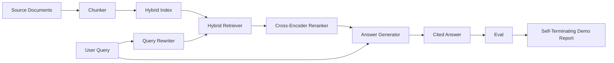

# 端到端 RAG 系统

> 组件的六课――一根管道――一评估循环――一个自动终止的演示――这是您交付的系统――

**Type:** Build
**Languages:** Python
**Prerequisites:** 第11期第06课（RAG）、10（评估）；第 19 阶段 Track B 基础（第 20-29 课）；第 19 阶段课程 64, 65, 66, 67, 68
**Time:** ~90 分钟

## Öğrenme hedefi
- Bölümleme cihazı, karıştırma kontrol cihazı, sorgu yazıcıları, çap çaplı kodlama cihazı, bir uçtan sonuna kadar bir boru oluşturan bir sıralama ve cevap üreticisi oluşturmak.
- 实现一个答案生成器,通过块点引用其声明,并具有低信任性拒绝回归功能──
- İyi bir tesisat için 68'inci sınıfın değerlendirilmesi ve her bir gösterge üzerinde inşaat aşamalarının tek başına aynı bileşenlerden daha iyi olduğunu kanıtlamak
- Constructing an automatic terminated CLI 演示, which will capture fixed speech material library, run a fixed query set, and return a summary report to zero──

## 问题

孤立的六成分不能证明什么──分块器可以在recall@5上战胜语料库中,但在系统的recall@5上失败,因为检查器无法对分块器的发射进行排名──重排器可以提高合成候选池上的MRR,但无法处理真正的双编码器候选人,因为重排预算下双编码器的召回率太低──查询重写器可以在单个查询上升黄金文档,然后在下一个查询上断断,因为LLM 模拟返回退化假设──

Entegre test, tüm borunun aynı sabitleme için bir anda aynı göstergeye sahip olup, aynı göstergeye sahip olup, tüm içeriği birbirine bağlayacak bir düzenleyici dosyasını kullanır. Bu dersin içeriği budur.

## 概念



### 接线选择

管道是一个小图――每个阶段都是一个具有清晰签名的函数――

|舞台|输入|输出|
|-------|-------|--------|
|块块|文档正文 |块记录列表 |
|检索器 |查询字符串 | Top-N chunk 记录 |
|重写器（可选）|查询字符串 |重写列表+假设|
|重新排序 |查询，候选人 |带有交叉分数的 Top-K 块记录 |
|发电机|查询，top-K Chunk 记录 |带有引文的答案字符串 |

Her imzası sabit olduğunda, birleştirme çok basit.`Pipeline`Klas beş aşama içerir ve onları sırayla yürütür.`query`方法── her aşama değişken: farklı bölge makinesi, kontrol makinesi, yeniden yazıcı, yeniden düzenleme makinesi veya üreticisi, tüp hala çalışılabilir.

### 带引文的答案生成器

发电机 son sınıf, en kolay bozulması olanıdır. Bu ders bir kesinlik simülasyon jeneratörü, bu jeneratör sunar:

1. 取出前 K 个重新排序的块──
2. En fazla iki metin seçilir ve sorgu üstlenme derecesinin en yüksek olduğu bir içeriği simgesi vardır.
3.  Bir cevap gönder, bu cevap her seçilen bloktan bir cümleyi bir arada, her cümleyi bir sonraki bir cümleyle `[doc_id:chunk_index]`- Evet.
4. Eğer bir blok yüklenmeden  değerini reddetmek için daha fazla bir blok yoksa, 发出我不知道且不带引用

Üretim sırasında, gerçek LLM için değiştirmek için bir tip modules kullanabilirsiniz:

```
You are answering a question using only the snippets below.
Cite every claim with the anchor in parentheses.
If the snippets do not answer the question, say "I do not know".

Question: {query}

Snippets:
{enumerated chunks with anchors}

Answer:
```

低信度拒绝路径 (低信度拒绝路径) kaydı çapında kodlayıcı sıralamasının tüm nedenleri vardır. Eğer bu 值  değerinden düşükse, jeneratör reddeder.

### Son gösterim

Bu gösteride bir soru sorunun her aşamasında ayrıntılar basılır, dört sabit krel 运行评估, bir gösterge göstergesi basılır. Eğer 68 numaralı ders tüm göstergeler gösteride ayarlanan değerlere ulaşırsa, gösterge sıfırdan çıkılır.

Bu, CI'nin tütün testinin biçimidir. Bu boruların  değerinin kasten sert olması, bu nedenle altı bölümlük derslerin herhangi birinin geri dönüşü gösterinin başarısız olmasına neden olur.


```figure
rag-pipeline-flow
```

## Yapın onu.

`code/main.py`实现:

- `Chunk`- 贯穿所有阶段的记录 (chunk_index 和源 doc_id) 扩展 第 64 课的形状) ⋅
- `Chunker`- 64'ten 课中选择策略 (tanımlı olarak ayrılma)
- `HybridIndex`- BM25 + 密集 + RRF'den 65'den beri.
- `Rewriter`(可选) - sorgu uzunluğu ve bağlantı kelimelerinin varlığına göre 67 dersinden HyDE、多查询、分解之一を選択します.
- `Reranker`- 第66 课中训练过交叉编码器,较小的配件 训练集,因此可以在几秒内收收──
- `Generator`- 引用和低信度拒绝的确定性模拟生成器──
- `Pipeline`- 使用返回 `Result(answer, top_k, latency_ms_per_stage)``query(question)`方法组成五个阶段──
- `run_demo()`- 摄取语料库,运行三个固定查询,运行评估,印结果,并按值设置退出代码──

- Yapma .

```bash
python3 code/main.py
```

输出 is a segment of printed query trace、 complete assessment表和最终通过/失败状态──on default fixture 上返回退出代码 0──

## 演示将隐藏的故障模式

**分块器边界漂移。**Eğer değerlendirme işleminde ve gösterim sırasında bir bölgecilik stratejisi ile bir de bir değişim yaparsanız, bir bölgecilik stratejisi bir bölgecilik belgesi ile bir de bir bölgecilik stratejisi ile bir de bir gösterim yapılır.

**Reranker 训练集泄漏到 eval 中。**Bölüm 66'da 14 eğitim üçü grupları, değerlendirme sorgularına benzer sorguları içerir.

**模拟生成器隐藏了幻觉风险。**模拟 cannot produce illusion, because it only issues text from the block to be examined. Bu ders bunu fark etti ve gerçek modellerin üretiminin dönüşüm yolunu belirtti.

**无流式传输。**Bu, bir üretim sisteminin, bir üretim sisteminin, bir üretim sisteminin, bir üretim sisteminin, bir üretim sisteminin, bir üretim sisteminin, bir üretim sisteminin, bir üretim sisteminin, bir üretim sisteminin, bir üretim sisteminin, bir üretim sisteminin, bir üretim sisteminin, bir üretim sisteminin, bir üretim sisteminin, bir üretim sisteminin, bir üretim sisteminin, bir üretim sisteminin, bir üretim sisteminin, bir üretim sisteminin, bir üretim sisteminin, bir üretim sisteminin, bir üretim sisteminin, bir üretim sisteminin, bir üretim sisteminin, bir üretim sisteminin, bir üretim sisteminin, bir üretim sisteminin, bir üretim sisteminin, bir üretim sisteminin, bir üretim sisteminin, bir üretim sisteminin, bir üretim sisteminin, bir üretim sisteminin, birleştirilmesi, bir üretim sisteminin, birleştirilmesi, birleştirilmesi, birleştirilmesi, birleştirilmesi ve birleştirilmesi, birleştirilmesi, birleştirilmesi ve birleştirilmesi, birleştirilmesi, birleştirilmesi ve birleştirilmesi, birleştirilmesi, birleştirilmesi ve birleştirilmesi, birleştirilmesi, birleştirilmesi ve birleştirilmesi, birleştirilmesi, birleştirilmesi, birleştirilmesi, birleştirilmesi ve birleştirilmesi, birleştirilmesi, birleştirilmesi, birleştirme, birleştirme, birleştirme, birleştirme, birleştirme, birleştirme, birleştirme, birleştirme, birleştirme, birleştirme, birleştirme, birleştirme, birleştirme, birleştirme, birleştirme, birleştirme, birleştirme, birleştirme, birleştirme, birleştirme, birleştirme, birleştirme, birleştirme, birleştirme, birleştirme, birleştirme, birleştirme, birleştirme, birleştirme, birleştirme, birleştirme, birleştirme, birleştirme, birleştirme, bir, birleştirme, birleştirme, bir, birleştirme, bir, birleştirme, bir, birleştirme, bir, bir, birleştirme, bir, bir, bir, birleştirme, bir, bir, bir, bir, bir, bir, bir, bir, bir, birleştirme, bir, bir, bir, bir, bir, bir, bir, bir, bir, bir, yapme, yapme, yap yap yap yap yap yap yap yap

**延迟是离线的。**模拟LLM 调用是恒定时间──真正的LLM电话占主导地位──在请求范围内规划延迟预算;本课程的每阶段计时时只测量CPU工作──

## Kullan

生产模式:

- Bu nedenle, bu işlemin sonucunda, bir türden bir işlem yapılır.
- Eğer değer düşerse, sonuç düşmez.
- Her bir CI'nin işlevini takip et, böylece dönüşüm aşamasına dönebilirsin.
- 20 sorgu ekleyin: duman kümesi, 30 saniyeden fazla sürmez; tam bir duman kümesi her gece çalışmaktadır.

## Gönderi

Bu dersdeki boru dosyası, 19. aşamada Track F dersinin geri kalan kısmında kullanılan biçimlerdir. Sonraki dersler, otomatik alım, yeniden indeksileme, uzaktan ölçüm ve üst hizmet seviyesi ile birlikte tamamlanmıştır.

## 练习

1. Çekilme biçimi: 67 课的启发式 (长度,连词,行话比例) 选择 HyDE,多查询,解析,
2. Env 标志后面添加对生成器的真正LLM 调用──默认为模拟──测量延迟增量──
3.                                                                                                                                                                                                                                                                                                                                                                                                                                                                                                                              `--corpus path`标志──重新运行评估和值检查──
4.                                                                                                                                                                                                                                                                                                                                                                                                                                                                                                                              `--strategy`标志── her stratejinin sonuna kadar geri çağırma katkılarını ölçmek──
5. 添加流生成器接口并将其输入到 eval 中──确认忠诚度是根据最终字符串而不是流式前计算的──

## 关键术语

|术语 |人们怎么说|它实际上意味着什么 |
|------|-----------------|------------------------|
|管道| “RAG 管道”|从摄取到引用答案的撰写阶段|
|引文锚| “来源链接” |每个声明附加的 (doc_id, chunk_index) 引用 |
|低置信度拒答| “我不知道” |当重排器 top-1 分数低于阈值时，生成器不返回答案 |
|smoke set | “CI 评估”|每次 PR 检查中运行的最小 qrels 子集 |
|阶段接口| “函数签名”|各个管道阶段的稳定输入输出类型 |

## 进一步阅读

- [人择、建筑搜索与检索](https://www.anthropic.com/news/contextual-retrieval)
- [Pinterest，MCP 内部搜索](https://medium.com/pinterest-engineering)- 参考生产架构
- [Ragas：RAG 管道的自动评估](https://docs.ragas.io)
- 第 11 阶段 第 06 课 - RAG 基础知识
- 第19 阶段 Ders 64-68 - Burada oluşuyor
