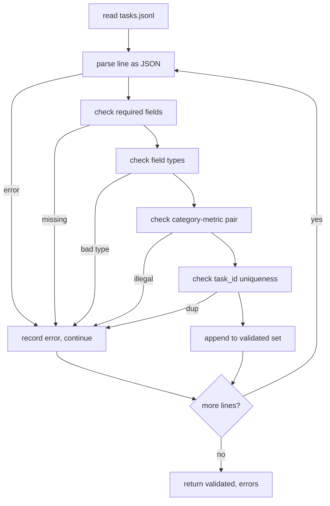

# Görev kuralları

> 评估安全带的好坏取决于其任务执行的合同──在编写单个评分函数之前,请结结 JSONL 形和量词汇──

**Type:** Build
**Languages:** Python
**Prerequisites:** 19期B轨地基
**Time:** ~90 分钟

## Öğrenme hedefi


```figure
ci-task-spec-gate
```

-  define a JSONL  görev kayıt modeli, bir biçiminde kaltimleri, çoklu seçimleri, kodları, sınıfları ve serbest metinleri kapsayan bir biçim olarak
- 固定量名称的封闭词汇表,以便下游课程 (71-73)
- Küçük örnek örnekleri ve sonrası işlem kurallarını, koşucuların bir parçası değil, görevlerin bir parçası olarak belirlemek, bu nedenle aynı ipuçları modeller arasında aynı hedef oluşturur.
- ¢¢¢¢¢¢¢¢¢¢¢¢¢¢¢¢¢¢¢¢¢¢¢¢¢¢¢¢¢¢¢¢¢¢¢¢¢¢¢¢¢¢¢¢¢¢¢¢¢¢¢¢¢¢¢¢¢¢¢¢¢¢¢¢¢¢¢¢¢¢¢¢¢¢¢¢¢¢¢¢¢¢¢¢¢¢¢¢¢¢¢¢¢¢¢¢¢¢¢¢¢¢¢¢¢¢¢¢¢¢¢¢¢¢¢¢¢¢¢¢¢¢¢¢¢¢¢¢¢¢¢¢¢¢¢¢¢¢¢¢¢¢¢¢¢¢¢¢¢¢¢¢¢¢¢¢¢¢¢¢¢¢¢¢¢¢¢¢¢¢¢¢¢¢¢¢¢¢¢¢¢¢¢¢¢¢¢¢¢¢¢¢¢¢¢¢¢¢¢¢¢¢¢¢¢¢¢¢¢¢¢¢¢¢¢¢¢¢¢¢¢¢¢¢¢¢¢¢¢¢¢¢¢¢¢¢¢¢¢¢¢¢¢¢¢¢¢¢¢¢¢¢¢¢¢¢¢¢¢¢¢¢¢¢¢¢¢¢¢¢¢¢¢¢¢¢¢¢¢¢¢¢¢¢¢¢¢¢¢¢¢¢¢¢¢¢¢¢¢¢¢¢¢¢¢¢¢¢¢¢¢¢¢¢¢¢¢¢¢¢¢¢¢¢¢¢¢¢¢¢¢¢¢¢¢¢¢¢¢¢¢¢¢¢¢¢¢¢¢¢¢¢¢¢¢¢¢¢¢¢¢¢¢¢¢¢¢¢¢¢¢¢¢¢¢¢¢¢¢¢¢¢¢¢¢¢¢¢¢¢¢¢¢¢¢¢¢¢¢¢¢¢¢¢¢¢¢¢¢¢¢¢¢¢¢¢¢¢¢¢¢¢¢¢¢¢¢¢¢¢¢¢¢¢¢¢¢¢¢¢¢¢¢¢¢¢¢¢¢¢¢¢¢¢¢¢¢¢¢¢¢¢¢¢¢¢¢¢¢¢¢¢¢¢¢¢¢¢¢¢¢¢¢¢¢¢¢¢¢¢¢¢¢¢¢¢¢¢¢¢¢¢¢¢¢¢¢¢¢
- Test kurallarının her bir bölümünde test görevlerinin 10 tane olduğu bir takımını yayınlamak, böylece test cihazının gerçek bir şey olması için kullanılabilir.

## Neden bu kuralları?

Araştırma kod kütüphanesi ätz 脚本の速度も積累テストの速度よりも速い. 6 ay sonra her notun kendi JSON biçimi vardır, her gösterge iki kez yeniden gerçekleştirilmiştir ve çalışmalar arasında karşılaştırma yapılmaz.

Bu şekil, BIG-bench、HELM 和 lm-eval 风格线束のアイデアを借借用した.

## 记录形状

任务是单行上的 JSON对象──线束读取 `tasks.jsonl`Ve her bir yol için bir yanlış yol, bu kayıtları durdurur.

```json
{
  "task_id": "arith_001",
  "category": "arithmetic",
  "prompt": "Compute the result. Question: 17 + 24\nAnswer:",
  "targets": ["41"],
  "metric_name": "exact_match",
  "few_shot_examples": [
    {"prompt": "Question: 2 + 2\nAnswer:", "completion": "4"}
  ],
  "post_process": "strip_whitespace",
  "metadata": {"difficulty": "easy"}
}
```

Bıçağı`task_id`- Evet.`category`- Evet.`prompt`- Evet.`targets`- Evet.`metric_name`- Evet.`post_process`- Evet.`few_shot_examples`和 `metadata`Yapılacak seçimler. Bilinmeyen bir sınav başarısızlığı.

## 字段规则

`task_id`Bu, boş olmayan bir karakterdir. Tüm dosyanın tek özelliği.

`category`Evet .`arithmetic`- Evet.`mcq`- Evet.`code_exec`- Evet.`classification`- Evet.`summary`之一── bu sınıf, ölçüm ve sonrası işlemin yasal olduğunu sınırlandırır.`code_exec`任务必须使用 `metric_name = code_exec`- Evet .`mcq`任务必须使用 `metric_name = exact_match`- Evet.

`prompt`Bu, bir boşluktan ibaret bir satırdır. Bu satırın yazılı olarak yazılı olarak yazılı olarak yazılı olarak yazılı olarak yazılı olarak yazılı olarak yazılı olarak yazılı olarak yazılı olarak yazılı olarak yazılı olarak yazılı olarak yazılı olarak yazılı olarak yazılı olarak yazılı olarak yazılı olarak yazılı olarak yazılı olarak yazılı olarak yazılı olarak yazılı olarak yazılı olarak yazılı olarak yazılı olarak yazılı olarak yazılı olarak yazılı olarak yazılı olarak yazılı olarak yazılı olarak yazılı olarak yazılı olarak yazılı olarak yazılı olarak yazılı olarak yazılı olarak yazılı olarak yazılı olarak yazılı olarak yazılı olarak yazılı olarak yazılı olarak yazılı olarak yazılı olarak yazılıdır.

`targets`Bu bir boş olmayan bir çizgi.`exact_match`, herhangi bir eşleşen elementin hesaplanması için.`f1`和`rouge_l`, en yüksek puanı kazanma hedefi.`mcq`, listede sadece bir element vardır.

`metric_name`Evet .`exact_match`- Evet.`f1`- Evet.`bleu_4`- Evet.`rouge_l`- Evet.`accuracy`- Evet.`code_exec`之一──词汇是封闭的──新标需要新教训和新条款── yeni bir işaret gerektirir.

`few_shot_examples`Evet .`{prompt, completion}`Bu listeyi sekiz maddeye sınırlayacak.

`post_process`Evet .`none`- Evet.`strip_whitespace`- Evet.`lower`- Evet.`extract_letter`- Evet.`extract_code_block`- Evet.`extract_first_line`之一── her kuralın bir belirlenme davranışı vardır──verifier prohibits 组合规则──

## 验证器 davranışları



验证器 iki listeyi geri gönderir: 验证记录 ve hata kayıtları, bunların içinde ihlal 、 ihlal 则和错误字段 bulunur.`--allow-bad-tasks`- Evet.

## Küçük bir görüntü

Runner önündeki birkaç örneği boşluk ayırtcılarıyla bağlayacaktır. Her model aynı kod yolunu kullanır, bu nedenle tek farkın kaynağı modelin kendisi olacaktır.

```python
def render(task):
    parts = []
    for ex in task.get("few_shot_examples", []):
        parts.append(ex["prompt"] + " " + ex["completion"])
    parts.append(task["prompt"])
    return "\n\n".join(parts)
```

## 后处理规则

后处理步骤在生成后、指标之前运行─── bu kesinlik ve durumsuzluk ‖

- `none`返回字符串不变──
- `strip_whitespace`Gitmiş, gitmiş, gitmiş.
- `lower`Küçük yazışma.
- `extract_letter`返回与 `[A-E]`匹配的第一个字符, MCQ için kullanılır.
- `extract_code_block`返回第3重反引号隔离块主体, kod uygulaması için
- `extract_first_line`返回第1非空行,用于汇总分类──

Bu listeden dışındaki kuralların görevleri yeni bir ders içermektedir.

## 本课不做什么

Bu, bir model kullanmıyor, kod çalışmıyor, bu konular da derslerin 71, 72 ve 75'inde mevcuttur.

10 个任务 fixture 覆盖两个算术项,两个 MCQ项,两个代码执行项,两个分类项和两个摘要项,验证器通过所有10条规则,一个单独的 fixture (`tasks_bad.jsonl`) her kuralın hatası olacaktır ve tescilci geri gönderilen hata sayısı bu hatalarla aynı olacaktır.

## Nasıl okuyabilirim?

`main.py`- Defini etti .`TaskSpec`- Evet.`validate_task`- Evet.`validate_file`CLI Giriş Noktası.`load_fixtures`染和后处理助手 验证逻辑旁边位置,因此第75 课中的运行者只需导入单个模块──

Üsttan aşağıya kadar oku`main.py`Sonra okudu.`code/tests/test_spec.py` Testing will fix each verification rules and each subsequent processing behavior`main.py`底部の演示会验证捆绑の固定并印摘要──

## Daha ileri

Gerçek değerlendirme kitleri, bir sınıfın büyümesi biçiminde büyümektedir. Açık bir hareket, bir sınıf eklemeyi reddetmek, bir gösterge eklememek, bir sonraki işlem kuralları ve en az bir sabit görevdir.
