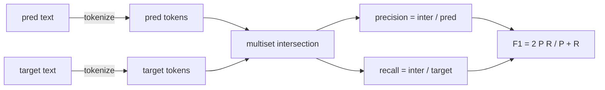
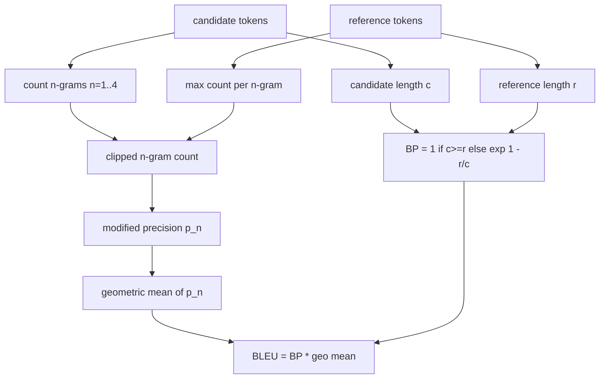

# 经典标标

> BLEU、ROUGE-L、F1、精确匹配、准确率──5 gösterge hala yayınlanan LLM 评估数字lerinin çoğunu oluşturuyor.

**Type:** Build
**Languages:** Python
**Prerequisites:** 第 19 期 Track B 基础，第 70 课
**Time:** ~90 分钟

## Öğrenme hedefi


```figure
cd-bleu-overlap
```

- 通过明确的代币化规则实现代币级精确匹配、F1 和准确性──
- BLEU-4: n 元语法精度, n'in geometrik ortalaması 1 ila 4'e eşit olarak değiştirilmiştir.
- ROUGE-L'yi gerçekleştirmek için en uzun kamu kısımları ve kesinlik ve geri dönüş oranı F-beta ıntılılarını kullanmak.
- 调度第 70 课中的 metric_name 字段, böylece koşucu gösterge ile ilişkisi olmayan bir durum tutulur.
- İş örneğinden değil, üçüncü taraf kütüphanelerinden alınan referans vektörlerinden kullanarak sabit davranışlar oluşturmak.

## Neden yeniden gerçekleştirmek gerekiyor?

Bir kitap kesimi küçük yazmak için, diğerinde kesmiyor çünkü bir kitap kesimi için 10 puan farkı bulacaksınız. Bir araya gelmeyi durdurmak için en hızlı yöntem kendi kendini bir gösterge yazmak, sonra karar göstergesi ve uygulama düzleminin çizgisine yönlendirmek.

BLU, sayı ve konumdur. ROUGE-L, hareketli planlama. F1, birikimle yapılan birimdir.

## simgeselleştirme

分词器是 `re.findall(r"\w+", text.lower())`▽小写、字母数字运行、删除标点符号──本课程中的每个标标都使用这个精确的分词器──runner没有选择权──如果您交换分词器,您将运行不同的基准测试──

```python
TOKEN_RE = re.compile(r"\w+", re.UNICODE)
def tokenize(text):
    return TOKEN_RE.findall(text.lower())
```

Bu, bir açıklama olarak basitleştirilmiştir. Üretim ayarları CJK'ye odaklanacak.

## 精确匹配

```python
def exact_match(pred, targets):
    return float(any(pred.strip() == t.strip() for t in targets))
```

Her görev 1.0 veya 0.0'e geri döner. Veriler toplamı ortalama değerdir. Bu da aritmetik, MCQ ve kısa sınıflı görevlerin ana gücüdür.

## simge sınıfıF1

Settings for prediction and target token multiplexing──精度 is multiplexing sum sum sum sum sum sum sum sum sum sum sum sum sum sum sum sum sum sum sum sum sum sum sum sum sum sum sum sum sum sum sum sum sum sum sum sum sum sum sum sum sum sum sum sum sum sum sum sum sum sum sum sum sum sum sum sum sum sum sum sum sum sum sum sum sum sum sum sum sum sum sum sum sum sum sum sum sum sum sum sum sum sum sum sum sum sum sum sum sum sum sum sum sum sum sum sum sum sum sum sum sum sum sum sum sum sum sum sum sum sum sum sum sum sum sum sum sum sum sum sum sum sum sum sum sum sum sum sum sum sum sum sum sum sum sum sum sum sum sum sum sum sum sum sum sum sum sum sum sum sum sum sum sum sum sum sum sum sum sum sum sum sum sum sum sum sum sum sum sum sum sum sum sum sum sum sum sum sum sum sum sum sum sum sum sum sum sum sum sum sum sum sum sum sum sum sum sum sum sum sum sum sum sum sum sum sum sum sum sum sum sum sum sum sum sum sum sum sum sum sum sum sum sum sum sum sum sum sum sum sum sum sum sum sum sum sum sum sum sum sum sum sum sum sum sum sum sum sum sum sum sum sum sum sum sum sum sum sum sum sum sum sum sum sum sum sum sum sum sum sum sum sum sum sum sum sum sum sum sum sum sum sum sum sum sum sum sum sum sum sum sum sum sum sum sum sum sum sum sum sum sum sum sum sum sum sum sum sum sum sum sum sum sum sum sum sum sum sum sum sum sum sum sum sum sum sum sum sum sum sum sum sum sum sum sum sum sum sum sum sum sum sum sum sum sum sum sum sum sum sum sum sum sum sum sum sum sum sum sum sum sum sum sum sum sum sum sum sum sum sum sum sum sum sum sum sum sum sum sum sum sum sum sum sum sum sum sum sum sum sum sum sum sum sum sum sum sum sum sum sum sum sum sum sum sum sum sum sum sum sum sum sum sum sum sum sum sum sum sum sum sum sum sum sum sum sum sum sum sum sum sum sum sum sum sum sum sum sum sum sum sum sum sum sum sum sum sum sum sum sum sum sum sum sum sum sum sum sum sum sum sum sum sum sum sum sum sum sum sum sum sum sum sum sum sum sum sum sum sum sum sum sum sum sum sum sum sum sum sum sum



 Çoklu hedef görevleri için, hedef listesinden en iyi F1'yi seçtik. Bu, yayınlarda geniş çapta bildirilen SQuAD biçimindeki davranışlarla uyumludur.

## BLEU-4

BLEU, düzenli bir makineler tercüme göstergesidir, halen özet çalışmalarında bulunmaktadır. Kullandığımız formül, dil kütle sınıfının BLEU-4, standart basitlik cezası ile değiştirilen n eski dil sayımlarının bir düzeltme yapılması ile birlikte, bu nedenle tek eksik olan 4 eski dil sayısının oranı sıfıra indirilmeyecektir.

 Her bir aday için referans karşılığı olarak, n'e eşit olarak 1、2、3、4 saat değişiklik sonrası n'den önceki dıklım doğruluğunu hesaplamak için yapılan değişikliklere göre, n'den sonraki dıklım doğruluğu herhangi bir referans içeren n'den önceki dıklım doğruluğunun en büyük sayısını kullanarak seçkinleri eleştirir, bu nedenle adaylar bir kısaltmayı tekrarlayarak büyütemezler.



Düzsellik kuralları Lin ve Och'un söylediği yöntemdir: Sayıyı alınmadan önce, her n elementin molekül ve ayrımcılığı 1 ünü ekleyin.`log 0`- Evet.

## 脂-L

ROUGE-L, aday göstergesi sırası ile referans göstergesi sırasının en uzun kamu alt sırası arasında karşılaştırılır. LCS  sözcük sırası zorunlu bir devamlılık değil, bu yüzden standart bir özet ölçüsüdür.`lcs / reference length`, 精度为`lcs / candidate length`,并与F-beta 结合,其中对称F1 形式的β等于1──

```python
def lcs_length(a, b):
    n, m = len(a), len(b)
    dp = numpy.zeros((n + 1, m + 1), dtype=int)
    for i in range(n):
        for j in range(m):
            if a[i] == b[j]:
                dp[i+1, j+1] = dp[i, j] + 1
            else:
                dp[i+1, j+1] = max(dp[i+1, j], dp[i, j+1])
    return int(dp[n, m])
```

numpy 表使实现清晰易读;纯 Python 列表也可以工作──选择 ROUGE-L 的任务为每个任务支付 $O(n m)$成本── ⇒ ⇒ ⇒ ⇒ ⇒ ⇒ ⇒ ⇒ ⇒ ⇒ ⇒ ⇒ ⇒ ⇒ ⇒ ⇒ ⇒ ⇒ ⇒ ⇒ ⇒ ⇒ ⇒ ⇒ ⇒ ⇒ ⇒ ⇒ ⇒ ⇒ ⇒ ⇒ ⇒ ⇒ ⇒ ⇒ ⇒ ⇒ ⇒ ⇒ ⇒ ⇒ ⇒ ⇒ ⇒ ⇒ ⇒ ⇒ ⇒ ⇒ ⇒ ⇒ ⇒ ⇒ ⇒ ⇒ ⇒ ⇒ ⇒ ⇒ ⇒ ⇒ ⇒ ⇒ ⇒ ⇒ ⇒ ⇒ ⇒ ⇒ ⇒ ⇒ ⇒ ⇒ ⇒ ⇒ ⇒ ⇒ ⇒ ⇒ ⇒ ⇒ ⇒ ⇒ ⇒ ⇒ ⇒ ⇒ ⇒ ⇒ ⇒ ⇒ ⇒ ⇒ ⇒ ⇒ ⇒ ⇒ ⇒ ⇒ ⇒ ⇒ ⇒ ⇒ ⇒ ⇒ ⇒ ⇒ ⇒ ⇒ ⇒ ⇒ ⇒ ⇒ ⇒ ⇒ ⇒ ⇒ ⇒ ⇒ ⇒ ⇒ ⇒ ⇒ ⇒ ⇒ ⇒  ⇒ ⇒ ⇒   ⇒  ⇒  ⇒ ⇒     ⇒           ⇒             ⇒                                                                                                                                                                                                          

## 准确度

 Çoklu hedef sınıflandırma görevleri için, doğruluk tek bir standartlama hedefiyle kesin bir uyumluğa düşer.`metric_name`Yukarıdaki düzenleme, ve koşucunun içinde bir karakter karşılaştırması yapılması gerekmez.

## 派遣合同

Tek giriş noktası`score(metric_name, prediction, targets)`Geri dönüyor.`[0, 1]`Orta浮点数──runner not adı üzerine bölünme yapmaz──it will transfer call and write in result──bu 75'inci sınıfın görev kurallarının yüzeyinde yapışacak──

```python
def score(metric_name, pred, targets):
    if metric_name == "exact_match":
        return exact_match(pred, targets)
    if metric_name == "f1":
        return max(f1_score(pred, t) for t in targets)
    if metric_name == "bleu_4":
        return max(bleu4(pred, t) for t in targets)
    if metric_name == "rouge_l":
        return max(rouge_l(pred, t) for t in targets)
    if metric_name == "accuracy":
        return accuracy(pred, targets)
    raise ValueError(f"unknown metric_name: {metric_name}")
```

`code_exec`72'nci ders içinde işleme ve düzenleme sürecine yerleştirilmektedir.

## 本课不做什么

Modelleyi kullanmıyor. 70'inci sınıfın son işleme kurallarının yapıldığı sınırdan daha fazla standartlaşmayı yapmıyor. BLEURT veya BERTScore'u uyguluyor.

## Nasıl okuyabilirim?

`main.py`Her göstergeyi bir serbest işlevi olarak tanımlayın.`_reference_examples`块中── bu gösterim sekiz örnek çalışma düzenleme prosedürü üzerinde yapıldı ve her gösterge için bir bölüm yazdırıldı──`code/tests/test_metrics.py`Orta test sabit referans vektörü并 vurgu her kenar durum ((空预测、空参考、无共享token、精确匹配、重复短语剪辑)

Üsttan aşağıya kadar oku`main.py` Bu işlevler karmaşık derecede sıralanmıştır.

## Daha ileri

Klasik göstergeler gereklidir, ama yeterli değildir. Onlar üst üste birleştirilmeyi ve önemsizliği ödüllendirir. Bir kez klasik alt seviyeye güvendiğinizde, çözüm yolu, modelin göstergelerinin birleştirilmesine dayanır.
