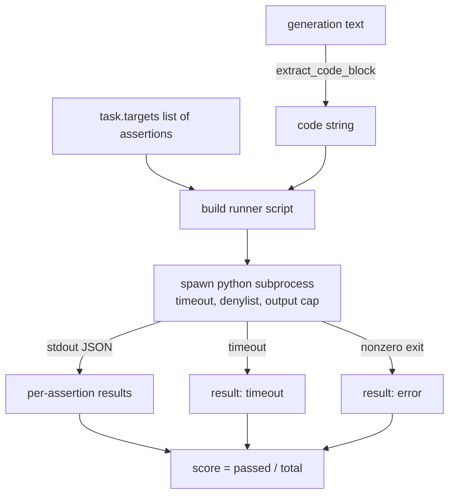
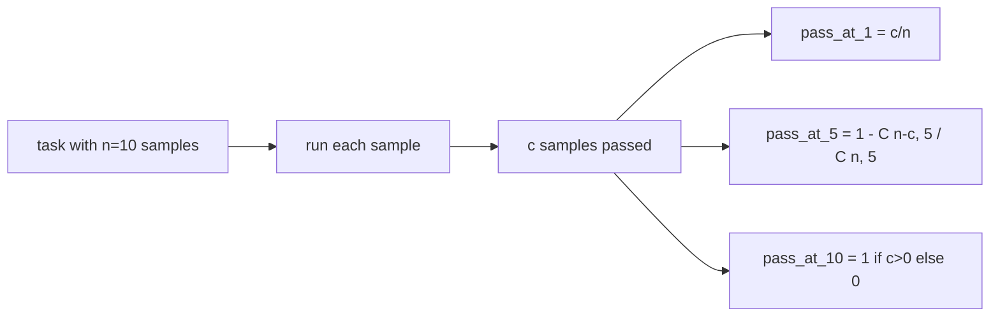

# 代码执行指标

> Test sonrası doğru olan kod oluşturmak için değerlendirme aracı kod çıkarmak, onu kullanmak ve bu yüzeyi oluşturmak için kullanmak gerekir.

**Type:** Build
**Languages:** Python
**Prerequisites:** 第 19 期 Track B 基础，第 70 和 71 课
**Time:** ~90 分钟

## Öğrenme hedefi


```figure
sandbox-runner
```

- Bu, 70 numaralı dersdeki son işleme kurallarına uygun bir şekilde özgür biçim oluşturma modunda kod bloklarını çıkarmakla ilgilidir.
- Seçim kodlarını, çıkış ve giriş sınırlarını reddeden bir listeyi açma sürecinde uygula­
- Görevleri değerlendirmek için verilen ifadeler arasında adayların oranlarına göre değerlendirme yapılır.
- Bir modelden bir dizi görevden geçiş yapmayı hesaplayın.
- Çarşılıklı bir başarısızlık modeli olarak görülen bir kasa çöküşü, dil harf hataları ve süper zaman, aynı zamanda kaydedilebilir farklı çıkış kodlarına sahiptir.

## Neden bir ayrı süreç gerekiyor?

İçerisi`exec`Güvenlik ve istikrarın varlığı`while True: pass`永遠阻止 eval──生成的 `import shutil; shutil.rmtree('/')`确实像听起来如灾难性──解决方法是为每个候选人生成一个新的Python解释器,在 stdin上传递代码,将断言结果写入 stdout,并在溢出时终止该进程──主机 eval 进程继续运行──

HumanEval、MBPP、BigCodeBench 和 LiveCodeBench等 gibi gerçek değerlendirme, çocuk süreç sandığı kullanıyor. Bazı katman Docker                                                                                                                                                                                                                                                                                                                                                                                                                                                                                         

## 代码执行任务的形状

`code_exec`Görev taşıyın`targets`Çeviri: Çeviri: Çeviri: Çeviri: Çeviri: Çeviri: Çeviri: Çeviri: Çeviri: Çeviri: Çeviri: Çeviri: Çeviri: Çeviri: Çeviri: Çeviri: Çeviri: Çeviri: Çeviri: Çeviri: Çeviri: Çeviri: Çeviri: Çeviri: Çeviri: Çeviri: Çeviri: Çeviri: Çeviri: Çeviri: Çeviri: Çeviri: Çeviri: Çeviri: Çeviri: Çeviri: Çeviri: Çeviri: Çeviri: Çeviri: Çeviri: Çeviri: Çeviri: Çeviri: Çeviri: Çeviri: Çeviri: Çeviri: Çeviri: Çeviri: Çeviri: Çeviri: Çeviri: Çeviri: Çeviri: Çeviri: Çeviri: Çeviri: Çeviri: Çeviri: Çeviri: Çeviri: Çeviri: Çeviri: Çeviri: Çeviri: Çeviri: Çeviri: Çeviri: Çeviri: Çeviri: Çeviri: Çeviri: Çeviri: Çeviri: Çeviri: Çeviri: Çeviri: Çeviri: Çeviri: Çeviri: Çeviri: Çeviri: Çeviri: Çeviri: Çeviri: Çeviri: Çeviri: Çeviri: Çeviri: Çeviri: Çeviri: Çeviri: Çeviri: Çeviri: Çeviri: Çeviri: Çeviri: Çeviri: Çeviri: Çeviri: Çeviri: Çeviri: Çeviri: Çeviri: Çeviri: Ç Ç Ç Çeviri: Ç Ç Ç Ç Ç Ç Ç Ç Ç Ç Ç Ç Ç Ç Ç Ç Ç Ç Ç Ç Ç Ç Ç Ç Ç Ç Ç Ç Ç Ç Ç Ç Ç Ç Ç Ç Ç Ç Ç Ç Ç Ç Ç Ç Ç Ç Ç Ç Ç Ç Ç Ç Ç Ç Ç Ç Ç Ç Ç Ç Ç Ç Ç Ç Ç Ç Ç Ç Ç Ç Ç Ç Ç Ç Ç Ç Ç Ç Ç



- Evet .`[0, 1]`Orta skorı: ∞, iki kez 0.667 puan aldığı üç açıklama görevi vardır. ∞, hangi hata olursa olsun, koşucunun hepsi aynı şekle geri dönecektir. ∞, standartlama hatalı kodlara, yukarıdaki Python geri dönüşüne değil, ∞, ∞, ∞, ∞, ∞, ∞, ∞, ∞, ∞, ∞, ∞, ∞, ∞, ∞, ∞, ∞, ∞, ∞, ∞, ∞, ∞, ∞, ∞, ∞, ∞, ∞, ∞, ∞, ∞, ∞, ∞, ∞, ∞, ∞, ∞, ∞, ∞, ∞, ∞, ∞, ∞, ∞, ∞, ∞, ∞, ∞, ∞, ∞, ∞, ∞, ∞, ∞, ∞, ∞, ∞, ∞, ∞, ∞, ∞, ∞, ∞, ∞, ∞, ∞, ∞, ∞, ∞, ∞, ∞, ∞, ∞, ∞, ∞, ∞, ∞, ∞, ∞, ∞, ∞, ∞, ∞, ∞, ∞, ∞, ∞, ∞, ∞, ∞, ∞, ∞, ∞, ∞, ∞, ∞, ∞, ∞, ∞, ∞, ∞, ∞, ∞, ∞, ∞, ∞, ∞, ∞, ∞, ∞, ∞, ∞, ∞, ∞, ∞, ∞, ∞, ∞, ∞, ∞, ∞, ∞, ∞, ∞, ∞, ∞, ∞, ∞, ∞, ∞, ∞, ∞, ∞, ∞, ∞, ∞, ∞, ∞, ∞, ∞, ∞, ∞, ∞, ∞, ∞, ∞, ∞, ∞, ∞, ∞, ∞, ∞,

## 拒绝名单

拒绝列表是基于导入. 运行候选码之前,运行脚本会将危险模块的导入重写到引发. `ImportError("denied")`Bu listede neden korunmuştur:`os.system`- Evet.`subprocess`- Evet.`socket`- Evet.`requests`- Evet.`urllib`- Evet.`urllib.request`- Evet.`urllib.error`- Evet.`urllib.parse`- Evet.`ctypes`- Evet.`shutil`- Evet.`http.client`- Evet.`asyncio.subprocess`- Evet.

Biz bu silahın içeri girmediğini yapmayız. Python'da herhangi bir süreçten kaçmak için kesin bir karşılık koduna sahibiz.

```python
DENIED = {
    "os.system": True,
    "subprocess": True,
    "socket": True,
    "shutil": True,
    "requests": True,
    "urllib": True,
    "ctypes": True,
}
```

Biz de önümüzdeyiz.`import sys`Ve bir geçiş yaptır.`os.system`Bu yüzden, bu bir seçimdir.`main.py`İçeride.

## 挂钟超时

Her süreçte üç dakikanın bir öntanımlı bütçesi vardır.`subprocess.run(..., timeout=t)`Eğer süper zaman olursa, koşucu yakalar.`TimeoutExpired`, bitirme süreci, ve görevlerin kaydedilmesi`timeout`退出原因──この任務の分数は零──ランナー devam eder──

Her görevin geçici zamanı .`task.metadata.timeout_s`配置──长时间运行单元测试可能会要求更多; 70 课中的验证器将该值限制为30秒,以保持套件的边界──

## 输出上限

Son süreçler standart çıkışları altında batırır, tüm başlıklı kaydı tüketir.`exit_code = error`, Detaylı bilgi için`"output overflow"`                                                                                                                                                                                                                                                              

## - Evet.

Geç-at-k, insan değerleri ve arkadaşların kullandığı bir değerlendirme makinesi.`n`独立样本和其中的 `c`- Evet, evet.`n`Büyüklükte`k`Örnekler en az bir çözümün geçerli olma olasılığını içerir:

```
pass_at_k(n, c, k) = 1 - C(n - c, k) / C(n, k)
```

- Evet .`n - c < k`时, molecules undefined, value为 `1`◊ Bu durumun doğrudan işlenmesi için.`pass_at_k(n, c, k)`供排行层使用──



## 退出代码

Koşucu her görevden beş sonuçtan biriyle geri döner:

- Her bir sözün geçtiği zaman`pass`- Evet.
- `assertion_fail`Kod çalıştırılır ama en azından bir başarısızlık ifadesi vardır.
- `syntax_error`Kodı aktarılmamış veya yanlış yazılmış zaman.
- `timeout`Zamanı geldiğinde...
- `error`Bu da bir diğer çöküş için kullanılır.`"output overflow"`Yüzeyde (Yüzeyde)

%s hâlâ sıfırdır. Çıktı kodlar ise veri değeridir.

## 本课不做什么

Bu size gerçek bir sandık vermez. Açık ağlardan güvenilmeyen kod çalıştırmaz. Dosya I/O veya ağ çağrısı gibi durumlu görevleri işlemiyor. Bunlar bir konteyner veya mikroVM gerektirir. Bu dersin ana noktası bir anlaşma: bağımsız bir alt süreç: listayı reddetmek, süper zaman, çıkışlar, sınırları temiz çıkış kodları.

## Nasıl okuyabilirim?

`main.py`- Defini etti .`extract_code`- Evet.`run_candidate`- Evet.`score_code_exec`和 `pass_at_k`△子进程runner脚本构建为字符串,并作为 `-c`Yeni Python'a aktarım.`code/tests/test_exec.py`Ortalama testler HumanEval 风格中提取 iş örnekleri tarafından dört geri dönüş kodu ve geçiş yapıldı.

Üsttan aşağıya kadar oku`main.py`△ 流道模板是承重件──着断言循环,直到您可以预测它写回父进程的JSON 信封──

## Daha ileri

Bir kere süreç şekli işe yararsa, bir sonraki sorun nakliye edilebilirliktir. Windows'ta farklı Python  sürümleri SIGKILL'i farklı şekilde işliyor. En temiz çözüm, operatörü Docker 鏡像 içine yerleştirmektir.
