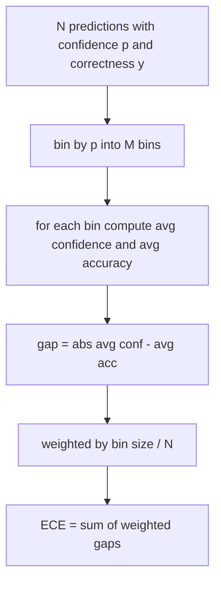
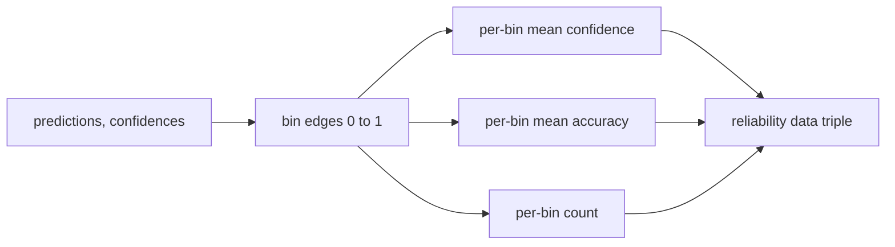

# 困惑度和校准

> Eğer modeliniz 1000 cevabın %90'ı doğruluğunu göstermiş ve 600'ü doğru cevaplamışsa, bu da iyi bir kalibrasyon geçmediğini gösterir. Kalibrasyon güvenilir bir değerlendirme yarısından fazlasını oluşturur.

**Type:** Build
**Languages:** Python
**Prerequisites:** 第 19 期 Track B 基础，第 70 和 71 课
**Time:** ~90 分钟

## Öğrenme hedefi


```figure
cd-reliability-diagram
```

- 模型适配器 tarafından sağlanan token negativ karşı sayı olasılığı hesaplama 语料库daki token sınıfı karışıklığı △
- 分箱预测概率计算分类器或多项选择评估的预期校准误差 (ECE) △
- 計算 Brier 分数 (ECE'nin nasıl gerçekleştirildiğini açıklama)
- Kürüklerin güvenilirlik ve doğruluk için gerekli tablo verileri oluşturmak.
- Tüm üçü de değerlendirme hattına bağlanıp, koşucuyu güvende tutabiliriz.`perplexity`- Evet.`ece`和 `brier`编号附加到模型报告中──

## 困惑告诉你什么

困惑度是每个代币的指数平均负对数似然──越低越好──困惑度为 1 困惑度为 1 困惑度为 1 困惑度为 1 困惑度为 1 困惑度为 1 困惑度为 1 困惑度为 1 困惑度为 1 困惑度为 1 困惑度为 1 困惑度为 1 困惑度为 1 困惑度为 1 困惑度为 1 困惑度为 1 困惑度为 1 困惑度为 1 困惑度为 1 困惑度为 1 困惑为 1 困惑为 1 困惑为 1 困惑为 1 困惑为 1 困惑为 1 困惑为 1 困惑为 1 困惑为 1 困惑为 1 困惑为 1 困惑为 1 困难为 1 困难为 1 困难为 1 困难为 1 困难为 1 困难为 1 困难为 1 困难为 1 困难为 1 困难为 2 困难为 2 困难为 困难为 2 困难为 困难为 困难为 困难为 困难为 困难为 于 于 于 于 于 于 于 于 于 于 于 于 于 于 于 于 于 于 于 于 于 于 于 于 于 于 于 于 于 于 于 于 于 于 于 于 于 于 于 于 于 于 于 于 于 于 于 于 于 于 于 于 于 于 于 于 于 于 于 于 于 于 于 于 于 于 于 于 于 于 于 于 于 于 于 于 于 于 于 于 于 于 于 于 于 于 于 于 于 于 于 于 于 于 于 于 于 于 于 于 于 于 于 于 于 于 于 于 于 于

Bu araç kendiliğinden sayısal olasılıkları hesaplamaz. Bunlar model uyarlama makinelerinden geliyor. Bu araç birleştirir: her bir sayısal olasılık listesi, her bir dizi için bir sayısal sayısal listesi alır ve dil kütlesinin karışıklığına geri döner.

```python
def perplexity(neg_log_probs, token_counts):
    total_nll = sum(neg_log_probs)
    total_tokens = sum(token_counts)
    return math.exp(total_nll / total_tokens)
```

Bu uygulama, 零token kenarında olan durumu ve 負 負 數概率 負 負 負 負 負 負 負 負 負 負 負 負 負 負 負 負 負 負 負 負 負 負 負 負 負 負 負 負 負 負 負 負 負 負 負 負 負 負 負 負 負 負 負 負 負 負 負 負 負 負 負 負 負 負 負 負 負 負 負 負 負 負 負 負 負 負 負 負 負 負 負 負 負 負 負 負 負 負 負 負 負 負 負 負 負 負 負 負 負 負 負 負 負 負 負 負 負 負 負 負 負 負 負 負 負 負 負 負 負 負 負 負 負 負 負 負 負 負 負 負 負 負 負 負 負 負 負 負 負 負 負 負 負 負 負 負 負 負 負 負 負 負 負 負 負 負 負 負 負 負 負 負 負 負 負 負 負 負 負 負 負 負 負 負 負 負 負 負 負 負 負 負 負 負 負 負 負 負 負 負 負 負 負 負 負 負 負 負 負 負 負 負 負 負 負 負 負 負 負 負 負 負 負 負 負 負 負 負 負 負 負 負 負 負 負 負 負 負 負 負 負 負 負 負 負 負 負 負 負 負 負 負 負 負 負 負 負 負 負 負 負 負 負 負 `log p`Hayır.`-log p`Adaptörün 1'den düşük bir karışıklık oluşur, bu imkansızdır. Bu işlevi sözleşme ihlal olarak görüyoruz.

## ECE  tedbirleri nedir

预期校准差 预期校准差 预测分组将根据信度分组在固定数盒中,然后测量各盒的信度与准确度之间的平均差,并按盒大小加权.



标准公式在 `[0, 1]`Üst 10'u kullanın. Geniş bir bin.`bins`参数, böylece operatörler düzenleme (10) ve düzenleme (15) arasında seçim yapabilirler.

ECE'nin kutu sayısı ve örnek büyüklüğü arasında bir fark vardır. 10 kutu ve 100 kutu tahmin kullanılarak, 0.02 ECE ile ses ses farkı yapamazsınız. Bu gerçekleşir.

## Brier 分数 is ECE  没有的

ECE sadece ortalama farkla ilgilenir. Eğer modelin bir yarısı veri kutularına karşı fazla güvenli ve diğer yarısı veri kutularına karşı güvensizse, ECE'si daha düşük olabilir ve yerel kalibrasyon da çok kötü olacaktır.

Bu iki değerli sonuç için, Brier`mean((p_i - y_i)^2)`△ Bu, güvenilirliğe, çözünürlük ve belirsizlik olarak ayrılır.

```python
def brier(p, y):
    return float(np.mean((p - y) ** 2))
```

## Güvenilirlik

Güvenilirlik çizim, her kutudaki deneyime göre bir tahmin doğruluğu çizilmiştir.



返回的元组是调用层绘画图或计算自定义 ECE 变体(自适应 ECE、扫描 ECE等) 返回的元组──我们返回 numpy 数组,因此下游代码不必进行转换──

## 置信来源

Bu araç güvenini softmax'ten alıyor.`[0, 1]`Orta herhangi bir sayı.`softmax over option log-likelihoods`❖ Özgür metin için, doğal inanç, bir modelin kendi rapor oranı veya ortalama sayısal benzerlik göstergesidir.

## 边缘 durumu

- Tüm tahminler yanlış: ECE ortalama güvenilirlik, Brier yüksek değer, karışıklık metin bakış açısıdır.
- % % % % % % % % % % % % % % % % % % % % % % % % % % % % % % % % % % % % % % % % % % % % % % % % % % % % % % % % % % % % % % % % % % % % % % % % % % % % % % % % % % % % % % % % % % % % % % % % % % % % % % % % % % % % % % % % % % % % % % % % % % % % % % % % % % % % % % % % % % % % % % % % % % % % % % % % % % % % % % % % % % % % % % % % % % % % % % % % % % % % % % % % % % % % % % % % % % % % % % % % % % % % % % % % % % % % % % % % % % % % % % % % % % % % % % % % % % % % % % % % % % % % % % % % % % % % % % % % % % % % % % % % % % % % % % % % % % % % % % % % % % % % % % % % % % % % % % % % % % % % % % % % % % % % % % % % % % % % % % % % % % % % % % % % % % % % % % % % % % % % % % % % % % % % % % % % % % % % % % % % % % % % % % % % % % % % % % % % % % % % % % % % % % % % % % % % % % % % % % % % % % % % % % % % % % % % % % % % % % % % % % % % % % % % % % % % % % % % % % % % % % % % % % % % % % % % % % % % % % % % % % % % % % % % % % % % % % % % % % % % % % % % % % % % % % % % % % % % % % % % % % % % % % % % % %
- p=0.5 时完全不确定预测因子:ECE 0.5 减去精度,Brier 0.25 减去校正项──
- 空输入:ECE、Brier 和可靠性返回 `0.0`(或零填充数组) ◊零token durumu için, karmaşıklık 返回 `NaN` Bu yollar uyarı yayınlamayacaktır; koşucu bu değerleri kontrol eder ve rapor edilmeyeceğini veya atlamayı karar verir.

Bu örnekler testlere dahil edilmiştir. Gerçek temel testlerdeki gerçek modeller onları yenmez, ancak eksik bir uyarıcı veya küçük örnek onları yenmez ve işletim cihazı çökmemesi gerekir.

## 调度

校准不像F1 那样是针对每个任务的指标――这是每个模型的报告――runner在整个评估过程中积累了――`(confidence, correct)`ECE, Brier, Brier ve güvenilirlik verileri için hesaplanmıştır.

Interface:

```python
report = CalibrationReport.from_predictions(confidences, correct)
report.ece          # float
report.brier        # float
report.reliability  # tuple of three numpy arrays
report.populated_bins  # int
```

`PerplexityResult.from_token_nll(neg_log_probs, token_counts)`返回每个代币的困惑度和平均负对数似然──

## 本课不做什么

Modelleyi kullanmıyor. Softmax'ı gerçekleştirmiyor. İplemenin çıkış noktasını tahmin etmiyor. Bu adaptörün işi.

## Nasıl okuyabilirim?

`main.py` defini `perplexity`- Evet.`expected_calibration_error`- Evet.`brier_score`- Evet.`reliability_diagram`和 `CalibrationReport`- Ne ?`PerplexityResult`Gösterim bilinen temel gerçeklerin genel öngörülmesine dayanır: iyi bir model, aşırı güvenli bir model ve yeterince güvensiz bir model.`code/tests/test_calibration.py`Orta test, her kenar durum ve genel öngörüleme değişikliğinin referans değerini sabitlemektedir.

Üsttan aşağıya kadar oku`main.py`◊ Görevlerin sırası, ölçümden kütleye kadar rapor edilmektedir.

## Daha ileri

Kalsifikasyon, yayınlanan değerlendirmelerde en kolay göz ardı edilen bir etkendir. Çoğu sıralama, bir doğruluk rakamını rapor eder ve tamamlanmış olarak adlandırır. Bir doğrulukta kazanmış ve Brier'de başarısız olan bir model, doğrulukta puan alanları daha düşük ancak güvenilir bir şekilde rapor eden belirsizlik modelinin daha kötü bir üretim görevlendirmesi ile karşılaştırılır. Kalsifikasyon boruları yer aldığında, kaydedilen onay parçalarına sıcaklık küçülmesi, yeniden hesaplama ECE, ve boşlukların küçülmesini gözlemleyerek. Bu tek bir ders, ancak tablo burada.
