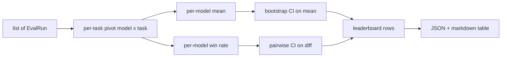
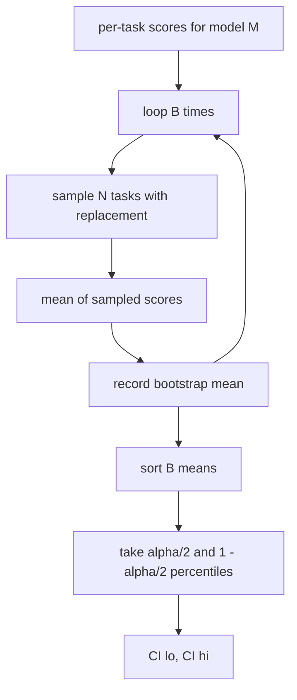

# 排行榜聚合

> Her görevin puanı kolaydır. Her farklı yapılandırma görevinin sırası daha zor.

**Type:** Build
**Languages:** Python
**Prerequisites:** 第19期B轨基础，第70、71、73课
**Time:** ~90 分钟

## Öğrenme hedefi


```figure
ci-leaderboard-ci
```

- Çoklu model ve çoklu görevlerin her görev bölümünü bir bütünlü model çizgisinde toplamak.
- 標準化异质分数, böylece geçiş oranı ve BLEU 值 toplamı aşırı etkilemez.
- 平均 değer ve kazanç oranı ile modellerin sıralanmasını ve her modelin nasıl doğru olduğunu açıklamasını yapmaktadır.
- 計算各模型的平均分和成对差的引导置信区间──
- JSON Raporu ve Markdown Tablosu için sıralama listesi çıkartmak, 75. Sınıfdaki koşucuları CI 评论中に粘贴することができます。

## 输入的形状

聚合器 kullanımı `EvalRun`Kayıt listesi:

```python
@dataclass
class EvalRun:
    model_id: str
    task_id: str
    metric_name: str
    score: float          # in [0, 1]
    category: str
```

第 75 课中的跑者为每一个`(model, task)`Bir kayıt yayımlamak için.`[0, 1]`İçeride.

## 输出

出来三张表:



排行榜行 içerir:`model_id`- Evet.`mean_score`- Evet.`mean_ci_lo`- Evet.`mean_ci_hi`- Evet.`win_rate`- Evet.`tasks_completed`Ve her sınıf için ortalama değerlerin seçeneği.`categories`Yer haritası.

## standardization

Eğer bir görev için bir puan varsa`[0, 1]`, başka bir görev için puan .`[0, 100]`,则第二任务默默地主导平均值──聚合器验证每个输入分数是否位于`[0, 1]`Bu, bir kısım olarak kabul edilmesi gereken bir kısımdır.

## 平均值和胜率

Bu iki sıralama programı farklı hedeflere hizmet eder.

Ortalama puan, bir modelin görev puanlarının ortalama değeridir. Bu, başlıklı sayısal sıralama raporu.

胜率计算模型在同一任务上击败所有其他模型的频率──每任务,得分最高的模型获胜──平局时,每个并列模型都算完整一次获胜──胜率等于获胜次除了模型得分的任务数──它对异常值和尺度差不太敏感,但会丢失信息──

```python
def win_rate(model_id, runs_by_task, all_models):
    wins, total = 0, 0
    for task_id, runs in runs_by_task.items():
        scores = {r.model_id: r.score for r in runs if r.model_id in all_models}
        if model_id not in scores:
            continue
        total += 1
        best = max(scores.values())
        if scores[model_id] >= best:
            wins += 1
    return wins / total if total else 0.0
```

Harness 会同时报告两者──第 75 课中的 runner 默认按平均排名排序;胜率的Markdown 列也保留在那里,以便用户偏好这种视角时使用──

## Kendini kurmuş bir bölge

Her modelin ortalama değeri, görevi yönlendirerek yeniden değerlendirme, değerlendirme ve değerlendirme yapmaktadır.`B`Sonra da...`alpha`级别获取百分位间隔──



                                                                                                                                                                                                                                                              `score_A - score_B`%s %s %s %s %s %s %s %s %s %s %s %s %s %s %s %s %s %s %s %s %s %s %s %s %s %s %s %s %s %s %s %s %s %s %s %s %s %s %s %s %s %s %s %s %s %s %s %s %s %s %s %s %s %s %s %s %s %s %s %s %s %s %s %s %s %s %s %s %s %s %s %s %s %s %s %s %s %s %s %s %s %s %s %s %s %s %s %s %s %s %s %s %s %s %s %s %s %s %s %s %s %s %s %s %s %s %s %s %s %s %s %s %s %s %s %s %s %s %s %s %s %s %s %s %s %s %s %s %s %s %s %s %s %s %s %s %s %s %s %s %s %s %s %s %s %s %s %s %s %s %s %s %s %s %s %s %s %s %s %s %s %s %s %s %s %s %s %s %s %s %s %s %s %s %s %s %s %s %s %s %s %s %s %s %s %s %s %s %s %s %s %s %s %s %s %s %s %s %s %s %s %s %s %s %s %s %s %s %s %s %s %s %s %s %s %s %s %s %s %s %s %s %s %s %s %s %s %s %s %s %s %s %s %s %s %s %s %s %s %s %s %s %s %s %s %s %s %s %s %s %s %s %s %s %s

低级助手(`bootstrap_mean_ci`- Evet.`bootstrap_pairwise_diff`)`B=1000`;公共聚合器`aggregate`- Evet.`pairwise_diffs`) olarak kabul edilir.`b=500`Bu nedenle, gösterim ve test 速率保持──默认 alfa 值为0.05──本课程使引导程序保持纯 numpy,而不是 schipy──

## 类别

Eğer ayarlanmışsa`EvalRun.category`, polymer ayrıca her sınıfın ortalama değerini rapor eder. Bu her sıralamada bir , yukarıda yazıyor.`math`- Evet.`reasoning`- Evet.`code`- Evet.`safety`️Bu, modelin genel olarak iyi olup olmadığını ancak kodun zayıf olduğunu öğrenmesine yardımcı olur.

## Markdown 染

排行榜呈现为 Markdown 表:

```text
| Rank | Model | Mean | 95% CI | Win rate | Tasks |
|------|-------|------|--------|----------|-------|
| 1    | gpt   | 0.78 | 0.74-0.82 | 0.62 | 50 |
| 2    | claude| 0.75 | 0.71-0.79 | 0.34 | 50 |
| 3    | random| 0.10 | 0.07-0.13 | 0.04 | 50 |
```

Şekil ortalama sıralamalara göre. CI iki sayılı küçük sayılarda kalır.

## 本课不做什么

Bu, ECE veya diğer kurum değişkenlerine özgüven geliştirmiyor. Bunlar 73'cü sınıflardır. Burada, her görev eşit derecede önemlidir.`weight`字段 字段 字段 字段 字段 字段 字段 字段 字段 字段 字段 字段 字段 字段 字段 字段 字段 字段 字段 字段 字段 字段 字段 字段 字段 字段 字段 字段 字段 字段 字段 字段 字段 字段 字段 字段 字段 字段 字段 字段 字段 字段 字段 字段 字段 字段 字段 字段 字段 字段 字段 字段 字段 字段 字段 字段 字段 字段 字段 字段 字段 字段 字段 字段 字段 字段 字段 字段 字段 字段 字段 字段 字段 字段 字段 字段 字段 字段 字段 字段 字段 字段 字段 字段 字段 字段 字段 字段 字段 字段 字段 字段 字段 字段 字段 字 字 字 字 字 字 字 字 字 字 字 字 字 字 字 字 字 字 字 字 字 字 字 字 字 字 字 字 字 字 字 字 字 字 字 字 字 字 字 字 字 字 字 字 字 字 字 字 字 字 字 字 字 字 字 字 字 字 字 字 字 字 字 字 字 字 字 字 字 字 字 字 字 字 字 字 字 字    字 字 字  字 字                                                       

## Nasıl okuyabilirim?

`main.py`- Defini etti .`EvalRun`- Evet.`LeaderboardRow`- Evet.`aggregate`- Evet.`bootstrap_mean_ci`- Evet.`bootstrap_pairwise_diff`和 `render_markdown` Bu gösterim üç modelden ve on iki görevden oluşan bir komple kitle oluşturur, bir araya getirir ve bir sıralama listesi ve bir farklılık listesi oluşturur.`code/tests/test_leaderboard.py`Orta test, başlangıç çizgisini belirledi, Markdown 染, kazanç oranı ve boş giriş davranışını belirledi.

Üsttan aşağıya kadar oku`main.py` Verim şekli`EvalRun`- Evet.`LeaderboardRow`) önce ortaya çıkar, sonra bir polymer, üçüncü bir bootstrap, son olarak bir 染── her fonksiyonun bir fokus kontratı vardır──

## Daha ileri

Her modelin alanı eşleşmez, ancak modeller arasındaki karşılaştırma eşleşmelidir. A ve B modelleri aynı yüz görevde çalışıyorsanız, uygun testler, bireysel görev farklarına yönelik eşleşme yönlendirme programıdır.`bootstrap_pairwise_diff`Bu yüzden, bu dersin temelinde, koruyabileceğiniz sayıları rapor etmek için doğru söylemler vardır.
