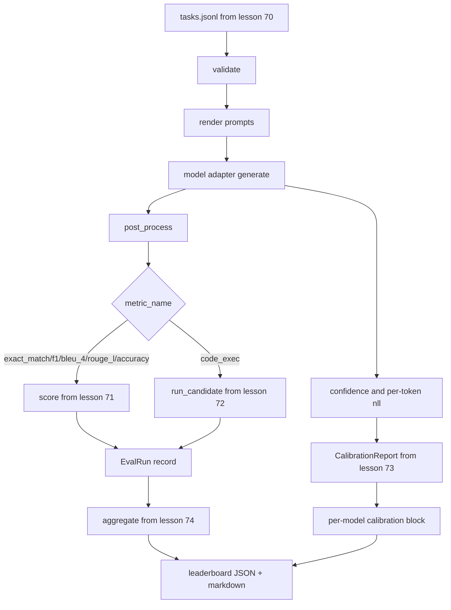

# 端到端评估运行器

> 五堂管道安装课,一堂水课, 跑者读取第70 课中的任务规范,通过适配器调用模型,对第71 课和第72 课进行评分,附加第73 课中的校准报告,并发出第74 课中的排列列列, 演示自闭终止──

**Type:** Build
**Languages:** Python
**Prerequisites:** 第 19 期 Track B 基础，第 70 至 74 课
**Time:** ~90 分钟

## Öğrenme hedefi


```figure
eval-grid
```

- 定义任何模型(模拟、本地、API) küçük yöntemlerle yüzeyde karşılayabilirsiniz `ModelAdapter`- Evet.
- Yapılan çalışmaların değerlendirilmesi ve iş kütlesinde gerçekleştirilen görevler.
- Bir kez daha bir kez daha bir kez daha bir kez daha bir kez daha bir kez daha bir kez daha bir kez daha bir kez daha bir kez daha bir kez daha bir kez daha bir kez daha daha bir kez daha bir kez daha bir kez daha bir kez daha bir kez daha bir kez daha bir kez daha bir kez daha bir kez daha bir kez daha bir kez daha bir kez daha bir kez daha bir kez daha bir kez daha bir kez daha daha daha daha daha daha daha daha daha daha daha daha daha daha daha daha daha daha daha daha daha daha daha daha daha daha daha daha daha daha daha daha daha daha daha daha daha daha daha daha daha daha daha daha daha daha daha daha daha daha daha daha daha daha daha daha daha daha daha daha daha daha daha daha daha daha daha daha daha daha daha daha daha daha daha daha daha daha daha daha daha daha daha daha daha daha daha daha daha daha daha daha daha daha daha daha daha daha daha daha daha daha daha daha daha daha daha daha daha daha daha daha daha daha daha daha daha daha daha daha daha daha daha daha daha daha daha daha daha daha daha daha daha daha daha daha daha daha daha daha daha daha daha daha daha daha daha daha daha daha daha daha daha daha daha daha daha daha daha daha daha daha daha daha daha daha daha daha daha daha daha daha daha daha daha daha daha daha daha daha daha daha daha daha daha daha daha daha daha daha daha daha daha daha daha daha daha daha daha daha daha daha daha daha daha daha daha daha daha daha daha daha daha daha daha daha daha daha daha daha daha daha daha daha daha daha daha daha daha daha daha daha daha daha daha daha daha daha daha daha daha daha daha daha daha daha daha daha daha daha daha daha daha daha daha daha daha daha daha daha daha daha daha daha daha daha daha daha daha daha daha daha daha daha daha daha daha daha daha daha daha daha daha daha daha daha daha daha daha daha daha daha daha daha daha daha daha daha daha daha daha daha daha daha daha daha daha daha daha daha daha daha daha daha daha daha daha daha daha daha daha daha daha daha daha daha daha daha daha daha daha daha daha daha daha daha daha daha daha daha daha daha daha daha daha daha daha daha daha daha daha daha daha daha daha daha daha daha daha daha daha daha daha daha daha daha daha daha daha daha daha daha daha daha daha daha daha daha daha daha daha daha daha daha daha daha daha daha daha daha daha daha daha daha daha daha daha daha daha daha daha daha daha daha daha daha daha daha daha daha daha daha daha daha daha daha daha daha daha daha daha daha daha
- Her modelini çıkar.`EvalRun`记录并将其直接输入排行榜聚合器──
- Aynı zamanda JSON raporunu ve Markdown tablosunu çıkarır; net çalışmada bitmeden çıkış, doğrulama veya çalışmada başarısızlık sırasında çıkışsız çıkışlar.

## 管道



Runner bütünleme noktasıdır. 70 ila 74 derslerindeki her dersde Runner tarafından yazılmış bir modül vardır.

## 适配器接口

适配器 is runner 和任何模型之间的接口──接口故意很小──

```python
class ModelAdapter:
    model_id: str

    def generate(self, prompt: str, task: TaskSpec) -> Generation: ...
```

`Generation`Bu bir veri sınıfı, aşağıdakileri içerir:

- `text`Model of Liberty Format: Model of Liberty Format: Model of Liberty
- `confidence`- ...`[0, 1]`Orta bir nüfus, model kendi raporunun yanıt olasılığını gösterir
- `token_nll`: genertoken of option negative vs sayıya benzer ∈ sum
- `token_count`: genertoken'in seçilebilir sayısı

运行器中的模拟适配器提供三种风格:`RuleBasedAdapter`(确定性, neredeyse完美),`NoisyAdapter`(çüce güven, sık hata)`BiasedAdapter`(擅长一类,糟糕于另类) . Bu gösteri, 70'inci sınıfın ayarında tüm üçüyle yürütülmüştür.

## İşlemi yaptır

runner usage `concurrent.futures.ThreadPoolExecutor`模擬并行運行任務──工作線程数默认为8 和任务數目中较小者──線程就足够了,因为实际模型调用瓶是网络 I/O──代码执行路径在任务内生成自己的子进程,执行器只安排等──

Kesinlik testi için, yarışçı açık.`run_eval(adapters, tasks, parallel=False)`, test yaparak, bir uygulama sırasını belirleyebilmesi için.

## 单遍评分循环

 Her görev için:

1. 染提示(few-shot 前加上提示正文)
2. 呼叫适配器并为呼叫计时──
3. Görev kurallarına göre, üretim sonrası işleme.
4. 调度到度量层──
5. %s ve gösterge değerleri kullanın`EvalRun`Kayıt.
6. - Ben de .`(confidence, correct)`Okul kuruluşu için bir bölüm.

对于精确匹配样式标标 ()`exact_match`- Evet.`accuracy`- Evet.`code_exec`),`correct`- Sinyal:`score >= 1.0`, sınıf göstergesi için,`score >= 0.5`- Sinyal:`score >= 0.5`                                                                                                                                                                                                                                                              `_correct_from_score`Ve operatörler açıkça kamu kapsamına girmez.

## 聚合

Her görev sonuçlarını aldıktan sonra, koşucu 74'te görevlendirilir.`aggregate`和 `pairwise_diffs`Ve 73 . Sınıfın içinde .`CalibrationReport.from_predictions`△输出是一个 JSON 信封:

```json
{
  "leaderboard": [...],
  "pairwise": [...],
  "calibration": {
    "model_id_a": {"ece": 0.04, "brier": 0.10, "populated_bins": 8, ...},
    ...
  },
  "summary": {
    "tasks": 10,
    "models": 3,
    "wall_seconds": 1.2
  }
}
```

Runner ayrıca sonuçları PR 评论中に yapıştırmak için Markdown 表写入标准输出 olarak kullanır.

## Son gösterim

Bu gösterim 70'inci sınıfın 10 sabit görevinde çalışacak. Üç simülasyonlı adaptör.

清洁运行标准是:

- Bölüm 70 课中验证'ın her bir görevi
- 71 ve 72 derslerdeki her görev için ortalama değerlendirme.
- 73 . Sınıfın Genel Kurul Yönetimi Raporu hata yapmadı.
- Renkleme kurallara dayalı olarak düzenlenecek.

Eğer bunlardan herhangi biri kesilse, koşucu sıfır değeri olmayan olarak geri çıkaracak ve JSON gönderisinde yapısal hatalar ortaya çıkacaktır.

## 本课不做什么

Gerçek model kullanmıyor. API'yi gerçekleştirmiyor. Anahtar akımı veya hız sınırlaması işlemi gerçekleştirmiyor. Akım veya kısım üretimi gerçekleştirmiyor. Adaptör her kullanımda bir nesle geri dönüyor.

## Nasıl okuyabilirim?

`main.py`Bir küçük bir gruptan geçiyor.`_load_sibling` programı diğer beş ders modülünden aktarmak,  programı onları karşılaştırmalı yollarla çözmek.`Generation`- Evet.`EvalReport`和 `ModelAdapter`Bu, bir dosyanın alt kısmında yer alan bir uyum örneği.

Üsttan aşağıya kadar oku`main.py`◊ ◊ ◊ ◊ ◊ ◊ ◊ ◊ ◊ ◊ ◊ ◊ ◊ ◊ ◊ ◊ ◊ ◊ ◊ ◊ ◊ ◊ ◊ ◊ ◊ ◊ ◊ ◊ ◊ ◊ ◊ ◊ ◊ ◊ ◊ ◊ ◊ ◊ ◊ ◊ ◊ ◊ ◊ ◊ ◊ ◊ ◊ ◊ ◊ ◊ ◊ ◊ ◊ ◊ ◊ ◊ ◊ ◊ ◊ ◊ ◊ ◊ ◊ ◊ ◊ ◊ ◊ ◊ ◊ ◊ ◊ ◊ ◊ ◊ ◊ ◊ ◊ ◊ ◊ ◊ ◊ ◊ ◊ ◊ ◊ ◊ ◊ ◊ ◊ ◊ ◊ ◊ ◊ ◊ ◊ ◊ ◊ ◊ ◊ ◊ ◊ ◊ ◊ ◊ ◊ ◊ ◊ ◊ ◊ ◊ ◊ ◊ ◊ ◊ ◊ ◊ ◊ ◊ ◊ ◊ ◊ ◊ ◊ ◊ ◊ ◊ ◊ ◊ ◊ ◊ ◊ ◊ ◊ ◊ ◊ ◊ ◊ ◊ ◊ ◊ ◊ ◊ ◊ ◊ ◊ ◊ ◊ ◊ ◊ ◊ ◊ ◊ ◊ ◊ ◊ ◊ ◊ ◊ ◊ ◊ ◊ ◊ ◊ ◊ ◊ ◊ ◊ ◊ ◊ ◊ ◊ ◊ ◊ ◊ ◊ ◊ ◊ ◊ ◊ ◊ ◊ ◊ ◊ ◊ ◊ ◊ ◊ ◊ ◊ ◊ ◊ ◊ ◊     ◊ ◊   ◊ ◊      ◊       ◊ ◊            ◊                                                                                `run_eval`Sonra da `_score_one`Son gösterim ise bir kesik noktası.

`code/tests/test_runner.py`Orta test sabit adapteci bağlantı, tek yol döngüsü, eşlik etmesi ve sıralama eylemi, kurulum buçuk bölgesi ve JSON önemli ağ biçimi,

## Daha ileri

Bu yarışçı yeryüzüdür.`(task_id, model_id, model_version)`Kilit kontrolün sonuçları depolama ✓ her seferinde işlem yapan dolar ve simgelerin maliyetleri ✓ geri dönüş hızının sınırlandırılması ✓ geçiş-at-k  görevlerin örnek stratejisi ✓ uzun takımların akış çıkış biçimi ✓ her biri ayrı bir odak noktasıdır, operatörleri paketler ve gösterge veya birleştirme katmanında değişiklik gerekmez.

模拟工作后,为真正的提供程序添加适配器──选择一个免费级别,写三十行水,看看排列清亮起──然后添加第二个提供程序并让线束完成工作──
