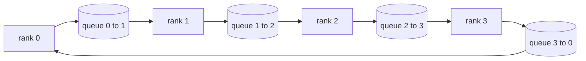

# Kolektif Operasyonları gerçekleştirmek

> Toplantıdaki dört grup işletim, tüm kısımları birleştirerek tüm kısımları azaltmak, yayımlamak, toplamak ve dağıtmak için birleştirir.`multiprocessing.Queue`网格上构建一次它们,根据参考实现验证它们,轨道的其余部分就变成管道──

**Type:** Build
**Languages:** Python
**Prerequisites:** 第 19 阶段 Track C 课程 42-49
**Time:** ~90 分钟

## Öğrenme hedefi

- İki kez gönderilen bir dönemde tüm kısıtlamalar gerçekleştirilmektedir.
- - Evet .`multiprocessing.Queue`Üst nokta ile gönderme üzerine inşaat yayım, toplama ve dağılımı azaltma.
- Aynı girişlere göre.`torch.distributed`Glow 参考验证每个原语──
- Toplu şekillerde, geçici ve genişliğin üst sınırları açısından, ağaç ve ağaç seçimlerini savunmak.

## 问题

N'de basit tüm azaltmak 将张量 N 次发送到根并广播 N 次。 her rango'nun genişliği kısaltmak için$O(N)$, kök bir şişe oldu, ve asılı olan asılı olan asılı olan en yavaş bağlantı N.$T/N$- Evet.$2(N-1)$块, bu yüzden her sıra 字节下降到$2T(N-1)/N$Ağaçlar, küçük N ve yüksek gecikme zincirinde kazanır, çünkü derinlik $\log_2(N)$跳而不是 $2(N-1)$◊ Kötü toplu seçim için, en yavaş GPU karar adım zaman

Bu ders içinde okuduğunuz her dağıtımlı eğitim çerçevesinin hepsi bu dört temel dile bağlıdır. PyTorch DDP, her bir parametrelerden bir tümü ile derecesi azaltır, aynı adımları yapar. ZeRO, tümüyle birlikte 广播更新的参数, 广播更新的参数, 广播更新的参数, 节点_散分, 节点_散分, 节点_散分, 节点_散分, 节点_散分, 节点_散分, 节点_散分, 节点_散分, 节点_散分, 节点_散分, 节点_散分, 节点_散分, 节点_散分, 节点_散分, 节点_散分, 节点_散分, 节点_散分, 节点_散分, 节点_散分, 节点_散分, 节点_散分, 节点_散分, 节点_散分, 节点_散分, 节点_散分_散分_散分_分_分_分_分_分_分_分_分_分_分_分_分_分_分_分_分_分_分_分_分_分_分_分_分_分_分______________________________________________________________________________________________________________________________________________________________________________________________________

## 概念



### İki kez yapın tümü azaltın

Çangı bölmek N 个相等块,索引为 0..N-1──每个级 拥有与其级相等块索引──第 1遍,reduce_scatter,运行 N-1 步骤──在步骤 s,rank r 发送块 (r - s) mod N 到rank (r + 1) mod N,并从rank (r - 1) mod N 接收块 (r - s - 1) mod N,接收块 积累到本地副本中──经过 N-1 步骤后,全部 r 拥有块 r总和和和──第 2 阶段,全部收集,运行 N-1 个步骤,并绕绕旋转完成块,直到每个级都保存了全部和总和──

|原语|每 rank 字节 |步骤|何时使用 |
|-----------|---------------|-------|-------------|
|Ring allreduce| 2T(N-1)/N | 2(N-1) |大 T、fat-pipe 同构集群 |
|Tree allreduce | T log2(N) | 2 log2(N) |小 T 或高延迟链路 |
|广播| T | log2(N) 树 |参数初始化，标量配置|
|allgather| T(N-1)/N | N-1 |分片转发，ZeRO 取消分片 |
|reduce_scatter | T(N-1)/N | N-1 | ZeRO 梯度分片 |

### 队列网格 olarak NCCL'nin bir takviyesi olarak

NCCL PCIe ve NVLink'de çalışıyordu, ve donanım yükünü azaltıyordu.`multiprocessing.Queue`Tek üreticiler ve tek tüketicilerle sipariş nokta karşı nokta teslimatı sağlamak için. Kullanıcı alanında gerçekleşen bu artışın azalması için Python'u ödemek gerekir.

### 针对 gloo 进行验证

Her bir orijinal dil, aynı dünya çapında aynı miktarda kullanılarak birim testleri yaparak, çıkışını aynı dünya çapında aynı miktarda kullanır.`torch.distributed`比較:  Eğer yüzüğünüz tümüyle gloo gloo                                                                                                                                                                                                                                                     


```figure
ci-ring-allreduce
```

## Yapın onu.

`code/main.py`实现:

- `Mesh`类,将 N 个 `multiprocessing.Queue`例 连接到环中,并按等级公开 `send(dst, tensor)`和 `recv(src)`- Evet.
- `ring_allreduce(mesh, rank, world_size, tensor)`运行两遍算法──
- Ağaçlara`broadcast(mesh, rank, world_size, tensor, src)`- Evet.
- `allgather(mesh, rank, world_size, tensor)`N-1 轮换──
- `reduce_scatter(mesh, rank, world_size, tensor)`作为allreduce的前半部分──
- `_gloo_reference(op, world_size, tensor)`- Evet .`torch.distributed`运行相同输入,并使用 gloo 进行字节相等比较──

- Yapma .

```bash
python3 code/main.py
```

输出: 输出 输出 输出 输出 输出 输出 输出 输出 输出 输出 输出 输出 输出 输出 输出 输出 输出 输出 输出 输出 输出 输出 输出 输出 输出 输出 输出 输出 输出 输出 输出 输出 输出 输出 输出 输出 输出 输出 输出 输出 输出 输出 输出 输出 输出 输出 输出 输出 输出 输出 输出 输出 输出 输出 输出 输出 输出 输出 输出 输出 输出 输出 输出 输出 输出 输出 输出 输出 输出 输出 输出 输出 输出 输 输 输 输 输 输 输 输 输 输 输 输 输 输 输 输 输 输 输 输 输 输 输 输 输 输 输 输 输 输 输 输 输 输 输 输 输 输 输 输 输 输 输 输 输 输 输 输 输 输 输 输 输 输 输 输 输 输 输 输 输 输 输 输 输 输 输 输 输 输 输 输 输 输 输 输 输 输 输 输 输 输 输 输 输 输 输 输 输 输 输 输 输 输 输 输 输 输 输 输 输 输 输 输 输 输 输 输 输 输 输 输 输 输 输 输 输 输 输 输 输 输 输 输 输                                     

## 野外生产模式

Üç çeşit model, temelin yeterince sağlam olmasını sağlar.

**在 allreduce 之前对梯度进行分桶。**1B 参数 modeli, binlerce 梯度张量── her 张量 için bir kez tümü azaltılır 会支付 N 倍的延迟下限── DDP, 梯度 depolama alanının yaklaşık 25 MB'lik bir blokuna sahip olur ve her depo kutu için bir tümü düşürür; 小张量骑大张量的后面──如果不分桶,延迟开销将占主导地位──

**通信与计算重叠。**Geriye doğru, tersine sıradan olarak, son katmanın seviyesi hazır olduğunda, tümüyle azaltmaya başlayın, aynı zamanda aşağı katman da hesaplamaya devam eder. PyTorch DDP, ağın bulunduğu zaman, birleştirme, görünen iletişim süresini yarıya düşürür.

**根据消息大小而不是宗教来选择环或树。**NCCL                                                                                                                                                                                                                                                                                                                                                                                                                                                                                                                           

## Kullan

生产模式:

- **PyTorch DDP。**Arka tarafta `dist.all_reduce`斗大小可调; 100Gbit için, 25 MB'nin mantıklı olduğu belirtilmiştir.
- **DeepSpeed ZeRO。**发出减_scatter 发出_scatter 发出_scatter 发出_scatter 发出_scatter 发出_scatter 发出_scatter 发出_scatter 发出_scatter 发出_scatter 发出_scatter 发出_scatter 发出_scatter 发出_scatter 发出_scatter 发出_scatter 发出_scatter 发出_scatter 发出_scatter 发出_scatter 发出_scatter 发出_scatter 发出_scatter 发出_scatter 发出_scatter 发出_scatter 发出_scatter 发出_scatter 发出_scatter 发出_scatter 发出_scatter 发出_scat_scatter 发_scat_scat_scat_scat_scat_scat_scat_scat_scat_scat_scat_scat_scat_scat_scat_scat_scat_scat_scat_scat_scat_scat_scat_scat_scat_scat_scat_scat_scat_scat_scat_scat_scat_scat_scat_scat_scat_scat_scat_scat_scat_scat_scat_scat_scat_scat_scat_scat_scat_scat_scat_scat_scat_scat_scat_scat_scat_scat_scat_scat_scat_scat_scat_scat_scat_scat_scat_scat_scat_scat_scat_scat_scat_scat_scat_scat_scat_scat_scat_scat_scat_scat_scat_scat_scat_scat_scat_scat_scat_scat_scat_scat_scat_
- **FSDP.**Önceki yazı: Allgather  başlamak için katman için elimination 分片,计算, sonra reduce_scatter kullanmak  küçültmek için reduction yapmak ve elimination 分片── aynı orijinal, farklı zamanlamaları──

## Gönderi

7.78.7.7.7.7.7.7.7.7.7.7.7.7.7.7.7.7.7.7.7.7.7.7.7.7.7.7.7.7.7.7.7.7.7.7.7.7.7.7.7.7.7.7.7.7.7.7.7.7.7.7.7.7.7.7.7.7.7.7.7.7.7.7.7.7.7.7.7.7.7.7.7.7.7.7.7.7.7.7.7.7.7.7.7.7.7.7.7.7.7.7.7.7.7.7.7.7.7.7.7.7.7.7.7.7.7.7.7.7.7.7.7.7.7.7.7.7.7.7.7.7.7.7.7.7.7.7.7.7.7.7.7.7.7.7.7.7.7.7.7.7.7.7.7.7.7.7.7.7.7.7.7.7.7.7.7.7.7.7.7.7.7.7.7.7.7.7.7.7.7.7.7.7.7.7.7.7.7.7.7.7.7.7.7.7.7.7.7.7.7.7.7.7.7.7.7.7.7.7.7.7.7.7.7.7.7.7.7.7.7.7.7.7.7.7.7.7.7.7.7.7.7.7.7.7.7.7.7.7.7.7.7.7.7.7.7.7.7.7.7.7.7.7.7.7.7.7.7.7.7.7.7.7.7.7.7.7.7.7.7.7.7.7.7.7.7.7.7.7.7.7.7.7.7.7.7.7.7.7.7.7.7.7.7.7.7.7.7.7.7.7.7.7.7.7.7.7.7.7.7.7.7.7.7.7.7.7.7.7.7.7.7.7.7.7.7.7.7.7.7.7.7.7.7.7.7.7.7.7.7.7.7.7.7.7.7.7.7.7.7.7.7.7.7.7.7.7.7.7.7.7.7.7.7.7.7.7.7.7.7.7.7.7.7.7.7.7.7.7.7.7.7.7.7.7.7.7.7.7.7.7.7.7.7.7.7.7.7.7.7.7.7.7.7.7.7.7.7.7.7.7.7.7.7.7.7.7.7.7.7.7.7.7.7.7.7.7.7.7.7.7.7.7.7.7.7.7.7.7.7.7.7.7.7.7.7.7.7.7.7.7.7.7.7.7.7.7.7.7.7.7.7.7.7.7.7.7.7.7.7.7.7.7.7.7.7.7.7.7.7.7.7.7.7.7.7.7.7.7.7.7.7.7.7.7.7.7.7.7.7.7.7.7.7.7.7.7.7.7.7.7.7.7.7.7.7.7.7.

## 练习

1. 添加tree allreduce变体,并根据消息大小在环和树之间切换──测量交叉──
2. 添加 `recv_timeout_ms`Bu yüzden, durgunluk sıralaması sonsuza dek kalmak yerine son tarih hatası ortaya çıkacaktır.
3. Dört orijinal dil`multiprocessing.Queue`替换为 TCP 套接字──相同的测试,真线──
4. 添加带宽检测挂, böylece her sırada bir metraj hesaplayıcı JSONL olarak kaydedilebilir.
5. 1 KB,1 MB,1 6 MB'lik bir miktarda 4 seviyelik bir ağaçla asılı saat süresi ile karşılaştırılmaktadır.

## 关键术语

|术语 |人们怎么说|它实际上意味着什么 |
|------|----------------|------------------------|
|allreduce| “跨等级总和”|调用后，每个等级都保留相同的简化张量 |
|戒指| “快速拓扑”| N-1 个大小为 T/N 的块绕周期流动两次 |
|树| “日志拓扑”|归约遵循二叉树；深度为 log2(N) 跳 |
|allgather| “连接碎片”|每个等级都以其他等级的碎片结束 |
|reduce_scatter | “平分总和”|每个排名仅以一个块的总和结束 |
|桶| “融合小张量”|将N个小的全部合并为一个大的|

## 进一步阅读

- [PyTorch 分布式：NCCL 集体](https://pytorch.org/docs/stable/distributed.html#collective-functions)
- [Horovod环全减纸](https://arxiv.org/abs/1802.05799)
- NCCL拓和算法选择](https://docs.nvidia.com/deeplearning/nccl/user-guide/docs/index.html)
- [Patarasuk 和 Yuan，带宽最优 allreduce 算法](https://www.cs.fsu.edu/~xyuan/paper/09jpdc.pdf)
- 第 10 阶段 第 05 课 - 分布式训练概述
- 第19 阶段 第77 课 - DDP 连接在这些原语之上
