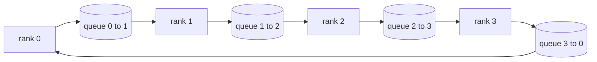

# Kolektif Operasyonları gerçekleştirmek

> 支分布式训练的四种集体通信(集体)操作是所有减少,广播,allgather 和减少_scatter──训练框架提供的其他原语几乎都是四者的包装──先在`multiprocessing.Queue`Mesh 上实现一遍,再对照参考实现做验证, bu 条 条 条 条 条 条 条 条 条 条 条 条 条 条 条 条 条 条 条 条 条 条 条 条 条 条 条 条 条 条 条 条 条 条 条 条 条 条 条 条 条 条 条 条 条 条 条 条 条 条 条 条 条 条 条 条 条 条 条 条 条 条 条 条 条 条 条 条 条 条 条 条 条 条 条 条 条 条 条 条 条     条                                                                                                                                                                                                                                                                                                                                      

**Type:** Build
**Languages:** Python
**Prerequisites:** Phase 19 Track C lessons 42-49
**Time:** ~90 分钟

## Öğrenme hedefi

- İki kere algoritma kullanarak yüzük tümü azaltmak, önce dağılımı azaltmak, tekrar toplamak, ve her bir sırada iletişim miktarı her bir element olduğunu kanıtlamak.$2(N-1)/N$- Evet.
- - Evet .`multiprocessing.Queue`Ünün nokta gönderin 之上 实现播放、allgather 和 reduce_scatter。
- Aynı giriş için kullanın.`torch.distributed`Bu yüzden, bu, bir temel temel oluşturur.
- Grup şekli 延迟下限和带宽上限 发发,论证 应选环 还是树

## 问题

N 个级 上做朴素 allreduce,将把张量向根发送 N 次,再广播回来 N 次── her sıra 带宽按 $O(N)$                                                                                                                                                                                                                                                                                                                                                                                                                                                                                                                             $2(N-1)$个大小为 $T/N$Her bir sırada bir parça var.$2T(N-1)/N$, N                                                                                                                                                                                                                                                                                                                                                                                                                                                                                                                            $2T$且永不超出,集群规模无关. 树全减少在小N、高延迟链路上更优,因为深度是$\log_2(N)$跳, yerine $2(N-1)$En yavaş GPU'nun, adımını belirleyeceği zaman.

Bu track 里会读的每个分布式训练框架,都依赖于这四个原语──PyTorch DDP, her parametreler kova ile, bir kez tümüyle azaltın, bir kez tümüyle azaltın, bir kez tümüyle birlikte gradiente bulunın──ZeRO, reduc_scatter 分片优化器状态,再用 allgather 广播更新后的参数──FSDP, tamı ileriye bırakın 变为全gather 加减_scatter──Pipeline paralel 需要跨阶段组播播 传动──实现不了这些四个集体,无法推推训为何住,为何梯度卡不匹配现在排名3、以及为何换拓后的管道泡会翻倍──

## 概念



### İki kere tamamlanmak için Ring allreduce

Çang miktarını N 个等 büyük bir parçaya ayırmak, indeks 0..N-1── her rütbe 拥有与自身的级 号相同的块 索引──第 1 遍是减少散散,跑 N-1 步──在第 1 步,排列 r 把块$(r - s) \bmod N$Rangoyu ver .$(r + 1) \bmod N$, 并从级 $(r - 1) \bmod N$接收 parça $(r - s - 1) \bmod N$2. tekrar toplanıp, tekrar N-1'e koşun, tamamlanmış parçayı her sırada dolaşıncaya kadar her sırada her parçaya tam bir ihtiyaç vardır.

| 原语 | 每 rank 字节数 | 步数 | 何时使用 |
|-----------|---------------|-------|-------------|
| Ring allreduce | 2T(N-1)/N | 2(N-1) | 大 T、同构 fat-pipe 集群 |
| Tree allreduce | T log2(N) | 2 log2(N) | 小 T 或高延迟链路 |
| Broadcast | T | log2(N) tree | 参数初始化、标量配置 |
| Allgather | T(N-1)/N | N-1 | 分片 forward、ZeRO unshard |
| Reduce_scatter | T(N-1)/N | N-1 | ZeRO 梯度分片 |

### Kullanımlı bir dizi ağ yerine NCCL

NCCL  PCIe ve NVLink üzerinde çalışır, geriye kadar donanım yüklenebilir.`multiprocessing.Queue`Bu nedenle Python'un satışını yaptırmak için düzenli bir şekilde bir nokta karşı bir nokta teslimat yapılması gerekir. Ancak, bir satırın ilk versiyonunda doğruyu netleştirmek, grup davranışının net şekilde takip edilmesi gerekir.

### Gözetim için bir test yapın

Her bir orijinal dil birim testi ile birlikte: aynı dünya büyüklüğünde, aynı 张量 üzerinde, onu çıkış ve kullanımı ile 后端初始化 `torch.distributed`karşılaştırma. Eğer yüzük tümüyle azaltılırsa, gözün parlaklığı float32 epsilon'dan daha fazlasa, test başarısız olur. karşılaştırma.

```figure
ci-ring-allreduce
```

## Yapın onu.

`code/main.py`实现:

- `Mesh`类:把 N 个 `multiprocessing.Queue`接成环,并按级 暴露 `send(dst, tensor)`ile`recv(src)`- Evet.
- `ring_allreduce(mesh, rank, world_size, tensor)`- Evet.
- `broadcast(mesh, rank, world_size, tensor, src)`Ağaçlara doğru gidiyoruz.
- `allgather(mesh, rank, world_size, tensor)`N-1 sonraki döngüsüyle.
- `reduce_scatter(mesh, rank, world_size, tensor)`: As allreduce 的前半段──
- `_gloo_reference(op, world_size, tensor)`Aynı bir giriş , aynı bir yerin içine gönderme .`torch.distributed`,做字节级对比──

运行:

```bash
python3 code/main.py
```

输出:按原语对比排列-mesh与 gloo 输出验证表,以及证明 $2T(N-1)/N$缩放的每级 字节计数器──

## 生产环境中的实践

Üç farklı modü bu orijinal dilleri kolayca bağlanabilecek bir seviyeye kadar sertleştirebilir.

**allreduce 前先对梯度分桶。**Bir 10 milyar parametre modeli, binlerce derecede 张量── her 张量 bir kez tümüyle azaltmak, N 倍延迟下限付──DDP 梯度打成25 MB'lik bir kova, her kova 发发一次全部减;小张量搭大张量后面──不分桶时,延迟开销会主导整个步骤──

**让通信与计算重叠。**Son aşama aşama aşama aşama aşama aşama aşama aşama aşama aşama aşama aşama aşama aşama aşama aşama aşama aşama aşama aşama aşama aşama aşama aşama aşama aşama aşama aşama aşama aşama aşama aşama aşama aşama aşama aşama aşama aşama aşama aşama aşama aşama aşama aşama aşama aşama aşama aşama aşama aşama aşama aşama aşama aşama aşama aşama aşama aşama aşama aşama aşama aşama aşama aşama aşama aşama aşama aşama aşama aşama aşama aşama aşama aşama aşama aşama aşama aşama aşama aşama aşama aşama aşama aşama aşama aşama aşama aşama aşama aşama aşama aşama aşama aşama aşama aşama aşama aşama aşama aşama aşama aşama aşama aşama aşama aşama aşama aşama aşama aşama aşama aşama aşama aşama aşama aşama aşama aşama aşama aşama aşama aşama aşama aşama aşama aşama aşama aşama aşama aşama aşama aşama aşama aşama aşama aşama aşama aşama aşama aşama aşama aşama aşama aşama aşama aşama aşama aşama aşama aşama aşama aşama aşama aşama aşama aşama aşama aşama aşama aşama aşama aşama aşama aşama aşama aşama aşama aşama aşama aşama aşama aşama aşama aşama aşama aşama aşama aşama aşama aşama aşama aşama aşama aşama aşama aşama aşama aşama aşama aşama aşama aşama aşama aşama aşama aşama aşama aşama aşama aşama aşama aşama aşama aşama aşama aşama aşama aşama aşama aşama aşama aşama aşama aşama aşama aşama aşama aşama aşama aşama aşama aşama aşama aşama aşama aşama aşama aşama aşama aşama aşama aşama aşama aşama aşama aşama aşama aşama aşama aşama aşama aşama aşama aşama aşama aşama aşama aşama aşama aşama aşama aşama aşama aşama aş

**按消息大小选 ring 或 tree，不要教条。**NCCL Öz带拓检测:大约 1 MB 以上选戒,以下选树──交叉点是带宽对延迟超过1 MB 时带宽项 $2T(N-1)/N$占主导,ring 胜出;低于 1 MB 时$\log_2(N)$跳数占优――写死一种拓,会在错误的消息大小上损失吞吞――

## Kullan

生产中的使用法:

- **PyTorch DDP。**Geriye doğru                                                                                                                                                                                                                                                                                                                                                                                                                                                                                                                           `dist.all_reduce`◊ bucket ⋅ 100Gbit 以太网下默认 25 MB 合理──
- **DeepSpeed ZeRO。**发 reduce_scatter 分片梯度,forward 前再 allgather 重建完整参数──本课的原语正是 ZeRO 实际发射调用──
- **FSDP。**Önceden önce hepsini toplayın, bu katmanı parçalanmadan bırakın, tekrar kullanın, azaltın 归约并丢掉未分割──同一套原语,不同调度──

## - Söyle.

Bu sıralar, ilk olarak, bir dizi dizi dizi dizi dizi dizi dizi dizi dizi dizi dizi dizi dizi dizi dizi dizi dizi dizi dizi dizi dizi dizi dizi dizi dizi dizi dizi dizi dizi dizi dizi dizi dizi dizi dizi dizi dizi dizi dizi dizi dizi dizi dizi dizi dizi dizi dizi dizi dizi dizi dizi dizi dizi dizi dizi dizi dizi dizi dizi dizi dizi dizi dizi dizi dizi dizi dizi dizi dizi dizi dizi dizi dizi dizi dizi dizi dizi dizi dizi dizi dizi dizi dizi dizi dizi dizi dizi dizi dizi dizi dizi dizi dizi dizi dizi dizi dizi dizi dizi dizi dizi dizi dizi dizi dizi dizi dizi dizi dizi dizi dizi dizi dizi dizi dizi dizi dizi dizi dizi dizi dizi dizi dizi dizi dizi dizi dizi dizi dizi dizi dizi dizi dizi dizi dizi dizi dizi dizi dizi dizi dizi dizi dizi dizi dizi dizi dizi dizi dizi dizi dizi dizi dizi dizi dizi dizi dizi dizi dizi dizi dizi dizi dizi dizi dizi dizi dizi dizi dizi dizi dizi dizi dizi dizi dizi dizi dizi dizi dizi dizi dizi dizi dizi dizi dizi dizi dizi dizi dizi dizi dizi dizi dizi dizi dizi dizi dizi dizi dizi dizi dizi dizi dizi dizi dizi dizi dizi dizi dizi dizi dizi dizi dizi dizi dizi dizi dizi dizi dizi dizi dizi dizi dizi dizi dizi dizi dizi dizi dizi dizi dizi dizi dizi dizi dizi dizi dizi dizi dizi dizi dizi dizi dizi dizi dizi dizi dizi dizi dizi dizi dizi dizi dizi dizi dizi dizi dizi dizi dizi dizi dizi dizi dizi dizi dizi dizi dizi dizi dizi dizi dizi dizi dizi dizi dizi dizi dizi dizi dizi dizi dizi dizi dizi dizi dizi dizi dizi dizi dizi dizi dizi dizi dizi dizi dizi dizi dizi dizi dizi dizi dizi dizi dizi dizi dizi dizi dizi dizi dizi dizi dizi dizi dizi dizi dizi dizi dizi dizi dizi dizi dizi dizi dizi dizi dizi dizi dizi dizi dizi dizi dizi dizi dizi dizi dizi dizi dizi dizi dizi dizi dizi dizi dizi dizi dizi dizi dizi dizi dizi dizi dizi dizi dizi dizi dizi dizi dizi dizi dizi dizi dizi dizi dizi dizi dizi dizi dizi dizi dizi dizi dizi dizi dizi dizi dizi dizi dizi dizi dizi dizi dizi dizi dizi dizi dizi dizi dizi dizi dizi dizi dizi dizi dizi dizi dizi dizi dizi dizi dizi dizi dizi dizi dizi dizi dizi dizi dizi dizi dizi dizi dizi dizi dizi dizi dizi dizi dizi dizi dizi dizi dizi dizi dizi dizi dizi dizi dizi dizi dizi dizi dizi dizi dizi dizi dizi dizi dizi dizi dizi dizi dizi dizi dizi dizi dizi dizi dizi dizi dizi dizi dizi dizi dizi dizi dizi dizi dizi dizi dizi dizi dizi dizi dizi dizi dizi dizi dizi dizi dizi dizi dizi dizi dizi dizi dizi dizi dizi dizi dizi dizi dizi dizi dizi dizi dizi dizi dizi dizi dizi dizi dizi dizi dizi dizi dizi dizi dizi dizi dizi dizi dizi dizi

## 练习

1. 增加 tree allreduce 变体,并按消息大小在 ring 与 tree 之间切换──测出交叉点──
2. 增加 `recv_timeout_ms`, let the rank of the card sit out ırkın kesinti hatası, sonsuza dek asılı değil.
3. Dört orijinal dili ayır.`multiprocessing.Queue`TCP soketine dönüştürülmüş.
4. Üstüne bir tane tane tane, bir tane tane tane.
5. 4 sıralarda, 1KB ∼ 1MB ∼ 16MB 张量比较环与树的墙钟时间──用实测为交叉点辩护──

## 关键术语

| 术语 | 人们常说 | 实际含义 |
|------|----------------|------------------------|
| Allreduce | “跨 rank 求和” | 调用结束后每个 rank 持有相同的归约张量 |
| Ring | “更快的拓扑” | N-1 个大小为 T/N 的 chunk 绕环流两圈 |
| Tree | “对数拓扑” | 归约沿二叉树进行；深度为 log2(N) 跳 |
| Allgather | “拼接分片” | 每个 rank 最终持有所有其他 rank 的分片 |
| Reduce_scatter | “把求和切开” | 每个 rank 最终只持有某一个 chunk 的求和 |
| Bucket | “融合小张量” | 把 N 次小 allreduce 合并成一次大的 |

## 延伸阅读

- [PyTorch Distributed: NCCL collectives](https://pytorch.org/docs/stable/distributed.html#collective-functions)
- [Horovod ring allreduce paper](https://arxiv.org/abs/1802.05799)
- [NCCL topology and algorithm selection](https://docs.nvidia.com/deeplearning/nccl/user-guide/docs/index.html)
- [Patarasuk and Yuan, Bandwidth optimal allreduce algorithms](https://www.cs.fsu.edu/~xyuan/paper/09jpdc.pdf)
- 10. aşama 05 ders - dağıtılmış eğitim genel bakış
- Fase 19 Ders 77 - DDP bu primitiflerin üzerine kablolu
