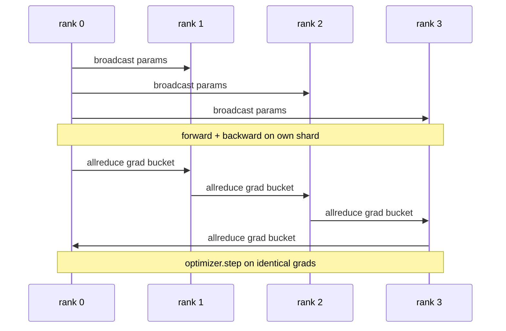

# Baştan itibaren veriler DDP'ye doğru ilerliyor

> Paylaştırılmış Veriler paralel olarak, tüm azaltma 之上一子── paketleme bir model, 0 级den başlayan başlangıç parametrelerini yaymaya başlıyor, böylece her bir seviyede aynı şekilde başlıyor, her bir çıkış seviyesinde tüm azaltma 之上一子, geride kalanı ise 梯度下降── tüm tasarımın 200 satırı vardır.

**Type:** Build
**Languages:** Python
**Prerequisites:** 第 19 期 Track C 课程 42-49
**Time:** ~90 分钟

## Öğrenme hedefi

- Bir bağlantı .`DistributedDataParallel`形包装器, bu包装器 yayım ilk parametreleri ve geriye doğru geriye indirgesini azaltmak
- Spawn N CPU dosya tabanlı toplantıların alt kısmında sıralanır`torch.multiprocessing.spawn`- Evet.
-  Aynı veri üzerinde sırayla eğitim yaparak aynı model ve her adımın eşdeğerliğini göstererek derece eşdeğerinin doğruluğunu kanıtlamak için 
- 捍卫储桶 (梯度融合) ve重叠 (重叠) 后通信) kullanımını, iş DDP'nin iki değişikliği olarak DDP'nin üretimi için dönüştürmek üzere kullanmak.

## 问题

12 GB  aktif kapasiteli 10 milyar parametre modeli bir tüketim seviyesindeki GPU'ya uygun değildir.  Hatta uygun olsa da, eğitim de birkaç hafta sürer.  Verim ve veri yolları, her seviyeyi N seviyesine bölünerek, her seviyesinin öne ve arkasına hesaplanır.

Eğer bir dilim eşzamanlı değilse, N 个副本会在第二步发生分歧――该模型不再是在更多数据上训练的模型,而是巧合共享初级权重的 N 个独立模型. Eğer bir dilim eşzamanlı değilse, 网络就会成为瓶,GPU 会空等线路. DDP'nin teknolojisi, 梯度和的计算比较几乎免费的.

## 概念



### DDP'nin üç işlemine ihtiyacı var.

|舞台|集体|为什么 |
|-------|-----------|-----|
|初始化|从排名 0 开始广播 |每个排名都以相同的参数开始 |
|后退|各梯度的 allreduce |平均梯度是优化器所采用的 |
|有时|缓冲区广播| Batchnorm 运行统计数据保持同步 |

### Neden toplam yerine ortalama değer?

Allreduce-SUM world_size dışında ortalama seviye elde eder. World_size için ortalama değer değişmez: Birinci sınıf ayarlama öğrenme oranı dörtte geçerlidir, çünkü her adım aşama genişliği değişmez.

### Neden bu kadar kullanıyorsun?

Transformer binlerce parametre 张量── her 张量 bir kez tümü azaltır 会支付 gloo 延迟下限数千倍的费用── DDP, gradiente分组将成25 MB'lik bir depo kutu içinde, her depo kutu için bir tümü düşürür.

### Neden tohumları sabitle?

Her bir sıra ayarlanmalıdır.`torch.manual_seed(seed + rank)`                                                                                                                                                                                                                                                                                                                                                                                                                                                                                                                             `torch.manual_seed(seed)`参数 başlangıç yapılması.                                                                                                                                                                                                                                                           


```figure
ci-ddp-grad-sync
```

## Yapın onu.

`code/main.py`实现:

- `MiniMLP`3 kat MLP, küçük kadar yeterli birkaç saniye içinde alınır, büyük kadar yeterli kadar ortaya çıkar.
- `DistributedDataParallel(model, world_size)`: in konstruksie 广播参数, geri dönmek bir paketleme makinesi,其 `sync_grads`Toplanan tümü dünya boyutundan ayırarak artan ve oranı azaltır.
- `worker(rank, world_size, ...)`Gloo 、前进、后退、同步、步进                                                                                                                                                                                                                                                                                                                                                                                                                                                                                                               `torch.distributed`init'in tam eğitim döngüsü:
- `_reference_single_process_loop(...)`Bir aşamada aynı veri üzerinde aynı model türünü, her adımdan sonra test yapısı fazları ve parametreler için uygulanır.

- Yapma .

```bash
python3 code/main.py
```

输出: her adım eğitim tablosu, tek süreç kaybı ve parametreler sınavı ile 4 seviye üzerinde çalışan DDP  ile karşılaştırmak için ︎ ︎ ︎ ︎ ︎ ︎ ︎ ︎ ︎ ︎ ︎ ︎ ︎ ︎ ︎ ︎ ︎ ︎ ︎ ︎ ︎ ︎ ︎ ︎ ︎ ︎ ︎ ︎ ︎ ︎ ︎ ︎ ︎ ︎ ︎ ︎ ︎ ︎ ︎ ︎ ︎ ︎ ︎ ︎ ︎ ︎ ︎ ︎ ︎ ︎ ︎ ︎ ︎ ︎ ︎ ︎ ︎ ︎ ︎ ︎ ︎ ︎ ︎ ︎ ︎ ︎ ︎ ︎ ︎ ︎ ︎ ︎ ︎ ︎ ︎ ︎ ︎ ︎ ︎ ︎ ︎ ︎ ︎ ︎ ︎ ︎ ︎ ︎ ︎ ︎ ︎ ︎ ︎ ︎ ︎ ︎ ︎ ︎ ︎ ︎ ︎ ︎ ︎ ︎ ︎ ︎ ︎ ︎ ︎ ︎ ︎ ︎ ︎ ︎ ︎ ︎

## 野外生产模式

Üç farklı modüyle DDP'nin sertleşmesi yeterli bir yüklemeye ulaştı.

**查找未使用的参数。** bazı dönüş yolları şartlı olarak atlama parametreleri                                                                                                                                                                                                                                                         `find_unused_parameters=True`DDP'ye azaltmadan önce hangi parametrelerin seviye elde ettiğini söyle.

**静态图优化。**Değişiklikler zaman,`static_graph=True`让DDP 预先计算储备桶调度―― ölçekte optimize çok önemlidir:预计算每一步节省了几毫秒,这在 10000 步骤中复合――

**梯度累积需要小心。**K'deki küçük gruplardaki toplanma derecesinden farklı olarak her küçük grup 10 kat daha fazla toplama elde edebilir.`no_sync()`Açıkça görüldüğü gibi, bu sistem, bir süre sonra tümüyle azaltmak için kullanılır.

## Kullan

生产模式:

- **PyTorch DDP。**规范的实现──`torch.nn.parallel.DistributedDataParallel(model)`连接分桶、重叠和 no_sync 上下文。
- **HuggingFace Accelerate。**添加一个处理 `torchrun`环境变量和模型包装的启动器──底层的DDP 相同──
- **Megatron-LM 数据并行。**DDP ile 张量并行ı büyük modeller için birleştirmek; Data并行 kısmı aynı tüm azaltma sonrası geriye doğru 模式ıdır.

## Gönderi

第 78 课 ↓ ZeRO 分片) her parametrin tümünü  reduction                                                                                                                                                                                                                                                                                                                                                                                                                                                                                                           

## 练习

1. Büyük bir dereceli kutu ekleyip, daha derin bir modelde ölçümle her bir parametreyle tümüyle azaltılan hızlandırma oranını oluşturur.
2. - Ben de .`no_sync()`实现为上下文管理器,并验证梯度累积与K 个微批次单进程基线相相相相相相相相.
3. Ekle`find_unused_parameters`模式, içinde önceden bazen MLP katmanlarından birini atlar; eğer bu işaret yoksa, yürüyüş 局 a düşecek.
4. çölde değişecek`torch.distributed.barrier()`- Sadece eşzamanlı, her şeyi azaltmak ve engelleme ile ilişkin bir farkı hissederken.
5. 量批量大小为 1、16、256 的梯度同步开销作为步长时间的一部分,并解释缩小比例──

## 关键术语

|术语 |人们怎么说|它实际上意味着什么 |
|------|----------------|------------------------|
|DDP | “数据并行” |广播参数并减少每一步梯度的包装器 |
|桶| “保险丝梯度”| N组小都化为一大|
|重叠| “隐藏通讯” |当后面的层仍在向后计算时发出 allreduce |
|无同步 | 「积累」|跳过后向 allreduce 进行梯度累积 |
|查找未使用的 | “分支前进”|减少之前检测无梯度的参数 |

## 进一步阅读

- [PyTorch 分布式数据并行文档](https://pytorch.org/docs/stable/generated/torch.nn.parallel.DistributedDataParallel.html)
- PyTorch DDP内部教程](https://pytorch.org/tutorials/intermediate/ddp_tutorial.html)
- [Li等人，PyTorch分布式：加速数据并行训练的经验](https://arxiv.org/abs/2006.15704)
- 第19 阶段 第 76 课 - DDP tarafından kurulan kolektif
- 第19 阶段 第78 课 - ZeRO 分片 her parametre ' nin tümünü azaltmak yerine azaltmak için yaymak için
