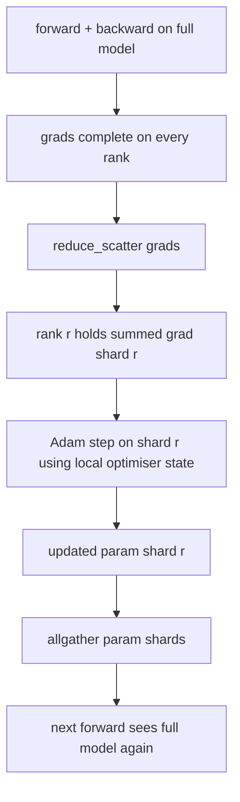

# ZeRO 优化器状态分片

> Adam, her bir parametreden iki değeri hesapladı, hepsi float32 format depolama olarak. 7B parametreler modeli 56 GB'lık optimizer durumunu taşıyor. ZeRO birinci aşama segmentleri N 个级 üzerinden geçiyor; her bir sınıfın 1/N'lik optimizerleri vardır.

**Type:** Build
**Languages:** Python
**Prerequisites:** 第 19 期 Track C 课程 42-49
**Time:** ~90 分钟

## Öğrenme hedefi

- N 个级的碎片优化器状态(第一时刻、第二时刻、fp32 主副本), bu nedenle her bir sınıfın 1/N vardır。
- Uygulayacağınız kısımların tümü, her bir seviyeye ulaşırken, tüm kısımların yeniden yeniden bir araya gelmesi için kullanılır.
- 根据普通 DDP 计算阶段 1、阶段 2、阶段 3 的内存节省表──
- Modelle'de büyüklük ve genişlik bütçesinde 1. aşama, 2. aşama ve 3. aşama seçimlerini savunmak.

## 问题

Vanilla DDP, her şeyi kopyaladı: parametre, gradient ve optimizer durumu her bir seviyeye kadar tam olarak varmaktadır. Fp16'daki 7B parametre modeli için, bu her bir seviyeye 14 GB parametre, 14 GB gradient ve 28 GB optimizer durumu anlamına gelir.

ZeRO 1. aşamasında optimizer durumuna bölünmeler yapılır. Her aşama bir 1/N'in Adem'i vardır. Ardından ZeRO tüm gradiyi azaltmaz ve kendi adımlarını yerleştirir, aksine yayılımı azaltır. Bu nedenle her aşama sadece kendi parçacıklarının gradiyi toplamını alır.

## 概念



### ZeRO'nun aşaması

|阶段|分片对象 |每 rank 内存|每 step 通信|
|-------|----------------|------------------|---------------|
| DDP |无 |params + grads + optim | 1x allreduce |
| ZeRO-1 |optimizer state |params + grads + optim/N | 1x reduce_scatter + 1x allgather |
| ZeRO-2 |optim + grads |params + grads/N + optim/N | 1x reduce_scatter + 1x allgather |
| ZeRO-3 |optim + grads + params |params/N + grads/N + optim/N |每层 1x allgather + 每层 1x reduce_scatter |

İlk aşama, en düşük maliyet kazançıdır, çünkü optimize durumunun bütçe üzerinde baskısı vardır. İkinci aşama, bir dizi bölümün toplam mantığı gerektirir, ancak genişlik aynıdır.

### 记忆数学,实数

 Adam'ı kullanarak karışık kesinlik eğitimi için P 参数 ile model:

|术语 |vanilla|ZeRO-1 |为什么 |
|------|---------|--------|-----|
| fp16 参数 | 2P字节| 2P字节|需要转发|
| FP16 梯度 | 2P字节| 2P字节|需要落后|
| fp32 母版 | 4P字节| 4P/N 字节 |只有最优化的人才会使用它 |
| fp32 第一时刻 | 4P字节| 4P/N 字节 |只有最优化的人才会使用它 |
| fp32 第二时刻 | 4P字节| 4P/N 字节 |只有最优化的人才会使用它 |
|总计 | 16P字节| 4P + 12P/N 字节 |   |

N=8 时:vanilla 16P,ZeRO-1 5.5P,% 65% düştü. N=64 时:vanilla 16P,ZeRO-1 4.19P,% 74 düştü.

### Neden yayılmayı azaltmak her şeyi azaltmaktan daha iyidir

Allreduce için her bir seviye tam bir talep ve derece sağlar. Eğer sadece parça parçaları gerekirse, gradientlerin azaltılmasıdır.


```figure
cd-zero-shard
```

## Yapın onu.

`code/main.py`实现:

- `flatten_params(module)`和 `unflatten_into(module, flat)`Modelin parametrelerini bir dizi çantadan bir parçaya doldurarak yeniden çözülür.
- `ZeroOptimizer(model, world_size, rank, lr)`- Üstün bir kopyasına ve o zamanki sınıf parçalarına sahip.
- `step()`Düz bir dilimde çalışarak, Adam'ı ırkınlık bölümü olarak kullanıp, tüm yenilemeleri toplayacaktır.
- Bir gösterim, 3 katlı MLP 20 adımını eğitmek, her adımın内存 bütçesini ve sıradan DDP 基线を印刷 etmek.

- Yapma .

```bash
python3 code/main.py
```

输出: Her adım kaybı ve bellek tablosu ZeRO-1 ile DDP'nin tam kopyasına göre, her seviyede 1/N'in optimizer durumunu koruyor.

## 野外生产模式

Üç çeşit modüyle ZeRO'nun teslimatı yapılıyor.

**分片检查点很重要。**ZeRO-1'nin optimizer durumu sınıflandırılmış; kontrol noktası hangi derecenin ne sahip olduğunu kaydetmelidir. 80. sınıf, aynı dünya çapında ZeRO'nun çalışmasını yeniden başlatan bir kontrol noktası listesi oluşturdu.

**混合精度是重点。**ZeRO bir karışık kesinlik tekniği; fp32 主副本是分片的──混合精度 olmaksızın yürütülen ZeRO fp32 master'a 内存税 getirecek, fakat eşleşmeyen fp16'ın önde gelen kazancı olmayan ZeRO'nun üretim süreci her zaman autocast veya bf16 配重配对对─

**第一阶段几乎是免费的。**通信在带宽方面与DDP相同──内存节省与N 成线性关系──唯一成本是优化器分片的簿记──生产堆默认为阶段 1,除非参数分片内存也是一个问题;然后第二或第三阶段用通信换取内存──

## Kullan

生产模式:

- **DeepSpeed ZeRO。**参考实现―― `deepspeed_config.json`选择阶段 1/2/3 和分区大小──
- **PyTorch FSDP。**PyTorch 原生等效项── `ShardingStrategy.SHARD_GRAD_OP`- ZeRO-2 .`FULL_SHARD`ZeRO-3'dür.
- **HuggingFace Accelerate。**DeepSpeed ve FSDP'yi birleştirmek için bir araya gelmek gerekir.

## Gönderi

第 79 课(管道并行) 正交分片轴:管道不是跨同一模型对优化器状态进行分片,而是跨等级进行分片. 第 81 课在端到端演示中组成 DDP + ZeRO.

## 练习

1.                                                                                                                                                                                                                                                               
2. 0 級 üzerinde basmak için bir bellek analizi ekle.
3. 测量普通 DDP与 ZeRO-1'ın her adım saatini ölçmek, ve onu ön yön, arka yön, iletişim olarak parçalayarak
4. ZeRO-1'de aşağıdaki derecede kesim gerçekleştirilmesi: L2 范数 hesaplama alanındaki tüm bölgeleri bölgeye bölmek için bölgeye bölgeye bölgeye bölgeye bölgeye bölgeye bölgeye bölgeye bölgeye bölgeye bölgeye bölgeye bölgeye bölgeye bölge bölgeye bölge bölge bölgeye bölge bölge bölge bölge bölge bölge bölge bölge bölge bölge bölge bölge bölge bölge bölge bölge bölge bölge bölge bölge bölge bölge bölge bölge bölge bölge bölge bölge bölge bölge bölge bölge bölge bölge bölge bölge bölge bölge bölge bölge bölge bölge bölge bölge bölge bölge bölge bölge bölge bölge bölge bölge bölge bölge bölge bölge bölge bölge bölge bölge bölge bölge bölge bölge bölge bölge bölge bölge bölge bölge bölge bölge bölge bölge bölge bölge bölge bölge bölge bölge bölge bölge bölge bölge bölge bölge bölge bölge bölge bölge bölge bölge bölge bölge bölge bölge bölge bölge bölge bölge bölge bölge bölge bölge bölge bölge bölge bölge bölge bölge bölge bölge bölge bölge bölge bölge bölge bölge bölge bölge bölge bölge bölge bölge bölge bölge bölge bölge bölge bölge bölge bölge bölge bölge bölge bölge bölge bölge bölge bölge bölge bölge bölge bölge bölge bölge bölge bölge bölge bölge bölge bölge bölge bölge bölge bölge bölge bölge bölge bölge bölge bölge bölge bölge bölge bölge bölge bölge bölge bölge bölge bölge bölge bölge bölge bölge bölge bölge bölge bölge bölge bölge bölge bölge bölge bölge bölge bölge bölge bölge bölge bölge bölge bölge bölge bölge bölge bölge bölge bölge bölge bölge bölge bölge bölge bölge bölge bölge bölge bölge bölge böl
5. Tüm kısaltma yerine kısaltma yerine kısaltma ✓ ✓ ✓ ✓ ✓ ✓ ✓ ✓ ✓ ✓ ✓ ✓ ✓ ✓ ✓ ✓ ✓ ✓ ✓ ✓ ✓ ✓ ✓ ✓ ✓ ✓ ✓ ✓ ✓ ✓ ✓ ✓ ✓ ✓ ✓ ✓ ✓ ✓ ✓ ✓ ✓ ✓ ✓ ✓ ✓ ✓ ✓ ✓ ✓ ✓ ✓ ✓ ✓ ✓ ✓ ✓ ✓ ✓ ✓ ✓ ✓ ✓ ✓ ✓ ✓ ✓ ✓ ✓ ✓ ✓ ✓ ✓ ✓ ✓ ✓ ✓ ✓ ✓ ✓ ✓ ✓ ✓ ✓ ✓ ✓ ✓ ✓ ✓ ✓ ✓ ✓ ✓ ✓ ✓ ✓ ✓ ✓ ✓ ✓ ✓ ✓ ✓ ✓ ✓ ✓ ✓ ✓ ✓ ✓ ✓ ✓ ✓ ✓ ✓ ✓ ✓ ✓ ✓ ✓ ✓ ✓ ✓ ✓ ✓ ✓ ✓ ✓ ✓ ✓ ✓ ✓ ✓ ✓ ✓ ✓ ✓ ✓ ✓ ✓ ✓ ✓ ✓ ✓ ✓ ✓ ✓ ✓ ✓ ✓ ✓ ✓ ✓ ✓ ✓ ✓ ✓ ✓ ✓ ✓ ✓ ✓ ✓ ✓ ✓ ✓ ✓ ✓ ✓ ✓ ✓ ✓ ✓ ✓ ✓ ✓ ✓ ✓ ✓ ✓ ✓ ✓ ✓ ✓ ✓ ✓ ✓ ✓ ✓ ✓ ✓ ✓ ✓ ✓ ✓ ✓ ✓ ✓ ✓ ✓ ✓ ✓ ✓ ✓ ✓ ✓ ✓ ✓ ✓ ✓ ✓ ✓ ✓ ✓ ✓ ✓ ✓ ✓ ✓ ✓ ✓ ✓ ✓ ✓ ✓   ✓ ✓ ✓ ✓ ✓ ✓ ✓ ✓     ✓ ✓    ✓     ✓         ✓ ✓ 

## 关键术语

|术语 |人们怎么说|它实际上意味着什么 |
|------|----------------|------------------------|
|ZeRO-1 | “优化器分片”|每个等级拥有 1/N 的 fp32 master + Adam 时刻 |
| ZeRO-2 | “grads 也分片”|每个 rank 在 reduce_scatter 后也会丢弃非本分片的梯度 |
|ZeRO-3 | “分片参数” |每个等级保存 1/N 的 fp16 参数；向前每层allgather |
|master copy| “fp32 权重”|高精度参数复制优化器更新|
|reduce_scatter | “平分总和”|仅提供每个等级其分片的梯度总和 |

## 进一步阅读

- [Rajbhandari 等人，ZeRO：训练万亿参数模型的内存优化](https://arxiv.org/abs/1910.02054)
- [DeepSpeed ZeRO 文档](https://www.deepspeed.ai/tutorials/zero/)
- [PyTorch FSDP 文档](https://pytorch.org/docs/stable/fsdp.html)
- 第19 阶段 第 76 课 - 本课所涉及的减少_scatter和全集
- 第19 阶段 第80 课 - ZeRO  durumu kullanılması gereken bölge kontrol noktası
