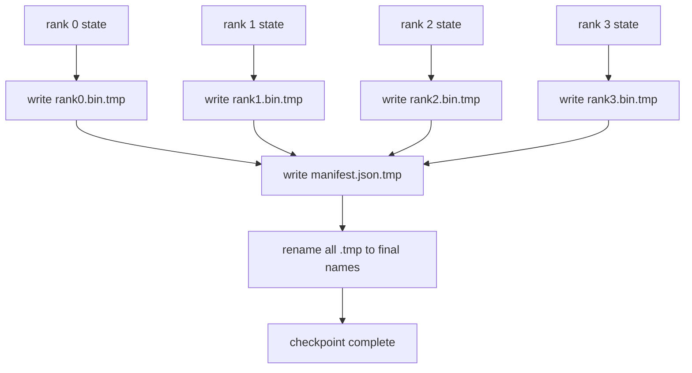

# Çekim noktaları ve atom geri kazanımı

> Her birkaç saat sonra bir düğüm bozukluğu nedeniyle 70B parametresi eğitim çalışmaları durdurulur. Kontrol noktasının biçimi, kayıp olduğunu belirler. 30 dakika mı yoksa 30 saat mi?

**Type:** Build
**Languages:** Python
**Prerequisites:** 第 19 期 Track C 课程 42-49
**Time:** ~90 分钟

## Öğrenme hedefi

- Bir çok dereceli kontrol noktası, her derecenin ayrıntılı dosyaları ve hangi derecenin ne sahip olduğunu kaydetmek için bir listeye eklenecektir.
- kullan Atom yazma modusu ([[{{lang-en}}}}) }} , böylece yazma sürecinin çöküşü asla yarım bitmiş bir kontrol noktası oluşturmaz.
- Çekimden geri kazanma, her derecede fp16 parametr ve ZeRO  optimizer durumu 字节相等 durumu 
- 保护清单架构免受三种故障模式的影响:全局大小变更、分片计数不匹配和部分写入──

## 问题

Normal kontrol noktası tüm parametreleri ve optimizer durumunu 0 seviyeye kadar okuyacak, toplayacak ve tek bir dosyayaya yazacak. 70B model için, birinci sınıf ağ limanı 1.1 TB  durumu sağlayacak. Yazış tüm diğer seviyeyiyi engelleyecek, çünkü bunlar boşlukta toplanmayı bekliyor. IO 带宽 en yavaş tek GPU  ağ zinciri, birleştirme bandwidden daha yavaş. Gerçek clusterlerde,  toplamak ve sonra  yazmak için adımlar daha uzun süre gerektirebilir. Bu, her antrenman gününde iş için gönderilen kontrol noktasının birinden daha az olduğunu gösterir.

Bölüm kontrol noktası dönüştürülmüş bir modüdür: her sınıf kendi bölümlerini kendi dosyalarına yazıyor. Liste hangi sınıfın hangi bölümü olduğunu kaydeder, böylece geri kazanım her bölümü kaynağına geri bırakabilir.

## 概念



### 清单架构

```json
{
  "world_size": 4,
  "step": 1234,
  "wall_clock_seconds": 4521,
  "shards": [
    {"rank": 0, "path": "rank0.bin", "sha256": "...", "param_shard_offset": 0, "param_shard_numel": 65536},
    {"rank": 1, "path": "rank1.bin", "sha256": "...", "param_shard_offset": 65536, "param_shard_numel": 65536}
  ],
  "schema_version": 1
}
```

Üç oyun da ağırlıklı.`world_size`Bu yüzden, her parçadan bir parça daha fazla zarar görmezden gelmek için, bir parça daha daha fazla zarar görmezden gelmek için, bir parça daha daha kaybetmek için, bir parça daha kaybetmek için, bir parça daha kaybetmek için, bir parça daha kaybetmek için, bir parça daha kaybetmek için.`sha256`Bir parça ya da bir parça yazılmış.`param_shard_offset`和 `param_shard_numel`让载体在正确位置重建平面参数张量──

### Atom-seçim

標準模式:将每个分片写入 `<name>.tmp`,将清单写入 `manifest.json.tmp`,fsync Her parça, sonra yeniden adlandırılır. Aynı dosya sistemindeki POSIX yeniden adlandırılması atomic; ya yeni dosya tamamen var, ya da eski dosya tamamen var.

### 模式 must defend 的三种故障模式 模式

|失败|症状|防御|
|---------|---------|---------|
|世界规模的变化|在 N=8 上恢复，并从 N=4 开始清单 |清单中的 world_size 不匹配，大声失败 |
|分片数量不匹配 |resume 看到的 rank*.bin 文件少于 manifest 中的分片 |枚举分片，验证每个分片都存在 |
|部分写入|分片文件在刷新过程中被截断|加载时进行 sha256 验证 |

Her savunma en kısa zamanda kötü yükü reddeder; diğer seçeneği ise, zararın NaN'e dönüştüğünde, 100 adım sonra bu zarar oluşur.

### Neden her bir sınıf dosyası, büyük bir dosya değil?

- Evet .`O_APPEND`Bir dosyanın yayım yazısı POSIX 字节对齐写入 için uygundur, ancak aslında, bir bölüm içindeki etkisi MB büyük bölgeyi geçerek ve baskın bir konumdadır.


```figure
ci-sharded-checkpoint
```

## Yapın onu.

`code/main.py`实现:

- `ShardManifest`Görevi sınıfı, yukarıdaki yapılara ek olarak `to_json`- Ne ?`from_json`- Evet.
- `save_sharded(state_dict_per_rank, dir, step)`Atomlar için zamanlı olarak yeniden adlandırma biçimi kullanılarak, her derecenin ikinci düzeyde durumu kendi dosyalarına yazılır ve sonra da bir listeye yazılır.
- `load_sharded(dir, expected_world_size)`读取清单,验证每个分片的 sha256,并返回每个级别的状态字典──
- 往返测试:构建每列状态、保存、加载、断言字节相等──

- Yapma .

```bash
python3 code/main.py
```

输出:4 个分片文件以及写入的清单,然后通过字节相等验证重新加载──

## 野外生产模式

Üç farklı modül, kontrol noktasını taşınma için yeterince sağlam hale getirir.

**异步写入。**Üretimlerin devam etmesi için tek bir yol veya süreçte kontrol noktasını yazmak için gönderilmektedir.`async_io`Bu ders, bu yüzden adımlar görülebilir.

**先本地快速磁盘，然后异步上传。**写入本地 NVMe(快速), sonra异步上传到S3 或 GCS──两层模式使集群内检查点能够快速恢复,同时将持久副本发送到集群外进行存档──清单携带本地路径;上传清单携带远程路径──

**轮换很重要。**Üretim süreci son K 个检查点 (genellikle 3-5 个) tutarak en erken kontrol noktasını değiştirir. Eğer dönmezse, disk çalışmada doldurur ve bir sonraki kontrol noktası başarısız olur.

## Kullan

生产模式:

- **DeepSpeed 检查点。** `deepspeed.save_checkpoint(tag=step)` Yazmak her derecede dosya ve hareket etiketleri `latest`- Evet.
- **PyTorch FSDP 检查点。** `torch.distributed.checkpoint`Her sınıfın düzeni kullanın.`Planner`保存分片状态──
- **NeMo.**Ekleyici verileri kullanın`save_to_checkpoint`API 封装 DeepSpeed ve FSDP

## Gönderi

第 81 课 DDP+ZeRO'nun işleyişinin uç uç uç kontrol noktasını korudu ve yeniden kurulan bir yeniden kuruluş anlaşmasını kanıtlamak için aynı dünya üzerinde yeniden yüklendi.

## 练习

1. 添加异步写入: 在线程中启动保存并让训练继续──阻止下一次保存,直到下一次保存完成──
2. 添加 `last_5_steps`轮换: 5 son kontrol noktasını sakla, en eski kontrol noktasını kaldır ve yeni kontrol noktasını sakla.
3. Çeviri yeniden yüklenmesi için sadece CRC'nin hızlı denetim yolu eklenir.
4. 添加跨世界小的负载:通过读取清单、连接和重新分片,分片将从N=4到N=8重新平衡.
5. S3 (Yalanlı S3 (Yalanlı S3 (Yalanlı S3))

## 关键术语

|术语 |人们怎么说|它实际上意味着什么 |
|------|----------------|------------------------|
|分片检查点 | “按等级保存”|每个rank并行写入自己的分片文件|
|清单 | “索引”|记录分片路径、偏移量和 sha256 的 JSON 文件 |
|原子写| “tmp 然后重命名” |写入 .tmp，然后 POSIX 重命名，以便崩溃使先前的文件保持活动状态 |
|部分写入| “截断的碎片” |写入过程中的崩溃会产生损坏的分片； sha256 抓住它 |
|旋转| “保留最后 K”|在写入新检查点以限制磁盘使用量之前删除最旧的检查点 |

## 进一步阅读

- [DeepSpeed 检查点](https://www.deepspeed.ai/tutorials/checkpointing/)
- [PyTorch torch.distributed.checkpoint](https://pytorch.org/docs/stable/distributed.checkpoint.html)
- [POSIX重命名原子性](https://pubs.opengroup.org/onlinepubs/9699919799/functions/rename.html)
- 第19 阶段 第 78 课 - Bu kontrol noktası , ZeRO ' nun durumunu korumak için tasarlanmıştır .
- 第19 阶段 第81 课 - 端到端演示往返保存的状态
