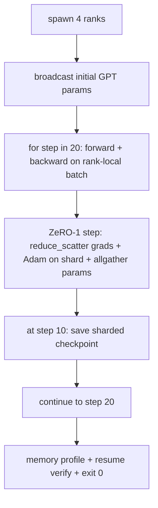

# 端到端 dağıtımlı eğitim

> 第 76 课到第 80 课各拼 一件作品──这是组件:一个微型GPT,训练在4模拟队列上,使用DDP进行梯度同步,ZeRO-1用于优化器状态分片,以及中间token处的分片检查点──这个演示运行 20 步骤,自动终止,打印损失曲线和内存配置文件,并写入可恢复检查点──

**Type:** Build
**Languages:** Python
**Prerequisites:** 第 19 期 Track C 课程 42-49
**Time:** ~90 分钟

## Öğrenme hedefi

- DDP (DDP) (第 77 课) (ZERO-1) (第 78 课) (分片检查点) (第 80 课) (ZERO-1) (ZERO-78) (ZERO-78) (ZERO-77) (ZERO-77) (ZERO-78) (ZERO-78) (ZERO-78) (ZERO-78) (ZERO-78) (ZERO-78) (ZERO-78) (ZERO-78) (ZERO-78) (ZERO-78) (ZERO-78) (ZERO-78) (ZERO-78) (ZERO-78) (ZERO-78) (ZERO-78) (ZERO-78) (ZERO-78) (ZERO-78) (ZERO-78) (ZERO-78) (ZERO-78) (ZERO-78) (ZERO-78)) (ZERO-78) (ZERO) (ZERO) (ZERO) (ZERO) (ZERO) (ZERO) (ZERO) (ZERO) (ZERO) (ZERO))) (ZERO) (ZERO) (ZERO) (ZERO) (ZERO) (ZERO) (ZERO) (ZERO))) (ZERO) (ZERO) (ZERO) (ZERO) (ZERO) (Z) (Z) (Z))) (Z) (Z) (Z) (Z) (Z) (Z) (Z) (Z) (Z))))) (Z) (Z) (Z) (Z) (Z) (Z) (Z) (Z) (Z) (Z) (Z) (Z) (Z) (Z) (Z) (Z) (Z) (Z) (Z) (Z)  Z)  Z)  Z)  Z)  Z)  Z) (Z)  Z) (Z)  Z)  Z)  Z) (Z) (Z) (Z) (Z)  Z) (Z)  Z) (Z)  Z) (Z)  Z) (Z) (Z)  Z) (Z) (Z) (Z)  Z) (Z) (Z) (Z) (Z) (Z)  Z) (Z) (Z)  Z) (Z)  Z) (Z) (Z) (
- Küçük yapay dil kütüphanesinde eğitim 2 kat Transformer 语言模型, 4 模拟等级 boyunca 20 步骤进行.
- 印每步失失表,每列内存配置文件, aynı zamanda aynı dünya üzerinde yeniden kurulan 字节相等のチェックポイントの清单
- Def def def def def def def def def def def def def def def def def def def def def def def def def def def def def def def def def def def def def def def def def def def def def def def def def def def def def def def def def def def def def def def def def def def def def def def def def def def def def def def def def def def def def def def def def def def def def def def def def def def def def def def def def def def def def def def def def def def def def def def def def def def def def def def def def def def def def def def def def def def def def def def def def def def def def def def def def def def def def def def def def def def def def def def def def def def def def def def def def def def def def def def def def def def def def def def def def def def def def def def def def def def def def def def def def def def def def def def def def def def def def def def def def def def def def def def def def def def def def def def def def def def def def def def def def def def def def def def def def def def def def def def def def def def def def def def def def def def def def def def def def def def def def def def def def def def def def def def def def def def def def def def def def def def def def def def def def def def def def def def def def def def def def def def def def def def def def def def def def def def def def def def def def def def def def def def def def def def def def def def def def def def def def def def def def def def def def def def def def def def def def def def def def def def def def def def def def def def def def def def def def def def def def def def def def def def def def def def def def def def def def def def def def def def def def def def def def def def def def def def def def def def def def def def def def def def def def def def def def def def def def def def def def def def def def def def def def def def def def def def def def def def def def def def def def def def def def def def def def def def def def def def def def def def def def def

## 问题

Capstone, her bölümün bir araya gelmesinin kanıtıdır. 76 ders uygulamalı cemaat. 77 ders onları DDP'ye dahil edecek. 78 ders, azaltma_paylaşımını ve optimizasyon cihazını kullanmakla birlikte. 79 ders, bir parça kontrol noktasını koruyacak. 80 ders, her bölümün kendi testleri vardır.

Bu ders yürütülür ve sonuçlandırılır. Bu ders sonuna kadar gösterilmektedir ve dört değişkenlik gösterilmektedir: a) Kayıplar, hareketli gürültü içindeki 20 aşamada tek düzenletilmiştir, b) Her aşamada her aşamada aynı parametreler varlığını korur, c) Her aşamada optimizasyon makinesi içi kaydı ZeRO-1 公式 12P/N 字节, ve d) aşamada 10 aşamada kontrol noktası yeniden başlatıldığında yeniden yüklenmiş 字节 aşamada e.g.).

## 概念



### 迷你 GPT

Model kasıtlı olarak çok küçük: 2 个Transformer块、嵌入dim 32、4 个注意力头、词汇 64、序列长度 16、批次 4。 birkaç bin参数。 her bir bağlantı kararını gerçekleştirmek için yeterince büyüktür(多头注意力运行标准屏蔽路径;LayerNorm has to be synchronous weight;LM 头 is to return the词汇's single lineary projection)。 yeterince küçük, 4 CPU seviyesindeki 20 aşama birkaç saniye içinde tamamlanabilir。

### 组成规则

|课程片段 |它拥有什么 |它留给循环什么？
|--------------|--------------|----------------------------|
| DDP广播 |初始参数同步 |构建时一次调用 |
| ZeRO-1 步骤 |梯度同步、母版更新、参数广播 |每一步调用一次，替换 optimiser.step |
|分片检查点 |保持每等级状态，用 sha256 体现 |通过 allgather 收集状态，调用等级 0 |
|训练循环 |向前、向后、丢失记录 |按顺序调用以上三个 |

Bu döngü, yayılma azaltma veya randevu dosyası hakkında bilmiyor. ZeRO ve kontrol noktası modüller döngüden oluşan dar bir bağlantıyı açtı.

### Neden küçük GPT ve sadece MLP değil ?

第77 课中的 MLP 足以验证梯度同步──一个微小的GPT 添加了三个东西:词汇上一个单独的LM头──在本课中,为了清晰起见,将解它;完整的GPT 总是将头与代码嵌入联系起来 (起来) ‧软max+交叉作为损失 (MSE 更多数值边缘情况),以及一个不对称的前向 (前向) ──嵌入然后是注意力,然后是注意力,然后是每层的MLP)──坚持使用 MLP 作为Capstone 藏藏藏将是否正确处理 LayerNorm 或嵌层的渐变形状──

### Önemli olan çıkış 0

Dönüşüm: 20 adım çıkmadı`while True`, kimse müdahale etmiyor, dış durumdan geri dönemiyor. İnsan değeri olmadan çalışıp tamamlandıktan sonra tamamlanmış bir günlüğün Capstone'unu bulabilirsiniz. Eğer herhangi bir bölüm 局'ya düşerse, gösterim asla geri dönmeyecek ve test yapısı onu yakalayacak.


```figure
ci-distributed-assembly
```

## Yapın onu.

`code/main.py`实现:

- `MiniGPT`: 2 katlı Transformer: kendine dikkat ve bağımsız LM başı
- `make_corpus(seed, total_tokens)`: kesin sex: kesin sex: kesin sex: kesin sex: kesin sex: kesin sex: kesin sex: kesin sex: kesin sex: kesin sex: kesin sex: kesin sex: kesin sex: kesin sex: kesin sex: kesin sex: kesin sex: kesin sex: kesin sex: kesin sex: kesin sex: kesin sex: kesin sex: kesin sex: kesin sex: kesin sex: kesin sex: kesin sex: kesin sex: seks: seks: seks: seks: seks: seks: seks: seks: seks: seks: seks
- `_train_worker`: aşama aşamasında üretilmeye;                                                                                                                                                                                                                                                          
- `verify_resume`Başlık: Başlık işlevi sonrası, yeniden yükleme sürecinin 10. aşamasında kontrol noktası, ve kaydetme başlık bölümü ile kaydetme sırasında hızlı bir şekilde bir ölçüde uyumlu olduğunu belirtir.
- `main`: tüm gösterimi düzenlemek, yazdırma kayıp tablo, bellek konutlama dosyası ve test sonuçları

- Yapma .

```bash
python3 code/main.py
```

输出:20 行丢失表、4 行每列内存配置文件、检查点清单以及成功时的RESUME VERIFIED行──

## 野外生产模式

Üç çeşit model gerçek işleyişin yapılandırmasını tamamladı.

**每 K 分钟检查一次，而不是每 K 步骤一次。**步骤时间 长度和微批次计数随着变化而变──模型大小如何,10 分检查点节奏都捕获相同的计算──为了简单起见,本课程使用步骤式方式;生产采用挂钟为主──

**及早检测分歧。**Üretim süreci ileride NaN 防護と失失尖峰検査器; eğer bir aşamada kayıp 2 kattan fazla atlarsa, optimizasyon cihazının geri dönüş durumuna girmesine izin vermek yerine önceki bir kontrol noktasına geri döner. Bu kursa kayıp eğilimi çok düz, bu nedenle koruma takımı kullanılmıyor, ancak 子保留。

**跨等级聚合内存配置文件。**Her sınıf içinde gerçek işletme vardır. Bu sınıflar arasında farklılıklar vardır.

## Kullan

生产模式:

- **DeepSpeed.**Bu kursun yapısı, DeepSpeed şekli kısaltmasıdır.
- **PyTorch FSDP。**本机等效项──`FullyShardedDataParallel`和 `ShardingStrategy.SHARD_GRAD_OP`- ZeRO-2'yi.
- **NeMo 和 Megatron-LM。**En büyük model için 张量并行; aksi takdirde, bileşenlerin şekli aynıdır.

## Gönderi

Bu 6 ders birlikte, DeepSpeed'in kullanılmasından önce inşa edilecek olan dağıtımlı eğitim sistemini oluşturur. Bu çekim dünya üzerinde kanıtlanmıştır ve bir sorunlu model kullanılmıştır.

## 练习

1. 添加注意力头的张量并行分割并验证损失与单排基线匹配──二级: 单排基线匹配──二级: 单排基线匹配──二级: 单排基线匹配──二级: 单排的注意力输出都减少──
2. 4 küçük kat kat kat kat kat kat kat kat kat kat kat kat kat kat kat kat kat kat kat kat kat kat kat kat kat kat kat kat kat kat kat kat kat kat kat kat kat kat kat kat kat kat kat kat kat kat kat kat kat kat kat kat kat kat kat kat kat kat kat kat kat kat kat kat kat kat kat kat kat kat kat kat kat kat kat kat kat kat kat kat kat kat kat kat kat kat kat kat kat kat kat kat kat kat kat kat kat kat kat kat kat kat kat kat kat kat kat kat kat kat kat kat kat kat kat kat kat kat kat kat kat kat kat kat kat kat kat kat kat kat kat kat kat kat kat kat kat kat kat kat kat kat kat kat kat kat kat kat kat kat kat kat kat kat kat kat kat kat kat kat kat kat kat kat kat kat kat kat kat kat kat kat kat kat kat kat kat kat kat kat kat kat kat kat kat kat kat kat kat kat kat kat kat kat kat kat kat kat kat kat kat kat kat kat kat kat kat kat kat kat kat kat kat kat kat kat kat kat kat kat kat kat kat kat kat kat kat kat kat kat kat kat kat kat kat kat kat kat kat kat kat kat kat kat kat kat kat kat kat kat kat kat kat kat kat kat kat kat kat kat kat kat kat kat kat kat kat kat kat kat kat kat kat kat kat kat kat kat kat kat kat kat kat kat kat kat kat kat kat kat kat kat kat kat kat kat kat kat kat kat kat kat kat kat kat kat kat kat kat kat kat kat kat kat kat kat kat kat kat kat kat kat kat kat kat kat kat kat kat kat kat kat kat kat kat kat kat kat kat kat kat kat kat kat kat kat kat kat kat kat kat kat kat kat kat kat kat kat kat kat kat kat kat kat kat kat kat kat kat kat kat kat kat kat kat kat kat kat kat kat kat kat kat kat kat kat kat kat kat kat kat kat kat kat kat kat kat kat kat kat kat kat kat kat kat kat kat kat kat kat kat kat kat kat kat kat kat kat kat kat kat kat kat kat kat kat kat kat kat kat kat kat kat kat kat kat kat kat kat kat kat kat kat kat kat kat kat kat kat kat kat kat kat kat kat kat kat kat kat kat kat kat kat kat kat kat kat kat kat kat kat kat kat kat kat kat kat kat kat kat kat kat kat kat kat kat kat kat kat kat kat kat kat kat kat kat kat kat kat kat kat kat kat kat kat kat kat kat
3. 添加一条步骤10 开始恢复的路径,该路径实际上继续训练到步骤20,并产生与原始运行相同的最终损失──
4. Bu, JSONL'e eklenecek ve daha sonra da görülebilir bir şekilde çalıştırılacaktır.
5. Bir NaN                                                                                                                                                                                                                                                                                                                                                                                                                                                                                                                           

## 关键术语

|术语 |人们怎么说|它实际上意味着什么 |
|------|----------------|------------------------|
|端到端| “将一切连接起来”|一次运行构成了每个部分，而不是每个部分的单元测试 |
|内存简介 | “每级 GB”|每个等级上保存的参数、梯度、优化器状态的字节数 |
|简历合同 | “保存并加载”|检查点往返后每列状态字节相等 |
|自动终止 | “有界奔跑”|固定步数，完成后退出 0，循环中没有人 |

## 进一步阅读

- DeepSpeed端到端 eğitim eğitim eğitim](https://www.deepspeed.ai/getting-started/)
- PyTorch FSDP进阶教程](https://pytorch.org/tutorials/intermediate/FSDP_advanced_tutorial.html)
- Megatron-LM eğitim脚本参考]https://github.com/NVIDIA/Megatron-LM)
- 第19 阶段 第76-80 课 - 本课组成的每首曲子
- 第17 aşama - Kompleks gerçek gruplara taşınır
