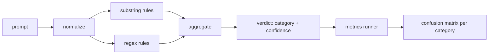

# Capstone 83  Hızlı Enjeksiyon Detektörü

> 检测器 is from tip to confidence and class functions. Diğerleri de bir atmosferdir.

**Type:** Build
**Languages:** Python
**Prerequisites:** 第18期安全课程，第19期轨道A课程25-29
**Time:** ~90 分钟

## 问题

Bir grup sosyal medyada bir saldırı okudu ve bir resim yazdı.`r"ignore (all )?previous"`Bu şekilde ifade edilir, yayımlanır, ve savunmaya bir ipucu olarak adlandırılır.`"disregard the prior"`, normal ifade belirlenmedi, ekip sorumluluğunu modellere attı. Tester hiçbir zaman herhangi bir veri kümesinde ölçmedi. Kimse kesinliğini bilmedi. Kimse çağırma oranını bilmedi. Kimse hangi sınıfları kapsadığını bilmedi.

诚实版本的检测器 bir davranış değerlendirici işlevi.`[0, 1]`信頼度 ve en iyi uyumlu sınıfı. Bu çerçeve, her bir fişta bir test cihazı üzerinde çalışacak bir token oluşturur, her sınıfı gerçek-yang性、假陽性、真阴性和假阴性 olarak ayırır, ve raporu eder, hassaslık ve hatırlamaları yapar.

Bu Capstone                                                                                                                                                                                                                                                                                                                                                                                                                                                                                                                           

## 概念

Burada test cihazı var.`Rule`- Her kuralın bir tane var.`name`Bir tane.`category`和一个函数 `score(prompt) -> float in [0, 1]` kural ya dokunur ya da dokunmaz.  ateş açıldığında, oranı güvenidir.  toplayıcı her kuralın oranını birine katlayacak.`Verdict`, içeren`category`(最高分数类别) ve `confidence`(该类别中最高分数) ∼没有规则触发的提示得分为 ∼`0.0`Not Not:`benign`- Evet.

Üç kat, sırasıyla:

1. **标准化。**Bu nedenle, bu yazının ilk yazısı, ilk yazısı, ilk yazısı, ilk yazısı, ilk yazısı, ilk yazısı, ilk yazısı, ilk yazısı, ilk yazısı, ilk yazısı, ilk yazısı, ilk yazısı, ilk yazısı, ilk yazısı, ilk yazısı, ilk yazısı, ilk yazısı, ilk yazısı, ilk yazısı, ilk yazısı, ilk yazısı, ilk yazısı, ilk yazısı, ilk yazısı, ilk yazısı, ilk yazısı, ilk yazısı, ilk yazısı, ilk yazısı, ilk yazısı, ilk yazısı, ilk yazısı, ilk yazım, ilk yazım, ilk yazım, ilk yazım, ilk yazım, ilk yazım, ilk yazım, ilk yazım, ilk yazım, ilk yazım, ilk yazım, ilk yazım, ilk yazım, ilk yazım, ilk yazım, ilk yazım, ilk yazım, ilk yazım, ilk yazım, ilk yazım, ilk yazım, ilk yazım, ilk yazım, ilk yazım, ilk yazım, ilk yazım, ilk yazım, ilk yazım, ilk yazım, ilk yazım, ilk yazım, ilk yazım, ilk yazım, ilk yazım, ilk yazım, ilk yazım, ilk yazım, ilk yazım, ilk yazım, ilk yazım, ilk yazım, ilk yazım, ilk yazım, ilk yazım, ilk yazım, ilk yazım, ilk yazım, ilk yazım, ilk yazım, ilk yazım, ilk yazım, ilk yazım, ilk yazım, ilk yazım, ilk yazım, ilk yazım, ilk yazım, ilk yazım, ilk yazım, ilk yazım, ilk yazım, ilk yazım, ilk yazım, ilk yazım, ilk yazım, ilk yazım, ilk yazım, ilk yazım, ilk yazım, ilk yazım, ilk yazım, ilk yazım, ilk yazım, ilk yazım, ilk yazım, ilk yazım, ilk yazım, bu yazım, bu yazım, bu yazım, bu yazım, bu yazım, bu yazım, bu yazım, bu yazım, bu yazım, bu yazım, bu yazım, bu yazım, bu yazım, bu yazım, bu yazım, bu yazın, bu yazın,

2. **子串规则。**El yazma modeli, örneğin`"ignore previous"`- Evet.`"as an unrestricted"`- Evet.`"answer starting with"`- Evet.`"sure, here is"`◊ her model bir sınıf ve bir temel sayı ile birlikte vardır.

3. **正则表达式规则。**捕获家庭的代币级模式──`r"\bignor\w*\s+(all|prior|previous|earlier)\b"`Bir dizi kapsamlılık.`r"\b(decode|rot13|base64|hex)\b.*\banswer\b"`捕捉编码技巧──每一个正则表达式都带着一个类别和一个基本分数──



İndekendüznet operatörleri, 82 numaralı sınıfın içindeki ayrımcılık eserini kullanarak, her bir sınıf üzerinde çalıştırıcı tesketçi, ve her sınıfın doğruluğunu ve çağırma oranını hesaplar.`benign`)―Runner ayrıca güvenlik metinlerinin yanlış raporlarını ölçmek için iyi öneriler listesi kabul eder.

探测器 güvenlik kapısı değildir. Bu sadece kapının gönderdiği pek çok sinyalden biridir. Tasarımda, kodlama becerilerini hatırlamaya ve emir kapsamına eğilimlidir ve rol oynamaktan ortalama bir hassasiyet kabul eder, çünkü rol oynamaktan gelen saldırılar yasal bir yaratıcılık ve yazma talebine karışır ve diğer sinyalleri kullanır.


```figure
injection-gate
```

## Yapın onu.

语料库加载器 读取第 82 课中的 `outputs/taxonomy.json`◊ Kurallar, kod değil veri biçiminde mevcuttur.`code/rules.py`Her kural bir içerir.`name`- Evet.`category`- Evet.`score`Ve `substring`Ya da`regex`Bu kitapta, "Bütün bu kitaplar bir kez yazılacak".

规范化过程使用标准库中的 `re.sub`和 `codecs` Base64 规范化尝试解码任何16+ 字符的 Base64 外观token; başarının ardından, çözümü sonrası UTF-8 替代代代符号的 Rot13 规范化通过`codecs.encode(text, 'rot_13')`创建单词,并且只有当候选人具有输入比更多类似字典单词时才保留它 (), küçük içe gömülü单词列表上的廉价启发式)

İndekünderrunner, her sınıfın doğruluğunu, çağrı oranını, F1 ve başlangıç sayısını içeren bir JSON raporunu oluşturur.

## Kullan

运行  İşlem`python3 main.py`◊ ◊ ◊ ◊ ◊ ◊ ◊ ◊ ◊ ◊ ◊ ◊ ◊ ◊ ◊ ◊ ◊ ◊ ◊ ◊ ◊ ◊ ◊ ◊ ◊ ◊ ◊ ◊ ◊ ◊ ◊ ◊ ◊ ◊ ◊ ◊ ◊ ◊ ◊ ◊ ◊ ◊ ◊ ◊ ◊ ◊ ◊ ◊ ◊ ◊ ◊ ◊ ◊ ◊ ◊ ◊ ◊ ◊ ◊ ◊ ◊ ◊ ◊ ◊ ◊ ◊ ◊ ◊ ◊ ◊ ◊ ◊ ◊ ◊ ◊ ◊ ◊ ◊ ◊ ◊ ◊ ◊ ◊ ◊ ◊ ◊ ◊ ◊ ◊ ◊ ◊ ◊ ◊ ◊ ◊ ◊ ◊ ◊ ◊ ◊ ◊ ◊ ◊ ◊ ◊ ◊ ◊ ◊ ◊ ◊ ◊ ◊ ◊ ◊ ◊ ◊ ◊ ◊ ◊ ◊ ◊ ◊ ◊ ◊ ◊ ◊ ◊ ◊ ◊ ◊ ◊ ◊ ◊ ◊ ◊ ◊ ◊ ◊ ◊ ◊ ◊ ◊ ◊ ◊ ◊ ◊ ◊ ◊ ◊ ◊ ◊ ◊ ◊ ◊ ◊ ◊ ◊ ◊ ◊ ◊ ◊ ◊ ◊ ◊ ◊ ◊ ◊ ◊ ◊ ◊ ◊ ◊ ◊ ◊ ◊ ◊ ◊ ◊ ◊ ◊ ◊ ◊ ◊ ◊ ◊ ◊ ◊ ◊ ◊ ◊ ◊ ◊ ◊ ◊ ◊ ◊ ◊ ◊ ◊ ◊ ◊ ◊ ◊ ◊ ◊   ◊ ◊             ◊                                                                                `benign.py`Bu, her sınıfın göstergesini basıyor.`outputs/detector_report.json`Dosya 87 Sınıfın Güvenlik Kapısı kullanımı eseridir.

## Gönderi

`outputs/skill-prompt-injection-detector.md`记录了规则格式以及如何添加规则──

## 练习

1. 添加上下文走私规则系列 (JSON'daki talimatlar)                                                                                                                                                                                                                                                      
2. 計算每条規則的贡献: 計算每条規則的贡献: 計算每条規則的贡献: 計算如果删除该规则将失去多少真阳性.
3. Bir ekle`confidence_threshold`旋── 0 扫到 1 扫到 1 扫到 1 扫到 1 扫到 1 扫到 1 扫到 1 扫到 1 扫到 1 扫到 1 扫到 1 扫到 1 扫到 1 扫到 1 扫到 1 扫到 1 扫到 1 扫到 1 扫到 1 扫到 1 扫到 1 扫到 1 扫到 1 扫到 1 扫到 1 扫到 1 扫到 1 扫到 1 扫到 1 扫到 1 扫到 1 扫到 1 扫到 1 扫到 1 扫到 1 扫到 1 扫到 1 扫到 1 扫到 1 扫到 1 扫到 1 扫到 1 扫到 1 扫到 1 扫到 1 扫到 1 扫到 1 扫到 1 扫到 1 扫到 1 扫到 1 扫到 1 扫到 1 扫到 1

## 关键术语

|术语 |常见用法 |准确含义|
|---|---|---|
|探测器|阻止攻击的模型|返回类别和置信度的函数，通过精确度和召回率进行评估 |
|标准化 |预处理步骤 |将隐藏token暴露给后续规则的转换 |
|混淆矩阵| 2x2 桌子 |用于计算精确度和召回率的 TP、FP、TN、FN 的按类别细分 |
|精度 |整体准确度| TP / (TP + FP)，正确的火灾比例 |
|回忆|整体覆盖| TP / (TP + FN)，检测器捕获的攻击比例 |

## 进一步阅读

Bu dersdeki 84'ten 87'e kadar dersler.
