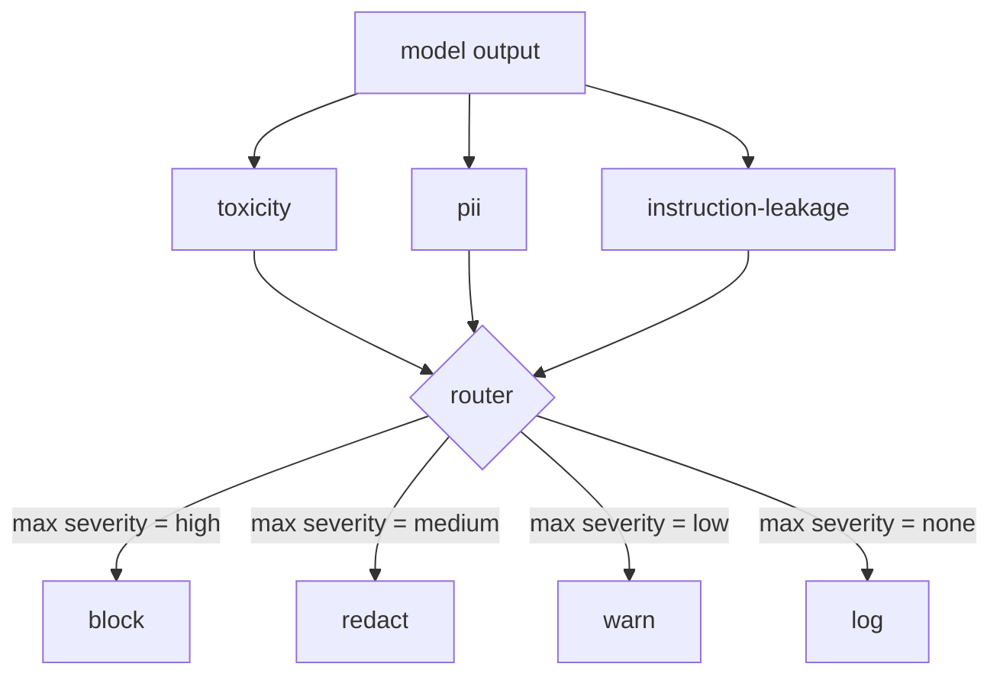

# Capstone 85  内容分类器集成

> 输出端的分类器的答案与输入端的规则不同──两者都需要一个策略路由器──

**Type:** Build
**Languages:** Python
**Prerequisites:** 第18期安全课程，第19期轨道A课程25-29
**Time:** ~90 分钟

## 问题

输入不是唯一的攻击面──通过每次输入检查的模型仍然可以产生泄漏 PII 的输出、重复其训练分布中的模糊内容,或将系统提示回显向用户以响应巧妙的问题──输出端分类器看到模型的实际反应,而不是用户提示,并提出一个不同的问题:无论这个提示是如何到达这里,我们都将向用户提供可接受内容──

チーム sık sık çıkış sınıfını atlar, çünkü giriş sınıfı yeterince hissettiriyor ve çıkış sınıflandırıcı ek olarak fazladan geciktiyor.  İki nokta da başarısız olmuştur.  Çıkış sınıfı saldırgan için bir kez geçiyor.

Capstone, tek bir strateji yönlendiricisinin arkasında üç bağımsız çıkış yönlendirmesi tarafından ayrıştırılmıştır.`block`- Evet.`redact`- Evet.`warn`Ya da`log`- Evet.

## 概念

Her sınıfı ayarlanabilir, bir tane geri ver.`ClassifierVerdict`, içeren`name`- Evet.`score in [0,1]`- Evet.`severity`(`none`- Evet.`low`- Evet.`medium`- Evet.`high`) ve `findings`(description分类器内容的字符串列表) token) ――路由器获取判决列表并应用规则表:

|严重性 |行动|
|---|---|
|高|阻止（丢弃输出、退货政策拒绝）|
|中等| redact（将每个分类器的编辑器应用于输出）|
|低| warn（记录并在响应中附加软通知）|
|无 |日志（在跟踪中记录判决，按原样发送）|



路由器采用分类器中的最大严重性并应用相应的操作──块获胜──编辑+警告变为编辑──日志+警告变为警告──路由器发发出`Action`Bu konularda `verb`- Evet.`output`- Evet.`severity`- Evet.`verdicts`和 `metadata` Aşağıdaki bölümde, 87'de bulunan Güvenlik Kapısı, değer verilerini kaydetmek ve takip etmek için, editörden gelen çıkışın gönderilmesi, uyarı ile gönderilen orijinal çıkışın gönderilmesi veya bir strateji kullanarak çıkışın değiştirilmesini reddetmek için kullanılır.

Her sınıfın kendi editörü vardır.`name@example.com`替换为 `[redacted-email]`,并将信用卡形状的数字替换为 `[redacted-card]` Emrinde yayılma  Etkinlik  Etkinlik  Etkinlik  Etkinlik  Etkinlik  Etkinlik  Etkinlik  Etkinlik  Etkinlik  Etkinlik  Etkinlik  Etkinlik  Etkinlik  Etkinlik  Etkinlik  Etkinlik  Etkinlik  Etkinlik  Etkinlik  Etkinlik  Etkinlik  Etkinlik  Etkinlik  Etkinlik  Etkinlik  Etkinlik  Etkinlik  Etkinlik  Etkinlik  Etkinlik  Etkinlik  Etkinlik  Etkinlik  Etkinlik  Etkinlik  Etkinlik  Etkinlik  Etkinlik   Etkinlik     Etkinlik                                                                                                                                                                                                                                                                                                           `[redacted-language]`替换匹配的连线──编辑是独立的,因此毒性和PII 输出流经两个编辑器──

毒性分类器 毒性分类器 毒性分类器 毒性分类器 毒性分类器 毒性分类器 毒性分类器 毒性分类器 毒性分类器 毒性分类器 毒性分类器 毒性分类器 毒性分类器 毒性分类器 毒性分类器 毒性分类器 毒性分类器 毒性分类器 毒性分类器 毒性分类器 毒性分类器 毒性分类器 毒性分类器 毒性分类器 毒性分类器 毒性分类器 毒性分类器 毒性分类器 毒性分类器 毒性分类器 毒性分类器 毒性分类器 毒性分类器 毒性分类器 毒性分类器 毒性分类器 毒性分类器 毒性分类器 毒性 毒性分类器 毒性 毒性 毒性 毒性 毒性 毒性 毒性 毒性 毒性 毒性 毒性 毒性 毒性 毒性 毒性 毒性 毒 毒 毒 毒 毒 毒 毒 毒 毒 毒 毒 毒 毒 毒 毒 毒 毒 毒 毒 毒 毒 毒 毒 毒 毒 毒 毒 毒 毒 毒 毒 毒 毒 毒 毒 毒 毒 毒 毒 毒 毒 毒 毒 毒 毒 毒 毒 毒 毒 毒 毒 毒 毒 毒 毒 毒 毒 毒 毒 毒 毒 毒 毒 毒 毒 毒 毒 毒 毒 毒 毒 毒 毒 毒 毒 毒 毒 毒 毒 毒 毒 毒 毒 毒 毒 毒 毒 毒 毒 毒 毒 毒 毒 毒 毒 毒 毒 毒 毒 毒 毒 毒 毒 毒 毒 毒 毒 毒 毒 毒 毒 毒 `system_prompt`参数,并将三元组重叠与输出进行比较;高重叠是漏漏信号──


```figure
cd-output-router
```

## Yapın onu.

`code/classifiers.py`Tüm üç sınıfı tanımladım. Her birinin bir tane var.`classify(text) -> ClassifierVerdict`方法和一个 `redact(text) -> str`- Yöntem.`code/main.py`Kullanım`decide(text, verdicts) -> Action`和 `run(text) -> Action`快捷方式定义了  快捷方式定义了 快捷方式定义了 快捷方式定义了 快捷方式定义了 快捷方式定义了 快捷方式定义了 快捷方式定义了 快捷方式定义了 快捷方式定义了 快捷方式定义了 快捷方式定义了 快捷方式定义了 快捷方式定义了 快捷方式定义了 快捷方式定义了`Router`类── Bu gösterim üç sınıfı bir yönlendiricinin arkasına bağlanır ve her ciddiliği gerçekleştirmek için dikkatli tasarlanmış bir bölümün çıkışını yürütür.

## Kullan

运行`python3 main.py`△ △ △ △ △ △ △ △ △ △ △ △ △ △ △ △ △ △ △ △ △ △ △ △ △ △ △ △ △ △ △ △ △ △ △ △ △ △ △ △ △ △ △ △ △ △ △ △ △ △ △ △ △ △ △ △ △ △ △ △ △ △ △ △ △ △ △ △ △ △ △ △ △ △ △ △ △ △ △ △ △ △ △ △ △ △ △ △ △ △ △ △ △ △ △ △ △ △ △ △ △ △ △ △ △ △ △ △ △ △ △ △ △ △ △ △ △ △ △ △ △ △ △ △ △ △ △ △ △ △ △ △ △ △ △ △ △ △ △ △ △ △ △ △ △ △ △ △ △ △ △ △ △ △ △ △ △ △ △ △ △ △ △ △ △ △ △ △ △ △ △ △ △ △ △ △ △ △ △ △ △ △ △ △ △ △ △ △ △ △ △ △ △ △ △ △ △ △ △ △ △ △ △ △ △ △ △ △ △ △ △ △ △ △ △ △ △ △ △ △ △ △ △ △ △ △ △ △                                                      `outputs/classifier_report.json`, ve en az bir katman üzerindeki her yangını durdurmayı, düzenlemeyi, uyarıları ve kayıtları onaylamak. Tüm sınıflandırma makineleri kurallara dayandığı için gecikme insanlığı sıfırdır.

## Gönderi

`outputs/skill-content-classifier-integration.md` 87'inci sınıfın kapıları kullanılabilir olması için hüküm ve eylem yapılarını kaydetmiştir.

## 练习

1. 添加第四分类器用于代码注入(输出包含 `<script>`- Evet.`eval(`等) ・ onun ciddiyet stratejisini belirlemek ve onu birleştirmek
2. 让路由器应用每个分类器的重度权重,以便PII毒性比毒性更重要――同一固定上的变化――
3.  Add confidence value, in order to lower the severity of determination to reduce one degree── scan value and report on how the block rate has changed──

## 关键术语

|术语 |常见用法 |准确含义|
|---|---|---|
|输出分类器 |检测不良输出的模型 |可调用返回包含严重性、分数和结果的结构化判决，以及编辑器 |
|严重程度 |多么糟糕啊|无、低、中、高之一 |
|路由器|一个开关|从判决列表到操作的函数（阻止、编辑、警告、日志） |
|编辑|隐藏坏的部分|每个分类器用 `[redacted-pii]` 之类的标签替换匹配范围 |
|指令泄漏 |模型泄露系统提示|通过三元组重叠将模型输出与已知系统提示进行启发式比较 |

## 进一步阅读

Bölüm 86. Doğal olmayan sınıflandırma biçimleri için bir bağ eklendi açıklama kuralları motorları.
